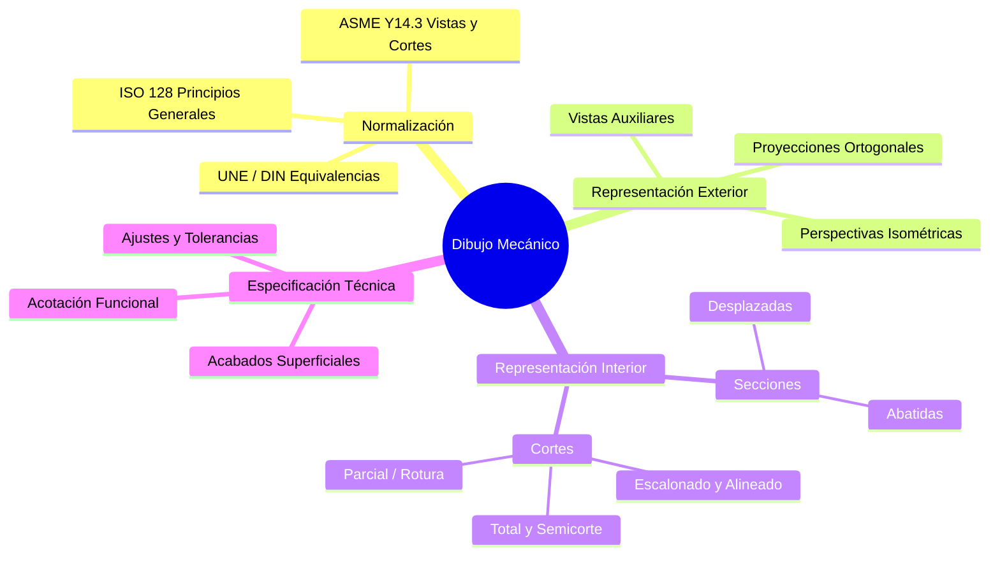
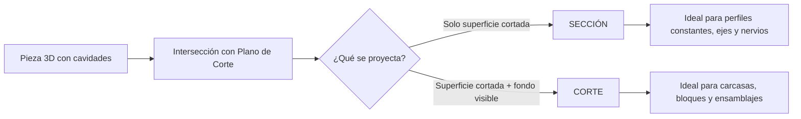
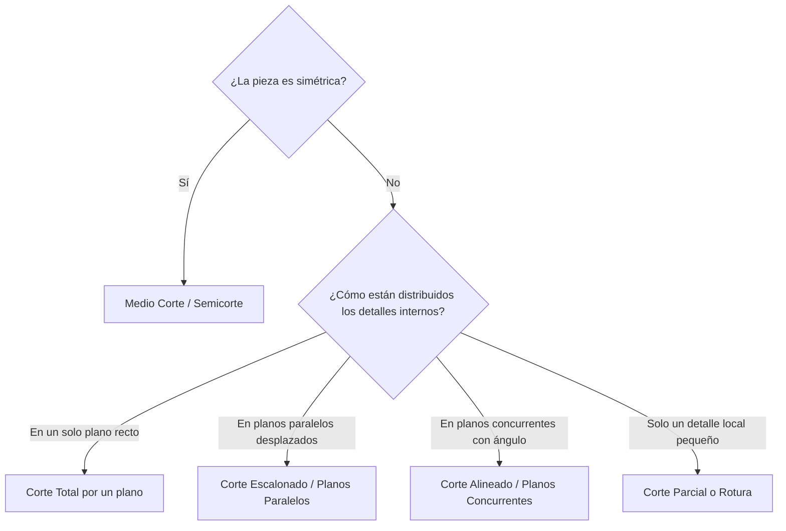

# Secciones y Cortes en Dibujo Mecánico

---

## 1. Presentación y encuadre pedagógico del curso

### 1.1. Prueba de entrada diagnóstica
La evaluación diagnóstica inicial verifica los prerrequisitos geométricos y normativos indispensables antes de abordar el seccionamiento de sólidos:

* **Sistemas de proyección ortogonal:** Dominio de la disposición de vistas según norma **ISO-E** (Primer Diedro / Sistema Europeo) e **ISO-A** (Tercer Diedro / Sistema Americano).
* **Alfabeto de líneas (ISO 128):** Diferenciación jerárquica entre aristas visibles (línea continua gruesa), aristas ocultas (línea de trazos media) y ejes de simetría (línea de trazo largo y punto fina).
* **Interpretación espacial (3D $\leftrightarrow$ 2D):** Capacidad de reconstruir volúmenes complejos a partir de vistas diédricas principales (alzado, planta y perfil) y viceversa.
* **Acotación básica:** Lectura de cotas lineales, radiales, diametrales y tolerancias dimensionales elementales.

> [!WARNING]
> **Error crítico detectado en diagnósticos:** Acotar sobre **líneas ocultas** (discontinuas). Esta práctica genera ambigüedad geométrica y está prohibida por la norma ISO 129; el uso de cortes y secciones existe precisamente para eliminar esta necesidad.

### 1.2. Introducción general al curso: metodología, sistema de evaluación, revisión del sílabo y esquema conceptual del Dibujo Mecánico

#### Metodología y dinámica de trabajo
* **Enfoque teórico-práctico:** Transición directa de la norma técnica (ISO 128-40 / ISO 128-50 / ASME Y14.3) a la representación gráfica manual y asistida por computadora (CAD).
* **Lectura inversa:** Análisis de planos de despiece y conjuntos industriales reales para identificar planos de corte y trayectorias de seccionamiento.

#### Estructura del sistema de evaluación
La valoración del desempeño técnico se distribuye en tres dimensiones progresivas:

| Componente Evaluativo | Ponderación Típica | Criterios Técnicos de Calificación |
| :--- | :--- | :--- |
| **Evaluación Diagnóstica ($ED$)** | $0\%$ (Formativa) | Nivelación de proyecciones diédricas y uso de instrumentos/CAD. |
| **Prácticas Calificadas / Láminas ($PC$)** | $40\% - 50\%$ | Aplicación de rayados, precisión geométrica, calidad de línea y acotación. |
| **Examen Parcial ($EP$)** | $20\% - 25\%$ | Resolución de cortes totales, medios cortes y excepciones normalizadas. |
| **Examen Final ($EF$)** | $25\% - 30\%$ | Interpretación de cortes escalonados, alineados y planos de conjunto complejos. |

$$
\text{Nota Final} = 0.45 \cdot \overline{PC} + 0.25 \cdot EP + 0.30 \cdot EF
$$

#### Revisión del sílabo y esquema conceptual del Dibujo Mecánico
El **Dibujo Mecánico** es el lenguaje gráfico estandarizado para comunicar inequívocamente la geometría, dimensiones, materiales y procesos de fabricación de componentes de máquinas.

---

## 2. Fundamentos y normas de representación de vistas seccionadas

### 2.1. Definición y distinción fundamental entre secciones y cortes técnicos

Cuando una pieza presenta cavidades internas complejas, las líneas de trazos (aristas ocultas) se superponen, dificultando la lectura y acotación. Para resolverlo, se introduce un **plano de corte imaginario** que divide la pieza y retira la porción ubicada entre el observador y dicho plano.

* **Sección:** Representa **exclusivamente** la superficie de contacto donde el plano imaginario intersecta físicamente al material sólido de la pieza. No muestra contornos situados detrás del plano de corte.
* **Corte:** Representa la **sección propiamente dicha más todas las aristas y contornos visibles** que quedan detrás del plano de corte según la dirección de observación.

| Criterio de Comparación | Sección | Corte |
| :--- | :--- | :--- |
| **Contenido gráfico** | Únicamente el área intersectada por el plano. | Área intersectada + geometría visible posterior al plano. |
| **Complejidad visual** | Mínima y limpia; sin líneas de fondo. | Mayor; incluye aristas de niveles posteriores. |
| **Uso principal** | Mostrar perfiles transversales (brazos, vigas, ranuras). | Revelar arquitectura interna completa (taladros, cámaras). |
| **Dependencia de vista** | Puede superponerse directamente sobre la vista. | Siempre genera una vista independiente o parcial. |

  <svg width="520" height="190" viewBox="0 0 520 190" xmlns="http://www.w3.org/2000/svg">
    <defs>
      <pattern id="hatch" width="8" height="8" patternTransform="rotate(45 0 0)" patternUnits="userSpaceOnUse">
        <line x1="0" y1="0" x2="0" y2="8" stroke="#1e293b" stroke-width="1.5" />
      </pattern>
    </defs>
    <!-- Pieza 3D Esquemática (Cilindro escalonado hueco) -->
    <text x="85" y="20" font-family="sans-serif" font-size="12" font-weight="bold" text-anchor="middle" fill="#0f172a">1. Pieza + Plano A-A</text>
    <rect x="35" y="45" width="100" height="35" fill="#e2e8f0" stroke="#334155" stroke-width="1.5"/>
    <rect x="55" y="80" width="60" height="65" fill="#cbd5e1" stroke="#334155" stroke-width="1.5"/>
    <rect x="75" y="45" width="20" height="100" fill="#ffffff" stroke="#334155" stroke-dasharray="3,2"/>
    <line x1="85" y1="30" x2="85" y2="160" stroke="#dc2626" stroke-width="2" stroke-dasharray="8,3,2,3"/>
    <text x="95" y="36" font-family="sans-serif" font-size="11" fill="#dc2626" font-weight="bold">A-A</text>
    <!-- SECCIÓN A-A -->
    <text x="255" y="20" font-family="sans-serif" font-size="12" font-weight="bold" text-anchor="middle" fill="#0f172a">2. SECCIÓN A-A</text>
    <rect x="205" y="45" width="40" height="35" fill="url(#hatch)" stroke="#0f172a" stroke-width="2"/>
    <rect x="265" y="45" width="40" height="35" fill="url(#hatch)" stroke="#0f172a" stroke-width="2"/>
    <rect x="225" y="80" width="20" height="65" fill="url(#hatch)" stroke="#0f172a" stroke-width="2"/>
    <rect x="265" y="80" width="20" height="65" fill="url(#hatch)" stroke="#0f172a" stroke-width="2"/>
    <text x="255" y="170" font-family="sans-serif" font-size="10" text-anchor="middle" fill="#475569">Solo área tocada por plano</text>
    <!-- CORTE A-A -->
    <text x="425" y="20" font-family="sans-serif" font-size="12" font-weight="bold" text-anchor="middle" fill="#0f172a">3. CORTE A-A</text>
    <rect x="375" y="45" width="40" height="35" fill="url(#hatch)" stroke="#0f172a" stroke-width="2"/>
    <rect x="435" y="45" width="40" height="35" fill="url(#hatch)" stroke="#0f172a" stroke-width="2"/>
    <rect x="395" y="80" width="20" height="65" fill="url(#hatch)" stroke="#0f172a" stroke-width="2"/>
    <rect x="435" y="80" width="20" height="65" fill="url(#hatch)" stroke="#0f172a" stroke-width="2"/>
    <!-- Aristas visibles posteriores del agujero central y escalón -->
    <line x1="415" y1="45" x2="435" y2="45" stroke="#0f172a" stroke-width="1.5"/>
    <line x1="415" y1="80" x2="435" y2="80" stroke="#0f172a" stroke-width="1.5"/>
    <line x1="415" y1="145" x2="435" y2="145" stroke="#0f172a" stroke-width="1.5"/>
    <text x="425" y="170" font-family="sans-serif" font-size="10" text-anchor="middle" fill="#475569">Sección + contornos del fondo</text>
  </svg>

> [!NOTE]
> **Regla de trazado de planos de corte (ISO 128-40):** La traza del plano se dibuja con línea fina de trazo largo y punto, engrosada en los extremos y en los cambios de dirección. Las flechas indican el **sentido de observación** y se identifican con letras mayúsculas iguales ($A-A$, $B-B$).

---

### 2.2. Convenios de rayado de sección: inclinación, espaciado y diferenciación de materiales

El **rayado (achurado)** identifica inequívocamente las zonas macizas que han sido atravesadas por el plano de corte. Se ejecuta siempre con **línea continua fina** (tipo $01.1$ según ISO 128-20).

#### Reglas geométricas fundamentales
1. **Inclinación estándar:** Debe trazarse a un ángulo $\theta = 45^\circ$ respecto a los ejes principales de simetría o líneas de contorno fundamentales de la pieza.
2. **Excepción de paralelismo:** Si las aristas principales de la pieza están inclinadas a $45^\circ$, el rayado debe orientarse a $\theta = 30^\circ$ o $\theta = 60^\circ$ para evitar que las líneas de achurado queden paralelas o perpendiculares a los bordes.
3. **Espaciado ($d$):** Uniforme en toda la pieza y proporcional al tamaño del área seccionada. El rango normativo recomendado es:
   $$1.5\text{ mm} \le d \le 4.0\text{ mm}$$
   (Nunca menor a $0.7\text{ mm}$ para evitar empastamiento en reducción/impresión).
4. **Coherencia en una misma pieza:** Todas las zonas cortadas de un **mismo componente** en una o varias vistas deben mantener exactamente la misma inclinación y el mismo espaciado.
5. **Piezas adyacentes en conjuntos:** Dos piezas en contacto se distinguen invirtiendo la dirección del rayado ($+45^\circ$ frente a $-45^\circ$) o modificando el espaciado ($d_1 \neq d_2$). Si hay tres o más piezas juntas, se combinan ángulos ($30^\circ, 45^\circ, 60^\circ$) y espaciados.
6. **Secciones muy delgadas:** En chapas, perfiles estructurales o juntas con espesor aparente menor a $2\text{ mm}$, el área se rellena completamente de negro (dejando una franja blanca de separación entre piezas contiguas).
7. **Superficies muy extensas:** El rayado puede limitarse a una franja estrecha que siga el contorno interior de la zona cortada.
8. **Interrupción por cotas:** Si es indispensable inscribir una cifra de cota dentro de una zona rayada, se debe **interrumpir el rayado** alrededor del texto, manteniendo la línea de cota continua.

#### Diferenciación de materiales (Norma ISO 128-50 / ANSI)
Aunque la norma ISO moderna prioriza el rayado universal a $45^\circ$ delegando el material al cajetín, en planos de conjunto o esquemas técnicos se emplean patrones normalizados para identificar familias de materiales:

| Material / Grupo | Patrón de Rayado Convencional | Descripción Visual |
| :--- | :--- | :--- |
| **Acero, hierro fundido y metales en general** | Líneas continuas finas equidistantes a $45^\circ$. | Rayado estándar universal. |
| **Cobre, bronce, latón y aleaciones ligeras** | Alternancia de línea continua fina y línea de trazos fina a $45^\circ$. | Pares paralelos (1 llena + 1 discontinua). |
| **Plásticos, polímeros y aislantes** | Cuadrícula a $45^\circ$ y $135^\circ$ o líneas paralelas dobles espaciadas. | Retícula cruzada fina. |
| **Hormigón / Concreto** | Punteado irregular combinado con pequeños triángulos (áridos). | Textura granular heterogénea. |
| **Madera** | Vetas longitudinales (corte a lo largo) o anillos concéntricos (corte transversal). | Imitación orgánica de fibra. |
| **Líquidos (agua, aceite)** | Líneas horizontales discontinuas paralelas a la superficie libre. | Densidad decreciente hacia el fondo. |

---

### 2.3. Excepciones de corte: identificación de partes y elementos normalizados que no se seccionan

Por convención internacional (ISO 128-40), ciertos elementos mecánicos **no se rayan** aunque el plano de corte pase longitudinalmente por su eje de simetría. Seccionarlos daría la falsa impresión de que son piezas huecas, debilitadas o divididas en dos mitades.

> [!TIP]
> **Regla mnemotécnica de oro:** *"Si cortar un elemento a lo largo lo hace parecer partido o confunde su función estructural, **NO lo rayes**; dibújalo entero en vista exterior. Si lo cortas transversalmente, **SÍ se raya**."*

#### Catálogo de elementos excluidos del rayado longitudinal
1. **Nervios o cartelas de refuerzo:** Paredes delgadas que conectan dos planos ortogonales para aportar rigidez. Si el plano de corte es paralelo a la cara del nervio, **no se raya** (evita que parezca un bloque macizo pesado). Si el plano corta perpendicularmente al nervio, **sí se raya**.
2. **Ejes y árboles macizos:** Cilindros de transmisión de potencia (ejes lisos o escalonados). Solo se les aplica corte parcial (rotura) si contienen chaveteros o agujeros ciegos internos.
3. **Elementos de fijación normalizados:** Tornillos, pernos, espárragos, tuercas, arandelas, pasadores y remaches.
4. **Radios y brazos de ruedas o poleas:** Al igual que los nervios, si el plano longitudinal contiene el eje de los radios, estos se dibujan sin rayar.
5. **Elementos rodantes:** Bolas, rodillos cilíndricos, cónicos y agujas dentro de rodamientos (los anillos interior y exterior sí se rayan).
6. **Chavetas, lengüetas y dientes de engranajes:** En vista longitudinal, los dientes de ruedas dentadas y las chavetas se representan sin achurar.

  <svg width="480" height="170" viewBox="0 0 480 170" xmlns="http://www.w3.org/2000/svg">
    <defs>
      <pattern id="hatch2" width="7" height="7" patternTransform="rotate(45 0 0)" patternUnits="userSpaceOnUse">
        <line x1="0" y1="0" x2="0" y2="7" stroke="#1e293b" stroke-width="1.3" />
      </pattern>
    </defs>
    <!-- Caso Correcto -->
    <text x="120" y="20" font-family="sans-serif" font-size="12" font-weight="bold" text-anchor="middle" fill="#15803d">CORRECTO (ISO 128-40)</text>
    <!-- Base y Pared vertical rayadas -->
    <polygon points="40,35 65,35 65,120 190,120 190,145 40,145" fill="url(#hatch2)" stroke="#0f172a" stroke-width="2"/>
    <!-- Nervio SIN rayar -->
    <polygon points="65,50 170,120 65,120" fill="#ffffff" stroke="#0f172a" stroke-width="2"/>
    <text x="120" y="162" font-family="sans-serif" font-size="10" text-anchor="middle" fill="#15803d">Nervio longitudinal sin rayado</text>
    <!-- Caso Incorrecto -->
    <text x="360" y="20" font-family="sans-serif" font-size="12" font-weight="bold" text-anchor="middle" fill="#b91c1c">INCORRECTO (Error Típico)</text>
    <!-- Todo rayado como bloque macizo -->
    <polygon points="280,35 305,35 305,50 410,120 430,120 430,145 280,145" fill="url(#hatch2)" stroke="#0f172a" stroke-width="2"/>
    <text x="360" y="162" font-family="sans-serif" font-size="10" text-anchor="middle" fill="#b91c1c">Aparenta una pieza maciza triangular</text>
  </svg>

---

## 3. Tipologías y clasificación normalizada

### 3.1. Clasificación y representación de secciones: sección total, girada (abatida), proyectada y desplazada

Las secciones permiten conocer la forma exacta de perfiles transversales sin necesidad de crear una vista ortogonal completa adicional.

#### 1. Sección total (Sección transversal completa)
* **Definición:** El plano de corte atraviesa completamente de lado a lado la pieza o perfil, mostrando toda la superficie de intersección en una proyección independiente.
* **Aplicación:** Perfiles laminados (en I, U, L, T), vigas estructurales y piezas de sección variable a lo largo de su eje.

#### 2. Sección girada o abatida (sin desplazamiento)
* **Definición:** El plano de corte se gira $90^\circ$ *in situ* alrededor de su propio eje de traza, dibujando la sección **directamente encima de la vista** principal.
* **Convención de línea:** El contorno de la sección abatida se dibuja con **línea continua fina** (nunca gruesa) para no confundirse con las aristas exteriores de la pieza.
* **Interrupción:** Las líneas exteriores de la vista principal **no se interrumpen** al cruzarse con la sección abatida.
* **Aplicación:** Brazos de volantes, ganchos de grúa, bielas, rayos de poleas y perfiles largos de sección constante o gradual.

#### 3. Sección proyectada (Sección desplazada en dirección de proyección)
* **Definición:** La sección se extrae fuera de la vista principal siguiendo exactamente la **proyección ortogonal** indicada por las flechas de corte y la traza del plano.
* **Convención de línea:** A diferencia de la abatida, su contorno se traza con **línea continua gruesa** (igual que una vista normal).
* **Identificación:** Se rotula con letras mayúsculas en sus extremos ($A-A$) y encima/debajo de la sección resultante.

#### 4. Sección desplazada (con o sin interrupción de vista)
* **Definición:** La sección se traslada fuera del contorno de la vista hacia cualquier espacio libre del plano (no necesariamente alineada en proyección ortogonal) o se inserta **interrumpiendo la vista** mediante líneas de rotura a mano alzada.
* **Subtipos:**
  * *Desplazada a lo largo de la traza:* Se desliza siguiendo la prolongación de la línea de eje del corte.
  * *Desplazada con rotura:* Se parte la vista principal con dos líneas finas irregulares y se encaja la sección en el espacio intermedio (muy útil en ejes largos con chaveteros).

| Tipo de Sección | Ubicación en el Plano | Grosor de Contorno | ¿Requiere Letras ($A-A$)? | Uso Óptimo |
| :--- | :--- | :--- | :--- | :--- |
| **Sección Total** | Vista independiente alineada. | Línea gruesa. | Sí, obligatorio. | Perfiles complejos de extremo a extremo. |
| **Girada (Abatida)** | Superpuesta dentro de la vista. | **Línea fina.** | No (si es simétrica). | Brazos, nervios, perfiles simples. |
| **Proyectada** | Fuera de la vista, alineada por proyección. | Línea gruesa. | Sí, obligatorio. | Ejes escalonados con múltiples ranuras. |
| **Desplazada** | Fuera de la vista (posición libre) o entre roturas. | Línea gruesa. | Sí (si está libre) / No (si es por rotura). | Optimización de espacio en planos grandes. |

---

### 3.2. Clasificación y representación de cortes: corte total, medio corte (semicorte), corte alineado, corte por planos paralelos (escalonado) y corte parcial o rotura

La selección del tipo de corte responde a la simetría geométrica de la pieza y a la ubicación espacial de sus detalles internos.

#### 1. Corte Total (Corte por un solo plano)
* **Mecanismo:** Un único plano secante atraviesa toda la pieza siguiendo generalmente su eje principal longitudinal o transversal. Se retira la mitad delantera y se proyecta el resto.
* **Regla de omisión de traza:** Si el plano de corte coincide exactamente con el **eje de simetría principal** de la pieza y es evidente, se puede omitir la línea de traza, las flechas y las letras de identificación.

#### 2. Medio Corte o Semicorte (Corte al cuarto)
* **Mecanismo:** Aplicable **exclusivamente a piezas simétricas** (especialmente cuerpos de revolución). Se elimina imaginariamente un cuarto ($90^\circ$) de la pieza mediante dos planos perpendiculares que se intersectan en el eje de simetría.
* **Resultado visual:** Una mitad de la vista muestra el **aspecto exterior** y la otra mitad muestra el **interior seccionado**.
* **Reglas normativas críticas:**
  * La frontera entre la mitad cortada y la mitad exterior es siempre el **eje de simetría** (línea de trazo largo y punto fina), **nunca** una línea continua gruesa.
  * En la mitad exterior no cortada **se omiten las aristas ocultas** (líneas de trazos), pues ya quedan reveladas en la mitad seccionada.
  * Para acotar diámetros internos que solo muestran un extremo en el semicorte, la línea de cota rebasa ligeramente el eje de simetría y lleva una sola flecha.

> [!WARNING]
> **Trampa de examen en Semicortes:** Si una arista de la pieza coincide exactamente con el eje de simetría central (por ejemplo, una nervadura central o un agujero pasante con arista viva en el eje), **prevalece la arista visible** (línea continua gruesa) sobre el eje de simetría, o se recurre a un corte parcial para evitar ambigüedad.

#### 3. Corte Alineado (Corte por planos concurrentes o girados)
* **Mecanismo:** Dos o más planos secantes se intersectan formando un ángulo ($\alpha \neq 180^\circ$), pasando por detalles radiales distribuidos angularmente (ej. bridas con 3 o 5 agujeros, nervios radiales).
* **Proyección:** Uno de los planos se abate (gira) alrededor de la arista de intersección hasta hacerlo coplanar con el otro plano antes de proyectar la vista.
* **Longitud aparente:** La vista resultante muestra la longitud desarrollada (abatida), por lo que la proyección del corte puede resultar más larga que la proyección ortogonal directa de la pieza sin cortar.

#### 4. Corte por Planos Paralelos (Corte escalonado o quebrado)
* **Mecanismo:** Un único plano recto no logra intersectar todos los taladros o cavidades de una pieza asimétrica. Se emplean dos o más planos paralelos conectados por planos perpendiculares a $90^\circ$ formando un recorrido escalonado.
* **Regla fundamental de representación:** En la vista del corte resultante, **NO se dibujan líneas de separación** en los lugares donde el plano cambia de dirección (los escalones son imaginarios; la vista se dibuja como si todos los detalles estuvieran en un mismo plano continuo).
* **Trazado:** La línea de corte se engrosa en cada quiebre de $90^\circ$ para indicar el salto de plano.

#### 5. Corte Parcial o Rotura (Mordedura)
* **Mecanismo:** Se extrae una pequeña porción localizada de material cuando solo interesa mostrar un detalle interno menor (un chavetero, un agujero ciego, el fondo de una rosca) y no se justifica un corte total ni un semicorte.
* **Delimitación:** El límite entre la zona cortada y el resto de la pieza se traza con **línea continua fina a mano alzada** (línea de rotura) o línea fina en zigzag (en CAD).
* **Restricción absoluta:** La línea de rotura **nunca** puede coincidir con una arista de la pieza ni con un eje de simetría.

---

### 3.3. Ejemplos de aplicación práctica e interpretación en planos de piezas industriales

Para dominar la lectura y ejecución de planos industriales, aplica el siguiente protocolo sistemático de análisis e interpretación:

#### Protocolo de lectura de vistas seccionadas en planos industriales
1. **Localizar las trazas de corte:** Identificar en las vistas principales las líneas de trazo y punto con extremos gruesos y flechas ($A-A$, $B-B$).
2. **Determinar el sentido de proyección:** Observar hacia dónde apuntan las flechas (representan la línea de visual del observador, **no** la dirección hacia donde se retira la pieza).
3. **Identificar el tipo de corte aplicado:** Verificar si la traza es recta (corte total), escalonada a $90^\circ$ (planos paralelos) o angular (alineado).
4. **Analizar el rayado (achurado):**
   * Contar cuántas direcciones/espaciados distintos de rayado existen en la vista $\rightarrow$ indica el número de piezas independientes en un plano de conjunto.
   * Detectar islas blancas sin rayar rodeadas de rayado $\rightarrow$ identificar si corresponden a cavidades vacías (agujeros) o a **excepciones de corte** (ejes, nervios, pernos).
5. **Verificar coherencia entre vistas:** Proyectar mentalmente las aristas visibles del corte hacia las vistas adyacentes para confirmar profundidades, avellanados, roscas y chaflanes internos.

> [!EXAMPLE]
> **Caso práctico integrado — Cuerpo de Válvula Bridada:**
> Supongamos una válvula industrial fundida con bridas circulares de 5 pernos, cámara interna esférica, asiento roscado inferior y nervios exteriores de refuerzo:
> * **Vista Frontal (Alzado):** Se aplica un **Corte Alineado** ($A-A$) para mostrar simultáneamente uno de los agujeros de la brida superior (ubicado a $36^\circ$) y el conducto central de flujo.
> * **Nervio lateral:** Aunque el plano de corte pasa por el nervio exterior de rigidez, este se dibuja **sin rayar** (excepción ISO 128-40) para diferenciarlo del espesor de pared de la carcasa.
> * **Vástago y pernos:** En el plano de conjunto de la válvula armada, el vástago macizo y los espárragos de cierre se representan **sin seccionar**; únicamente se aplicará un **corte parcial (rotura)** en el extremo del vástago para visualizar la ranura de acoplamiento del volante.
> * **Volante de accionamiento:** Para definir el perfil ovalado de sus brazos sin añadir vistas extra, se dibuja una **sección girada (abatida)** con línea fina directamente sobre uno de los radios.

#### Checklist rápido de verificación antes de entregar un plano
* [ ] ¿Están todas las superficies cortadas rayadas a $45^\circ$ con línea fina uniforme?
* [ ] ¿Se han excluido del rayado todos los ejes, nervios longitudinales, tornillos, tuercas, pasadores y chavetas?
* [ ] ¿Están omitidas las líneas ocultas en las zonas ya cortadas y en la mitad exterior de los semicortes?
* [ ] ¿Carecen los cortes escalonados de líneas verticales falsas en los quiebres del plano de corte?
* [ ] ¿Están las trazas de corte identificadas con letras mayúsculas y flechas apuntando hacia la vista proyectada (según norma ISO-E / ISO-A)?