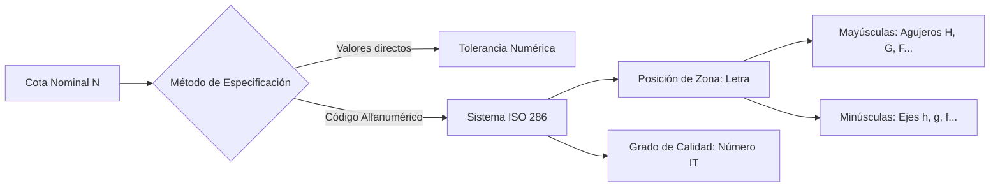

# Tolerancias, Ajustes y Acabado Superficial

## 1. Tolerancias dimensionales

### 1.1. Fundamentos de metrología aplicada: tolerancias numéricas y tolerancias según el sistema ISO

En manufactura mecánica es físicamente imposible fabricar piezas con dimensiones exactas debido a limitaciones de máquinas-herramienta, desgaste de insertos, dilatación térmica y errores de medición. La **tolerancia dimensional** garantiza el principio de **intercambiabilidad**: cualquier pieza fabricada dentro de los límites especificados funcionará correctamente al ensamblarse sin requerir retrabajo manual.

* **Tolerancias numéricas (explícitas):** Indican directamente junto a la cota nominal los valores límite o las desviaciones permitidas en milímetros (ej. $40^{+0.025}_{-0.010}$ o $40 \pm 0.05$). Se usan en piezas únicas, prototipos o cotas no sujetas a ajustes normalizados.
* **Tolerancias según el Sistema ISO (ISO 286):** Estandarizan la magnitud de la tolerancia (calidad) y su ubicación respecto a la medida nominal (posición) mediante un código alfanumérico (ej. $\varnothing 40\text{H7}$ o $\varnothing 40\text{g6}$). Permiten el uso de calibres fijos pasa / no pasa y herramientas normalizadas.

> [!NOTE]
> **Convención de terminología ISO 286:** En el sistema ISO, el término **Agujero** designa cualquier característica dimensional interna (cilíndrica o paralela, como un chavetero hembra), mientras que **Eje** designa cualquier característica dimensional externa (cilíndrica o paralela, como una lengüeta).

---

### 1.2. Parámetros dimensionales: cota nominal, cota máxima, cota mínima, diferencias, desviaciones y discrepancias

Todo elemento tolerado se define geométricamente respecto a una **línea cero** (que representa la medida nominal sin desviación):

* **Cota o Medida Nominal ($N$):** Valor teórico de referencia indicado en el plano a partir del cual se calculan los límites. Es idéntica para el eje y el agujero en un ajuste.
* **Cota Máxima ($D_{\max}$ / $d_{\max}$):** Mayor dimensión admisible para el agujero ($D_{\max}$) o para el eje ($d_{\max}$).
* **Cota Mínima ($D_{\min}$ / $d_{\min}$):** Menor dimensión admisible para el agujero ($D_{\min}$) o para el eje ($d_{\min}$).
* **Desviación / Diferencia Superior ($ES$ / $es$):** Diferencia algebraica entre la medida máxima y la medida nominal.
  $$ES = D_{\max} - N \qquad ; \qquad es = d_{\max} - N$$
* **Desviación / Diferencia Inferior ($EI$ / $ei$):** Diferencia algebraica entre la medida mínima y la medida nominal.
  $$EI = D_{\min} - N \qquad ; \qquad ei = d_{\min} - N$$
* **Desviación Fundamental:** Aquella de las dos desviaciones ($ES/EI$ o $es/ei$) que se encuentra más próxima a la línea cero; define la **posición** de la zona de tolerancia.
* **Tolerancia Dimensional ($T_D$ / $T_d$ o $IT$):** Variación total admisible de la dimensión. Es siempre una magnitud **positiva** (sin signo):
  $$IT_D = D_{\max} - D_{\min} = ES - EI$$
  $$IT_d = d_{\max} - d_{\min} = es - ei$$
* **Discrepancia (Desviación efectiva):** Diferencia entre la medida real obtenida tras el mecanizado ($D_{\text{real}}$) y la medida nominal ($N$). Para que la pieza sea aceptada: $EI \le (D_{\text{real}} - N) \le ES$.

  <svg width="520" height="230" viewBox="0 0 520 230" xmlns="http://www.w3.org/2000/svg">
    <rect width="520" height="230" rx="8" fill="#f8fafc" stroke="#cbd5e1" stroke-width="1.5"/>
    <!-- Línea Cero -->
    <line x1="60" y1="115" x2="490" y2="115" stroke="#0f172a" stroke-width="2" stroke-dasharray="8,4"/>
    <text x="485" y="108" font-family="sans-serif" font-size="11" font-weight="bold" text-anchor="end" fill="#0f172a">Línea Cero (Medida Nominal N)</text>
    <!-- Eje de referencia inferior -->
    <line x1="60" y1="205" x2="490" y2="205" stroke="#64748b" stroke-width="1.5"/>
    <!-- Zona Tolerancia Agujero -->
    <rect x="130" y="45" width="75" height="45" fill="#bfdbfe" stroke="#1d4ed8" stroke-width="2"/>
    <text x="167" y="72" font-family="sans-serif" font-size="12" font-weight="bold" text-anchor="middle" fill="#1e3a8a">IT Agujero</text>
    <!-- Cotas Agujero -->
    <line x1="95" y1="45" x2="130" y2="45" stroke="#1d4ed8" stroke-width="1" stroke-dasharray="2,2"/>
    <line x1="100" y1="45" x2="100" y2="205" stroke="#1d4ed8" stroke-width="1.2"/>
    <text x="95" y="135" font-family="sans-serif" font-size="10" text-anchor="end" fill="#1d4ed8" transform="rotate(-90 95,135)">D máx</text>
    <line x1="115" y1="90" x2="130" y2="90" stroke="#1d4ed8" stroke-width="1" stroke-dasharray="2,2"/>
    <line x1="118" y1="90" x2="118" y2="205" stroke="#1d4ed8" stroke-width="1.2"/>
    <text x="114" y="150" font-family="sans-serif" font-size="10" text-anchor="end" fill="#1d4ed8" transform="rotate(-90 114,150)">D mín</text>
    <!-- ES y EI -->
    <line x1="205" y1="45" x2="235" y2="45" stroke="#1d4ed8" stroke-width="1"/>
    <line x1="230" y1="45" x2="230" y2="115" stroke="#1d4ed8" stroke-width="1.2"/>
    <text x="235" y="80" font-family="sans-serif" font-size="11" font-weight="bold" fill="#1d4ed8">ES (+)</text>
    <line x1="205" y1="90" x2="220" y2="90" stroke="#1d4ed8" stroke-width="1"/>
    <line x1="215" y1="90" x2="215" y2="115" stroke="#1d4ed8" stroke-width="1.2"/>
    <text x="220" y="106" font-family="sans-serif" font-size="11" font-weight="bold" fill="#1d4ed8">EI (+)</text>
    <!-- Zona Tolerancia Eje -->
    <rect x="310" y="135" width="75" height="40" fill="#fecaca" stroke="#b91c1c" stroke-width="2"/>
    <text x="347" y="159" font-family="sans-serif" font-size="12" font-weight="bold" text-anchor="middle" fill="#7f1d1d">IT Eje</text>
    <!-- es y ei -->
    <line x1="385" y1="135" x2="405" y2="135" stroke="#b91c1c" stroke-width="1"/>
    <line x1="400" y1="115" x2="400" y2="135" stroke="#b91c1c" stroke-width="1.2"/>
    <text x="405" y="129" font-family="sans-serif" font-size="11" font-weight="bold" fill="#b91c1c">es (-)</text>
    <line x1="385" y1="175" x2="425" y2="175" stroke="#b91c1c" stroke-width="1"/>
    <line x1="420" y1="115" x2="420" y2="175" stroke="#b91c1c" stroke-width="1.2"/>
    <text x="425" y="155" font-family="sans-serif" font-size="11" font-weight="bold" fill="#b91c1c">ei (-)</text>
  </svg>

---

### 1.3. Criterios de designación normalizada de tolerancias dimensionales en planos mecánicos

Según la norma **ISO 406 / ISO 129-1**, las tolerancias individuales y en conjuntos se acotan siguiendo reglas estrictas:

1. **Designación por símbolo ISO:** Se escribe la medida nominal seguida inmediatamente (sin espacio) de la letra de posición y el número de grado de calidad ($IT$).
   * Agujero: $\varnothing 50\text{H7}$ (opcionalmente seguido de los valores numéricos entre paréntesis: $\varnothing 50\text{H7}\ (^{+0.025}_{0})$).
   * Eje: $\varnothing 50\text{f6}$ (o $\varnothing 50\text{f6}\ (^{-0.025}_{-0.041})$).
2. **Designación por desviaciones numéricas:**
   * Las desviaciones se escriben en tamaño de fuente menor al de la cifra nominal.
   * La desviación superior siempre va arriba y la inferior abajo.
   * Si una desviación es cero, se expresa como `0` **sin signo** (ej. $35^{0}_{-0.025}$).
   * Si ambas desviaciones son iguales en magnitud y de signo opuesto, se escribe una sola vez precedida del signo $\pm$ en el mismo tamaño de letra que la cota nominal (ej. $25 \pm 0.05$).
3. **Cotas límites directas:** Se coloca la medida máxima arriba y la mínima abajo, sin signos (ej. $\begin{smallmatrix} 40.025 \\ 40.000 \end{smallmatrix}$).
4. **Tolerancias generales (ISO 2768-1):** Las cotas que no llevan tolerancia individual se rigen por una nota en el cajetín (ej. `ISO 2768-m` para clase media o `ISO 2768-f` para clase fina), evitando saturar el plano.

| Grado de Calidad ($IT$) | Rango de Aplicación Industrial | Procesos de Fabricación Asociados |
| :--- | :--- | :--- |
| **IT01 – IT4** | Calibres patrón, bloques Johansen, instrumentación óptica y relojería. | Lapeado, superacabado, rectificado de ultra precisión. |
| **IT5 – IT7** | Ajustes de precisión, rodamientos, ejes de transmisión, válvulas hidráulicas. | Rectificado cilíndrico/plano, escariado, brochado, torneado fino. |
| **IT8 – IT11** | Ajustes corrientes de maquinaria general, chaveteros, engranajes comerciales. | Torneado estándar, fresado, taladrado con plantilla, mandrinado. |
| **IT12 – IT16** | Piezas en bruto, estructuras soldadas, fundición, estampación y forja. | Laminado, fundición en arena, corte por plasma/oxicorte, doblado. |

---

### 1.4. Ejemplos de aplicación en elementos y componentes industriales

> [!EXAMPLE]
> **Cálculo completo de parámetros dimensionales:**
> Dado un eje de bomba hidráulica acotado como $\varnothing 30\text{k5}$, donde las tablas ISO 286 para el grupo dimensional de $18\text{ mm}$ a $30\text{ mm}$ establecen $ei = +2\ \mu\text{m}$ y $IT5 = 9\ \mu\text{m}$:
> 1. **Conversión a milímetros:** $ei = +0.002\text{ mm}$ ; $IT_d = 0.009\text{ mm}$.
> 2. **Desviación superior ($es$):** $es = ei + IT_d = +0.002 + 0.009 = +0.011\text{ mm}$.
> 3. **Cota máxima ($d_{\max}$):** $d_{\max} = N + es = 30 + 0.011 = 30.011\text{ mm}$.
> 4. **Cota mínima ($d_{\min}$):** $d_{\min} = N + ei = 30 + 0.002 = 30.002\text{ mm}$.
> 5. **Verificación de lote:** Una pieza medida con micrómetro que arroje $30.000\text{ mm}$ tiene una discrepancia de $0.000\text{ mm} < ei (+0.002\text{ mm})$, por lo que **es rechazada** por falta de apriete.

---

## 2. Sistemas de ajustes mecánicos

### 2.1. Concepto de ajuste y tolerancia de ajuste: juegos, aprietos y ajustes indeterminados

Un **ajuste** es la relación dimensional resultante entre dos piezas (un eje y un agujero) que tienen la misma medida nominal y están destinadas a acoplarse entre sí.

* **Juego ($J$):** Diferencia positiva entre la medida del agujero y la del eje antes del montaje ($D > d$). Permite movimiento relativo (deslizamiento o rotación).
  $$J_{\max} = D_{\max} - d_{\min} = ES - ei \qquad ; \qquad J_{\min} = D_{\min} - d_{\max} = EI - es$$
* **Aprieto ($A$):** Diferencia negativa entre la medida del agujero y la del eje antes del montaje ($D < d$), expresada en valor absoluto como interferencia. Exige fuerza de prensado o dilatación térmica para ensamblarse, generando unión fija.
  $$A_{\max} = d_{\max} - D_{\min} = es - EI \qquad ; \qquad A_{\min} = d_{\min} - D_{\max} = ei - ES$$
* **Tolerancia del Ajuste ($T_A$):** Suma aritmética de las tolerancias del agujero y del eje; representa la variación total posible en la holgura o interferencia del ensamble:
  $$T_A = IT_D + IT_d = J_{\max} - J_{\min} = A_{\max} - A_{\min}$$

#### Clasificación funcional de los ajustes

| Tipo de Ajuste | Condición Matemática | Posición Relativa de Zonas | Comportamiento Mecánico |
| :--- | :--- | :--- | :--- |
| **Ajuste con Juego (Móvil)** | $D_{\min} \ge d_{\max}$ ($J_{\min} \ge 0$) | Zona del agujero completamente **encima** de la del eje. | Siempre existe holgura; permite giro o traslación libre. |
| **Ajuste con Aprieto (Fijo)** | $D_{\max} \le d_{\min}$ ($A_{\min} \ge 0$) | Zona del agujero completamente **debajo** de la del eje. | Siempre existe interferencia; transmisión de par sin chaveta. |
| **Ajuste Indeterminado (De transición)** | $D_{\max} > d_{\min}$ y $D_{\min} < d_{\max}$ | Las zonas de tolerancia se **solapan** parcial o totalmente. | Puede resultar en un juego pequeño o un aprieto ligero al azar. |

  <svg width="520" height="190" viewBox="0 0 520 190" xmlns="http://www.w3.org/2000/svg">
    <rect width="520" height="190" rx="8" fill="#f8fafc" stroke="#cbd5e1" stroke-width="1.5"/>
    <line x1="20" y1="95" x2="500" y2="95" stroke="#0f172a" stroke-width="1.5" stroke-dasharray="6,4"/>
    <text x="495" y="88" font-family="sans-serif" font-size="10" text-anchor="end" fill="#475569">Línea Cero</text>
    <!-- 1. JUEGO -->
    <text x="95" y="22" font-family="sans-serif" font-size="11" font-weight="bold" text-anchor="middle" fill="#0f172a">1. AJUSTE CON JUEGO</text>
    <rect x="55" y="40" width="35" height="35" fill="#bfdbfe" stroke="#1d4ed8" stroke-width="1.5"/>
    <text x="72" y="61" font-family="sans-serif" font-size="10" font-weight="bold" text-anchor="middle" fill="#1e3a8a">H7</text>
    <rect x="100" y="110" width="35" height="35" fill="#fecaca" stroke="#b91c1c" stroke-width="1.5"/>
    <text x="117" y="131" font-family="sans-serif" font-size="10" font-weight="bold" text-anchor="middle" fill="#7f1d1d">f7</text>
    <text x="95" y="170" font-family="sans-serif" font-size="10" text-anchor="middle" fill="#15803d">J mín &gt; 0 (Siempre holgura)</text>
    <!-- 2. INDETERMINADO -->
    <text x="260" y="22" font-family="sans-serif" font-size="11" font-weight="bold" text-anchor="middle" fill="#0f172a">2. INDETERMINADO</text>
    <rect x="220" y="55" width="35" height="40" fill="#bfdbfe" stroke="#1d4ed8" stroke-width="1.5"/>
    <text x="237" y="79" font-family="sans-serif" font-size="10" font-weight="bold" text-anchor="middle" fill="#1e3a8a">H7</text>
    <rect x="265" y="75" width="35" height="35" fill="#fecaca" stroke="#b91c1c" stroke-width="1.5"/>
    <text x="282" y="96" font-family="sans-serif" font-size="10" font-weight="bold" text-anchor="middle" fill="#7f1d1d">k6</text>
    <text x="260" y="170" font-family="sans-serif" font-size="10" text-anchor="middle" fill="#b45309">Zonas solapadas (J máx / A máx)</text>
    <!-- 3. APRIETO -->
    <text x="425" y="22" font-family="sans-serif" font-size="11" font-weight="bold" text-anchor="middle" fill="#0f172a">3. AJUSTE CON APRIETO</text>
    <rect x="385" y="60" width="35" height="35" fill="#bfdbfe" stroke="#1d4ed8" stroke-width="1.5"/>
    <text x="402" y="81" font-family="sans-serif" font-size="10" font-weight="bold" text-anchor="middle" fill="#1e3a8a">H7</text>
    <rect x="430" y="25" width="35" height="28" fill="#fecaca" stroke="#b91c1c" stroke-width="1.5"/>
    <text x="447" y="43" font-family="sans-serif" font-size="10" font-weight="bold" text-anchor="middle" fill="#7f1d1d">p6</text>
    <text x="425" y="170" font-family="sans-serif" font-size="10" text-anchor="middle" fill="#b91c1c">A mín &gt; 0 (Siempre interferencia)</text>
  </svg>

---

### 2.2. Sistemas de ajuste normalizados (sistema de agujero único y sistema de eje único)

Para evitar la proliferación infinita de herramientas de corte y calibres de verificación, ISO 286 establece dos sistemas preferentes manteniendo constante uno de los elementos como referencia base (desviación fundamental igual a cero):

#### 1. Sistema de Agujero Único (Agujero Base — Letra `H`)
* **Principio:** Todos los agujeros tienen su **desviación inferior nula ($EI = 0$)**, es decir, su zona de tolerancia descansa directamente sobre la línea cero hacia arriba ($\text{H6, H7, H8...}$).
* **Obtención de ajustes:** Se mantiene fijo el agujero (`H`) y se varía la posición del eje:
  * Ejes `a` hasta `h` $\rightarrow$ **Ajustes con juego**.
  * Ejes `j` hasta `n` $\rightarrow$ **Ajustes indeterminados**.
  * Ejes `p` hasta `zc` $\rightarrow$ **Ajustes con aprieto**.
* **Ventaja económica:** Es el sistema **más utilizado (85%–90% de la industria)** porque mecanizar agujeros precisos requiere herramientas de medida fija (brocas, escariadores, brochadoras, mandriles calibrados), mientras que un eje se tornea o rectifica fácilmente a cualquier diámetro.

#### 2. Sistema de Eje Único (Eje Base — Letra `h`)
* **Principio:** Todos los ejes tienen su **desviación superior nula ($es = 0$)**, apoyándose en la línea cero hacia abajo ($\text{h5, h6, h7...}$).
* **Obtención de ajustes:** Se mantiene fijo el eje (`h`) y se varía la posición del agujero (`A–H` para juego, `J–N` para indeterminado, `P–ZC` para aprieto).
* **Aplicación específica:** Se emplea cuando se utilizan **barras de acero calibradas estiradas en frío** sin mecanizado exterior (ejes de transmisión largos) sobre las que se montan múltiples componentes (poleas, cojinetes, acoplamientos) con distintos tipos de ajuste, o en pistones hidráulicos y pasadores normalizados.

> [!TIP]
> **Regla económica en el diseño de ajustes:** Por lo general, al eje se le asigna **un grado de calidad más fino** que al agujero (ej. $\text{H7/g6}$, $\text{H7/k6}$, $\text{H8/f7}$), ya que es mucho más económico y sencillo lograr precisión en una superficie cilíndrica externa que en una interna.

---

### 2.3. Designación técnica de ajustes y lectura de tablas normalizadas

En planos de conjunto, el ajuste se acota indicando primero la tolerancia del agujero y luego la del eje, separadas por una barra inclinada o sobrepuestas:

$$\varnothing 50\ \text{H7/g6} \qquad \text{o bien} \qquad \varnothing 50\ \frac{\text{H7}}{\text{g6}}$$

#### Procedimiento de lectura de tablas ISO 286
1. **Ubicar el grupo de diámetros nominales:** Localizar la fila correspondiente al rango $(D_1, D_2]$ en milímetros (nota: el límite inferior es abierto y el superior cerrado; ej. $50\text{ mm}$ pertenece al rango *"más de 30 hasta 50"*).
2. **Extraer valores de desviaciones:** Leer las desviaciones en micras ($\mu\text{m} = 10^{-3}\text{ mm}$) en la columna de la clase indicada (`H7` y `g6`).
3. **Calcular juegos o aprietos límite:** Aplicar las ecuaciones algebraicas respetando estrictamente los signos positivos y negativos.

---

### 2.4. Ejemplos de aplicación y montaje de piezas industriales acopladas

| Ajuste Preferente (Agujero Base) | Clasificación | Características de Montaje | Aplicaciones Industriales Típicas |
| :--- | :--- | :--- | :--- |
| **H11 / c11** | Juego muy amplio | Montaje manual holgado; compensa dilataciones y suciedad. | Bisagras, articulaciones agrícolas, tapas sin centrado. |
| **H8 / f7** | Juego normal giratorio | Lubricación hidrodinámica; giro continuo sin agarrotamiento. | Cojinetes de fricción (bujes de bronce), ejes de cajas de cambio. |
| **H7 / g6** | Juego deslizante preciso | Sin juego apreciable; deslizamiento suave con aceite ligero. | Correderas de válvulas, émbolos hidráulicos, guías de precisión. |
| **H7 / h6** | Juego mínimo (deslizante) | Montaje manual con ligera presión o lubricación; centrado exacto. | Casquillos guía de matrices, manguitos desmontables, contrapuntos. |
| **H7 / k6** | Indeterminado (fijo ligero) | Montaje y desmontaje con mazo de goma o prensa manual ligera. | Engranajes y poleas con chaveta, anillos interiores de rodamientos. |
| **H7 / n6** | Indeterminado (fijo medio) | Requiere prensa hidráulica ligera; desmontaje poco frecuente. | Coronas dentadas de bronce sobre núcleo de acero, casquillos fijos. |
| **H7 / p6** | Aprieto ligero | Prensado mecánico; transmite pares moderados sin chaveta. | Casquillos de cojinetes en alojamientos, ruedas dentadas fijas. |
| **H7 / s6** | Aprieto fuerte | Montaje por prensado pesado o **zunchado térmico** (calentamiento). | Acoplamientos de alta potencia, coronas de volante motor, ruedas de tren. |

> [!WARNING]
> **Cuidado en el montaje de rodamientos:** Los rodamientos comerciales tienen sus anillos fabricados con tolerancias fijas (generalmente agujero interior cercano a `H6` y diámetro exterior a `h6`). Por ello, para ajustar el aro interior sobre un eje se aplican tolerancias de eje como `j6`, `k5`, `m5` (carga giratoria sobre el aro interior), y para el alojamiento exterior se usan agujeros `H7`, `J7` o `M7`.

---

## 3. Textura y acabado superficial

### 3.1. Definición de rugosidad y calidad del acabado superficial

Ninguna superficie mecanizada es geométricamente plana. Al observarla al microscopio se distinguen tres niveles de desviación geométrica superpuestos:
1. **Error de forma (1er orden):** Desviaciones macrogeométricas (planitud, cilindricidad) causadas por flexión de máquina o guías desgastadas.
2. **Ondulación (2do orden):** Irregularidades periódicas de paso largo provocadas por vibraciones de la máquina-herramienta o excentricidad del husillo.
3. **Rugosidad (3er y 4to orden):** Microirregularidades (crestas y valles) dejadas directamente por la huella de la herramienta de corte, el avance o el grano abrasivo.

#### Parámetros cuantitativos principales (ISO 4287 / ISO 21920)
* **Rugosidad Media Aritmética ($Ra$):** Media aritmética de los valores absolutos de las desviaciones del perfil evaluado respecto a la línea media dentro de una longitud de muestreo ($l_r$):
  $$Ra = \frac{1}{l_r} \int_{0}^{l_r} |z(x)| \, dx \approx \frac{1}{n} \sum_{i=1}^{n} |z_i|$$
  *(Es el parámetro más universal en la industria; se expresa en micrómetros, $\mu\text{m}$).*
* **Altura Máxima del Perfil ($Rz$):** Suma de la altura del pico más alto ($Z_p$) y la profundidad del valle más hondo ($Z_v$) dentro de una longitud de muestreo (o promedio de 5 longitudes consecutivas en normas anteriores):
  $$Rz = Z_{p,\max} + Z_{v,\max}$$
  *(Crítico en superficies de estanqueidad, sellos dinámicos y piezas sometidas a fatiga, donde un solo valle profundo inicia una grieta).*

---

### 3.2. Representación de los símbolos y signos de acabado superficial sobre dibujos técnicos

La norma **ISO 1302** (y su actualización **ISO 21920-1**) establece tres símbolos gráficos básicos construidos con dos trazos desiguales inclinados a $60^\circ$ respecto a la superficie:

  <svg width="520" height="150" viewBox="0 0 520 150" xmlns="http://www.w3.org/2000/svg">
    <rect width="520" height="150" rx="8" fill="#f8fafc" stroke="#cbd5e1" stroke-width="1.5"/>
    <!-- Símbolo 1: Básico -->
    <polyline points="70,65 85,95 115,35" fill="none" stroke="#0f172a" stroke-width="2.2" stroke-linecap="round" stroke-linejoin="round"/>
    <text x="92" y="118" font-family="sans-serif" font-size="11" font-weight="bold" text-anchor="middle" fill="#0f172a">1. Símbolo Básico</text>
    <text x="92" y="133" font-family="sans-serif" font-size="9.5" text-anchor="middle" fill="#475569">Cualquier proceso</text>
    <!-- Símbolo 2: Arranque de viruta -->
    <polyline points="235,65 250,95 280,35" fill="none" stroke="#1d4ed8" stroke-width="2.2" stroke-linecap="round" stroke-linejoin="round"/>
    <line x1="235" y1="65" x2="265" y2="65" stroke="#1d4ed8" stroke-width="2.2"/>
    <text x="260" y="118" font-family="sans-serif" font-size="11" font-weight="bold" text-anchor="middle" fill="#1d4ed8">2. Arranque de Material</text>
    <text x="260" y="133" font-family="sans-serif" font-size="9.5" text-anchor="middle" fill="#475569">Mecanizado obligatorio</text>
    <!-- Símbolo 3: Sin arranque de viruta -->
    <polyline points="400,65 415,95 445,35" fill="none" stroke="#b91c1c" stroke-width="2.2" stroke-linecap="round" stroke-linejoin="round"/>
    <circle cx="415" cy="74" r="9.5" fill="none" stroke="#b91c1c" stroke-width="2"/>
    <text x="425" y="118" font-family="sans-serif" font-size="11" font-weight="bold" text-anchor="middle" fill="#b91c1c">3. Sin Arranque</text>
    <text x="425" y="133" font-family="sans-serif" font-size="9.5" text-anchor="middle" fill="#475569">Prohibido mecanizar</text>
  </svg>

1. **Símbolo básico (abierto):** La superficie puede obtenerse por cualquier procedimiento de fabricación (mecanizado, fundición, forja, etc.).
2. **Símbolo cerrado con barra horizontal:** Exige obligatoriamente **arranque de viruta / material** (torneado, fresado, rectificado, etc.). En este caso debe preverse una sobremedida de mecanizado.
3. **Símbolo con círculo inscrito:** **Prohíbe** la eliminación de material; la superficie debe conservarse en el estado en que resulta del proceso previo (fundición en bruto, laminado en frío, extrusión, o estado de entrega).

---

### 3.3. Alternativas de especificación y uso de signos de calidad superficial

Para transmitir información completa de fabricación, al trazo largo del símbolo se le añade un brazo horizontal superior donde se distribuyen las especificaciones en posiciones normalizadas:

  <svg width="460" height="175" viewBox="0 0 460 175" xmlns="http://www.w3.org/2000/svg">
    <rect width="460" height="175" rx="8" fill="#f8fafc" stroke="#cbd5e1" stroke-width="1.5"/>
    <!-- Superficie base -->
    <line x1="60" y1="145" x2="400" y2="145" stroke="#64748b" stroke-width="2"/>
    <!-- Símbolo completo -->
    <polyline points="145,105 165,145 205,65 360,65" fill="none" stroke="#0f172a" stroke-width="2.2" stroke-linecap="round" stroke-linejoin="round"/>
    <line x1="145" y1="105" x2="185" y2="105" stroke="#0f172a" stroke-width="2.2"/>
    <!-- Posiciones -->
    <rect x="215" y="38" width="135" height="22" rx="4" fill="#dbeafe" stroke="#2563eb" stroke-width="1"/>
    <text x="282" y="53" font-family="sans-serif" font-size="11" font-weight="bold" text-anchor="middle" fill="#1e40af">b: Proceso (Rectificado)</text>
    <rect x="215" y="72" width="135" height="22" rx="4" fill="#dcfce7" stroke="#16a34a" stroke-width="1"/>
    <text x="282" y="87" font-family="sans-serif" font-size="11" font-weight="bold" text-anchor="middle" fill="#166534">a: Parámetro (Ra 1.6)</text>
    <rect x="95" y="118" width="52" height="22" rx="4" fill="#fef3c7" stroke="#d97706" stroke-width="1"/>
    <text x="121" y="133" font-family="sans-serif" font-size="11" font-weight="bold" text-anchor="middle" fill="#92400e">d: Surcos</text>
    <rect x="180" y="118" width="75" height="22" rx="4" fill="#f3e8ff" stroke="#9333ea" stroke-width="1"/>
    <text x="217" y="133" font-family="sans-serif" font-size="11" font-weight="bold" text-anchor="middle" fill="#6b21a8">e: Sobrem. 0.5</text>
  </svg>

* **Posición `a` (Debajo del brazo horizontal):** Valor límite de rugosidad en micrómetros con su parámetro explícito (ej. `Ra 1.6` o `Rz 6.3`). Si se indican dos valores, el superior es el límite máximo y el inferior el mínimo.
* **Posición `b` (Encima del brazo horizontal):** Método de fabricación, tratamiento térmico o recubrimiento específico (ej. `Rectificado`, `Cromado duro`, `Temple por inducción`).
* **Posición `d` (A la derecha del vértice):** Dirección predominante de los surcos de mecanizado (`=` paralelos al plano de proyección, `⊥` perpendiculares, `X` cruzados, `M` multidireccionales, `C` concéntricos, `R` radiales).
* **Posición `e` (A la izquierda del vértice):** Sobremedida de mecanizado requerida en milímetros (ej. `0.5` o `1.2`).

#### Reglas de colocación en el plano
* **Orientación de lectura:** Los símbolos y textos deben poder leerse desde la **parte inferior** o desde la **derecha** del plano (misma regla que las cotas). El vértice del símbolo siempre toca la línea de contorno exterior de la superficie o una línea auxiliar de cota.
* **Indicación general:** Si la mayoría de las superficies de una pieza comparten el mismo acabado, se coloca un **símbolo general** en la esquina superior derecha del plano (cerca del cajetín), seguido entre paréntesis de los símbolos particulares que aparecen en el dibujo:
  $$\sqrt{\text{Ra } 3.2}\ \left(\sqrt{\text{Ra } 0.8}\ ,\ \cancel{\sqrt{\ }}\right)$$

---

### 3.4. Interpretación y uso de tablas y valores recomendados por las Normas ISO ($Ra, Rz$)

El costo de mecanizado crece exponencialmente al reducir el valor de rugosidad $Ra$; por ello, nunca se debe especificar un acabado más fino de lo estrictamente funcional.

| Rugosidad $Ra$ ($\mu\text{m}$) | Equivalencia $Rz$ aprox. ($\mu\text{m}$) | Clase ISO antigua | Procesos de Obtención | Aplicaciones Funcionales Típicas |
| :--- | :--- | :--- | :--- | :--- |
| **$50$ – $25$** | $200$ – $100$ | N12 – N11 | Fundición en arena, forja libre, corte por plasma/oxicorte. | Superficies en bruto sin contacto funcional (carcasas exteriores). |
| **$12.5$** | $50$ | N10 | Desbaste en torno o fresadora, taladrado estándar, laminado. | Caras de apoyo no críticas, chaflanes, cabezas de tornillos. |
| **$6.3$** | $25$ | N9 | Torneado y fresado de semiacabado, brochado grueso. | Superficies mecanizadas libres, caras de contacto estático sin carga. |
| **$3.2$** | $12.5$ | N8 | Torneado fino, fresado de acabado, escariado normal. | **Acabado industrial estándar** para piezas mecanizadas, bridas con junta. |
| **$1.6$** | $6.3$ | N7 | Torneado de precisión, rectificado cilíndrico/plano corriente. | Asientos de rodamientos, chaveteros, engranajes, superficies deslizantes lentas. |
| **$0.8$** | $3.2$ | N6 | Rectificado fino, escariado de precisión, mandrinado fino. | Ejes de transmisión en cojinetes, camisas de cilindros, sellos estáticos metálicos. |
| **$0.4$ – $0.2$** | $1.6$ – $0.8$ | N5 – N4 | Rectificado de alta precisión, bruñido (*honing*), lapeado grueso. | Vástagos de cilindros hidráulicos (retenes), muñones de cigüeñal, pistas. |
| **$0.1$ – $0.025$** | $0.4$ – $0.1$ | N3 – N1 | Lapeado fino, superacabado, pulido espejo. | Calibres patrón, válvulas de inyección diésel, sellos mecánicos rotativos. |

> [!WARNING]
> **Relación entre Tolerancia Dimensional ($IT$) y Rugosidad ($Ra$):** Existe una dependencia física directa entre ambas especificaciones. Si se especifica un eje con tolerancia muy estrecha ($\varnothing 20\text{h5}$, donde $IT5 = 9\ \mu\text{m}$) y un acabado grueso ($Ra = 6.3\ \mu\text{m}$, cuya altura de pico a valle $Rz \approx 25\ \mu\text{m}$), la rugosidad supera la tolerancia dimensional, haciendo imposible medir el diámetro real. Como regla empírica: $Rz \le 0.25 \cdot IT$.

---

### 3.5. Ejemplos de aplicación e indicaciones de mecanizado en piezas mecánicas

> [!EXAMPLE]
> **Especificación de acabados en un Eje Escalonado de Reductor:**
> 1. **Asientos de rodamientos ($\varnothing 35\text{k5}$):** Se especifica $\sqrt{\text{Ra } 0.8}$ con proceso `Rectificado` en la posición `b`, asegurando la cilindricidad y el contacto uniforme con la pista interior del rodamiento sin desgaste prematuro.
> 2. **Zona de roce de retén radial de aceite ($\varnothing 32\text{h8}$):** Se especifica $\sqrt{\text{Ra } 0.4}$ con surcos **sin avance axial** (rectificado por penetración / *plunge grinding*), evitando el efecto "tornillo" que bombearía el lubricante hacia el exterior.
> 3. **Alojamiento de engranaje con chaveta ($\varnothing 40\text{H7/k6}$):** Se especifica $\sqrt{\text{Ra } 1.6}$ obtenido por torneado fino; proporciona fricción suficiente para el ajuste indeterminado sin encarecer el proceso con rectificado.
> 4. **Escalones laterales de apoyo axial (hombros):** Se especifica $\sqrt{\text{Ra } 3.2}$ con símbolo de surcos concéntricos (`C`) obtenidos al refrentar en el torno, garantizando perpendicularidad respecto al eje.
> 5. **Chaflanes de entrada y zonas de alivio:** Se dejan gobernados por la indicación general del plano $\sqrt{\text{Ra } 6.3}$ (mecanizado estándar).