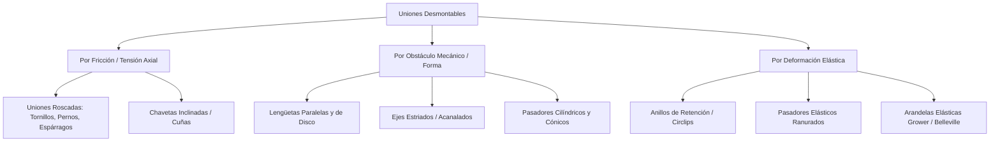

# Uniones Mecánicas

## 1. Uniones desmontables (no permanentes)

### 1.1. Clasificación general de elementos de unión desmontable

Las **uniones desmontables** permiten ensamblar y desensamblar componentes mecánicos repetidas veces sin destruir ni deformar permanentemente las piezas unidas ni los elementos de fijación, facilitando el mantenimiento, transporte y reemplazo de piezas de desgaste.

| Principio de Funcionamiento | Elementos Representativos | Cargas Principales Soportadas | Ventaja Operativa |
| :--- | :--- | :--- | :--- |
| **Fricción por precarga** | Pernos, tornillos, espárragos, chavetas inclinadas. | Tracción axial y cortante indirecto por fricción. | Alta capacidad de apriete y ajuste regulable. |
| **Obstáculo geométrico** | Lengüetas, ejes estriados, pasadores macizos. | Torsión (par motor) y cizallamiento directo. | Posicionamiento angular exacto y transmisión de alto par. |
| **Retención elástica** | Circlips (Seeger), pasadores elásticos. | Empuje axial moderado y posicionamiento. | Montaje ultrarrápido en ranuras sin roscado. |

### 1.2. Representación técnica y acotación

#### 1.2.1. Uniones roscadas (tornillos, tuercas, pernos y espárragos)

Según la norma **ISO 6410-1**, las roscas no se dibujan con su perfil helicoidal real (salvo en detalles didácticos), sino mediante una **representación simplificada convencional**:

* **Crestas de rosca (diámetro exterior en tornillos / diámetro interior en tuercas):** Se dibujan con **línea continua gruesa**.
* **Fondos o raíces de rosca (diámetro del núcleo en tornillos / diámetro nominal en tuercas):** Se dibujan con **línea continua fina**, separada de la línea gruesa una distancia aproximadamente igual a la altura del filete ($0.85 \cdot P$, mínimo $0.7\text{ mm}$).
* **Vista frontal / transversal (perpendicular al eje):** El fondo de rosca se representa como un **arco de circunferencia de $\approx 270^\circ$ ($3/4$ de círculo)** con línea continua fina, dejando abierto preferentemente el cuadrante superior derecho.
* **Límite de rosca útil:** Se traza con **línea continua gruesa** perpendicular al eje hasta el diámetro exterior de la rosca. Las salidas de rosca (chaflanes o gargantas) generalmente se omiten en representación simplificada.
* **Uniones roscadas montadas (en corte):** El **elemento macho (tornillo) prevalece** siempre sobre el elemento hembra (agujero roscado), ocultando las líneas de rosca de la pieza receptora en la zona acoplada. Además, por norma **ISO 128-40**, tornillos, tuercas y arandelas **no se rayan** longitudinalmente.

  <svg width="540" height="220" viewBox="0 0 540 220" xmlns="http://www.w3.org/2000/svg">
    <defs>
      <pattern id="hatchMetal" width="8" height="8" patternTransform="rotate(45 0 0)" patternUnits="userSpaceOnUse">
        <line x1="0" y1="0" x2="0" y2="8" stroke="#64748b" stroke-width="1"/>
      </pattern>
    </defs>
    <!-- 1. ROSCA EXTERIOR (TORNILLO) -->
    <text x="90" y="20" font-family="sans-serif" font-size="11" font-weight="bold" text-anchor="middle" fill="#0f172a">1. Rosca Exterior</text>
    <!-- Cuerpo -->
    <rect x="30" y="55" width="90" height="50" fill="none" stroke="#0f172a" stroke-width="2"/>
    <!-- Chaflán punta -->
    <polygon points="120,55 130,61 130,99 120,105" fill="none" stroke="#0f172a" stroke-width="2"/>
    <!-- Límite rosca útil -->
    <line x1="55" y1="55" x2="55" y2="105" stroke="#0f172a" stroke-width="2"/>
    <!-- Fondo de rosca (línea fina) -->
    <line x1="55" y1="61" x2="130" y2="61" stroke="#2563eb" stroke-width="1"/>
    <line x1="55" y1="99" x2="130" y2="99" stroke="#2563eb" stroke-width="1"/>
    <!-- Eje -->
    <line x1="20" y1="80" x2="140" y2="80" stroke="#dc2626" stroke-width="1" stroke-dasharray="10,3,2,3"/>
    <!-- Vista lateral -->
    <circle cx="90" cy="160" r="25" fill="none" stroke="#0f172a" stroke-width="2"/>
    <path d="M 90 141 A 19 19 0 1 0 109 160" fill="none" stroke="#2563eb" stroke-width="1"/>
    <line x1="60" y1="160" x2="120" y2="160" stroke="#dc2626" stroke-width="1" stroke-dasharray="8,2,2,2"/>
    <line x1="90" y1="130" x2="90" y2="190" stroke="#dc2626" stroke-width="1" stroke-dasharray="8,2,2,2"/>
    <text x="90" y="208" font-family="sans-serif" font-size="9" text-anchor="middle" fill="#475569">Cresta: Gruesa | Fondo: Fina (270°)</text>
    <!-- 2. AGUJERO ROSCADO CIEGO EN CORTE -->
    <text x="270" y="20" font-family="sans-serif" font-size="11" font-weight="bold" text-anchor="middle" fill="#0f172a">2. Agujero Roscado en Corte</text>
    <!-- Bloque rayado -->
    <path d="M 210 45 L 330 45 L 330 120 L 210 120 Z M 245 45 L 245 95 L 270 108 L 295 95 L 295 45 Z" fill="url(#hatchMetal)" fill-rule="evenodd" stroke="#0f172a" stroke-width="1.5"/>
    <!-- Diámetro menor (cresta interior - gruesa) -->
    <line x1="251" y1="45" x2="251" y2="95" stroke="#0f172a" stroke-width="2"/>
    <line x1="289" y1="45" x2="289" y2="95" stroke="#0f172a" stroke-width="2"/>
    <line x1="251" y1="95" x2="289" y2="95" stroke="#0f172a" stroke-width="2"/>
    <!-- Cono de broca 120° -->
    <polyline points="251,95 270,108 289,95" fill="none" stroke="#0f172a" stroke-width="2"/>
    <!-- Diámetro nominal (fondo exterior - fina) -->
    <line x1="245" y1="45" x2="245" y2="82" stroke="#2563eb" stroke-width="1"/>
    <line x1="295" y1="45" x2="295" y2="82" stroke="#2563eb" stroke-width="1"/>
    <!-- Límite rosca útil -->
    <line x1="245" y1="82" x2="295" y2="82" stroke="#0f172a" stroke-width="2"/>
    <!-- Eje -->
    <line x1="270" y1="35" x2="270" y2="115" stroke="#dc2626" stroke-width="1" stroke-dasharray="10,3,2,3"/>
    <!-- Vista superior -->
    <circle cx="270" cy="160" r="19" fill="none" stroke="#0f172a" stroke-width="2"/>
    <path d="M 270 135 A 25 25 0 1 0 295 160" fill="none" stroke="#2563eb" stroke-width="1"/>
    <text x="270" y="208" font-family="sans-serif" font-size="9" text-anchor="middle" fill="#475569">Rayado llega hasta la línea gruesa</text>
    <!-- 3. UNIÓN MONTADA (PREVALENCIA DEL TORNILLO) -->
    <text x="450" y="20" font-family="sans-serif" font-size="11" font-weight="bold" text-anchor="middle" fill="#0f172a">3. Unión Montada</text>
    <!-- Placa superior pasante -->
    <rect x="390" y="55" width="120" height="25" fill="url(#hatchMetal)" stroke="#0f172a" stroke-width="1.5"/>
    <!-- Bloque inferior roscado -->
    <rect x="390" y="80" width="120" height="55" fill="url(#hatchMetal)" stroke="#0f172a" stroke-width="1.5"/>
    <!-- Tornillo hexagonal (sin rayar) -->
    <rect x="428" y="38" width="44" height="17" fill="#ffffff" stroke="#0f172a" stroke-width="2"/>
    <line x1="439" y1="38" x2="439" y2="55" stroke="#0f172a" stroke-width="1.5"/>
    <line x1="461" y1="38" x2="461" y2="55" stroke="#0f172a" stroke-width="1.5"/>
    <!-- Vástago del tornillo -->
    <rect x="436" y="55" width="28" height="55" fill="#ffffff" stroke="#0f172a" stroke-width="2"/>
    <!-- Hilos del tornillo prevaleciendo -->
    <line x1="440" y1="68" x2="440" y2="110" stroke="#2563eb" stroke-width="1"/>
    <line x1="460" y1="68" x2="460" y2="110" stroke="#2563eb" stroke-width="1"/>
    <line x1="436" y1="68" x2="464" y2="68" stroke="#0f172a" stroke-width="2"/>
    <!-- Fondo de agujero libre debajo del tornillo -->
    <polygon points="440,110 440,120 450,127 460,120 460,110" fill="#ffffff" stroke="#0f172a" stroke-width="1.5"/>
    <line x1="436" y1="110" x2="436" y2="116" stroke="#2563eb" stroke-width="1"/>
    <line x1="464" y1="110" x2="464" y2="116" stroke="#2563eb" stroke-width="1"/>
    <line x1="436" y1="116" x2="464" y2="116" stroke="#0f172a" stroke-width="2"/>
    <!-- Eje -->
    <line x1="450" y1="30" x2="450" y2="135" stroke="#dc2626" stroke-width="1" stroke-dasharray="10,3,2,3"/>
    <text x="450" y="208" font-family="sans-serif" font-size="9" text-anchor="middle" fill="#475569">Tornillo sin rayar oculta rosca hembra</text>
  </svg>

##### Diferencias constructivas y acotación de elementos roscados

* **Tornillo:** Elemento roscado que enrosca directamente en un agujero roscado practicado en una de las piezas (no usa tuerca). Se acota: $\text{Designación de rosca} \times \text{Longitud nominal } L$ (ej. `M12 x 40`). La longitud $L$ **no incluye** la altura de la cabeza en tornillos hexagonales o cilíndricos, pero **sí la incluye** en tornillos de cabeza avellanada.
* **Perno:** Conjunto formado por un tornillo pasante que atraviesa agujeros lisos holgados en las piezas a unir y se asegura mediante una **tuerca** (y generalmente arandela) en el extremo opuesto.
* **Espárrago:** Varilla roscada en ambos extremos separados por un cuello liso. Un extremo (extremo de implantación, longitud $b_m \approx 1d \text{ a } 2d$ según el material receptor) se atornilla permanentemente en una carcasa (ej. bloque de motor de aluminio), mientras que el otro recibe la pieza desmontable y la tuerca.

#### 1.2.2. Chavetas, lengüetas y uniones estriadas

Permiten transmitir **momento torsor (par)** entre un eje y un cubo (polea, engranaje, volante) evitando el giro relativo:

1. **Chavetas (Inclinadas o de Cuña):**
   * Tienen una cara superior inclinada con pendiente normalizada de **$1:100$** ($1\%$).
   * Actúan por **acuñamiento radial**: al golpearlas o ajustarlas generan una fuerte presión entre el fondo del chavetero del eje y el techo del chavetero del cubo, transmitiendo par por fricción y bloqueando ligeramente el desplazamiento axial.
   * **Desventaja:** Provocan una ligera excentricidad entre el eje y el cubo.

2. **Lengüetas (Paralelas y de Disco / Woodruff):**
   * Sus caras superior e inferior son **estrictamente paralelas** (sin pendiente).
   * Actúan exclusivamente por **ajuste lateral** (cizallamiento en sus flancos), dejando una pequeña holgura superior ($t_2$) entre la lengüeta y el fondo del chavetero del cubo.
   * **Ventaja:** Mantienen la concentricidad exacta y permiten el desplazamiento axial del cubo si es necesario (lengüetas deslizantes).
   * **Acotación de chaveteros (ISO / DIN 6885):**
     * **En el eje:** Se acota el ancho de ranura $b$ (con tolerancia `N9` para ajuste fijo o `H9` para deslizante), la longitud $l$ y la **profundidad desde la generatriz opuesta** ($d - t_1$) o la profundidad directa $t_1$.
     * **En el agujero del cubo:** Se acota siempre la medida total **$D + t_2$** (diámetro interior más profundidad del chavetero), facilitando su verificación directa con pie de rey.

3. **Uniones Estriadas (Ejes Acanalados — ISO 14 / DIN 5462 / DIN 5480):**
   * Consisten en múltiples dientes o estrías talladas integralmente alrededor de la periferia del eje que engranan con ranuras internas correspondientes en el cubo.
   * **Aplicación:** Transmisión de pares muy elevados, cargas dinámicas reversibles (cajas de cambios automotrices, tomas de fuerza agrícolas) y deslizamiento axial bajo carga.
   * **Representación simplificada (ISO 6413):** Se dibuja únicamente un par de dientes reales en el extremo y se prolongan el diámetro exterior ($D$), el diámetro interior ($d$) y el diámetro primitivo con líneas convencionales, acompañado de la designación normalizada (ej. `Eje estriado 6 x 23 x 26 ISO 14`).

#### 1.2.3. Pasadores y anillos de retención (circlips)

* **Pasadores (ISO 2338 / ISO 2339 / ISO 8752):** Elementos cilíndricos o cónicos (conicidad $1:50$) utilizados para **centrar/posicionar** con alta precisión dos piezas antes de apretar los tornillos (pasadores de referencia) o para **transmitir esfuerzos cortantes** (pasadores de seguridad o articulación).
  * *Pasadores cilíndricos macizos:* Requieren agujeros escariados (`H7`).
  * *Pasadores cónicos:* Garantizan centrado repetible tras múltiples desmontajes.
  * *Pasadores elásticos ranurados:* Se instalan en agujeros taladrados estándar (`H12`) sin necesidad de escariado gracias a su compresión radial.
* **Anillos de retención o Circlips (DIN 471 para ejes / DIN 472 para agujeros):**
  * Arandelas elásticas abiertas con orejetas para pinzas que se alojan en ranuras circunferenciales mecanizadas.
  * **Propósito:** Absorber empuje axial (ej. fijar axialmente un rodamiento sobre un eje o dentro de un alojamiento).
  * **Acotación de la ranura:** Se acota el diámetro de fondo de ranura ($d_2$), el ancho de garganta ($m$, con tolerancia `H13`) y la distancia desde el hombro de apoyo hasta la pared de carga de la ranura.

### 1.3. Selección y dimensionamiento mediante el uso de tablas normalizadas de elementos comerciales

En ingeniería mecánica, los elementos de unión desmontable **no se diseñan desde cero**, sino que se seleccionan de catálogos y normas (ISO, DIN, ANSI) en función del diámetro del eje o de la carga de trabajo:

| Elemento Normalizado | Norma ISO / DIN | Parámetro de Entrada para Selección | Dimensiones Extraídas de Tabla |
| :--- | :--- | :--- | :--- |
| **Tornillo cabeza hexagonal** | ISO 4014 / DIN 931 | Diámetro nominal de rosca ($M$) y longitud ($L$). | Paso ($P$), ancho entre caras ($s$), altura de cabeza ($k$), longitud roscada ($b$). |
| **Lengüeta paralela** | DIN 6885-1 | Diámetro del eje ($d$) en el punto de montaje. | Sección $b \times h$, profundidad en eje ($t_1$), profundidad en cubo ($t_2$), rango de longitudes ($l$). |
| **Chaveta de disco (Woodruff)** | DIN 6888 | Diámetro del eje ($d$) y par a transmitir. | Ancho ($b$), diámetro del disco ($d_1$), altura ($h$), profundidad en eje ($t_1$). |
| **Anillo elástico exterior (Eje)** | DIN 471 | Diámetro nominal del eje ($d_1$). | Diámetro de garganta ($d_2$), ancho de ranura ($m$), espesor del anillo ($s$), carga axial admisible ($F_a$). |
| **Pasador cilíndrico** | ISO 2338 / DIN 7 | Espesor de piezas a unir y fuerza cortante ($F_v$). | Diámetro nominal ($d_1$ con tolerancia `m6` o `h8`), longitud ($l$), chaflán extremo. |

> [!TIP]
> **Criterio práctico de selección rápida de lengüetas (DIN 6885):** Para un eje de diámetro $d$, el ancho aproximado de la lengüeta suele ubicarse en torno a $b \approx 0.25 \cdot d$, y su longitud $l$ debe seleccionarse dentro del rango $1.2 \cdot d \le l \le 1.8 \cdot d$ para evitar concentraciones excesivas de tensión torsional.

---

## 2. Uniones permanentes: soldadura

### 2.1. Tipos y clasificación de uniones permanentes mediante soldadura

Las **uniones permanentes** no pueden desmontarse sin destruir el cordón de unión o dañar el material base. La **soldadura** logra la coalescencia (continuidad metálica) mediante fusión localizada, aporte de material o presión.

#### Clasificación según la disposición geométrica de las piezas (Juntas)

1. **Unión a tope:** Las piezas se sitúan en el mismo plano enfrentando sus bordes. Requiere preparación de bordes (bisel en V, X, U o J) cuando el espesor supera los $4\text{ mm} - 5\text{ mm}$ para garantizar penetración completa.
2. **Unión en T (en ángulo recto):** El borde de una pieza apoya perpendicularmente sobre la superficie plana de otra. Se ejecuta habitualmente mediante soldadura de **ángulo (filete)**.
3. **Unión a solape (traslape):** Una pieza se superpone parcialmente sobre la otra; se suelda uno o ambos bordes mediante cordones en ángulo.
4. **Unión en esquina (en L):** Dos piezas se encuentran formando un ángulo de $90^\circ$ en sus extremos exteriores.
5. **Unión de borde (canto):** Dos o más chapas delgadas paralelas se sueldan a lo largo de sus cantos alineados.

### 2.2. Representación técnica: simbología normalizada y representación figurativa según normas ISO y ANSI

Existen dos formas de representar soldaduras en planos técnicos:
* **Representación figurativa (detallada):** Se dibuja el perfil real del cordón (generalmente sombreado en negro o con arcos sucesivos a mano alzada). Solo se utiliza en vistas de detalle muy ampliadas.
* **Representación simbólica (ISO 2553 / AWS A2.4):** Utiliza un **símbolo elemental** que reproduce la forma geométrica de la sección transversal del cordón montado sobre una **línea de referencia** unida a una **línea de flecha**.

#### Diferencia fundamental crítica entre Norma ISO 2553 y Norma AWS / ANSI A2.4

Ambas normas utilizan la misma estructura de línea de referencia, pero difieren en la posición del símbolo cuando la soldadura está en el **lado opuesto** a la flecha:

| Característica | Norma Europea / Internacional (**ISO 2553**) | Norma Americana (**AWS A2.4 / ANSI**) |
| :--- | :--- | :--- |
| **Componentes de la línea de referencia** | **Doble línea:** una línea continua y una línea de trazos (discontinua) paralela. | **Una sola línea** horizontal continua. |
| **Soldadura en el LADO DE LA FLECHA** | El símbolo se dibuja sobre la **línea continua** (arriba o abajo según donde esté la línea continua). | El símbolo se dibuja siempre **DEBAJO** de la línea de referencia. |
| **Soldadura en el LADO OPUESTO** | El símbolo se dibuja sobre la **línea de trazos** (discontinua). | El símbolo se dibuja siempre **ENCIMA** de la línea de referencia. |
| **Soldadura simétrica (ambos lados)** | Se omite la línea de trazos y se colocan símbolos idénticos arriba y abajo de la línea continua. | Se colocan símbolos idénticos encima y debajo de la línea continua. |

  <svg width="540" height="190" viewBox="0 0 540 190" xmlns="http://www.w3.org/2000/svg">
    <!-- ESTRUCTURA DEL SÍMBOLO DE SOLDADURA (ISO 2553) -->
    <text x="270" y="18" font-family="sans-serif" font-size="12" font-weight="bold" text-anchor="middle" fill="#0f172a">Estructura Normalizada del Símbolo de Soldadura (ISO 2553)</text>
    <!-- Piezas en T -->
    <rect x="65" y="125" width="90" height="14" fill="#cbd5e1" stroke="#0f172a" stroke-width="1.5"/>
    <rect x="103" y="65" width="14" height="60" fill="#cbd5e1" stroke="#0f172a" stroke-width="1.5"/>
    <!-- Cordón real lado flecha -->
    <polygon points="117,113 117,125 129,125" fill="#dc2626"/>
    <!-- Flecha -->
    <line x1="123" y1="119" x2="180" y2="75" stroke="#0f172a" stroke-width="1.5"/>
    <polygon points="123,119 133,116 128,110" fill="#0f172a"/>
    <!-- Línea de referencia doble (ISO) -->
    <line x1="180" y1="75" x2="380" y2="75" stroke="#0f172a" stroke-width="1.8"/>
    <line x1="180" y1="81" x2="380" y2="81" stroke="#0f172a" stroke-width="1.2" stroke-dasharray="5,3"/>
    <!-- Símbolo elemental (Triángulo - Filete) en lado continuo -->
    <polygon points="265,75 265,57 283,75" fill="none" stroke="#2563eb" stroke-width="2"/>
    <!-- Símbolo suplementario (Plano) -->
    <line x1="263" y1="53" x2="285" y2="53" stroke="#16a34a" stroke-width="1.5"/>
    <!-- Cotas izquierda (espesor a / z) -->
    <text x="258" y="69" font-family="sans-serif" font-size="12" font-weight="bold" text-anchor="end" fill="#2563eb">a5</text>
    <!-- Cotas derecha (longitud x paso) -->
    <text x="290" y="69" font-family="sans-serif" font-size="12" font-weight="bold" text-anchor="start" fill="#2563eb">3 x 80 (50)</text>
    <!-- Bandera (en obra) y Círculo (perimetral) en el vértice -->
    <circle cx="180" cy="75" r="5" fill="none" stroke="#dc2626" stroke-width="1.5"/>
    <line x1="180" y1="75" x2="180" y2="48" stroke="#dc2626" stroke-width="1.5"/>
    <polygon points="180,48 196,53 180,58" fill="#dc2626"/>
    <!-- Cola bifurcada -->
    <polyline points="395,60 380,75 395,90" fill="none" stroke="#0f172a" stroke-width="1.5"/>
    <text x="400" y="79" font-family="sans-serif" font-size="11" font-weight="bold" fill="#0f172a">135 / E7018</text>
    <!-- Etiquetas explicativas -->
    <text x="165" y="42" font-family="sans-serif" font-size="9" text-anchor="middle" fill="#dc2626">En obra + Perimetral</text>
    <text x="235" y="102" font-family="sans-serif" font-size="9" text-anchor="middle" fill="#2563eb">Espesor garganta</text>
    <text x="275" y="38" font-family="sans-serif" font-size="9" text-anchor="middle" fill="#16a34a">Acabado plano</text>
    <text x="335" y="102" font-family="sans-serif" font-size="9" text-anchor="middle" fill="#2563eb">Nº x Long. (Separación)</text>
    <text x="445" y="102" font-family="sans-serif" font-size="9" text-anchor="middle" fill="#0f172a">Cola: Proceso ISO 4063</text>
  </svg>

> [!WARNING]
> **Regla de la flecha quebrada (Juntas con bisel simple):** Cuando solo **una** de las dos piezas debe llevar preparación de borde (bisel en medio V o medio U), la línea de flecha se dibuja con un quiebre en zigzag apuntando **directamente hacia la pieza que debe ser biselada**.

### 2.3. Signos adicionales, símbolos suplementarios y línea de referencia con flecha

#### Símbolos elementales más frecuentes

| Tipo de Soldadura | Forma del Símbolo Elemental | Aplicación Principal |
| :--- | :--- | :--- |
| **En ángulo (Filete)** | Triángulo rectángulo con cateto vertical siempre a la **izquierda** ($\triangle$). | Uniones en T, solape y esquina. |
| **A tope en V** | Letra `V` apoyada en su vértice. | Chapas de espesor medio ($5 - 15\text{ mm}$) soldadas por un lado. |
| **A tope en X (Doble V)** | Dos `V` opuestas por el vértice (arriba y abajo). | Planchas gruesas ($> 15\text{ mm}$) accesibles por ambos lados. |
| **A tope en medio V** | Barra vertical a la izquierda y trazo inclinado a la derecha ($\vert\!/$). | Unión en T o esquina con penetración total. |
| **A tope bordes rectos** | Dos barras verticales paralelas ($\parallel$). | Chapas delgadas ($< 4\text{ mm}$) sin biselado previo. |
| **De tapón o ojal** | Rectángulo alargado abierto por arriba ($\sqcup$). | Unión de chapas superpuestas mediante taladros o ranuras. |

#### Símbolos suplementarios (Forma de la superficie del cordón)

Se colocan encima del símbolo elemental para especificar el perfil final deseado:
* **Plano / Rasante (`—`):** Superficie nivelada (generalmente por amolado o esmerilado posterior).
* **Convexo (`⌒`):** Cordón abombado con refuerzo positivo.
* **Cóncavo (`◡`):** Cordón hundido suave (reduce concentración de tensiones en cargas cíclicas de fatiga).

#### Signos adicionales en el vértice y cola

* **Círculo en el punto de quiebre ($\bigcirc$):** **Soldadura periférica / perimetral** continua alrededor de todo el contorno cerrado de la junta.
* **Bandera rellena en el vértice ($\blacktriangleright$):** **Soldadura ejecutada en obra (montaje en campo)**, diferenciándola de las ejecutadas en taller.
* **Cola bifurcada (`<`):** Se añade solo cuando es necesario especificar el código numérico del proceso de soldadura según **ISO 4063** (ej. `111` = Electrodo revestido SMAW, `135` = MIG/MAG sólido GMAW, `141` = TIG GTAW), el metal de aporte o el nivel de calidad (ej. `ISO 5817-B`).

### 2.4. Especificación de la sucesión, dirección, espesor y longitud de cordón de soldadura

Las dimensiones del cordón se inscriben obligatoriamente a ambos lados del símbolo elemental siguiendo una sintaxis estricta:

#### 1. Dimensiones de la sección transversal (A la IZQUIERDA del símbolo)

* **Soldaduras a tope:** Se indica la profundidad de penetración efectiva ($s$). Si no hay cifra a la izquierda, se sobreentiende **penetración completa** del espesor de la chapa.
* **Soldaduras en ángulo (filete):** Debe anteponerse obligatoriamente una letra que defina qué dimensión del triángulo se está acotando:
  * **`a` (Espesor de garganta):** Altura del triángulo isósceles inscrito en la sección del cordón (parámetro estructural de cálculo mecánico).
  * **`z` (Longitud de cateto / pierna):** Longitud del lado del triángulo en contacto con las piezas. Relación geométrica para filetes simétricos a $45^\circ$:
    $$a = z \cdot \cos(45^\circ) \approx 0.707 \cdot z \qquad \Longleftrightarrow \qquad z \approx 1.414 \cdot a$$

#### 2. Dimensiones longitudinales y discontinuidad (A la DERECHA del símbolo)

* **Cordón continuo de extremo a extremo:** No se escribe nada a la derecha del símbolo.
* **Cordón continuo de longitud limitada:** Se indica su longitud $l$ en milímetros (ej. `a5 120`).
* **Soldadura intermitente (discontinua):** Se emplea para reducir deformaciones térmicas y costos cuando no se requiere estanqueidad. Formato ISO 2553:
  $$n \times l\ (e)$$
  * $n$: Número de tramos soldados.
  * $l$: Longitud de cada tramo soldado (en $\text{mm}$).
  * $(e)$: Distancia libre entre el final de un tramo y el inicio del siguiente (en $\text{mm}$). *(Nota: En norma americana AWS se escribe `l - p`, donde `p` es el paso centro a centro: $p = l + e$).*
* **Soldadura intermitente alternada (tresbolillo):** Para cordones discontinuos a ambos lados de una unión en T, si van alternados se añade una **`Z`** atravesando la línea de referencia entre los dos símbolos triangulares desplazados.

### 2.5. Ejemplos de aplicación y lectura de planos de conjuntos soldados industriales

> [!EXAMPLE]
> **Decodificación completa de una especificación ISO 2553 en una bancada estructural:**
> Supongamos una viga perfil `IPE 200` soldada perpendicularmente a una placa base de anclaje con la siguiente anotación en la línea de referencia:
> * **Vértice:** Círculo pequeño ($\bigcirc$) + Bandera ($\blacktriangleright$).
> * **Sobre línea continua:** Símbolo triangular ($\triangle$) con signo cóncavo (`◡`) encima.
> * **Izquierda del símbolo:** `a6`
> * **Derecha del símbolo:** *(vacío)*
> * **Cola:** `135 / ISO 5817-C`
>
> **Interpretación técnica para fabricación e inspección:**
> 1. **Ubicación:** Soldadura ejecutada en el **lado de la flecha** (línea continua), rodeando **todo el perímetro** completo del perfil IPE ($\bigcirc$).
> 2. **Lugar de ejecución:** Debe realizarse **en obra / montaje en campo** ($\blacktriangleright$), no en el taller previo al transporte.
> 3. **Geometría y tamaño:** Cordón continuo (sin cifra a la derecha) en **ángulo (filete)** ($\triangle$) con un **espesor de garganta mínimo de $a = 6\text{ mm}$** (equivalente a un cateto $z \approx 8.5\text{ mm}$).
> 4. **Acabado superficial:** El perfil exterior del cordón debe quedar ligeramente **cóncavo** (`◡`) para suavizar el flujo de tensiones en la transición viga-placa.
> 5. **Proceso y control de calidad:** Proceso **MAG con hilo macizo** (`135`) cumpliendo nivel de aceptación intermedio **C** según `ISO 5817`.

#### Checklist de verificación en planos de construcciones soldadas

* [ ] ¿Tienen todos los símbolos de filete ($\triangle$) o medio bisel ($\vert\!/$) su trazo vertical ubicado siempre a la **izquierda**?
* [ ] ¿Se distingue claramente entre espesor de garganta (`a`) y longitud de cateto (`z`) en las soldaduras en ángulo?
* [ ] ¿Están los cordones discontinuos correctamente formulados según la norma del proyecto (`n x l (e)` en ISO frente a `l - p` en AWS)?
* [ ] ¿Se han evitado soldaduras redundantes en zonas inaccesibles para la antorcha o electrodo?
* [ ] ¿Incluye la lista de materiales (cajetín) el peso total estimado del conjunto soldado y los tratamientos térmicos de distensionado posteriores si aplica?