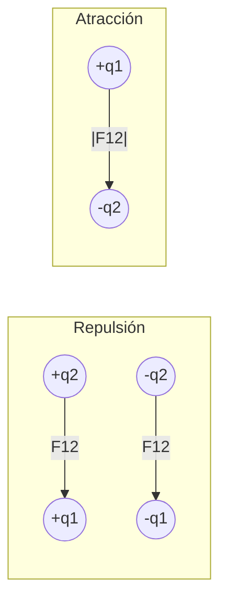
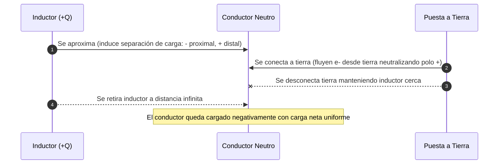

# Guía Exhaustiva de Estudio: Introducción y Ley de Coulomb

---

## 1. Fundamentos de la electrostática y naturaleza de la carga

### 1.1 Breve reseña histórica sobre la electricidad
La comprensión del fenómeno eléctrico evolucionó desde observaciones cualitativas fenoménicas hasta una formulación matemática de campo:

- **Tales de Mileto (~600 a.C.):** Primer registro documentado de la atracción de cuerpos ligeros (plumas, paja) por ámbar fósil (*elektron*, ἤλεκτρον) frotado contra piel animal.
- **William Gilbert (1600, *De Magnete*):** Distingue formalmente el fenómeno magnético del electrostático. Acuña el término *electricitas* y clasifica las sustancias en "eléctricas" (adquieren carga) y "aneléctricas".
- **Charles François de Cisternay du Fay (1733):** Descubre la existencia de dos naturalezas eléctricas opuestas:
  - *Electricidad vítrea* (generada al frotar vidrio con seda).
  - *Electricidad resinosa* (generada al frotar ámbar o resina con lana).
- **Benjamin Franklin (1747–1750):** Propone el modelo del fluido único. Renombra las cargas a **positiva (+)** y **negativa (-)** según un exceso o déficit de dicho fluido. Se establece por convención arbitraria la carga vítrea como positiva.
- **Robert Millikan (1909):** Con su experimento de la gota de aceite determina el carácter corpuscular y discreto de la carga eléctrica fundamental ($e$).

---

### 1.2 Carga eléctrica e interacción eléctrica: atracción y repulsión
La **carga eléctrica ($q, Q$)** es una propiedad intrínseca fundamental de la materia subatómica, análoga a la masa inercial, pero con carácter bipolar algebraico ($+/-$).

- **Principio cualitativo de interacción:**
  - Cargas de igual signo algebraico experimentan fuerzas mutuamente **repulsivas**:
    $$\text{sgn}(q_1 \cdot q_2) > 0 \implies \vec{F}_{12} \parallel \hat{r}_{12} \quad (\text{repulsión})$$
  - Cargas de signos opuestos experimentan fuerzas mutuamente **atractivas**:
    $$\text{sgn}(q_1 \cdot q_2) < 0 \implies \vec{F}_{12} \parallel -\hat{r}_{12} \quad (\text{atracción})$$



---

### 1.3 Propiedades fundamentales: principio de conservación y cuantización de la carga

#### Principio de Conservación de la Carga
En cualquier sistema físico aislado (aislamiento termodinámico y electromagnético), la suma algebraica de todas las cargas eléctricas se mantiene invariante en el tiempo:

$$\sum_{i=1}^{n} q_{i,\text{inicial}} = \sum_{j=1}^{m} q_{j,\text{final}} = \text{cte}$$

En procesos subatómicos (como la aniquilación o creación de pares $e^- + e^+ \leftrightarrow 2\gamma$), la carga neta se conserva ($(-e) + (+e) = 0$).

#### Principio de Cuantización de la Carga
La carga neta observable de cualquier objeto macroscópico o microscópico libre siempre es un múltiplo entero exacto del quanto elemental de carga ($e$):

$$Q = \pm n \cdot e, \quad n \in \mathbb{N} = \{0, 1, 2, 3, \dots\}$$

Donde el cuanto elemental de carga posee el valor exacto fijado por el CODATA (redefinición SI 2019):
$$e = 1.602\,176\,634 \times 10^{-19}\text{ C}$$

> [!NOTE]
> Aunque los quarks poseen cargas fraccionarias ($\pm \frac{1}{3}e, \pm \frac{2}{3}e$), el principio de **confinamiento de color** prohíbe quarks aislados a energías ordinarias. Por tanto, las partículas observables libres siempre exhiben estados múltiplos enteros de $e$.

> [!WARNING]
> La carga es un **invariante relativista**: su valor escalar no varía con la velocidad del marco de referencia inercial del observador, a diferencia de la masa relativista, longitud o tiempo.

---

### 1.4 Formas y mecanismos de electrización

| Mecanismo | Principio Físico Subyacente | Signo de Carga Adquirida | Contacto Físico Requerido |
| :--- | :--- | :--- | :--- |
| **Frotación (Triboeléctrico)** | Ruptura de enlaces superficiales y transferencia de $e^-$ por afinidad química. | Opuesto al del material con el que se frota. | Sí (fricción/contacto íntimo). |
| **Contacto (Conducción)** | Redistribución electrostática de portadores libres para igualar potencial. | Mismo signo que el cuerpo inductor/cargador. | Sí (contacto directo). |
| **Inducción electrostática** | Polarización espacial de portadores libres + drenado a tierra de una región. | Signo opuesto al cuerpo inductor. | No (sin contacto directo con el inductor). |

#### A. Electrización por Frotamiento (Efecto Triboeléctrico)
Dos materiales neutros con distinta función de trabajo y afinidad electrónica entran en contacto mecánico. El material con menor energía de ionización superficial cede electrones al de mayor afinidad, quedando ambos cargados con igual magnitud pero signo opuesto:
$$|Q_1| = |Q_2|, \quad Q_1 = -Q_2$$

#### B. Electrización por Contacto (Conducción)
Un cuerpo conductor previamente cargado toca a un conductor neutro o de diferente potencial. El campo electrostático resultante impulsa el flujo transitorio de electrones hasta alcanzar el **equilibrio electrostático** (mismo potencial electrostático $V_1 = V_2$).

Para dos esferas conductoras idénticas de radios $R_1 = R_2 = R$:
$$Q_1' = Q_2' = \frac{Q_1 + Q_2}{2}$$

#### C. Electrización por Inducción
Mecanismo que permite cargar un conductor sin cederle carga directa desde el inductor:



---

## 2. Medición y comportamiento de cargas en materiales

### 2.1 Clasificación de materiales: conductores y aislantes (dieléctricos)

<div align="center">
  <svg width="600" height="150" viewBox="0 0 600 150" xmlns="http://www.w3.org/2000/svg">
    <!-- Conductor -->
    <rect x="20" y="20" width="260" height="110" rx="8" fill="#1e293b" stroke="#3b82f6" stroke-width="2"/>
    <text x="150" y="45" fill="#60a5fa" font-size="14" font-weight="bold" text-anchor="middle" font-family="sans-serif">Conductor (Metales)</text>
    <circle cx="50" cy="80" r="10" fill="#3b82f6"/>
    <text x="50" y="84" fill="#ffffff" font-size="10" text-anchor="middle">e⁻</text>
    <path d="M65 80 L95 80" stroke="#60a5fa" stroke-width="2" marker-end="url(#arrow)"/>
    <circle cx="120" cy="80" r="10" fill="#3b82f6"/>
    <text x="120" y="84" fill="#ffffff" font-size="10" text-anchor="middle">e⁻</text>
    <path d="M135 80 L165 80" stroke="#60a5fa" stroke-width="2"/>
    <text x="150" y="115" fill="#94a3b8" font-size="11" text-anchor="middle">Electrones libres deslocalizados</text>
    <!-- Aislante -->
    <rect x="320" y="20" width="260" height="110" rx="8" fill="#1e293b" stroke="#10b981" stroke-width="2"/>
    <text x="450" y="45" fill="#34d399" font-size="14" font-weight="bold" text-anchor="middle" font-family="sans-serif">Dieléctrico (Aislante)</text>
    <!-- Dipolos inducidos -->
    <ellipse cx="370" cy="80" rx="20" ry="12" fill="none" stroke="#10b981" stroke-width="1.5"/>
    <text x="362" y="84" fill="#ef4444" font-size="10">-</text>
    <text x="378" y="84" fill="#3b82f6" font-size="10">+</text>
    <ellipse cx="440" cy="80" rx="20" ry="12" fill="none" stroke="#10b981" stroke-width="1.5"/>
    <text x="432" y="84" fill="#ef4444" font-size="10">-</text>
    <text x="448" y="84" fill="#3b82f6" font-size="10">+</text>
    <text x="450" y="115" fill="#94a3b8" font-size="11" text-anchor="middle">Dipolos ligados: polarización microscópica</text>
  </svg>
</div>

- **Conductores:** Poseen bandas de conducción parcialmente llenas o bandas de valencia y conducción superpuestas (brecha de energía prohibida $E_g \approx 0\text{ eV}$). Los electrones de valencia se deslocalizan en un "gas de electrones libres". 
  - *Condición electrostática:* $\vec{E}_{\text{interno}} = 0$, la carga neta reside exclusivamente en la superficie externa ($\sigma \ne 0$, $\rho_{\text{vol}} = 0$).
- **Aislantes (Dieléctricos):** Presentan una banda de valencia completamente llena y una banda prohibida amplia ($E_g > 5\text{ eV}$). Carecen de portadores libres a temperatura ambiente.
  - *Comportamiento ante campo externo:* No transmiten corriente macroscópica; en su lugar sufren **polarización eléctrica macroscópica** ($\vec{P} = \varepsilon_0 \chi_e \vec{E}$), por desplazamiento microscópico de nubes electrónicas o alineamiento de dipolos permanentes.
- **Semiconductores (Contexto límite):** Brecha energética intermedia ($0.1\text{ eV} < E_g < 3\text{ eV}$), conductividad altamente modulable por dopaje y temperatura.

---

### 2.2 El electroscopio y principios de detección electrostática
El **electroscopio de láminas de oro** es un instrumento electrostático para detectar la presencia, magnitud cualitativa y polaridad relativa de una carga eléctrica.

```
       [   Esfera conductora exterior   ]  <- Adquiere carga / induce carga
                     |
            [ Vástago conductor ]          <- Aislado de la carcasa por tapón
                     |
           +---------+---------+
           |                   |
        [Lámina 1]         [Lámina 2]      <- Desviación angular θ por repulsión
           \                  /
            \                /
```

- **Mecanismo de acción:** Al comunicar carga al terminal superior (esfera colectora), esta fluye por conducción a través del vástago hacia las dos láminas delgadas de baja inercia. Ambas láminas adquieren carga del **mismo signo algebraico**, experimentando una fuerza de repulsión electrostática:
  $$F_e = f(\theta) = 2\,mg \tan\theta$$
- **Detección de polaridad:** Si el electroscopio se calibra previamente con carga conocida (ej. negativa):
  - El acercamiento de un cuerpo negativo aumentará el ángulo $\theta$ (mayor repulsión en láminas).
  - El acercamiento de un cuerpo positivo disminuirá $\theta$ (atracción de electrones hacia la esfera colectora, descargando parcialmente las láminas).

---

### 2.3 Concepto de puesta a tierra y transferencia de carga
La **tierra física** se modela matemáticamente como un reservorio conductor infinito de carga a potencial nulo de referencia:

$$V_{\text{tierra}} = \lim_{R_{\text{tierra}} \to \infty} \frac{1}{4\pi\varepsilon_0}\frac{Q_{\text{tierra}}}{R_{\text{tierra}}} \equiv 0\text{ V}, \quad C_{\text{tierra}} \to \infty$$

- **Dinámica de transferencia:** Al conectar un cuerpo conductor cargado $Q$ con capacidad $C_{\text{cuerpo}}$ a tierra:
  $$Q_{\text{final, cuerpo}} = Q \cdot \left(\frac{C_{\text{cuerpo}}}{C_{\text{cuerpo}} + C_{\text{tierra}}}\right) \xrightarrow{C_{\text{tierra}} \to \infty} 0$$
- Si el cuerpo tiene **exceso de electrones** ($Q < 0$), los electrones drenan hacia la tierra.
- Si el cuerpo tiene **déficit de electrones** ($Q > 0$), los electrones fluyen desde la tierra al cuerpo hasta neutralizarlo.

---

## 3. Ley de Coulomb y formulación matemática

### 3.1 Enunciado cuantitativo, alcance y límites de validez de la Ley de Coulomb

#### Enunciado Cuantitativo
La fuerza electrostática ejercida entre dos **cargas puntuales en reposo** en el vacío es directamente proporcional al producto de sus magnitudes escalares, e inversamente proporcional al cuadrado de la distancia euclídea que las separa, actuando a lo largo de la recta directriz que las une.

**Formulación Vectorial Estricta:**
$$
\vec{F}_{12} = \frac{1}{4\pi\varepsilon_0} \frac{q_1 q_2}{|\vec{r}_2 - \vec{r}_1|^2} \hat{r}_{12} = \frac{1}{4\pi\varepsilon_0} \frac{q_1 q_2}{|\vec{r}_2 - \vec{r}_1|^3} (\vec{r}_2 - \vec{r}_1)
$$
Donde:
- $\vec{F}_{12}$: Fuerza que la carga $q_1$ ejerce sobre la carga $q_2$.
- $\vec{r}_1, \vec{r}_2$: Vectores de posición de las cargas respecto a un sistema de coordenadas inercial.
- $\hat{r}_{12} = \frac{\vec{r}_2 - \vec{r}_1}{|\vec{r}_2 - \vec{r}_1|}$: Vector unitario dirigido desde $1$ hacia $2$.

> [!NOTE]
> Cumple la **Tercera Ley de Newton (Acción y Reacción)** en su forma fuerte:
> $$\vec{F}_{21} = -\vec{F}_{12}, \quad \vec{F}_{12} \times (\vec{r}_2 - \vec{r}_1) = \vec{0}$$

#### Límites de Validez y Alcance
1. **Puntualidad:** Válida estrictamente para cargas cuyas dimensiones lineales $d$ son despreciables frente a la distancia mutua $r$ ($d \ll r$).
2. **Condición Electrostática:** Las cargas deben estar estacionarias ($\vec{v} = 0$). Si se mueven, aparecen términos magnéticos proporcionales a $\frac{v}{c}$ y retardos por radiación electromagnética (potenciales de Liénard-Wiechert).
3. **Escala Espacial:**
   - Válida desde distancias atómicas y nucleares ($r \approx 10^{-15}\text{ m}$) hasta distancias macroscópicas astronómicas.
   - Para $r < 10^{-15}\text{ m}$ (interior del núcleo), la interacción nuclear fuerte eclipsa y confina la repulsión coulómbica.
   - En distancias subatómicas extremas, se integran correcciones de **Electrodinámica Cuántica (QED)** por polarización del vacío.

---

### 3.2 Unidades electrostáticas en el Sistema Internacional (S.I.)

| Magnitud | Símbolo | Unidad S.I. | Dimensiones | Definición / Equivalencia Formal |
| :--- | :--- | :--- | :--- | :--- |
| Carga Eléctrica | $q, Q$ | Culombio ($\text{C}$) | $[\text{I} \cdot \text{T}] = \text{A}\cdot\text{s}$ | $1\text{ C} \equiv \frac{1}{1.602176634 \times 10^{-19}}$ cargas $e$ |
| Permitividad del Vacío | $\varepsilon_0$ | $\text{F}\cdot\text{m}^{-1}$ o $\text{C}^2\cdot\text{N}^{-1}\cdot\text{m}^{-2}$ | $[\text{M}^{-1} \text{L}^{-3} \text{T}^4 \text{I}^2]$ | $\varepsilon_0 = \frac{1}{\mu_0 c^2} \approx 8.854\,187\,8128 \times 10^{-12}\text{ C}^2\cdot\text{N}^{-1}\cdot\text{m}^{-2}$ |
| Constante de Coulomb | $k_e$ | $\text{N}\cdot\text{m}^2\cdot\text{C}^{-2}$ | $[\text{M} \text{L}^3 \text{T}^{-4} \text{I}^{-2}]$ | $k_e = \frac{1}{4\pi\varepsilon_0} \approx 8.987\,551\,7923 \times 10^9\text{ N}\cdot\text{m}^2\cdot\text{C}^{-2}$ |

---

### 3.3 Determinación experimental: balanza de torsión de Coulomb/Cavendish
Charles-Augustin de Coulomb (1785) adaptó el diseño de la **balanza de torsión** para medir fuerzas de magnitud minúscula ($\sim 10^{-7}\text{ N}$):

- **Principio físico del dispositivo:**
  Un hilo de torsión delgado de plata o seda sostiene una aguja aislante horizontal con una esfera conductora en su extremo (carga $q_1$). Al acercar una segunda esfera idéntica con carga $q_2$, la fuerza coulómbica genera un torque electrostático $\tau_e$:
  $$\tau_e = F_e \cdot L \cdot \cos\left(\frac{\theta}{2}\right) \approx F_e \cdot L$$
- **Condición de equilibrio estático:**
  El torque electrostático se equilibra con el torque elástico de restitución angular del hilo:
  $$\tau_{\text{elástico}} = \kappa \cdot \theta$$
  $$\kappa \cdot \theta = F_e \cdot L \implies F_e = \frac{\kappa \cdot \theta}{L}$$
  Donde:
  - $\kappa$: Constante elástica torsional del alambre.
  - $\theta$: Ángulo de torsión medido en una escala graduada circular.
  - $L$: Brazo de palanca.
- **Verificación empírica:** Demostró sistemáticamente que:
  1. $F_e \propto \frac{1}{r^2}$ manteniendo $q_1, q_2$ constantes.
  2. $F_e \propto q_1 q_2$ mediante sucesivas divisiones de carga entre esferas conductoras idénticas neutras y cargadas ($q \to \frac{q}{2} \to \frac{q}{4}\dots$).

---

### 3.4 Principio de superposición lineal
Dado que las ecuaciones fundamentales del electromagnetismo (ecuaciones de Maxwell en medios lineales) son **lineales**, la fuerza resultante ejercida sobre una carga de prueba $q_0$ por un conjunto de $N$ cargas estacionarias es idéntica a la suma vectorial pura de las fuerzas individuales ejercidas por cada carga de forma independiente:

$$
\vec{F}_{\text{neta}} = \sum_{i=1}^{N} \vec{F}_{i \to 0} = \frac{q_0}{4\pi\varepsilon_0} \sum_{i=1}^{N} \frac{q_i}{|\vec{r}_0 - \vec{r}_i|^3} (\vec{r}_0 - \vec{r}_i)
$$

> [!TIP]
> El principio de superposición garantiza que la presencia de una carga $q_k$ **no altera ni apantalla** la fuerza intrínseca entre las cargas $q_i$ y $q_0$ en el vacío.

---

### 3.5 Fuerzas electrostáticas en sistemas de cargas

#### A. Distribuciones Discretas de Carga
Para $N$ partículas puntuales, la fuerza que experimenta la carga arbitraria $k$-ésima por interacción con las restantes viene dada por:
$$
\vec{F}_k = \frac{q_k}{4\pi\varepsilon_0} \sum_{\substack{i=1 \\ i \neq k}}^{N} \frac{q_i}{|\vec{r}_k - \vec{r}_i|^3} (\vec{r}_k - \vec{r}_i)
$$

#### B. Distribuciones Continuas de Carga
Cuando la escala de observación macroscópica es mucho mayor que las distancias interatómicas promedio, la cuantización se promedia mediante un continuo material. Se definen las densidades diferenciales de carga:

| Tipo de Distribución | Definición Matemática | Unidad S.I. | Elemento Diferencial de Carga ($dq$) |
| :--- | :--- | :--- | :--- |
| **Lineal** ($\lambda$) | $\lambda(\vec{r}') = \frac{dq}{dl'}$ | $\text{C}\cdot\text{m}^{-1}$ | $dq = \lambda(\vec{r}')\,dl'$ |
| **Superficial** ($\sigma$) | $\sigma(\vec{r}') = \frac{dq}{da'}$ | $\text{C}\cdot\text{m}^{-2}$ | $dq = \sigma(\vec{r}')\,da'$ |
| **Volumétrica** ($\rho$) | $\rho(\vec{r}') = \frac{dq}{dv'}$ | $\text{C}\cdot\text{m}^{-3}$ | $dq = \rho(\vec{r}')\,dv'$ |

**Formulación Integral General de Fuerza sobre una Carga Puntual $q_0$:**
El diferencial de fuerza electrostática ejercido por un elemento continuo $dq$ ubicado en $\vec{r}'$ sobre la carga $q_0$ en $\vec{r}$ es:
$$d\vec{F} = \frac{q_0}{4\pi\varepsilon_0} \frac{dq}{|\vec{r} - \vec{r}'|^3}(\vec{r} - \vec{r}')$$

Integrando sobre todo el soporte geométrico de la fuente:
- **Volumen continuo ($\mathcal{V}$):**
  $$
  \vec{F}_{\text{total}} = \frac{q_0}{4\pi\varepsilon_0} \iiint_{\mathcal{V}} \rho(\vec{r}') \frac{\vec{r} - \vec{r}'}{|\vec{r} - \vec{r}'|^3} \, dv'
  $$
- **Superficie continua ($\mathcal{S}$):**
  $$
  \vec{F}_{\text{total}} = \frac{q_0}{4\pi\varepsilon_0} \iint_{\mathcal{S}} \sigma(\vec{r}') \frac{\vec{r} - \vec{r}'}{|\vec{r} - \vec{r}'|^3} \, da'
  $$
- **Línea continua ($\mathcal{L}$):**
  $$
  \vec{F}_{\text{total}} = \frac{q_0}{4\pi\varepsilon_0} \int_{\mathcal{L}} \lambda(\vec{r}') \frac{\vec{r} - \vec{r}'}{|\vec{r} - \vec{r}'|^3} \, dl'
  $$

---

## 4. Resolución de problemas y aplicaciones analíticas

### Metodología Algorítmica de Resolución
```mermaid
flowchart TD
    M1[1. Definir Sistema de Coordenadas Inercial] --> M2[2. Identificar y Vectorizar Posiciones: r_fuente y r_campo]
    M2 --> M3[3. Construir Vector Relativo: R = r - r' y su norma |R|]
    M3 --> M4{¿Distribución?}
    M4 -- Discreta --> M5["Aplicar Sumatoria Vectorial: Σ Fi"]
    M4 -- Continua --> M6["Identificar Simetrías y Descomponer dq en dl', da' o dv'"]
    M6 --> M7["Configurar Integrales de Componentes Cartesianas"]
    M5 --> M8[Evaluar Fuerza Neta y Aplicar Equilibrio ΣF = 0 o F = ma]
    M7 --> M8
```

---

### Caso Analítico 1: Carga puntual frente a una barra finita uniforme sobre su eje
**Enunciado:** Una barra delgada de longitud $L$ tiene una carga total $Q$ uniformemente distribuida ($\lambda = Q/L$). Se ubica a lo largo del eje $x$, desde $x = 0$ hasta $x = L$. Determinar la fuerza sobre una carga puntual $q_0$ situada en $(d + L, 0)$ con $d > 0$.

```
           0                   L              L+d
 (Eje X)---|===================|---------------(• q0)----->
                   dq = λ dx'           r
```

1. **Parámetros del problema:**
   - Posición de la carga: $\vec{r} = (L + d)\hat{i}$
   - Posición del elemento $dq$: $\vec{r}' = x'\hat{i}$, con $x' \in [0, L]$
   - Vector relativo: $\vec{r} - \vec{r}' = (L + d - x')\hat{i}$
   - Magnitud del vector relativo: $|\vec{r} - \vec{r}'| = L + d - x'$
   - Carga diferencial: $dq = \lambda\,dx' = \frac{Q}{L}dx'$

2. **Planteamiento de la integral:**
   $$d\vec{F} = \frac{1}{4\pi\varepsilon_0}\frac{q_0\,dq}{(L + d - x')^2}\hat{i} = \frac{q_0 Q}{4\pi\varepsilon_0 L} \frac{dx'}{(L + d - x')^2}\hat{i}$$

3. **Cálculo de la integral:**
   $$\vec{F} = \frac{q_0 Q}{4\pi\varepsilon_0 L} \left[ \int_{0}^{L} (L + d - x')^{-2} dx' \right]\hat{i}$$
   Haciendo el cambio $u = L + d - x'$, con $du = -dx'$:
   $$\int_{0}^{L} (L + d - x')^{-2} dx' = \left[ \frac{1}{L + d - x'} \right]_{0}^{L} = \left( \frac{1}{d} - \frac{1}{L + d} \right) = \frac{L}{d(L + d)}$$

4. **Resultado analítico final:**
   $$\vec{F} = \frac{1}{4\pi\varepsilon_0}\frac{q_0 Q}{d(L + d)}\hat{i}$$

> [!TIP]
> **Comprobación de límites asintóticos:**
> Si $d \gg L$, entonces $d(L + d) \approx d^2$, y se recupera la ley de Coulomb puntual:
> $$\lim_{d/L \to \infty} \vec{F} = \frac{1}{4\pi\varepsilon_0}\frac{q_0 Q}{d^2}\hat{i}$$

---

### Caso Analítico 2: Carga puntual en el eje de simetría de un anillo cargado uniforme
**Enunciado:** Un anillo circular delgado de radio $R$ posee carga total uniforme $Q$. Se coloca una carga puntual $q_0$ en el eje $z$ a una distancia $z$ del centro del anillo.

1. **Simetría y descomposición vectorial:**
   Por cada elemento $dq$ en un punto del anillo, existe un elemento diametralmente opuesto $dq'$ cuyas componentes ortogonales al eje $z$ ($dF_x, dF_y$) se cancelan exactamente:
   $$F_x = 0, \quad F_y = 0 \implies \vec{F}_{\text{total}} = F_z \hat{k}$$

2. **Geometría de la componente axial:**
   - Distancia de cualquier $dq$ a $q_0$: $r = \sqrt{R^2 + z^2}$
   - Factor de proyección: $\cos\theta = \frac{z}{r} = \frac{z}{\sqrt{R^2 + z^2}}$

3. **Integración formal:**
   $$dF_z = dF \cos\theta = \left(\frac{1}{4\pi\varepsilon_0} \frac{q_0\,dq}{R^2 + z^2}\right) \left(\frac{z}{\sqrt{R^2 + z^2}}\right) = \frac{q_0 z}{4\pi\varepsilon_0 (R^2 + z^2)^{3/2}} dq$$
   Dado que $z$ y $R$ son constantes para todos los puntos del anillo:
   $$F_z = \frac{q_0 z}{4\pi\varepsilon_0 (R^2 + z^2)^{3/2}} \oint_{\text{anillo}} dq = \frac{1}{4\pi\varepsilon_0}\frac{q_0 Q z}{(R^2 + z^2)^{3/2}}$$

4. **Vector fuerza total:**
   $$\vec{F} = \frac{1}{4\pi\varepsilon_0}\frac{q_0 Q z}{(R^2 + z^2)^{3/2}}\hat{k}$$

---

### Implementación Computacional: Cálculo de Fuerzas en Mallas Discretas
Algoritmo en Python para evaluar las fuerzas sobre un sistema arbitrario de $N$ partículas:

```python
import numpy as np

def calcular_fuerzas_coulomb(
    cargas: np.ndarray, 
    posiciones: np.ndarray
) -> np.ndarray:
    """
    Calcula el vector de fuerza neta resultante sobre cada carga del sistema.
    
    Parámetros:
        cargas: ndarray de forma (N,), magnitudes de carga en Coulombs.
        posiciones: ndarray de forma (N, 3), coordenadas espaciales (x, y, z) en metros.
        
    Retorna:
        fuerzas: ndarray de forma (N, 3), vector de fuerza neta [Fx, Fy, Fz] en Newtons.
    """
    N = len(cargas)
    fuerzas = np.zeros((N, 3), dtype=np.float64)
    ke = 8.9875517923e9  # N * m^2 / C^2
    
    for i in range(N):
        # Vector desplazamiento r_i - r_j para todo j
        delta_r = posiciones[i] - posiciones  # Forma (N, 3)
        distancias = np.linalg.norm(delta_r, axis=1)  # Forma (N,)
        
        # Evitar autointeracción singular en j = i
        mascara = np.arange(N) != i
        
        # Ley de Coulomb vectorial: F_i = ke * q_i * sum( q_j * (r_i - r_j) / |r_ij|^3 )
        terminos = (
            (cargas[mascara, np.newaxis] * delta_r[mascara]) 
            / (distancias[mascara, np.newaxis]**3)
        )
        fuerzas[i] = ke * cargas[i] * np.sum(terminos, axis=0)
        
    return fuerzas

# Ejemplo de prueba rápido: Dipolo sobre el eje X
if __name__ == "__main__":
    q = np.array([1e-6, -1e-6, 1e-6])  # +1 µC, -1 µC, +1 µC
    pos = np.array([
        [-0.05, 0.0, 0.0],
        [ 0.05, 0.0, 0.0],
        [ 0.00, 0.1, 0.0]
    ])
    f_res = calcular_fuerzas_coulomb(q, pos)
    print("Fuerzas netas calculadas (N):\n", f_res)
```

---

## 5. Resumen Nemotécnico y Fórmulas Clave de Repaso

| Concepto | Ecuación Central | Factor Crítico a Recordar |
| :--- | :--- | :--- |
| **Cuantización** | $Q = \pm n \cdot e$ | $e = 1.602 \times 10^{-19}\text{ C}$; $n \in \mathbb{N}$ |
| **Ley de Coulomb** | $\vec{F}_{12} = \frac{1}{4\pi\varepsilon_0}\frac{q_1 q_2}{r_{12}^2}\hat{r}_{12}$ | Vector unitario $\hat{r}_{12}$ va de la fuente a la carga receptora |
| **Equilibrio Conductor** | $V = \text{cte}, \;\vec{E}_{\text{int}} = 0$ | Las cargas se repelen a la superficie exterior |
| **Superposición** | $\vec{F}_{\text{neta}} = \sum \vec{F}_i$ | La suma es estrictamente **vectorial**, nunca escalar |
| **Continua (Línea)** | $dq = \lambda\,dl$ | Comprobar cancelaciones por simetría geométrica antes de integrar |