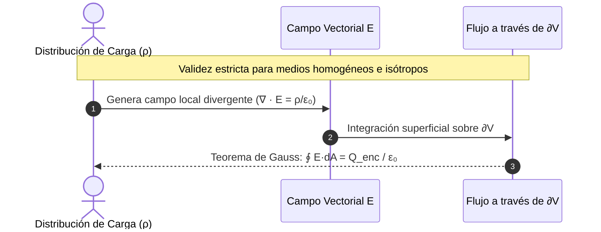

# Guía Exhaustiva de Estudio: Campo Eléctrico y Ley de Gauss

---

## 1. Concepto y Descripción Vectorial del Campo Eléctrico

### 1.1 Definición Física e Intensidad del Campo Eléctrico ($\vec{E}$)

El campo eléctrico $\vec{E}$ es una perturbación vectorial del espacio circundante a una o varias fuentes de carga, mediante la cual se transmite la interacción electrostática sin recurrir a la acción a distancia instantánea.

Matemáticamente, se define operacionalmente a través de una partícula de prueba $q_0 > 0$:

$$\vec{E}(\vec{r}) = \lim_{q_0 \to 0} \frac{\vec{F}_e(\vec{r})}{q_0}$$

* **Condición de límite ($q_0 \to 0$):** Garantiza que la carga de prueba sea diferencialmente pequeña para no perturbar espacialmente la distribución de las cargas fuente ni inducir polarización en conductores o dieléctricos adyacentes.
* **Naturaleza física:** $\vec{E}$ es intrínseco a las cargas fuente. Existe en cada punto del espacio independientemente de si hay o no una carga de prueba detectándolo.


---

### 1.2 Unidades en el Sistema Internacional (S.I.)

* **Unidad primaria (dinámica):**
  $$[\vec{E}] = \frac{[\vec{F}]}{[q]} = \frac{\text{N}}{\text{C}} = \text{kg} \cdot \text{m} \cdot \text{s}^{-3} \cdot \text{A}^{-1}$$
* **Unidad electrocinética/gradiente de potencial:**
  $$1\,\frac{\text{N}}{\text{C}} = 1\,\frac{\text{N}\cdot\text{m}}{\text{C}\cdot\text{m}} = 1\,\frac{\text{J}}{\text{C}\cdot\text{m}} = 1\,\frac{\text{V}}{\text{m}}$$

> [!NOTE]
> Ambas unidades ($\text{N/C}$ y $\text{V/m}$) son idénticas dimensionalmente. La formulación en $\text{V/m}$ evidencia de manera directa que el campo eléctrico representa la razón de cambio espacial del potencial eléctrico: $\vec{E} = -\nabla V$.

---

### 1.3 Principio de Superposición para Campos Eléctricos

Dado que las ecuaciones fundamentales de Maxwell en régimen estático son linealmente diferenciales respecto a las densidades de carga, el campo eléctrico total resultante en cualquier punto $\vec{r}$ es la suma vectorial directa de los campos originados por cada entidad cargada de forma aislada:

$$\vec{E}_{\text{total}}(\vec{r}) = \sum_{i=1}^{N} \vec{E}_i(\vec{r}) = \frac{1}{4\pi\varepsilon_0}\sum_{i=1}^{N} \frac{q_i}{|\vec{r} - \vec{r}_i|^3}(\vec{r} - \vec{r}_i)$$

* **Validez física:** El vacío es un medio perfectamente lineal para campos de magnitudes subcríticas (límite de Schwinger: $E_{\text{crit}} \approx 1.3 \times 10^{18}\ \text{V/m}$).

---

### 1.4 Cálculo de la Intensidad de Campo Eléctrico

#### A. Sistemas Discretos de Partículas Cargadas

Para $N$ partículas con cargas $q_i$ localizadas en posiciones $\vec{r}_i = (x_i, y_i, z_i)$, el campo en el punto de observación $P(\vec{r})$ se descompone en componentes cartesianas:

$$E_x = \frac{1}{4\pi\varepsilon_0}\sum_{i=1}^{N}\frac{q_i (x - x_i)}{\left[(x - x_i)^2 + (y - y_i)^2 + (z - z_i)^2\right]^{3/2}}$$

$$E_y = \frac{1}{4\pi\varepsilon_0}\sum_{i=1}^{N}\frac{q_i (y - y_i)}{\left[(x - x_i)^2 + (y - y_i)^2 + (z - z_i)^2\right]^{3/2}}$$

$$E_z = \frac{1}{4\pi\varepsilon_0}\sum_{i=1}^{N}\frac{q_i (z - z_i)}{\left[(x - x_i)^2 + (y - y_i)^2 + (z - z_i)^2\right]^{3/2}}$$

---

#### B. Distribuciones Continuas de Carga

Para un elemento infinitesimal de carga $dq$:

$$d\vec{E} = \frac{1}{4\pi\varepsilon_0} \frac{dq}{|\vec{r} - \vec{r}'|^3} (\vec{r} - \vec{r}') \implies \vec{E}(\vec{r}) = \frac{1}{4\pi\varepsilon_0} \int_{\mathcal{V}'} \frac{\vec{r} - \vec{r}'}{|\vec{r} - \vec{r}'|^3} dq$$

##### 1. Alambre Rectilíneo Finito
Considere un hilo lineal con densidad uniforme $\lambda$ a lo largo del eje $z$, extendido desde $z_1$ hasta $z_2$. Punto de observación a distancia perpendicular $r$ sobre el plano $xy$:

$$\vec{E} = \frac{\lambda}{4\pi\varepsilon_0 r} \left[ (\sin\theta_2 - \sin\theta_1)\,\hat{u}_r - (\cos\theta_2 - \cos\theta_1)\,\hat{u}_z \right]$$

Donde $\theta_1, \theta_2$ son los ángulos subtendidos desde los extremos hacia el punto de observación.

##### 2. Alambre Rectilíneo Infinito ($z_1 \to -\infty, z_2 \to +\infty$)
Por paridad angular ($\theta_1 = -\pi/2$, $\theta_2 = \pi/2$), las componentes axiales se anulan idénticamente:

$$\vec{E} = \frac{\lambda}{2\pi\varepsilon_0 r} \hat{u}_r$$

##### 3. Anillo Circular Cargado
Radio $R$, carga total $Q$ distribuida uniformemente en el plano $xy$. Punto de campo sobre el eje de simetría $z$:

$$dq = \lambda R\,d\phi = \frac{Q}{2\pi}d\phi$$

Por simetría azimutal, las componentes ortogonales al eje $z$ se cancelan por pares opuestos diametralmente ($dE_\perp = 0$):

$$E_z = \int_0^{2\pi} \frac{1}{4\pi\varepsilon_0} \frac{dq}{(z^2 + R^2)} \cos\alpha, \quad \text{con } \cos\alpha = \frac{z}{\sqrt{z^2 + R^2}}$$

$$\vec{E}(z) = \frac{1}{4\pi\varepsilon_0} \frac{Q z}{(z^2 + R^2)^{3/2}} \hat{u}_z$$

* **Comportamiento en el centro ($z = 0$):** $\vec{E} = \vec{0}$.
* **Máximo absoluto:** Derivando $\frac{dE_z}{dz} = 0 \implies z_{\text{máx}} = \pm \frac{R}{\sqrt{2}}$.

##### 4. Disco Circular Uniforme
Radio $R$, densidad superficial $\sigma = \frac{Q}{\pi R^2}$. Se descompone en anillos concéntricos de radio $r'$ y ancho diferencial $dr'$:

$$dq = \sigma\,dA' = \sigma (2\pi r' dr')$$

$$\vec{E}(z) = \hat{u}_z \int_0^R \frac{z\,\sigma (2\pi r' dr')}{4\pi\varepsilon_0 (z^2 + r'^2)^{3/2}} = \frac{\sigma z}{2\varepsilon_0} \left[ -\frac{1}{\sqrt{z^2 + r'^2}} \right]_0^R$$

$$\vec{E}(z) = \frac{\sigma}{2\varepsilon_0} \left( \frac{z}{|z|} - \frac{z}{\sqrt{z^2 + R^2}} \right) \hat{u}_z = \frac{\sigma}{2\varepsilon_0}\operatorname{sgn}(z)\left(1 - \frac{|z|}{\sqrt{z^2 + R^2}}\right)\hat{u}_z$$

##### 5. Lámina Plana Infinita
Tomando el límite asintótico del disco cuando $R \to \infty$:

$$\vec{E} = \frac{\sigma}{2\varepsilon_0} \operatorname{sgn}(z)\,\hat{u}_n$$

El campo es estrictamente **uniforme** e independiente de la distancia al plano.

##### 6. Cilindro Cargado de Radio $R$ (Volumétrico Uniforme $\rho$)
* **Interior ($r < R$):** $\vec{E}(r) = \frac{\rho r}{2\varepsilon_0} \hat{u}_r$
* **Exterior ($r \ge R$):** $\vec{E}(r) = \frac{\rho R^2}{2\varepsilon_0 r} \hat{u}_r = \frac{\lambda_{\text{eq}}}{2\pi\varepsilon_0 r}\hat{u}_r$, donde $\lambda_{\text{eq}} = \rho \pi R^2$.

| Configuración Continua | Expresión Vectorial de $\vec{E}$ | Parámetro Dominante |
| :--- | :--- | :--- |
| **Alambre infinito** | $\vec{E} = \frac{\lambda}{2\pi\varepsilon_0 r} \hat{u}_r$ | Decae con $r^{-1}$ |
| **Anillo en su eje** | $\vec{E} = \frac{Q z}{4\pi\varepsilon_0 (z^2 + R^2)^{3/2}} \hat{u}_z$ | Lineal en $z \ll R$, decae con $z^{-2}$ en $z \gg R$ |
| **Disco en su eje** | $\vec{E} = \frac{\sigma}{2\varepsilon_0}\left(1 - \frac{z}{\sqrt{z^2 + R^2}}\right)\hat{u}_z$ | Transición de plano a carga puntual |
| **Plano infinito** | $\vec{E} = \frac{\sigma}{2\varepsilon_0} \hat{u}_n$ | Invariante espacial ($r^0$) |
| **Cilindro macizo ($r<R$)** | $\vec{E} = \frac{\rho r}{2\varepsilon_0} \hat{u}_r$ | Lineal respecto a la distancia radial $r$ |

---

## 2. Visualización y Dipolo Eléctrico

### 2.1 Líneas de Fuerza Electroestática

Propuestas por Michael Faraday, constituyen una representación tangencial de la topología del campo vectorial:

1. **Tangencia:** El vector $\vec{E}(\vec{r})$ es tangente a la línea de fuerza en cada punto del espacio.
2. **Direccionalidad:** Emergen de cargas netas positivas (fuentes/manantiales) y convergen en cargas netas negativas (sumideros), o se proyectan al infinito.
3. **Impenetrabilidad:** Dos líneas de campo nunca se cruzan. Si lo hicieran, el vector campo eléctrico perdería unicidad en el punto de intersección.
4. **Densidad geométrica proporcional:** El número de líneas $dN$ que atraviesan ortogonalmente un elemento de área $dA_\perp$ es proporcional a la magnitud local del campo:
   $$\frac{dN}{dA_\perp} \propto |\vec{E}|$$

<div align="center">
  <svg width="340" height="150" viewBox="0 0 340 150" xmlns="http://www.w3.org/2000/svg">
    <!-- Lineas de campo del dipolo -->
    <path d="M 100 75 C 100 20, 240 20, 240 75" fill="none" stroke="#2563eb" stroke-width="2"/>
    <path d="M 100 75 C 100 -10, 240 -10, 240 75" fill="none" stroke="#2563eb" stroke-width="1.5" stroke-dasharray="3,3"/>
    <path d="M 100 75 C 100 130, 240 130, 240 75" fill="none" stroke="#2563eb" stroke-width="2"/>
    <path d="M 100 75 C 100 160, 240 160, 240 75" fill="none" stroke="#2563eb" stroke-width="1.5" stroke-dasharray="3,3"/>
    <line x1="100" y1="75" x2="240" y2="75" stroke="#2563eb" stroke-width="2"/>
    <!-- Cargas -->
    <circle cx="100" cy="75" r="14" fill="#ef4444" />
    <text x="100" y="80" fill="#ffffff" font-size="14" font-weight="bold" text-anchor="middle">+</text>
    <circle cx="240" cy="75" r="14" fill="#1d4ed8" />
    <text x="240" y="80" fill="#ffffff" font-size="14" font-weight="bold" text-anchor="middle">-</text>
    <text x="170" y="95" fill="#334155" font-size="11" text-anchor="middle" font-family="sans-serif">Momento p ➔</text>
  </svg>
</div>

---

### 2.2 El Dipolo Eléctrico

Un dipolo eléctrico elemental consta de dos cargas de igual magnitud y signo opuesto $+q$ y $-q$, separadas por un vector de desplazamiento relativo $\vec{d}$ orientado desde la carga negativa hacia la positiva.

#### A. Momento Dipolar Eléctrico ($\vec{p}$)
$$\vec{p} = q\,\vec{d} \quad [\,\text{C}\cdot\text{m}\,]$$

En el límite dipolar puntual ($d \to 0$, $q \to \infty$ con $p = qd$ finito):
* **Campo en el eje axial (punto sobre el eje del dipolo, $r \gg d$):**
  $$\vec{E}_{\text{axial}} \approx \frac{1}{4\pi\varepsilon_0} \frac{2\vec{p}}{r^3}$$
* **Campo en el plano ecuatorial (mediatriz, $r \gg d$):**
  $$\vec{E}_{\text{ecuatorial}} \approx -\frac{1}{4\pi\varepsilon_0} \frac{\vec{p}}{r^3}$$
* **Formulación tensorial/vectorial general en coordenadas esféricas:**
  $$\vec{E}(\vec{r}) = \frac{1}{4\pi\varepsilon_0 r^3} \left[ 3(\vec{p} \cdot \hat{u}_r)\hat{u}_r - \vec{p} \right]$$

> [!NOTE]
> El campo electrostático del dipolo decae como $r^{-3}$, de forma marcadamente más acelerada que el campo monopolítico ($r^{-2}$), debido a la cancelación asintótica de cargas opuestas a distancias dominantes.

---

#### B. Torque y Fuerzas sobre un Dipolo

##### 1. Campo Eléctrico Uniforme ($\vec{E} = \text{constante}$)
* **Fuerza neta:**
  $$\vec{F}_{\text{neta}} = \vec{F}_+ + \vec{F}_- = (+q)\vec{E} + (-q)\vec{E} = \vec{0}$$
* **Torque neto ($\vec{\tau}$):**
  Calculado respecto al centro geométrico o a cualquier referencia inercial:
  $$\vec{\tau} = \left(\frac{\vec{d}}{2} \times q\vec{E}\right) + \left(-\frac{\vec{d}}{2} \times (-q)\vec{E}\right) = q\vec{d} \times \vec{E}$$
  $$\vec{\tau} = \vec{p} \times \vec{E}$$
  El torque actúa siempre para alinear el vector momento dipolar $\vec{p}$ paralelamente al campo externo $\vec{E}$.

##### 2. Campo Eléctrico No Uniforme ($\vec{E} = \vec{E}(\vec{r})$)
La fuerza sobre cada carga no se anula. Expandiendo mediante aproximación de gradiente de primer orden en serie de Taylor:

$$\vec{F}_{\text{neta}} = q\left[\vec{E}(\vec{r} + \vec{d}) - \vec{E}(\vec{r})\right] \approx q (\vec{d} \cdot \nabla)\vec{E} = (\vec{p} \cdot \nabla)\vec{E}$$

Usando identidades vectoriales de cálculo multivariable ($\nabla \times \vec{E} = \vec{0}$ en electrostática):

$$\vec{F}_{\text{neta}} = \nabla(\vec{p} \cdot \vec{E})$$

> [!WARNING]
> Un dipolo neutro dentro de un campo electrostático no homogéneo experimentará traslación hacia regiones de mayor o menor intensidad de campo dependiendo de su orientación relativa.

---

#### C. Energía Potencial Electroestática ($U$)

El trabajo infinitesimal realizado por el agente externo contra el torque electrostático para rotar el dipolo es $dW_{\text{ext}} = \tau_{\text{ext}} d\theta = - \tau_e d\theta$:

$$U = -\int \tau_e \, d\theta = -\int (-p E \sin\theta) d\theta = -p E \cos\theta + U_0$$

Estableciendo el nivel de referencia nulo en la orientación ortogonal $\theta = \frac{\pi}{2}$ ($U(\pi/2) = 0$):

$$U = -\vec{p} \cdot \vec{E}$$

* **Equilibrio Estable:** $\theta = 0 \implies \vec{p} \parallel \vec{E} \implies U_{\text{mín}} = -pE$, con torque restaurador ante perturbaciones.
* **Equilibrio Inestable:** $\theta = \pi \implies \vec{p} \ anti\parallel \vec{E} \implies U_{\text{máx}} = +pE$, donde cualquier torque desestabiliza el alineamiento.

---

## 3. Flujo Eléctrico y Ley de Gauss

### 3.1 Concepto Geométrico de Ángulo Sólido ($\Omega$)

El ángulo sólido $\Omega$ es la generalización tridimensional del ángulo plano, definido sobre una superficie esférica de radio $r$:

$$d\Omega = \frac{dA_\perp}{r^2} = \frac{\vec{r} \cdot d\vec{A}}{r^3} \quad [\,\text{sr (estereorradianes)}\,]$$

* **Superficie cerrada circundante:**
  $$\Omega_{\text{cerrada}} = \oint \frac{dA_\perp}{r^2} = \frac{4\pi r^2}{r^2} = 4\pi\ \text{sr}$$
* **Punto externo a la superficie cerrada:** Si el vértice del ángulo sólido yace fuera del volumen acotado, todo cono infinitesimal entra y sale un número par de veces con proyecciones normales opuestas, resultando en:
  $$\Omega_{\text{externo}} = 0\ \text{sr}$$

---

### 3.2 Definición Matemática de Flujo del Campo Eléctrico ($\Phi_E$)

Dada una superficie arbitraria $S$ particionada en diferenciales vectoriales de área $d\vec{A} = \hat{n}\,dA$, donde $\hat{n}$ es el vector unitario normal:

$$\Phi_E = \iint_S \vec{E} \cdot d\vec{A} \quad \left[\,\text{N}\cdot\text{m}^2/\text{C}\text{ ó }\text{V}\cdot\text{m}\,\right]$$

Para una **superficie orientada cerrada** $\partial\mathcal{V}$ que encierra un volumen $\mathcal{V}$, se adopta la convención topológica estándar de que $\hat{n}$ apunta estrictamente hacia el **exterior**:

$$\Phi_E = \oint_{\partial\mathcal{V}} \vec{E} \cdot d\vec{A}$$

* **$\Phi_E > 0$:** Predominio de divergencia o presencia de fuentes netas positivas en el interior.
* **$\Phi_E < 0$:** Predominio de convergencia o sumideros de carga neta negativos.
* **$\Phi_E = 0$:** Ausencia de carga neta interna; todo flujo entrante compensa numéricamente al saliente.

---

### 3.3 Formulación Integral y Diferencial de la Ley de Gauss

#### Forma Integral
El flujo electrostático neto a través de cualquier superficie gaussiana cerrada es estrictamente proporcional a la carga eléctrica neta $Q_{\text{enc}}$ contenida en su volumen interior, independiente de la distribución geométrica de las cargas internas o de la presencia de cargas exteriores:

$$\oint_{\partial\mathcal{V}} \vec{E} \cdot d\vec{A} = \frac{Q_{\text{enc}}}{\varepsilon_0} = \frac{1}{\varepsilon_0}\iiint_{\mathcal{V}} \rho(\vec{r})\,dV$$

#### Deducción del Teorema de la Divergencia (Forma Diferencial)
Aplicando el Teorema de Gauss-Ostrogradsky a la superficie cerrada:

$$\oint_{\partial\mathcal{V}} \vec{E} \cdot d\vec{A} = \iiint_{\mathcal{V}} (\nabla \cdot \vec{E})\,dV = \frac{1}{\varepsilon_0}\iiint_{\mathcal{V}} \rho\,dV$$

Dado que el volumen de integración $\mathcal{V}$ es estrictamente arbitrario:

$$\nabla \cdot \vec{E} = \frac{\rho}{\varepsilon_0}$$

Esta es la primera de las ecuaciones fundamentales de Maxwell en el vacío.



---

### 3.4 Aplicaciones de la Ley de Gauss con Alta Simetría

Para despejar analíticamente $|\vec{E}|$ de la integral de Gauss, la superficie gaussiana elegida debe satisfacer las condiciones de simetría de Neumann:
1. $|\vec{E}|$ debe ser rigurosamente constante en los sectores de la superficie donde $\vec{E} \parallel d\vec{A}$.
2. En los sectores restantes, $\vec{E} \perp d\vec{A} \implies \vec{E} \cdot d\vec{A} = 0$.

#### 1. Alambre Rectilíneo Infinito
* **Superficie Gaussiana:** Cilindro coaxial de radio $r$ y longitud longitudinal $L$.
* **Evaluación del Flujo:**
  $$\oint \vec{E} \cdot d\vec{A} = \int_{\text{tapa 1}} 0 + \int_{\text{tapa 2}} 0 + \int_{\text{manto}} |\vec{E}|\,dA = E(2\pi r L)$$
* **Carga encerrada:** $Q_{\text{enc}} = \lambda L$
* **Campo resultante:**
  $$E(2\pi r L) = \frac{\lambda L}{\varepsilon_0} \implies \vec{E}(r) = \frac{\lambda}{2\pi\varepsilon_0 r}\hat{u}_r$$

---

#### 2. Lámina Infinita No Conductora
* **Superficie Gaussiana:** Cilindro recto ("caja de pastillas") transversal al plano con tapas de área $A$ a ambos lados simétricos a distancia $z$.
* **Evaluación del Flujo:** $\vec{E}$ es normal al plano; el manto cilíndrico tiene flujo nulo:
  $$\oint \vec{E} \cdot d\vec{A} = E A + E A = 2EA$$
* **Carga encerrada:** $Q_{\text{enc}} = \sigma A$
* **Campo resultante:**
  $$2EA = \frac{\sigma A}{\varepsilon_0} \implies E = \frac{\sigma}{2\varepsilon_0} \implies \vec{E} = \frac{\sigma}{2\varepsilon_0}\,\operatorname{sgn}(z)\,\hat{u}_n$$

> [!TIP]
> Para una **lámina conductora** en equilibrio electrostático, el campo interior es nulo ($\vec{E}_{\text{int}} = \vec{0}$). La superficie gaussiana solo tiene flujo saliente en una tapa exterior, lo que produce:
> $$EA = \frac{\sigma_{\text{cond}} A}{\varepsilon_0} \implies E_{\text{conductor}} = \frac{\sigma_{\text{cond}}}{\varepsilon_0}$$

---

#### 3. Cascarón Esférico de Radio $R$ con Carga $Q$
* **Interior ($r < R$):**
  $$Q_{\text{enc}} = 0 \implies \oint \vec{E} \cdot d\vec{A} = E(4\pi r^2) = 0 \implies \vec{E} = \vec{0}$$
* **Exterior ($r > R$):**
  $$Q_{\text{enc}} = Q \implies E(4\pi r^2) = \frac{Q}{\varepsilon_0} \implies \vec{E} = \frac{Q}{4\pi\varepsilon_0 r^2}\hat{u}_r$$

---

#### 4. Esfera Sólida Dieléctrica de Radio $R$ con Carga Total $Q$

##### A. Distribución Volumétrica Uniforme ($\rho_0 = \frac{Q}{\frac{4}{3}\pi R^3}$)
* **Zona Interna ($r \le R$):**
  $$Q_{\text{enc}} = \rho_0 \left(\frac{4}{3}\pi r^3\right) = Q \frac{r^3}{R^3}$$
  $$E(4\pi r^2) = \frac{Q r^3}{\varepsilon_0 R^3} \implies \vec{E}_{\text{int}}(r) = \frac{Q r}{4\pi\varepsilon_0 R^3}\hat{u}_r = \frac{\rho_0 r}{3\varepsilon_0}\hat{u}_r$$
* **Zona Externa ($r > R$):**
  $$Q_{\text{enc}} = Q \implies \vec{E}_{\text{ext}}(r) = \frac{Q}{4\pi\varepsilon_0 r^2}\hat{u}_r$$

##### B. Distribución Radial No Uniforme (ejemplo: $\rho(r) = k r^n$)
* **Carga Encerrada:**
  $$Q_{\text{enc}}(r) = \int_0^r \rho(r') 4\pi r'^2 dr' = 4\pi k \int_0^r r'^{n+2} dr' = \frac{4\pi k}{n+3} r^{n+3}$$
* **Campo interior:**
  $$E(4\pi r^2) = \frac{1}{\varepsilon_0} \left[ \frac{4\pi k}{n+3} r^{n+3} \right] \implies \vec{E}(r) = \frac{k}{(n+3)\varepsilon_0} r^{n+1}\hat{u}_r$$

---

#### 5. Configuración Cilíndrica Coaxial
Considere un conductor interno de radio $a$ con carga por unidad de longitud $+\lambda$, rodeado por un cascarón cilíndrico conductor concéntrico de radios $b$ (interno) y $c$ (externo) con carga total longitudinal $-\lambda$.

* **Región I ($r < a$):** Conductor en equilibrio $\implies \vec{E} = \vec{0}$.
* **Región II ($a < r < b$):** Espacio intermedio:
  $$E(2\pi r L) = \frac{\lambda L}{\varepsilon_0} \implies \vec{E}(r) = \frac{\lambda}{2\pi\varepsilon_0 r}\hat{u}_r$$
* **Región III ($b \le r \le c$):** Cuerpo conductor $\implies \vec{E} = \vec{0}$. Por inducción electrostática, la superficie interna en $r = b$ acumula $-\lambda$, dejando carga nula en la superficie externa $r = c$.
* **Región IV ($r > c$):** $Q_{\text{enc}} = +\lambda - \lambda = 0 \implies \vec{E} = \vec{0}$.

```python
import numpy as np

def campo_esfera_uniforme(r: np.ndarray, Q: float, R: float, eps0: float = 8.854e-12) -> np.ndarray:
    """Calcula la magnitud del campo E(r) de una esfera dielectrica uniforme."""
    k_e = 1.0 / (4.0 * np.pi * eps0)
    E = np.zeros_like(r)
    # Mascara booleana para particionar interior y exterior
    interior = r <= R
    exterior = ~interior
    
    E[interior] = (k_e * Q / R**3) * r[interior]
    E[exterior] = (k_e * Q) / (r[exterior]**2)
    return E

# Verificacion en la discontinuidad de frontera r = R
radio_esfera = 0.05  # 5 cm
carga_total = 1.0e-9 # 1 nC
puntos_r = np.array([0.025, radio_esfera, 0.10])
campos = campo_esfera_uniforme(puntos_r, carga_total, radio_esfera)
# Salida verificable: Continuidad en r = R garantizada por distribucion de volumen
```

---

## 4. Aplicaciones Atómicas: Modelos Nucleares Clásicos

El desarrollo de la estructura nuclear a principios del siglo XX se basó en el análisis del campo eléctrico interno para explicar la dispersión de partículas alfa ($\text{He}^{2+}$).

| Criterio Electroestático | Modelo de Thomson ("Pudín de Pasas", 1904) | Modelo Planetario de Rutherford (1911) |
| :--- | :--- | :--- |
| **Distribución de Carga Positiva** | Esfera macroscópica de radio $R_{\text{átomo}} \approx 10^{-10}\ \text{m}$ con densidad continua $\rho > 0$. | Carga concentrada en un núcleo central puntual ($R_{\text{núcleo}} \approx 10^{-14}\ \text{m}$). |
| **Comportamiento Interno de $\vec{E}(r)$** | Crece linealmente desde el centro: $E(r) = \frac{Z e r}{4\pi\varepsilon_0 R^3}$. | Decae con la ley del inverso al cuadrado hasta el núcleo: $E(r) = \frac{Z e}{4\pi\varepsilon_0 r^2}$. |
| **Magnitud Máxima del Campo Eléctrico** | $E_{\text{máx}} = \frac{Z e}{4\pi\varepsilon_0 R_{\text{átomo}}^2} \approx 10^{11}\ \text{V/m}$. | $E_{\text{máx}} = \frac{Z e}{4\pi\varepsilon_0 R_{\text{núcleo}}^2} \approx 10^{20}\ \text{V/m}$ ($10^9$ veces más intenso). |
| **Fuerza Deflectora sobre Partícula $\alpha$** | Fuerza máxima débil, insuficiente para frenar la partícula. | Fuerza coulombiana repulsiva extrema en aproximaciones cercanas ($r \to R_{\text{núcleo}}$). |
| **Ángulo de Dispersión ($\theta$) Predicho** | Desviaciones pequeñas gaussianas ($\theta \ll 1^\circ$). Imposible retrodispersión. | Predicción analítica de dispersión a grandes ángulos ($\theta > 90^\circ$ e incluso $\theta \approx 180^\circ$). |

### Análisis del Conflicto Físico Experimental
En el experimento de Geiger-Marsden, partículas alfa de energía cinética $K_\alpha \approx 5\ \text{MeV}$ bombardeaban láminas de oro ($Z = 79$):

1. **Bajo el modelo de Thomson:** La energía potencial electrostática máxima que una partícula alfa de carga $2e$ podía experimentar al penetrar la nube atómica era:
   $$U_{\text{máx}}^{\text{Thomson}} = \frac{1}{4\pi\varepsilon_0} \frac{2 Z e^2}{R_{\text{átomo}}} \approx \frac{(9 \times 10^9)(2)(79)(1.6 \times 10^{-19})^2}{10^{-10}} \approx 3.6 \times 10^{-16}\ \text{J} \approx 2.2 \times 10^3\ \text{eV} \ll 5\ \text{MeV}$$
   Las partículas alfa atravesarían el átomo prácticamente sin deflexión angular.

2. **Bajo la hipótesis del Núcleo de Rutherford:** La conservación de la energía mecánica total en una colisión frontal ($\theta = 180^\circ$) define la distancia de máximo acercamiento $d_{\text{min}}$:
   $$K_\alpha = U_{\text{coulomb}} = \frac{1}{4\pi\varepsilon_0} \frac{(2e)(Ze)}{d_{\text{min}}} \implies d_{\text{min}} = \frac{2 Z e^2}{4\pi\varepsilon_0 K_\alpha}$$

   Sustituyendo para lámina de oro con $K_\alpha = 5\ \text{MeV}$:
   $$d_{\text{min}} \approx \frac{(2)(79)(1.6 \times 10^{-19})^2 (9 \times 10^9)}{(5 \times 10^6)(1.6 \times 10^{-19})} \approx 4.5 \times 10^{-14}\ \text{m}$$

Como $d_{\text{min}} \ll R_{\text{átomo}}$, la carga positiva del átomo debía encontrarse concentrada en un volumen al menos $10^{12}$ veces menor que el volumen atómico total. Esto confirmó experimentalmente el núcleo atómico y descartó el modelo electrostático continuo de Thomson.