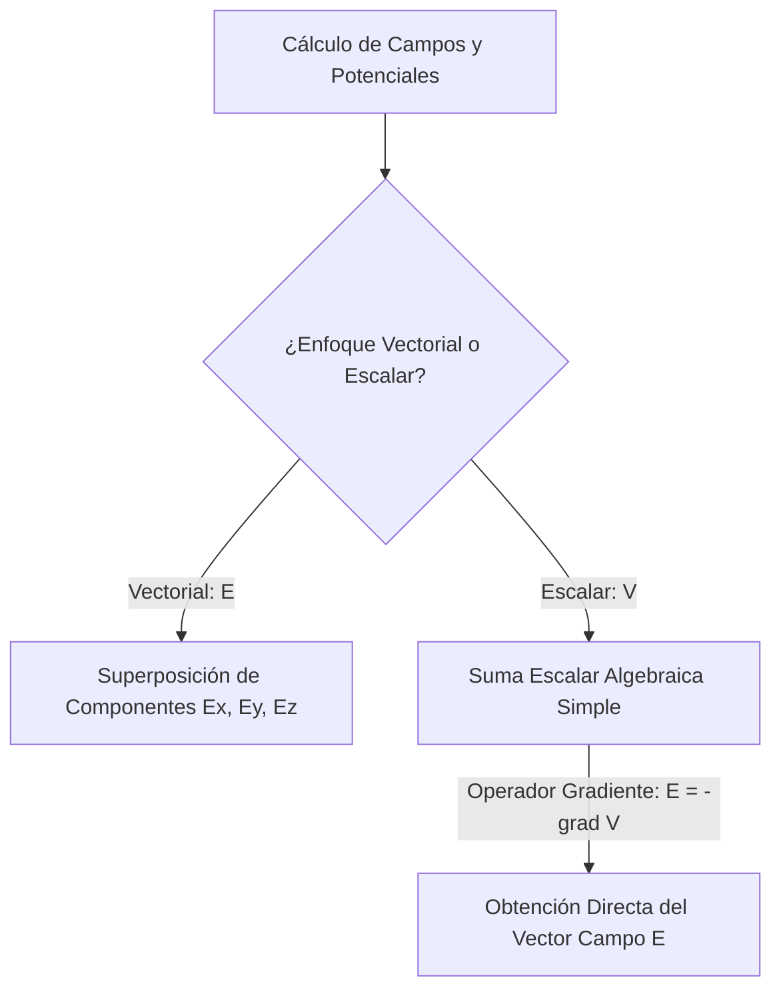
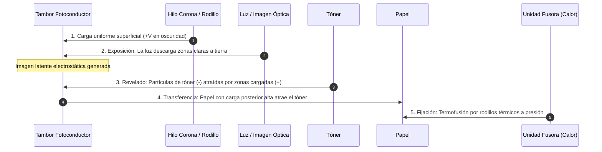

# Guía Exhaustiva de Estudio: Potencial Eléctrico

---

## 1. Potencial y Diferencia de Potencial Electroestático

### 1.1 Definición de Potencial Eléctrico ($V$) Generado por una Carga Puntual Fija

La fuerza electrostática coulombiana es estrictamente conservativa ($\vec{\nabla} \times \vec{E} = \vec{0}$), lo que permite definir una función escalar de energía potencial $U$. El potencial eléctrico $V$ en un punto del espacio $\vec{r}$ se define formalmente como la energía potencial electrostática por unidad de carga de prueba positiva $q_0$:

$$V(\vec{r}) = \frac{U(\vec{r})}{q_0} = -\int_{\vec{r}_{\text{ref}}}^{\vec{r}} \vec{E} \cdot d\vec{\ell}$$

Para una carga puntual estacionaria $q$ localizada en el origen con la condición de frontera estándar en el infinito ($V(r \to \infty) = 0$):

$$V(r) = -\int_{\infty}^{r} \left(\frac{1}{4\pi\varepsilon_0}\frac{q}{r'^2}\,\hat{u}_r\right) \cdot (dr'\,\hat{u}_r) = -\frac{q}{4\pi\varepsilon_0} \int_{\infty}^{r} \frac{dr'}{r'^2} = \left[ \frac{q}{4\pi\varepsilon_0 r'} \right]_{\infty}^{r}$$

$$V(r) = \frac{1}{4\pi\varepsilon_0}\frac{q}{r}$$

* **Escalar con signo:** A diferencia del vector $\vec{E}$, $V$ es un escalar algebraico. Si $q > 0 \implies V > 0$; si $q < 0 \implies V < 0$.
* **Significado físico:** Representa el trabajo externo requerido por unidad de carga para trasladar una carga de prueba con velocidad constante desde el infinito hasta la distancia $r$.

---

### 1.2 Diferencia de Potencial Electroestático ($\Delta V$) y Unidades en el S.I.

La diferencia de potencial $\Delta V$ entre un punto inicial $A$ y un punto final $B$ es independiente de la trayectoria elegida:

$$\Delta V = V_B - V_A = -\int_{A}^{B} \vec{E} \cdot d\vec{\ell} = \frac{W_{A \to B}^{\text{campo}}}{-q_0} = \frac{W_{A \to B}^{\text{externo}}}{q_0}$$

* **Unidad en el S.I. (Voltio, $\text{V}$):**
  $$[\Delta V] = \frac{[\text{Energía}]}{[\text{Carga}]} = \frac{\text{J}}{\text{C}} = \text{V} = \text{kg} \cdot \text{m}^2 \cdot \text{s}^{-3} \cdot \text{A}^{-1}$$

* **Electrón-voltio ($\text{eV}$):** Unidad de energía habitual en regímenes atómicos y de estado sólido:
  $$1\ \text{eV} = e \cdot (1\ \text{V}) = (1.602176634 \times 10^{-19}\ \text{C})(1\ \text{J/C}) = 1.602176634 \times 10^{-19}\ \text{J}$$

> [!NOTE]
> Las líneas de campo eléctrico apuntan inexorablemente en la dirección de **máxima disminución** del potencial eléctrico. Al desplazarse a favor de $\vec{E}$, el potencial decrece ($\Delta V < 0$).

---

### 1.3 Principio de Superposición para Potenciales Escalares

La superposición para el potencial eléctrico no involucra descomposición de componentes vectoriales, sino la suma algebraica de magnitudes escalares:

$$V(\vec{r}) = \sum_{i=1}^{N} V_i(\vec{r}) = \frac{1}{4\pi\varepsilon_0} \sum_{i=1}^{N} \frac{q_i}{|\vec{r} - \vec{r}_i|}$$

Para distribuciones continuas de carga:

$$V(\vec{r}) = \frac{1}{4\pi\varepsilon_0} \int \frac{dq'}{|\vec{r} - \vec{r}'|}$$



---

## 2. Geometría del Potencial y Relación de Campo

### 2.1 Superficies y Curvas Equipotenciales

Una **superficie equipotencial** es el lugar geométrico tridimensional donde el potencial electrostático permanece estrictamente constante ($V(\vec{r}) = C$).

1. **Trabajo nulo en desplazamientos internos:** Al mover una carga sobre una superficie equipotencial, $dW = -q_0\,dV = 0$.
2. **Ortogonalidad estricta:** Dado que $dV = -\vec{E} \cdot d\vec{\ell} = 0$, para cualquier desplazamiento tangencial $d\vec{\ell}$, el producto escalar exige que:
   $$\vec{E} \perp d\vec{\ell} \implies \vec{E} \perp \text{Superficie Equipotencial}$$
   Las líneas de campo eléctrico intersecan siempre a las superficies equipotenciales en ángulos ortogonales de $90^\circ$.
3. **Densidad geométrica:** Las superficies equipotenciales se aproximan entre sí en regiones donde la magnitud del campo $|\vec{E}|$ es más intensa, pues $|\Delta \ell| = \frac{|\Delta V|}{|\vec{E}|}$.

<div align="center">
  <svg width="320" height="160" viewBox="0 0 320 160" xmlns="http://www.w3.org/2000/svg">
    <!-- Carga Puntual -->
    <circle cx="160" cy="80" r="10" fill="#ef4444" />
    <text x="160" y="84" fill="#ffffff" font-size="12" font-weight="bold" text-anchor="middle">+</text>
    <!-- Superficies Equipotenciales -->
    <circle cx="160" cy="80" r="30" fill="none" stroke="#2563eb" stroke-dasharray="4,4" stroke-width="1.5"/>
    <circle cx="160" cy="80" r="55" fill="none" stroke="#2563eb" stroke-dasharray="4,4" stroke-width="1.5"/>
    <circle cx="160" cy="80" r="75" fill="none" stroke="#2563eb" stroke-dasharray="4,4" stroke-width="1.5"/>
    <!-- Líneas de Campo E Ortogonales -->
    <line x1="172" y1="80" x2="250" y2="80" stroke="#059669" stroke-width="2" marker-end="url(#arrow)"/>
    <line x1="160" y1="68" x2="160" y2="5" stroke="#059669" stroke-width="2"/>
    <line x1="148" y1="80" x2="70" y2="80" stroke="#059669" stroke-width="2"/>
    <line x1="160" y1="92" x2="160" y2="155" stroke="#059669" stroke-width="2"/>
    <text x="210" y="70" fill="#059669" font-size="10" font-family="sans-serif">Línea E</text>
    <text x="215" y="115" fill="#2563eb" font-size="10" font-family="sans-serif">Equipotenciales (V=cte)</text>
  </svg>
</div>

---

### 2.2 Relación entre Campo Eléctrico y Potencial

#### A. Formulación Integral de Camino
El potencial se obtiene integrando el campo a lo largo de cualquier curva orientada $\mathcal{C}$:

$$V(B) - V(A) = -\int_{A}^{B} \vec{E} \cdot d\vec{\ell}$$

Dado que el campo es conservativo, la integral sobre cualquier trayectoria cerrada $\partial S$ es nula:

$$\oint_{\partial S} \vec{E} \cdot d\vec{\ell} = 0 \iff \vec{\nabla} \times \vec{E} = \vec{0}$$

#### B. Relación Diferencial: Gradiente del Potencial
El diferencial total exacto del potencial escalar en el espacio es:

$$dV = \frac{\partial V}{\partial x} dx + \frac{\partial V}{\partial y} dy + \frac{\partial V}{\partial z} dz = (\vec{\nabla} V) \cdot d\vec{\ell}$$

Contrastando con la definición electrostática $dV = -\vec{E} \cdot d\vec{\ell}$:

$$\vec{E} = -\vec{\nabla} V = -\left( \frac{\partial V}{\partial x}\hat{\imath} + \frac{\partial V}{\partial y}\hat{\jmath} + \frac{\partial V}{\partial z}\hat{k} \right)$$

En sistemas de coordenadas no cartesianas:

* **Cilíndricas $(r, \phi, z)$:**
  $$\vec{E} = -\left( \frac{\partial V}{\partial r}\hat{u}_r + \frac{1}{r}\frac{\partial V}{\partial \phi}\hat{u}_\phi + \frac{\partial V}{\partial z}\hat{u}_z \right)$$
* **Esféricas $(r, \theta, \phi)$:**
  $$\vec{E} = -\left( \frac{\partial V}{\partial r}\hat{u}_r + \frac{1}{r}\frac{\partial V}{\partial \theta}\hat{u}_\theta + \frac{1}{r\sin\theta}\frac{\partial V}{\partial \phi}\hat{u}_\phi \right)$$

---

## 3. Cálculo del Potencial en Diferentes Distribuciones

### 3.1 Distribuciones Discretas
Para un ensamble de $N$ cargas puntuales, el potencial en el punto $\vec{r} = (x, y, z)$ se calcula directamente por:

$$V(x, y, z) = \frac{1}{4\pi\varepsilon_0} \sum_{i=1}^N \frac{q_i}{\sqrt{(x - x_i)^2 + (y - y_i)^2 + (z - z_i)^2}}$$

---

### 3.2 Distribuciones Continuas de Carga

#### 1. Alambre Recto Infinito con Densidad Uniforme $\lambda$
Debido a la extensión infinita de la fuente, el potencial diverge si se fija el cero en el infinito. Se debe elegir una referencia finita arbitraria $r_0$ tal que $V(r_0) = 0$:

$$V(r) - V(r_0) = -\int_{r_0}^r \vec{E} \cdot dr'\,\hat{u}_r = -\int_{r_0}^r \frac{\lambda}{2\pi\varepsilon_0 r'} dr'$$

$$V(r) = -\frac{\lambda}{2\pi\varepsilon_0}\ln\left(\frac{r}{r_0}\right) = \frac{\lambda}{2\pi\varepsilon_0}\ln\left(\frac{r_0}{r}\right)$$

#### 2. Anillo Cargado sobre su Eje de Simetría
Radio $R$, carga uniforme total $Q$. Para un punto situado a distancia axial $z$ sobre su eje perpendicular:

Todos los elementos $dq$ equidistan del punto de observación a una distancia $r' = \sqrt{z^2 + R^2}$:

$$V(z) = \frac{1}{4\pi\varepsilon_0} \int \frac{dq}{\sqrt{z^2 + R^2}} = \frac{1}{4\pi\varepsilon_0 \sqrt{z^2 + R^2}} \int dq$$

$$V(z) = \frac{1}{4\pi\varepsilon_0} \frac{Q}{\sqrt{z^2 + R^2}}$$

* **Obtención del campo axial mediante derivación:**
  $$E_z = -\frac{\partial V}{\partial z} = -\frac{\partial}{\partial z}\left[\frac{Q}{4\pi\varepsilon_0}(z^2+R^2)^{-1/2}\right] = \frac{Q z}{4\pi\varepsilon_0 (z^2 + R^2)^{3/2}}$$
  Coincide de manera unívoca con el cálculo vectorial obtenido por Ley de Coulomb.

#### 3. Disco Uniformemente Cargado
Radio $R$, densidad superficial uniforme $\sigma = \frac{Q}{\pi R^2}$. Dividiendo el disco en anillos concéntricos diferenciales de radio $r'$ y espesor $dr'$, con $dq = \sigma (2\pi r' dr')$:

$$V(z) = \frac{1}{4\pi\varepsilon_0} \int_0^R \frac{\sigma (2\pi r' dr')}{\sqrt{z^2 + r'^2}} = \frac{\sigma}{2\varepsilon_0} \left[ \sqrt{z^2 + r'^2} \right]_0^R$$

$$V(z) = \frac{\sigma}{2\varepsilon_0} \left( \sqrt{z^2 + R^2} - |z| \right)$$

* **Aproximación para distancias grandes ($z \gg R$):** Expandiendo la raíz mediante binomio de Newton:
  $$\sqrt{z^2 + R^2} = z \left(1 + \frac{R^2}{z^2}\right)^{1/2} \approx z \left(1 + \frac{R^2}{2z^2}\right) \implies V(z) \approx \frac{\sigma}{2\varepsilon_0}\left( \frac{R^2}{2z} \right) = \frac{\sigma \pi R^2}{4\pi\varepsilon_0 z} = \frac{Q}{4\pi\varepsilon_0 z}$$
  Recupera asintóticamente el potencial de una carga puntual.

#### 4. Esfera Sólida y Conductora

| Distribución Esférica (Radio $R$, Carga $Q$) | Potencial Exterior ($r \ge R$) | Potencial Interior ($r \le R$) |
| :--- | :--- | :--- |
| **Esfera Conductora en Equilibrio** | $V_{\text{ext}}(r) = \frac{1}{4\pi\varepsilon_0}\frac{Q}{r}$ | $V_{\text{int}}(r) = \frac{1}{4\pi\varepsilon_0}\frac{Q}{R} = \text{cte}$ |
| **Esfera Dieléctrica Uniforme ($\rho_0$)** | $V_{\text{ext}}(r) = \frac{1}{4\pi\varepsilon_0}\frac{Q}{r}$ | $V_{\text{int}}(r) = \frac{Q}{8\pi\varepsilon_0 R}\left(3 - \frac{r^2}{R^2}\right)$ |

Deducción para la **esfera dieléctrica homogénea en su interior**:

$$V_{\text{int}}(r) - V(R) = -\int_R^r E_{\text{int}}(r') dr' = -\int_R^r \frac{Q r'}{4\pi\varepsilon_0 R^3} dr' = -\frac{Q}{4\pi\varepsilon_0 R^3} \left[ \frac{r^2 - R^2}{2} \right]$$

$$V_{\text{int}}(r) = \frac{Q}{4\pi\varepsilon_0 R} + \frac{Q(R^2 - r^2)}{8\pi\varepsilon_0 R^3} = \frac{Q}{8\pi\varepsilon_0 R}\left(3 - \frac{r^2}{R^2}\right)$$

* **En el centro ($r = 0$):** $V_{\text{centro}} = \frac{3}{2} V_{\text{superficie}}$.

```python
import numpy as np

def potencial_esfera_dielectrica(r: np.ndarray, Q: float, R: float, eps0: float = 8.854e-12) -> np.ndarray:
    """Calcula el potencial electrostático de una esfera uniforme."""
    k_e = 1.0 / (4.0 * np.pi * eps0)
    V = np.zeros_like(r)
    interior = r <= R
    exterior = ~interior
    
    # Interior: forma parabolica cóncava hacia abajo
    V[interior] = (k_e * Q / (2.0 * R)) * (3.0 - (r[interior]**2 / R**2))
    # Exterior: decaimiento hiperbolico 1/r
    V[exterior] = k_e * Q / r[exterior]
    return V

# Continuidad estricta en la frontera r = R
r_eval = np.array([0.0, 0.02, 0.05, 0.10])
potenciales = potencial_esfera_dielectrica(r_eval, Q=1e-9, R=0.05)
```

---

## 4. Energía Electroestática y Conductores en Equilibrio

### 4.1 Energía Potencial Electroestática de Cargas y Ensambles Discretos

La energía electrostática $U_e$ representa el trabajo neto suministrado por agentes externos para ensamblar una configuración de cargas desde una separación infinita mutua:

* **Par de cargas:**
  $$U_{12} = \frac{1}{4\pi\varepsilon_0} \frac{q_1 q_2}{r_{12}}$$
* **Ensamble discreto de $N$ partículas:**
  $$U_e = \sum_{i=1}^{N} \sum_{j < i}^{N} \frac{1}{4\pi\varepsilon_0} \frac{q_i q_j}{r_{ij}} = \frac{1}{2} \sum_{i=1}^{N} q_i V(\vec{r}_i)$$
  Donde $V(\vec{r}_i)$ es el potencial en la posición de $q_i$ debido a todas las demás cargas excepto $q_i$, y el factor $1/2$ evita el doble conteo de pares.

---

### 4.2 Energía de Distribuciones Continuas de Carga

Al pasar al límite continuo ($q_i \to \rho\,dV$):

$$U_e = \frac{1}{2} \iiint_{\text{todo el espacio}} \rho(\vec{r})\,V(\vec{r})\,dV$$

Sustituyendo $\rho = \varepsilon_0 (\vec{\nabla} \cdot \vec{E})$ a través de la Ley de Gauss e integrando por partes en todo el volumen donde los términos de frontera decaen a cero en el infinito:

$$U_e = \frac{\varepsilon_0}{2} \iiint_{\text{espacio}} |\vec{E}|^2 dV$$

* **Densidad de Energía Electroestática ($u_e$):** La energía reside distribuida espacialmente en el propio campo eléctrico con una densidad volumétrica local:
  $$u_e = \frac{dU_e}{dV} = \frac{1}{2}\varepsilon_0 |\vec{E}|^2 \quad \left[\frac{\text{J}}{\text{m}^3}\right]$$

---

### 4.3 Propiedades Electroestáticas de Conductores en Equilibrio

Un conductor alcanza el equilibrio electrostático cuando cesa todo movimiento macroscópico neto de portadores libres ($\vec{J} = \vec{0}$).

1. **Campo Interno Estrictamente Nulo ($\vec{E}_{\text{int}} = \vec{0}$):** Si existiera campo tangencial o radial en el seno del conductor, la fuerza $\vec{F} = q\vec{E}$ aceleraría las cargas libres de conducción ($\tau \approx 10^{-14}\ \text{s}$ en metales), violando el estado estacionario.
2. **Equipotencialidad Volumétrica ($V = \text{constante}$):**
   $$V_B - V_A = -\int_A^B \vec{E}_{\text{int}} \cdot d\vec{\ell} = 0 \implies V_A = V_B \quad \forall A,B \in \text{Conductor}$$
3. **Localización Superficial de la Carga Neta en Exceso:**
   Por la forma diferencial de Gauss, como $\vec{E}_{\text{int}} = \vec{0}$:
   $$\vec{\nabla} \cdot \vec{E} = \frac{\rho}{\varepsilon_0} = 0 \implies \rho_{\text{int}} = 0$$
   Cualquier exceso de carga se redistribuye forzosamente sobre la superficie externa con densidad $\sigma$.
4. **Campo Eléctrico Inmediatamente Exterior Normal:**
   $$E_\perp = \frac{\sigma}{\varepsilon_0}, \quad E_\parallel = 0$$
5. **Efecto de Puntas (Poder de las Puntas):**
   Para dos esferas conductoras conectadas en equilibrio ($V_1 = V_2$):
   $$\frac{q_1}{R_1} = \frac{q_2}{R_2} \implies \frac{\sigma_1 R_1}{\varepsilon_0} = \frac{\sigma_2 R_2}{\varepsilon_0} \implies \frac{\sigma_1}{\sigma_2} = \frac{R_2}{R_1}$$
   La densidad superficial de carga $\sigma$ y el campo $\vec{E}$ superficial son inversamente proporcionales al radio de curvatura local:
   $$\sigma \propto \frac{1}{R_c}, \quad |\vec{E}| \propto \frac{1}{R_c}$$
   En zonas puntiagudas ($R_c \to 0$), el campo alcanza intensidades extremas capaces de superar la rigidez dieléctrica del aire ($E_{\text{aire}} \approx 3 \times 10^6\ \text{V/m}$), generando ionización por avalancha (efecto corona).
6. **Blindaje Electroestático (Jaula de Faraday):**
   En una cavidad hueca vacía dentro de un conductor en equilibrio, $\vec{E} = \vec{0}$ con independencia de los campos estáticos intensos externos aplicados. La polarización superficial neutraliza cualquier flujo entrante.

---

## 5. Aplicaciones Tecnológicas e Industriales de la Electroestática

### 5.1 Xerografía y Fotocopiado

Proceso electrofotográfico en seco basado en el comportamiento de materiales **fotoconductores** (típicamente Selenio amorfo o polímeros orgánicos dopados), que operan como aislantes en oscuridad y se vuelven conductores al incidir luz sobre ellos.



---

### 5.2 Funcionamiento de la Impresora Láser

Evolución del proceso xerográfico donde el barrido no es una reflexión analógica, sino un diodo láser modulado digitalmente y sincronizado con un espejo poligonal giratorio (*polygon mirror*):

1. **Escaneo Raster:** El haz láser barre línea por línea la superficie del fotorreceptor cargado.
2. **Descarga Selectiva:** Cada pulso de luz puntual ioniza pares electrón-hueco locales, descargando micropíxeles a tierra para crear la **imagen latente electrostática** con resoluciones de $600$ a $2400\ \text{DPI}$.
3. **Atracción Controlada de Partículas:** La diferencia de potencial entre el rodillo magnético dosificador ($V_{\text{bias}}$) y las áreas expuestas del tambor transfiere el tóner finamente polarizado.

---

### 5.3 Impresoras a Chorro de Tinta (Deflexión Electroestática Continua - CIJ)

En sistemas de inyección continua (*Continuous Inkjet*), las gotas de tinta son deflactadas electrostáticamente en pleno vuelo mediante placas paralelas con alto gradiente de potencial:

<div align="center">
  <svg width="380" height="150" viewBox="0 0 380 150" xmlns="http://www.w3.org/2000/svg">
    <!-- Boquilla -->
    <rect x="10" y="65" width="40" height="20" fill="#64748b" />
    <text x="30" y="100" fill="#334155" font-size="9" text-anchor="middle">Boquilla</text>
    <!-- Gotas saliendo -->
    <circle cx="70" cy="75" r="4" fill="#0284c7"/>
    <circle cx="95" cy="75" r="4" fill="#0284c7"/>
    <!-- Electrodo de Carga -->
    <rect x="120" y="55" width="20" height="40" fill="#f59e0b" rx="2"/>
    <text x="130" y="110" fill="#b45309" font-size="9" text-anchor="middle">Electrodo Carga</text>
    <!-- Placas Deflectoras -->
    <rect x="180" y="20" width="80" height="15" fill="#ef4444" />
    <text x="220" y="15" fill="#ef4444" font-size="9" text-anchor="middle">Placa Deflectora (+V)</text>
    <rect x="180" y="115" width="80" height="15" fill="#3b82f6" />
    <text x="220" y="145" fill="#3b82f6" font-size="9" text-anchor="middle">Placa Deflectora (-V)</text>
    <!-- Trayectorias -->
    <path d="M 140 75 Q 200 75 290 40" fill="none" stroke="#0284c7" stroke-width="2"/>
    <path d="M 140 75 L 300 75" fill="none" stroke="#0284c7" stroke-width="1" stroke-dasharray="2,2"/>
    <!-- Canalón y Papel -->
    <rect x="300" y="70" width="10" height="20" fill="#475569"/>
    <text x="305" y="105" fill="#475569" font-size="8" text-anchor="middle">Canalón</text>
    <rect x="330" y="20" width="8" height="80" fill="#10b981"/>
    <text x="334" y="115" fill="#047857" font-size="9" text-anchor="middle">Papel</text>
  </svg>
</div>

#### Modelo Analítico del Desvío Electroestático
1. Una gota de masa $m$ adquiere una carga $q$ inducida por el electrodo.
2. Ingresa a velocidad horizontal constante $v_x$ a una región entre placas deflectoras de longitud $L$ con campo eléctrico vertical uniforme $E_y = \frac{V_{\text{placas}}}{d}$.
3. **Aceleración transversal:**
   $$a_y = \frac{q E_y}{m}$$
4. **Tiempo de tránsito:** $t = \frac{L}{v_x}$
5. **Deflexión angular y posición al salir:**
   $$v_y = a_y t = \frac{q E_y L}{m v_x}$$
   $$y_1 = \frac{1}{2} a_y t^2 = \frac{q E_y L^2}{2 m v_x^2}$$
6. Las gotas no cargadas siguen trayectoria recta sin desvío hacia un canalón recolector para su recirculación; las cargadas impactan en el sustrato en la coordenada vertical requerida.

---

### 5.4 Precipitadores y Separadores Electroestáticos Industriales (ESP)

Sistemas críticos en plantas de energía térmica, fundiciones y cementeras para capturar material particulado contaminante ($PM_{2.5}$, $PM_{10}$) de gases de escape con eficiencias superiores al $99.5\%$.

* **Mecanismo Operativo:**
  1. **Ionización por Descarga Corona:** En el centro del flujo se instalan alambres emisores delgados sometidos a alto potencial negativo ($-40\ \text{kV}$ a $-100\ \text{kV}$). El campo superficial extremo ioniza los gases circundantes, creando una nube constante de electrones e iones negativos ($O_2^-$, $CO_2^-$).
  2. **Carga de Partículas por Bombardeo e Inducción:** El polvo en suspensión choca con los iones libres y adquiere carga neta negativa por saturación de campo.
  3. **Migración Electroforética:** Las partículas cargadas son repelidas por el electrodo central y forzadas lateralmente hacia las placas colectoras aterrizadas a potencial cero ($V = 0$), bajo la velocidad de deriva:
     $$w = \frac{q E_{\text{colector}}}{6\pi\eta r_p}$$
     Donde $\eta$ es la viscosidad del gas y $r_p$ el radio hidrodinámico de la partícula (resistencia hidrodinámica de Stokes).
  4. **Retención Mecánica y Limpieza:** El material particulado se adhiere a las placas colectoras formando una torta sólida, que se desprende periódicamente mediante sacudidores mecánicos de impacto (*rappers*) hacia tolvas inferiores.