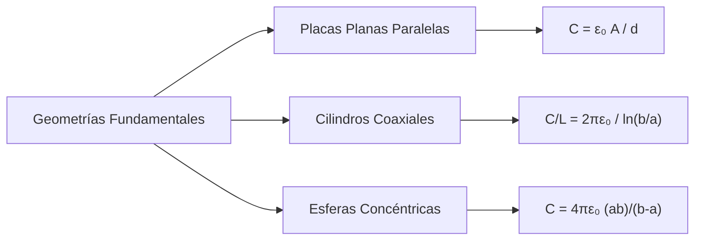
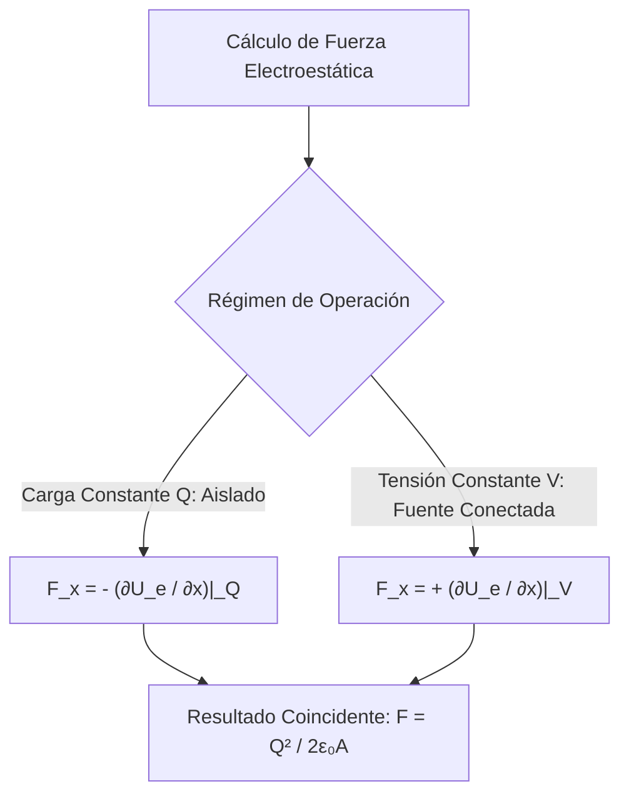

# Guía Exhaustiva de Estudio: Condensadores y Dieléctricos

---

## 1. Capacitancia y Configuraciones Fundamentales

### 1.1 Definición de Condensador y Capacidad Eléctrica ($C$)

Un **condensador** o **capacitor** es un dispositivo pasivo constituido por dos conductores de geometría arbitraria (denominados *armaduras* o *placas*) separados por el vacío o un medio dieléctrico. Cuando se transfieren portadores libres de un conductor al otro, las armaduras adquieren cargas de igual magnitud y signo opuesto ($+Q$ y $-Q$).

La **capacidad eléctrica** ($C$) mide la aptitud geométrica del sistema para confinar carga y almacenar energía electrostática por unidad de diferencia de potencial:

$$C = \frac{Q}{|\Delta V|} = \frac{Q}{V_+ - V_-}$$

* **Propiedad Intrínseca:** $C$ es un escalar estrictamente positivo que depende exclusivamente de la geometría del arreglo (área, forma, separación) y de las propiedades constitutivas del medio intermedio; es independiente de la carga instantánea $Q$ y de la tensión aplicada $\Delta V$.
* **Cálculo Sistemático de Capacitancia:**
  1. Suponer una carga arbitraria $\pm Q$ distribuida sobre los conductores.
  2. Determinar el campo eléctrico $\vec{E}$ entre las placas mediante la Ley de Gauss o integración directa de Coulomb.
  3. Evaluar la diferencia de potencial electrostático:
     $$\Delta V = -\int_{-}^{+} \vec{E} \cdot d\vec{\ell}$$
  4. Obtener $C$ mediante el cociente escalar $C = \frac{Q}{|\Delta V|}$.

---

### 1.2 Unidades en el Sistema Internacional (S.I.)

* **Unidad base (Faradio, $\text{F}$):**
  $$[C] = \frac{[Q]}{[\Delta V]} = \frac{\text{C}}{\text{V}} = \frac{\text{C}^2}{\text{J}} = \text{kg}^{-1} \cdot \text{m}^{-2} \cdot \text{s}^4 \cdot \text{A}^2$$
* **Escalas Prácticas:** El Faradio representa una unidad colosal para condensadores discretos en el vacío:
  * Microfaradio: $1\ \mu\text{F} = 10^{-6}\ \text{F}$
  * Nanofaradio: $1\ \text{nF} = 10^{-9}\ \text{F}$
  * Picofaradio: $1\ \text{pF} = 10^{-12}\ \text{F}$

---

### 1.3 Geometrías Clásicas de Condensadores al Vacío



#### A. Condensador Plano-Paralelo
Dos placas conductoras paralelas de área $A$, separadas por una distancia $d$, donde $d \ll \sqrt{A}$ (aproximación de placas infinitas para despreciar efectos de borde o líneas de dispersión periféricas):

1. **Campo Eléctrico Intermedio:** Superposición de campos inducidos por dos densidades $\sigma = \pm \frac{Q}{A}$:
   $$\vec{E} = \left(\frac{\sigma}{2\varepsilon_0} + \frac{\sigma}{2\varepsilon_0}\right) \hat{u}_n = \frac{\sigma}{\varepsilon_0}\hat{u}_n = \frac{Q}{\varepsilon_0 A}\hat{u}_n$$
2. **Diferencia de Potencial:**
   $$|\Delta V| = \int_0^d E\,dz = E d = \frac{Q d}{\varepsilon_0 A}$$
3. **Capacitancia:**
   $$C = \frac{\varepsilon_0 A}{d}$$

---

#### B. Condensador Cilíndrico Coaxial
Conductor cilíndrico interno de radio $a$ y cascarón coaxial externo de radio interno $b$, con longitud $L \gg b$ y densidad de carga lineal $\lambda = \frac{Q}{L}$:

1. **Campo por Ley de Gauss ($a < r < b$):**
   $$E(r) = \frac{\lambda}{2\pi\varepsilon_0 r} = \frac{Q}{2\pi\varepsilon_0 L r}$$
2. **Diferencia de Potencial:**
   $$|\Delta V| = \int_a^b E(r)\,dr = \frac{Q}{2\pi\varepsilon_0 L} \int_a^b \frac{dr}{r} = \frac{Q}{2\pi\varepsilon_0 L}\ln\left(\frac{b}{a}\right)$$
3. **Capacitancia Total y por Unidad de Longitud:**
   $$C = \frac{2\pi\varepsilon_0 L}{\ln(b/a)} \implies \frac{C}{L} = \frac{2\pi\varepsilon_0}{\ln(b/a)}$$

---

#### C. Condensador Esférico Concéntrico
Esfera conductora interna de radio $a$ con carga $+Q$ y cascarón concéntrico externo de radio interior $b$ con carga $-Q$:

1. **Campo Eléctrico Radial ($a < r < b$):**
   $$E(r) = \frac{Q}{4\pi\varepsilon_0 r^2}$$
2. **Diferencia de Potencial:**
   $$|\Delta V| = \int_a^b \frac{Q}{4\pi\varepsilon_0 r^2} dr = \frac{Q}{4\pi\varepsilon_0}\left(\frac{1}{a} - \frac{1}{b}\right) = \frac{Q}{4\pi\varepsilon_0}\left(\frac{b - a}{a b}\right)$$
3. **Capacitancia:**
   $$C = 4\pi\varepsilon_0 \left(\frac{a b}{b - a}\right)$$
* **Límite de Conductor Esférico Aislado ($b \to \infty$):**
  $$C_{\text{aislada}} = \lim_{b \to \infty} 4\pi\varepsilon_0 \left(\frac{a}{1 - a/b}\right) = 4\pi\varepsilon_0 a$$

| Geometría | Expresión Analítica de $C$ | Límite Asintótico Relevante |
| :--- | :--- | :--- |
| **Placas Paralelas** | $C = \frac{\varepsilon_0 A}{d}$ | Válido si $d/\sqrt{A} \to 0$ |
| **Cilíndrico Coaxial** | $C = \frac{2\pi\varepsilon_0 L}{\ln(b/a)}$ | Si $b \to a + \delta$ con $\delta \ll a$, $C \to \frac{\varepsilon_0 (2\pi a L)}{\delta}$ (plano) |
| **Esférico Concéntrico** | $C = 4\pi\varepsilon_0 \frac{ab}{b-a}$ | Si $b \to a + d$ con $d \ll a$, $C \to \frac{\varepsilon_0 (4\pi a^2)}{d}$ (plano) |
| **Esfera Aislada** | $C = 4\pi\varepsilon_0 R$ | Para la Tierra ($R \approx 6.37 \times 10^6\ \text{m}$), $C \approx 708\ \mu\text{F}$ |

---

## 2. Análisis de Circuitos con Condensadores

### 2.1 Métodos de Asociación Fundamental

#### A. Agrupamiento en Paralelo
Los condensadores comparten los mismos nodos de potencial; por tanto, la tensión es idéntica en cada elemento y la carga total suministrada por la fuente se bifurca aditivamente:

$$\Delta V = \Delta V_1 = \Delta V_2 = \dots = \Delta V_N$$

$$Q_{\text{total}} = \sum_{i=1}^{N} Q_i = C_1\Delta V + C_2\Delta V + \dots + C_N\Delta V = \left(\sum_{i=1}^{N} C_i\right) \Delta V$$

$$C_{\text{eq, paralelo}} = \sum_{i=1}^{N} C_i$$

---

#### B. Agrupamiento en Serie
La armadura negativa de un condensador se enlaza directamente a la armadura positiva del siguiente mediante un segmento conductor aislado. Por inducción electrostática y conservación de carga en la isla flotante, todas las unidades retienen la misma carga neta $Q$:

$$Q = Q_1 = Q_2 = \dots = Q_N$$

$$\Delta V_{\text{total}} = \sum_{i=1}^{N} \Delta V_i = \frac{Q}{C_1} + \frac{Q}{C_2} + \dots + \frac{Q}{C_N} = Q \sum_{i=1}^{N} \frac{1}{C_i}$$

$$\frac{1}{C_{\text{eq, serie}}} = \sum_{i=1}^{N} \frac{1}{C_i} \implies C_{\text{eq}} = \left( \sum_{i=1}^{N} \frac{1}{C_i} \right)^{-1}$$

* **Caso Particular de 2 Condensadores en Serie:**
  $$C_{\text{eq}} = \frac{C_1 C_2}{C_1 + C_2}$$

> [!WARNING]
> En agrupamientos en serie, la capacitancia equivalente $C_{\text{eq}}$ es **siempre menor** que la capacitancia más pequeña de la red ($C_{\text{eq}} < \min\{C_i\}$), mientras que en paralelo $C_{\text{eq}} > \max\{C_i\}$.

---

### 2.2 Métodos de Transformación Topológica: Red Estrella-Triángulo ($Y-\Delta$)

Cuando la topología de interconexión contiene celdas tipo puente (e.g., Puente de Wheatstone capacitivo desbalanceado) que impiden identificar conexiones estrictas en serie o paralelo, se recurre a la transformación bidireccional entre configuraciones en Triángulo ($\Delta$ o $\Pi$) y Estrella ($Y$ o $T$).

<div align="center">
  <svg width="420" height="180" viewBox="0 0 420 180" xmlns="http://www.w3.org/2000/svg">
    <!-- Configuración Triángulo (Delta) -->
    <g transform="translate(10, 10)">
      <circle cx="20" cy="140" r="4" fill="#0f172a"/><text x="10" y="155" font-size="11" font-family="sans-serif">A</text>
      <circle cx="160" cy="140" r="4" fill="#0f172a"/><text x="165" y="155" font-size="11" font-family="sans-serif">B</text>
      <circle cx="90" cy="20" r="4" fill="#0f172a"/><text x="90" y="12" font-size="11" text-anchor="middle" font-family="sans-serif">C</text>
      <!-- Ramas Delta -->
      <line x1="20" y1="140" x2="160" y2="140" stroke="#2563eb" stroke-width="2"/>
      <text x="90" y="155" fill="#2563eb" font-size="11" text-anchor="middle">C_c</text>
      <line x1="20" y1="140" x2="90" y2="20" stroke="#2563eb" stroke-width="2"/>
      <text x="40" y="75" fill="#2563eb" font-size="11">C_b</text>
      <line x1="160" y1="140" x2="90" y2="20" stroke="#2563eb" stroke-width="2"/>
      <text x="135" y="75" fill="#2563eb" font-size="11">C_a</text>
      <text x="90" y="90" fill="#334155" font-weight="bold" font-size="12" text-anchor="middle">Red Δ</text>
    </g>
    <!-- Flecha de Transformación -->
    <text x="210" y="95" font-size="20" text-anchor="middle" fill="#64748b">⇄</text>
    <!-- Configuración Estrella (Y) -->
    <g transform="translate(230, 10)">
      <circle cx="20" cy="140" r="4" fill="#0f172a"/><text x="10" y="155" font-size="11" font-family="sans-serif">A</text>
      <circle cx="160" cy="140" r="4" fill="#0f172a"/><text x="165" y="155" font-size="11" font-family="sans-serif">B</text>
      <circle cx="90" cy="20" r="4" fill="#0f172a"/><text x="90" y="12" font-size="11" text-anchor="middle" font-family="sans-serif">C</text>
      <circle cx="90" cy="95" r="4" fill="#dc2626"/><text x="105" y="100" fill="#dc2626" font-size="11" font-family="sans-serif">N</text>
      <!-- Ramas Estrella -->
      <line x1="20" y1="140" x2="90" y2="95" stroke="#dc2626" stroke-width="2"/>
      <text x="45" y="125" fill="#dc2626" font-size="11">C_A</text>
      <line x1="160" y1="140" x2="90" y2="95" stroke="#dc2626" stroke-width="2"/>
      <text x="135" y="125" fill="#dc2626" font-size="11">C_B</text>
      <line x1="90" y1="20" x2="90" y2="95" stroke="#dc2626" stroke-width="2"/>
      <text x="75" y="60" fill="#dc2626" font-size="11">C_C</text>
      <text x="90" y="170" fill="#334155" font-weight="bold" font-size="12" text-anchor="middle">Red Y</text>
    </g>
  </svg>
</div>

Para formular de forma compacta la transformación, se emplea la **elastancia** $S = \frac{1}{C}$ (expresada en Daraf, $\text{F}^{-1}$), dado que se comporta formalmente idéntica a la resistencia eléctrica en circuitos lineales:

* **Transformación Delta a Estrella ($\Delta \to Y$):**
  $$S_A = \frac{S_b S_c}{S_a + S_b + S_c}, \quad S_B = \frac{S_a S_c}{S_a + S_b + S_c}, \quad S_C = \frac{S_a S_b}{S_a + S_b + S_c}$$
  En términos directos de capacitancias:
  $$C_A = \frac{C_a C_b + C_b C_c + C_c C_a}{C_a}$$
  $$C_B = \frac{C_a C_b + C_b C_c + C_c C_a}{C_b}$$
  $$C_C = \frac{C_a C_b + C_b C_c + C_c C_a}{C_c}$$

* **Transformación Estrella a Delta ($Y \to \Delta$):**
  $$C_a = \frac{C_B C_C}{C_A + C_B + C_C}, \quad C_b = \frac{C_A C_C}{C_A + C_B + C_C}, \quad C_c = \frac{C_A C_B}{C_A + C_B + C_C}$$

```python
def delta_a_estrella(ca: float, cb: float, cc: float) -> tuple[float, float, float]:
    """Transforma capacitancias en configuracion Delta a Estrella."""
    numerador = ca * cb + cb * cc + cc * ca
    cA = numerador / ca
    cB = numerador / cb
    cC = numerador / cc
    return cA, cB, cC

def estrella_a_delta(cA: float, cB: float, cC: float) -> tuple[float, float, float]:
    """Transforma capacitancias en configuracion Estrella a Delta."""
    denominador = cA + cB + cC
    ca = (cB * cC) / denominador
    cb = (cA * cC) / denominador
    cc = (cA * cB) / denominador
    return ca, cb, cc
```

---

## 3. Energía y Fuerzas en Sistemas Electroestáticos

### 3.1 Energía Almacenada en un Condensador

El proceso de carga consiste en extraer diferencialmente incrementos de carga positiva $dq'$ desde la placa a menor potencial hacia la de mayor potencial. El trabajo externo acumulado es:

$$U_e = \int dW_{\text{ext}} = \int_0^Q V(q')\,dq' = \int_0^Q \frac{q'}{C}\,dq' = \frac{1}{2}\frac{Q^2}{C}$$

Empleando la relación constitutiva $Q = C\Delta V$:

$$U_e = \frac{1}{2}\frac{Q^2}{C} = \frac{1}{2} C (\Delta V)^2 = \frac{1}{2} Q \Delta V$$

---

### 3.2 Densidad Volumétrica de Energía Eléctrica ($u_e$)

Evaluando un condensador plano-paralelo ideal sin efectos de borde ($C = \frac{\varepsilon_0 A}{d}$ y $\Delta V = E d$):

$$U_e = \frac{1}{2} \left(\frac{\varepsilon_0 A}{d}\right) (E d)^2 = \frac{1}{2} \varepsilon_0 E^2 (A d)$$

Dado que el volumen del espacio confinado entre placas es $\text{Vol} = A d$, la **densidad volumétrica local** de energía $u_e$ resulta:

$$u_e = \frac{dU_e}{d\text{Vol}} = \frac{1}{2}\varepsilon_0 |\vec{E}|^2 \quad \left[\frac{\text{J}}{\text{m}^3}\right]$$

Esta relación posee validez universal en el vacío para cualquier campo electrostático arbitrario.

---

### 3.3 Fuerza Electroestática entre Armaduras

Para determinar la fuerza mecánica que una placa ejerce sobre la otra, se aplica el método de los desplazamientos virtuales evaluando la variación del trabajo mecánico $d W_{\text{mec}} = F_x dx$.



#### A. Condición de Carga Constante ($Q = \text{cte}$, Sistema Térmica y Eléctricamente Aislado)
Al no haber intercambio de carga con el exterior ($dW_{\text{fuente}} = 0$), el principio de conservación de la energía impone:

$$d W_{\text{mec}} + d U_e = 0 \implies F_x dx + d U_e = 0$$

$$F_x = -\left(\frac{\partial U_e}{\partial x}\right)_Q$$

Dado que $U_e = \frac{Q^2}{2 C(x)}$:

$$F_x = -\frac{Q^2}{2} \frac{\partial}{\partial x}\left(\frac{1}{C(x)}\right) = \frac{Q^2}{2 C^2}\frac{\partial C}{\partial x}$$

Para placas planas donde $C(x) = \frac{\varepsilon_0 A}{x}$:

$$\frac{\partial C}{\partial x} = -\frac{\varepsilon_0 A}{x^2} = -\frac{C}{x}$$

$$F_x = -\frac{Q^2}{2 \left(\frac{\varepsilon_0 A}{x}\right)^2} \left(\frac{\varepsilon_0 A}{x^2}\right) = -\frac{Q^2}{2\varepsilon_0 A}$$

El signo negativo denota una **fuerza estrictamente atractiva** que busca disminuir la separación $x$.

---

#### B. Condición de Tensión Constante ($\Delta V = \text{cte}$, Conectado Permanentemente a Fuente)
Si la separación varía mientras el capacitor sigue acoplado a la batería, la capacitancia cambia, forzando un flujo de carga diferencial $dQ = d(C V) = V dC$ provisto por la fuente. El trabajo entregado por la batería es:

$$d W_{\text{fuente}} = V\,dQ = V^2\,dC$$

El balance termodinámico del sistema es:

$$d W_{\text{fuente}} = d W_{\text{mec}} + d U_e \implies V^2 dC = F_x dx + d\left(\frac{1}{2} C V^2\right)$$

$$V^2 dC = F_x dx + \frac{1}{2} V^2 dC \implies F_x dx = \frac{1}{2} V^2 dC$$

$$F_x = +\left(\frac{\partial U_e}{\partial x}\right)_V = \frac{1}{2} V^2 \frac{\partial C}{\partial x}$$

Sustituyendo $\frac{\partial C}{\partial x} = -\frac{\varepsilon_0 A}{x^2}$:

$$F_x = -\frac{1}{2} V^2 \frac{\varepsilon_0 A}{x^2} = -\frac{1}{2}\varepsilon_0 \left(\frac{V}{x}\right)^2 A = -\frac{1}{2}\varepsilon_0 E^2 A$$

Sustituyendo $V = \frac{Q x}{\varepsilon_0 A}$, la fuerza recupera el valor idéntico:

$$|F_x| = \frac{Q^2}{2\varepsilon_0 A}$$

> [!WARNING]
> Un error conceptual recurrente es aplicar directamente $F = Q E_{\text{total}} = \frac{Q^2}{\varepsilon_0 A}$. El factor $\frac{1}{2}$ surge de que una placa no experimenta su propio campo eléctrico, sino únicamente el campo originado por la armadura opuesta: $E_{\text{placa opuesta}} = \frac{\sigma}{2\varepsilon_0} = \frac{Q}{2\varepsilon_0 A}$. Por ende: $F = Q \cdot E_{\text{placa opuesta}} = \frac{Q^2}{2\varepsilon_0 A}$.

---

## 4. Dieléctricos y Medios Materiales

### 4.1 Clasificación y Tipos de Dieléctricos

Los dieléctricos son materiales con alta resistividad eléctrica ($> 10^{10}\ \Omega\cdot\text{m}$) cuyos portadores de carga están confinados atómicamente y no pueden desplazarse libremente a nivel macroscópico:

* **Dieléctricos No Polares:**
  * Las moléculas presentan centros de carga positiva (núcleos) y negativa (nubes electrónicas) simétricamente superpuestos en ausencia de campo exterior. Momento dipolar intrínseco nulo ($\vec{p}_0 = \vec{0}$).
  * *Ejemplos:* $N_2$, $O_2$, $CO_2$, $CH_4$, gases nobles.
  * *Mecanismo:* La presencia de $\vec{E}_{\text{ext}}$ desplaza mecánicamente las nubes electrónicas en sentido opuesto a los núcleos, induciendo un momento dipolar elástico proporcional: $\vec{p}_{\text{ind}} = \alpha \vec{E}_{\text{local}}$ ($\alpha$: polarizabilidad electrónica).
* **Dieléctricos Polares:**
  * Las moléculas poseen una asimetría estructural de enlace permanente que genera un momento dipolar no nulo inherente ($\vec{p}_0 \ne \vec{0}$).
  * *Ejemplos:* $H_2O$ (geometría angular con ángulo de $104.5^\circ$), $HCl$, $NH_3$.
  * *Mecanismo:* Sin campo, las colisiones térmicas desorientan estocásticamente los dipolos ($\langle \vec{p} \rangle = \vec{0}$). Un campo externo $\vec{E}_{\text{ext}}$ induce un torque restaurador $\vec{\tau} = \vec{p}_0 \times \vec{E}_{\text{ext}}$ que vence parcialmente la agitación térmica y orienta progresivamente los dipolos (polarización por orientación).

---

### 4.2 Efecto en la Capacitancia y Rigidez Dieléctrica

Al intercalar un medio dieléctrico lineal, homogéneo e isótropo (LHI) rellenando por completo el espacio entre armaduras:

$$C = \kappa\,C_0 = \varepsilon_r\,C_0$$

* $\kappa = \varepsilon_r = \frac{\varepsilon}{\varepsilon_0} \ge 1$: **Constante dieléctrica** o permitividad relativa adimensional del medio.
* **Permitividad del medio ($\varepsilon$):** $\varepsilon = \kappa\,\varepsilon_0 = \varepsilon_r\,\varepsilon_0 \quad [\text{F/m}]$.

**Rigidez Dieléctrica ($E_{\text{rup}}$):**
Es el valor crítico de intensidad de campo eléctrico por encima del cual los electrones de valencia son arrancados de sus enlaces atómicos (ionización por impacto y efecto túnel), convirtiendo el dieléctrico en un plasma conductor mediante una chispa disruptiva catastrófica (*breakdown*).

| Sustancia | Constante Dieléctrica ($\kappa = \varepsilon_r$) | Rigidez Dieléctrica ($E_{\text{rup}}$ en $\text{kV/mm}$) |
| :--- | :--- | :--- |
| **Vacío** | $1.00000$ (exacto por definición) | $\infty$ (teórico) |
| **Aire seco ($1\ \text{atm}$)** | $1.00059$ | $3.0$ |
| **Teflón (PTFE)** | $2.1$ | $60.0$ |
| **Mylar (Poliéster)** | $3.1$ | $280.0$ |
| **Mica** | $5.4 - 7.0$ | $118.0$ |
| **Óxido de Titanio ($\text{TiO}_2$)**| $86 - 173$ | $4.0$ |
| **Agua pura ($20^\circ\text{C}$)** | $80.1$ | No aplicable (conducción iónica) |

---

### 4.3 Mecanismos de Polarización y Vector de Polarización ($\vec{P}$)

La polarización dieléctrica microscópica agrupa tres componentes:
1. **Electrónica ($\alpha_e$):** Deformación elástica de orbitales electrónicos ($\tau \sim 10^{-15}\ \text{s}$, responde hasta el rango ultravioleta).
2. **Iónica/Atómica ($\alpha_i$):** Desplazamiento relativo de cationes y aniones en redes cristalinas iónicas ($\tau \sim 10^{-13}\ \text{s}$, activa hasta el infrarrojo).
3. **Dipolar/Orientacional ($\alpha_o$):** Alineamiento macroscópico de dipolos permanentes bloqueado progresivamente por viscosidad térmica ($\tau \sim 10^{-9}\ \text{s}$, activa en microondas y radiofrecuencia). Se modela bajo la ley de Langevin-Debye: $\alpha_o = \frac{p_0^2}{3 k_B T}$.

El **Vector de Polarización** ($\vec{P}$) se define como la densidad volumétrica macroscópica de momentos dipolares eléctricos inducidos o alineados:

$$\vec{P} = \lim_{\Delta\mathcal{V} \to 0} \frac{1}{\Delta\mathcal{V}} \sum_{i \in \Delta\mathcal{V}} \vec{p}_i \quad \left[\frac{\text{C}}{\text{m}^2}\right]$$

---

### 4.4 Cargas Ligadas de Polarización Superficial y Volumétrica

El alineamiento de dipolos crea segregaciones locales de carga no compensadas en el interior y la superficie del material. Estas cargas permanecen ancladas atómicamente y se denominan **cargas ligadas** (*bound charges*):

<div align="center">
  <svg width="360" height="130" viewBox="0 0 360 130" xmlns="http://www.w3.org/2000/svg">
    <!-- Placa Conductora Positiva -->
    <rect x="20" y="15" width="20" height="100" fill="#ef4444" rx="2"/>
    <text x="30" y="65" fill="#ffffff" font-weight="bold" font-size="12" text-anchor="middle">+σ</text>
    <!-- Medio Dieléctrico -->
    <rect x="55" y="15" width="250" height="100" fill="#e2e8f0" stroke="#64748b" stroke-dasharray="2,2"/>
    <!-- Cargas Ligadas Superficie Izq -->
    <text x="70" y="35" fill="#1e3a8a" font-weight="bold" font-size="13">-σ_b</text>
    <text x="70" y="65" fill="#1e3a8a" font-weight="bold" font-size="13">-σ_b</text>
    <text x="70" y="95" fill="#1e3a8a" font-weight="bold" font-size="13">-σ_b</text>
    <!-- Vector Polarización -->
    <line x1="120" y1="65" x2="220" y2="65" stroke="#2563eb" stroke-width="3" marker-end="url(#arrowP)"/>
    <text x="170" y="55" fill="#2563eb" font-weight="bold" font-size="12" text-anchor="middle">Vector P ➔</text>
    <!-- Cargas Ligadas Superficie Der -->
    <text x="270" y="35" fill="#991b1b" font-weight="bold" font-size="13">+σ_b</text>
    <text x="270" y="65" fill="#991b1b" font-weight="bold" font-size="13">+σ_b</text>
    <text x="270" y="95" fill="#991b1b" font-weight="bold" font-size="13">+σ_b</text>
    <!-- Placa Conductora Negativa -->
    <rect x="320" y="15" width="20" height="100" fill="#1e40af" rx="2"/>
    <text x="330" y="65" fill="#ffffff" font-weight="bold" font-size="12" text-anchor="middle">-σ</text>
  </svg>
</div>

* **Densidad Volumétrica de Carga Ligada ($\rho_b$):**
  $$\rho_b = -\vec{\nabla} \cdot \vec{P}$$
  *Si la polarización es uniforme ($\vec{\nabla} \cdot \vec{P} = 0$), no surge carga ligada neta en el interior del material.*
* **Densidad Superficial de Carga Ligada ($\sigma_b$):**
  $$\sigma_b = \vec{P} \cdot \hat{n}$$
  Donde $\hat{n}$ es el vector unitario normal exterior a la superficie del dieléctrico.

---

### 4.5 Ley de Gauss Generalizada en Presencia de Dieléctricos

En medios polarizables coexisten **cargas libres** ($\rho_f$, controladas experimentalmente por fuentes o conductores) y **cargas ligadas** ($\rho_b$). La Ley de Gauss microscópica en el vacío es:

$$\vec{\nabla} \cdot \vec{E} = \frac{\rho_{\text{total}}}{\varepsilon_0} = \frac{\rho_f + \rho_b}{\varepsilon_0} = \frac{\rho_f - \vec{\nabla} \cdot \vec{P}}{\varepsilon_0}$$

Reagrupando términos dentro del operador diferencial:

$$\vec{\nabla} \cdot (\varepsilon_0 \vec{E} + \vec{P}) = \rho_f$$

Definiendo el **Vector Desplazamiento Eléctrico** ($\vec{D}$):

$$\vec{D} \equiv \varepsilon_0 \vec{E} + \vec{P} \quad \left[\frac{\text{C}}{\text{m}^2}\right]$$

Se obtiene la **Ley de Gauss Generalizada (Forma Diferencial)**:

$$\vec{\nabla} \cdot \vec{D} = \rho_f$$

**Forma Integral:**
Integrando sobre un volumen cerrado $\mathcal{V}$ acotado por $\partial\mathcal{V}$:

$$\oint_{\partial\mathcal{V}} \vec{D} \cdot d\vec{A} = Q_{f,\text{enc}} = \iiint_{\mathcal{V}} \rho_f \, dV$$

> [!TIP]
> El flujo del vector $\vec{D}$ depende **únicamente de las cargas libres** $Q_f$. Esto permite resolver analíticamente el problema electrostático en medios materiales desacoplándose de la complejidad de las cargas ligadas de polarización.

---

### 4.6 Vector Desplazamiento Eléctrico ($\vec{D}$), Susceptibilidad y Permitividad Relativa

Para medios dieléctricos **lineales, homogéneos e isótropos (LHI)**, el vector polarización responde linealmente al campo eléctrico neto macroscópico existente en el interior:

$$\vec{P} = \varepsilon_0 \chi_e \vec{E}$$

* $\chi_e$: **Susceptibilidad eléctrica** adimensional del medio ($\chi_e \ge 0$). Mide la reactividad o facilidad del material para polarizarse.

Sustituyendo $\vec{P}$ en la definición de $\vec{D}$:

$$\vec{D} = \varepsilon_0 \vec{E} + \varepsilon_0 \chi_e \vec{E} = \varepsilon_0 (1 + \chi_e)\vec{E}$$

Definiendo la **permitividad relativa** ($\kappa = \varepsilon_r$) y la **permitividad absoluta** ($\varepsilon$):

$$\varepsilon_r = 1 + \chi_e \implies \varepsilon = \varepsilon_0 \varepsilon_r = \varepsilon_0 (1 + \chi_e)$$

$$\vec{D} = \varepsilon \vec{E}$$

#### Reducción del Campo y Cargas Ligadas en Placas Paralelas:
* Campo eléctrico en el vacío: $E_0 = \frac{\sigma_f}{\varepsilon_0}$
* Campo interno con dieléctrico:
  $$E = \frac{E_0}{\kappa} = \frac{\sigma_f}{\kappa \varepsilon_0} = \frac{\sigma_f}{\varepsilon}$$
* Como $E = \frac{\sigma_f - \sigma_b}{\varepsilon_0}$, se deduce la relación directa para la carga ligada:
  $$\sigma_b = \sigma_f \left(1 - \frac{1}{\kappa}\right) = \sigma_f \left(\frac{\kappa - 1}{\kappa}\right) = \sigma_f \left(\frac{\chi_e}{1 + \chi_e}\right)$$

---

### 4.7 Balance de Energía y Densidad de Energía en Medios Dieléctricos

Para ensamblar una distribución de carga libre en presencia de un medio material, el trabajo elemental externo contra el potencial electrostático es:

$$\delta W = \iiint V(\vec{r})\,\delta\rho_f(\vec{r})\,dV = \iiint V\,\vec{\nabla}\cdot(\delta\vec{D})\,dV$$

Integrando por partes bajo la identidad $\vec{\nabla}\cdot(V\delta\vec{D}) = \vec{\nabla} V \cdot \delta\vec{D} + V\vec{\nabla}\cdot\delta\vec{D}$:

$$\delta W = \oint_{\text{frontera}} (V\delta\vec{D})\cdot d\vec{A} - \iiint (\vec{\nabla} V)\cdot\delta\vec{D}\,dV$$

La integral de superficie decae a cero en el infinito. Como $\vec{E} = -\vec{\nabla} V$:

$$\delta W = \iiint \vec{E} \cdot \delta\vec{D} \, dV$$

Para dieléctricos LHI donde $\vec{D} = \varepsilon\vec{E}$, $\vec{E}\cdot\delta\vec{D} = \varepsilon\vec{E}\cdot\delta\vec{E} = \frac{1}{2}\delta(\varepsilon |\vec{E}|^2) = \frac{1}{2}\delta(\vec{D}\cdot\vec{E})$:

$$U_e = \frac{1}{2} \iiint \vec{D} \cdot \vec{E} \, dV = \frac{1}{2} \iiint \varepsilon |\vec{E}|^2 dV$$

* **Densidad Volumétrica de Energía con Dieléctrico:**
  $$u_e = \frac{1}{2}\vec{D} \cdot \vec{E} = \frac{1}{2}\varepsilon |\vec{E}|^2 = \frac{1}{2}\kappa\varepsilon_0 |\vec{E}|^2 \quad \left[\frac{\text{J}}{\text{m}^3}\right]$$

#### Comparativa de Inserción de Dieléctrico: Sistema Aislado vs. Sistema Conectado a Fuente

| Parámetro Físico | Aislado de la Fuente ($Q = \text{cte}$) | Conectado a Batería ($\Delta V = \text{cte}$) |
| :--- | :--- | :--- |
| **Carga Libre ($Q$)** | Constante: $Q = Q_0$ | Aumenta: $Q = \kappa Q_0$ |
| **Capacitancia ($C$)** | Aumenta: $C = \kappa C_0$ | Aumenta: $C = \kappa C_0$ |
| **Diferencia Potencial ($\Delta V$)** | Disminuye: $\Delta V = \frac{V_0}{\kappa}$ | Constante: $\Delta V = V_0$ |
| **Campo Eléctrico ($E$)** | Disminuye: $E = \frac{E_0}{\kappa}$ | Constante: $E = E_0$ |
| **Desplazamiento Eléctrico ($D$)** | Constante: $D = D_0 = \sigma_f$ | Aumenta: $D = \kappa D_0 = \kappa \sigma_f$ |
| **Energía Almacenada ($U_e$)** | Disminuye: $U = \frac{U_0}{\kappa}$ | Aumenta: $U = \kappa U_0$ |
| **Balance Energético Externo** | El trabajo mecánico para insertar la placa es negativo (el dieléctrico es succionado espontáneamente): $\Delta U < 0$. | La batería suministra energía neta $\Delta W_{\text{bat}} = V\Delta Q = 2\Delta U$, transfiriendo mitad a energía electrostática y mitad a trabajo mecánico/calor. |