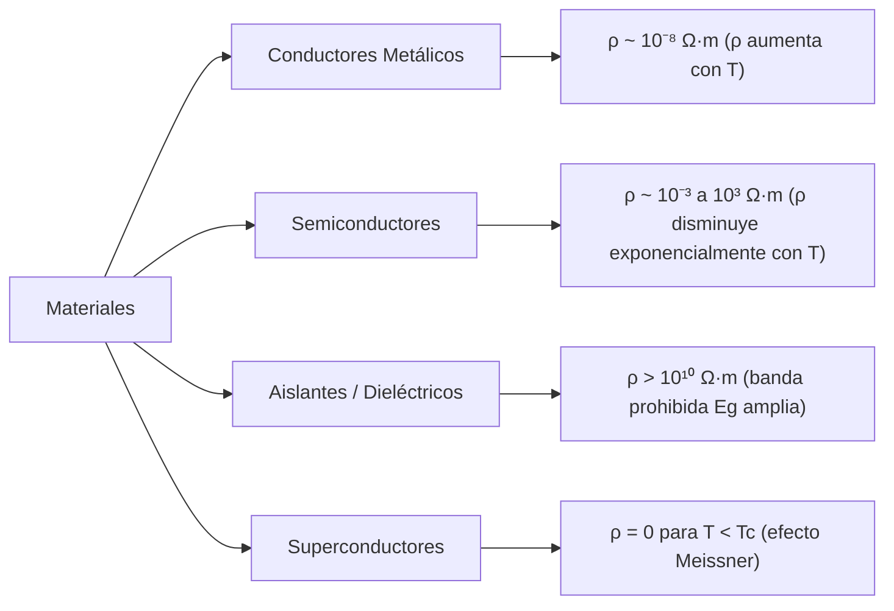
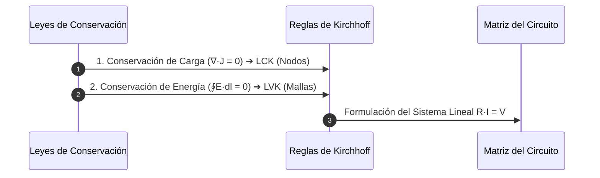

# Guía Exhaustiva de Estudio: Corriente Eléctrica

---

## 1. Fundamentos de la Conducción Eléctrica

### 1.1 Definición de Corriente Eléctrica e Intensidad Media e Instantánea ($I$)

La **corriente eléctrica** es el transporte ordenado y colectivo de portadores de carga eléctrica a través de una región del espacio o sección transversal de un medio conductor.

* **Intensidad de Corriente Media ($I_{\text{med}}$):** Cociente entre la carga neta $\Delta Q$ que atraviesa una sección transversal de referencia y el intervalo finito de tiempo transcurrido $\Delta t$:
  $$I_{\text{med}} = \frac{\Delta Q}{\Delta t}$$

* **Intensidad de Corriente Instantánea ($I$):** Límite infinitesimal cuando el intervalo de tiempo tiende a cero:
  $$I(t) = \lim_{\Delta t \to 0} \frac{\Delta Q}{\Delta t} = \frac{dQ}{dt}$$

* **Convención de Signos de Franklin:** La dirección asignada al sentido técnico de la corriente coincide con la trayectoria de avance de portadores de carga **positiva**. En conductores metálicos estándar, los portadores reales son electrones de valencia ($q = -e$), por lo que su flujo físico de desplazamiento neto es opuesto al sentido convencional de $I$.

---

### 1.2 Unidades en el Sistema Internacional (S.I.)

* **Unidad base fundamental:** **Amperio** ($\text{A}$), redefinido en el SI (2019) fijando el valor numérico exacto de la carga elemental $e = 1.602176634 \times 10^{-19}\ \text{C}$:
  $$1\ \text{A} = 1\ \frac{\text{C}}{\text{s}} = \frac{1}{1.602176634 \times 10^{-19}}\ \text{electrones/s} \approx 6.2415 \times 10^{18}\ \text{electrones/s}$$

---

### 1.3 Tipos y Regímenes de Corriente Eléctrica

| Régimen | Notación Matemática | Características Operativas | Casos Típicos |
| :--- | :--- | :--- | :--- |
| **Corriente Continua / Estacionaria (DC)** | $I(t) = I_0 = \text{cte}$ | Magnitud y polaridad invariantes en el tiempo. $\frac{dI}{dt} = 0$. | Pilas químicas, baterías Li-Ion, celdas fotovoltaicas. |
| **Corriente Alterna Senoidal (AC)** | $I(t) = I_0 \sin(\omega t + \phi)$ | Magnitud y dirección periódicamente alternadas. Valor medio nulo: $\langle I \rangle = 0$. | Redes de distribución eléctrica industrial y residencial. |
| **Corriente Pulsante / Rectificada** | $I(t) \ge 0$, periódico | Dirección unidireccional con amplitud variante en el tiempo. | Salida de rectificadores de diodos sin filtro capacitivo. |
| **Corriente Transitoria** | $I(t) = I_0 e^{-t/\tau}$ | Fenómenos de relajación temporal hacia un nuevo estado estacionario. | Conmutación de circuitos $RC$, $RL$, $RLC$. |

---

### 1.4 Vector Densidad de Corriente ($\vec{J}$) y Velocidad de Arrastre (Deriva)

#### A. Vector Densidad de Corriente ($\vec{J}$)
Magnitud vectorial local que cuantifica el flujo de corriente eléctrica por unidad de área normal:

$$I = \iint_S \vec{J} \cdot d\vec{A}$$

* Si la distribución de corriente es homogénea y ortogonal sobre un área plana transversal $A$:
  $$J = \frac{I}{A} \quad \left[\frac{\text{A}}{\text{m}^2}\right]$$

---

#### B. Modelo de Microconducción de Drude y Velocidad de Deriva ($\vec{v}_d$)
En un metal, los electrones experimentan un movimiento térmico caótico con velocidades de Fermi elevadas ($v_{\text{th}} \sim 10^6\ \text{m/s}$), pero con desplazamiento neto nulo ($\langle \vec{v}_{\text{th}} \rangle = \vec{0}$). 

Al aplicar un campo eléctrico macroscópico $\vec{E}$, se superpone una velocidad de arrastre promedio lenta $\vec{v}_d$ orientada en contra del campo:

<div align="center">
  <svg width="380" height="130" viewBox="0 0 380 130" xmlns="http://www.w3.org/2000/svg">
    <!-- Cilindro Conductor -->
    <rect x="50" y="30" width="260" height="70" fill="#f8fafc" stroke="#334155" stroke-width="2"/>
    <ellipse cx="50" cy="65" rx="15" ry="35" fill="#e2e8f0" stroke="#334155" stroke-width="2"/>
    <ellipse cx="310" cy="65" rx="15" ry="35" fill="#cbd5e1" stroke="#334155" stroke-width="2"/>
    <!-- Campo Eléctrico E -->
    <line x1="80" y1="15" x2="280" y2="15" stroke="#2563eb" stroke-width="2.5" marker-end="url(#arrowE)"/>
    <text x="180" y="10" fill="#2563eb" font-size="11" font-weight="bold" text-anchor="middle">Campo Eléctrico E ➔</text>
    <!-- Vector Densidad J -->
    <line x1="80" y1="115" x2="280" y2="115" stroke="#16a34a" stroke-width="2.5" marker-end="url(#arrowJ)"/>
    <text x="180" y="125" fill="#16a34a" font-size="11" font-weight="bold" text-anchor="middle">Densidad de Corriente J ➔</text>
    <!-- Electrones y Velocidad de Arrastre -->
    <circle cx="150" cy="55" r="7" fill="#ef4444"/>
    <text x="150" y="59" fill="#ffffff" font-size="10" text-anchor="middle">-</text>
    <line x1="140" y1="55" x2="105" y2="55" stroke="#ef4444" stroke-width="2"/>
    <text x="120" y="48" fill="#ef4444" font-size="10" font-family="sans-serif">v_d</text>
    <circle cx="230" cy="75" r="7" fill="#ef4444"/>
    <text x="230" y="79" fill="#ffffff" font-size="10" text-anchor="middle">-</text>
    <line x1="220" y1="75" x2="185" y2="75" stroke="#ef4444" stroke-width="2"/>
    <text x="200" y="68" fill="#ef4444" font-size="10" font-family="sans-serif">v_d</text>
  </svg>
</div>

Considere un elemento de volumen diferencial $dV = A\,dx = A (v_d\,dt)$ que encierra $n$ portadores libres por unidad de volumen, cada uno con carga $q$:

$$dQ = q \cdot (n\,dV) = q n A v_d\,dt$$

$$I = \frac{dQ}{dt} = n q v_d A \implies \vec{J} = n q \vec{v}_d$$

Para electrones libres en metales ($q = -e$):
$$\vec{J} = -n e \vec{v}_d \implies \vec{v}_d \text{ es antiparalela a } \vec{J} \text{ y } \vec{E}$$

> [!TIP]
> **Magnitud típica:** Para un alambre de cobre ($n \approx 8.5 \times 10^{28}\ \text{electrones/m}^3$) de calibre común conduciendo $10\ \text{A}$, la velocidad de deriva es de apenas $v_d \sim 10^{-4}\ \text{m/s}$ ($\sim 0.1\ \text{mm/s}$). La propagación casi instantánea de la señal energética ocurre porque la perturbación del campo electromagnético viaja por la línea a una velocidad cercana a la luz en el dieléctrico circundante ($v \sim \frac{c}{\sqrt{\kappa}} \sim 2 \times 10^8\ \text{m/s}$).

---

### 1.5 Ecuación de Continuidad y Principio de Conservación de la Carga

La carga eléctrica total es una magnitud invariante de Lorentz y estrictamente conservada. Para un volumen arbitrario $\mathcal{V}$ acotado por una superficie cerrada orientada hacia afuera $\partial\mathcal{V}$:

El flujo saliente del vector densidad de corriente debe ser exactamente igual a la tasa de decremento temporal de la carga libre neta encerrada $Q_{\text{enc}}$:

$$\oint_{\partial\mathcal{V}} \vec{J} \cdot d\vec{A} = -\frac{dQ_{\text{enc}}}{dt} = -\frac{d}{dt}\iiint_{\mathcal{V}} \rho\,dV = -\iiint_{\mathcal{V}} \frac{\partial \rho}{\partial t}\,dV$$

Aplicando el Teorema de Gauss-Ostrogradsky a la integral de superficie:

$$\iiint_{\mathcal{V}} (\vec{\nabla} \cdot \vec{J})\,dV = -\iiint_{\mathcal{V}} \frac{\partial \rho}{\partial t}\,dV$$

Dado que el volumen $\mathcal{V}$ es estrictamente arbitrario, se deduce la **Ecuación de Continuidad (Forma Diferencial)**:

$$\vec{\nabla} \cdot \vec{J} + \frac{\partial \rho}{\partial t} = 0$$

* **Régimen Estacionario / Continuo (DC):** No existe acumulación volumétrica neta de carga en ningún punto con el paso del tiempo ($\frac{\partial \rho}{\partial t} = 0$):
  $$\vec{\nabla} \cdot \vec{J} = 0 \iff \oint_{\partial\mathcal{V}} \vec{J} \cdot d\vec{A} = 0$$
  El flujo neto a través de cualquier superficie cerrada es nulo. Éste es el fundamento matemático de la Ley de Nodos de Kirchhoff.

---

## 2. Propiedades Resistivas y Ley de Ohm

### 2.1 Formulación Microscópica de la Ley de Ohm

En el modelo clásico de conducción de Drude, los electrones acelerados por la fuerza electrostática $\vec{F} = -e\vec{E}$ experimentan colisiones inelásticas sucesivas con los iones de la red cristalina a un ritmo caracterizado por un **tiempo medio entre colisiones** (tiempo de relajación, $\tau$):

$$m_e \frac{d\vec{v}_d}{dt} = -e\vec{E} - \frac{m_e \vec{v}_d}{\tau} = \vec{0} \implies \vec{v}_d = -\frac{e\tau}{m_e}\vec{E}$$

Sustituyendo $\vec{v}_d$ en la densidad de corriente $\vec{J} = -n e \vec{v}_d$:

$$\vec{J} = \left(\frac{n e^2 \tau}{m_e}\right)\vec{E}$$

Definiendo la **conductividad eléctrica** ($\sigma$):

$$\vec{J} = \sigma \vec{E}$$

Esta ecuación constituye la **forma microscópica (local) de la Ley de Ohm**.

---

### 2.2 Conceptos de Conductividad ($\sigma$) y Resistividad Eléctrica ($\rho$)

* **Conductividad ($\sigma$):** Facilidad intrínseca que presenta un medio material al paso de los portadores de carga:
  $$\sigma = \frac{n e^2 \tau}{m_e} \quad \left[\Omega^{-1}\cdot\text{m}^{-1}\text{ ó }\text{S/m}\right]$$

* **Resistividad ($\rho$):** Oposición constitutiva intrínseca que exhibe el medio al paso de corriente eléctrica:
  $$\rho = \frac{1}{\sigma} = \frac{m_e}{n e^2 \tau} \quad [\Omega\cdot\text{m}]$$



---

### 2.3 Efecto Térmico en Materiales: Variación con la Temperatura

#### A. Metales y Conductores Óhmicos
Al elevar la temperatura, los fonones (vibraciones reticulares térmicas) incrementan la sección eficaz de colisión de los iones de la red, disminuyendo el tiempo medio libre entre choques $\tau$. En rangos de temperatura moderados ($\Delta T < 100^\circ\text{C}$), la resistividad varía de forma lineal:

$$\rho(T) = \rho_0 \left[1 + \alpha (T - T_0)\right]$$

* $\rho_0$: Resistividad a la temperatura de referencia $T_0$ (típicamente $20^\circ\text{C} = 293.15\ \text{K}$).
* $\alpha$: **Coeficiente térmico de resistividad** $[\text{K}^{-1}\text{ ó }^\circ\text{C}^{-1}]$. Para conductores metálicos, $\alpha > 0$.

#### B. Semiconductores Intrínsecos (Silicio, Germanio)
El factor dominante no es el tiempo $\tau$, sino la excitación térmica de portadores a través de la banda prohibida (*bandgap* $E_g$). La densidad $n(T)$ se eleva exponencialmente:

$$\rho(T) = A e^{E_g / (2 k_B T)} \implies \alpha < 0$$
La resistividad decae fuertemente al incrementar la temperatura (coeficiente térmico negativo, NTC).

---

### 2.4 Formulación Macroscópica de la Ley de Ohm ($V = IR$)

Considere un conductor cilíndrico de longitud $L$ y sección transversal uniforme $A$, bajo una diferencia de potencial $\Delta V = V_a - V_b$:

$$E = \frac{\Delta V}{L}, \quad J = \frac{I}{A}$$

Sustituyendo en la ley microscópica $J = \frac{E}{\rho}$:

$$\frac{I}{A} = \frac{1}{\rho}\left(\frac{\Delta V}{L}\right) \implies \Delta V = I \left(\frac{\rho L}{A}\right)$$

Definiendo la **resistencia eléctrica** ($R$):

$$\Delta V = I R$$

* **Límite de Validez:** La relación es estrictamente válida para **materiales óhmicos** donde $\rho$ es independiente de la magnitud del campo eléctrico aplicado $|\vec{E}|$. Componentes como diodos semiconductores, tiristores, varistores y tubos de descarga de gas son **no óhmicos** y exhiben curvas $I-V$ no lineales.

---

### 2.5 Resistencia Eléctrica: Geometría, Materiales y Unidades

* **Resistencia en geometría uniforme:**
  $$R = \rho \frac{L}{A} \quad [\Omega\ (\text{Ohmio})]$$
* **Unidad en el S.I. (Ohmio, $\Omega$):**
  $$1\ \Omega = \frac{1\ \text{V}}{1\ \text{A}} = \text{kg} \cdot \text{m}^2 \cdot \text{s}^{-3} \cdot \text{A}^{-2}$$

* **Cálculo General para Geometrías No Uniformes:**
  Integrando secciones diferenciales normales al flujo de las líneas de corriente:
  $$R = \int \rho \frac{d\ell}{A(\ell)}$$

* **Ejemplo: Resistencia de un Cascarón Esférico:**
  Radio interior $a$, exterior $b$, material con resistividad $\rho$, flujo de corriente puramente radial:
  $$dR = \rho \frac{dr}{4\pi r^2} \implies R = \frac{\rho}{4\pi}\int_a^b \frac{dr}{r^2} = \frac{\rho}{4\pi}\left(\frac{1}{a} - \frac{1}{b}\right)$$

---

## 3. Fuentes, Potencia y Leyes de Circuitos

### 3.1 Fuerza Electromotriz (fem, $\mathcal{E}$)

Un campo electrostático puro $\vec{E}_c$ es conservativo ($\oint \vec{E}_c \cdot d\vec{\ell} = 0$) y no puede mantener una corriente circulante continua en un lazo cerrado. Se requiere un elemento activo provisto de un campo de origen no electrostático $\vec{E}_{\text{ne}}$ (químico, magnético o fotovoltaico) que impulse las cargas positivas contra el gradiente electrostático:

$$\mathcal{E} = \oint (\vec{E}_c + \vec{E}_{\text{ne}}) \cdot d\vec{\ell} = \oint \vec{E}_{\text{ne}} \cdot d\vec{\ell} = \frac{W_{\text{ne}}}{q} \quad [\text{V}]$$

* **Fuentes Reales con Resistencia Interna ($r$):**
  La tensión entre bornes $V_{ab}$ de una fuente real que entrega una corriente $I$ disminuye por la caída óhmica en sus electrolitos y contactos:
  $$V_{ab} = \mathcal{E} - I r$$
  Si la fuente es forzada a cargarse inyectándole corriente en terminal positivo ($I$ invertida):
  $$V_{ab} = \mathcal{E} + I r$$

---

### 3.2 Potencia Eléctrica en Elementos Activos y Pasivos

La tasa instantánea a la que se transforma o transfiere energía electromagnética en un bipolo con tensión en bornes $V$ e intensidad $I$ es:

$$P = \frac{dW}{dt} = \frac{V dq}{dt} = V I \quad [\text{W (Vatio)}]$$

* **Elemento Pasivo (Consumidor):** La corriente entra por la terminal a mayor potencial. Absorbe potencia del circuito: $P_{\text{absorbida}} = V I > 0$.
* **Elemento Activo (Generador/Fuente):** La corriente sale por la terminal a mayor potencial. Entrega potencia a la red: $P_{\text{entregada}} = \mathcal{E} I - I^2 r$.

---

### 3.3 Ley de Joule y Disipación Térmica

En un resistor óhmico ideal ($V = IR$), toda la energía eléctrica transferida por colisiones atómicas de los portadores se degrada irreversiblemente en energía térmica (calor):

$$P = V I = I^2 R = \frac{V^2}{R} \quad [\text{W}]$$

* **Formulación Microscópica de la Ley de Joule:**
  $$p = \frac{dP}{dV} = \vec{J} \cdot \vec{E} = \sigma |\vec{E}|^2 = \rho |\vec{J}|^2 \quad \left[\frac{\text{W}}{\text{m}^3}\right]$$

---

### 3.4 Reglas de Kirchhoff

Constituyen la adaptación directa de las ecuaciones de Maxwell al análisis de circuitos de parámetros concentrados:



#### A. Primera Regla: Ley de Nodos o Corrientes (LCK)
Consecuencia unívoca de la conservación de la carga en régimen estacionario ($\vec{\nabla}\cdot\vec{J} = 0$): la suma algebraica de corrientes que inciden en cualquier nodo de la red es idénticamente nula:

$$\sum_{k=1}^M I_k = 0 \iff \sum I_{\text{entrantes}} = \sum I_{\text{salientes}}$$

#### B. Segunda Regla: Ley de Mallas o Tensiones (LVK)
Consecuencia del carácter conservativo del campo electrostático ($\oint \vec{E}\cdot d\vec{\ell} = 0$): la suma algebraica de las diferencias de potencial electrostático y fuerzas electromotrices evaluadas a lo largo de cualquier lazo cerrado (malla) es nula:

$$\sum_{k=1}^N \Delta V_k = 0 \iff \sum \mathcal{E}_k = \sum I_j R_j$$

* **Convención de Signos al Recorrer la Malla:**
  * Al atravesar una fuente de $-$ a $+$: $+\mathcal{E}$. De $+$ a $-$: $-\mathcal{E}$.
  * Al atravesar un resistor en el mismo sentido de la corriente de malla: $-IR$. En contrasentido: $+IR$.

---

## 4. Topologías de Circuitos y Métodos de Análisis en DC

### 4.1 Asociación de Resistores y Transformaciones Topológicas

* **Resistores en Serie:** Corriente idéntica $I$, caída de tensión aditiva:
  $$R_{\text{eq, serie}} = \sum_{i=1}^N R_i$$

* **Resistores en Paralelo:** Tensión compartida $V$, bifurcación aditiva de corriente:
  $$\frac{1}{R_{\text{eq, paralelo}}} = \sum_{i=1}^N \frac{1}{R_i} \implies R_{\text{eq}} = \frac{R_1 R_2}{R_1 + R_2} \text{ (para dos ramas)}$$

* **Transformación Estrella-Triángulo ($Y-\Delta$):**
  A diferencia de las redes capacitivas, los resistores se transforman directamente en el dominio del valor resistivo:

$$\Delta \to Y: \quad R_1 = \frac{R_b R_c}{R_a + R_b + R_c}, \quad R_2 = \frac{R_a R_c}{R_a + R_b + R_c}, \quad R_3 = \frac{R_a R_b}{R_a + R_b + R_c}$$

$$Y \to \Delta: \quad R_a = \frac{R_1 R_2 + R_2 R_3 + R_3 R_1}{R_1}, \quad R_b = \frac{R_{\Sigma}}{R_2}, \quad R_c = \frac{R_{\Sigma}}{R_3}$$

---

### 4.2 Métodos de Medición: Circuito en Puente de Wheatstone

Red de cuatro ramas resistivas utilizada para medir resistencias desconocidas con alta precisión por deflexión nula.

<div align="center">
  <svg width="260" height="200" viewBox="0 0 260 200" xmlns="http://www.w3.org/2000/svg">
    <!-- Nodos -->
    <circle cx="130" cy="20" r="4" fill="#0f172a"/><text x="130" y="12" font-size="11" text-anchor="middle">A</text>
    <circle cx="50" cy="100" r="4" fill="#0f172a"/><text x="35" y="105" font-size="11">C</text>
    <circle cx="210" cy="100" r="4" fill="#0f172a"/><text x="220" y="105" font-size="11">D</text>
    <circle cx="130" cy="180" r="4" fill="#0f172a"/><text x="130" y="195" font-size="11" text-anchor="middle">B</text>
    <!-- Ramas Resistivas -->
    <line x1="130" y1="20" x2="50" y2="100" stroke="#334155" stroke-width="2"/>
    <text x="80" y="50" fill="#2563eb" font-size="11">R_1</text>
    <line x1="130" y1="20" x2="210" y2="100" stroke="#334155" stroke-width="2"/>
    <text x="175" y="50" fill="#2563eb" font-size="11">R_2</text>
    <line x1="50" y1="100" x2="130" y2="180" stroke="#334155" stroke-width="2"/>
    <text x="75" y="155" fill="#2563eb" font-size="11">R_3</text>
    <line x1="210" y1="100" x2="130" y2="180" stroke="#334155" stroke-width="2"/>
    <text x="175" y="155" fill="#ef4444" font-size="11">R_x</text>
    <!-- Galvanómetro de Detección Central -->
    <line x1="50" y1="100" x2="210" y2="100" stroke="#059669" stroke-width="2" stroke-dasharray="3,3"/>
    <circle cx="130" cy="100" r="14" fill="#ecfdf5" stroke="#059669" stroke-width="1.5"/>
    <text x="130" y="104" fill="#059669" font-size="10" font-weight="bold" text-anchor="middle">G</text>
  </svg>
</div>

* **Condición de Equilibrio (Balance):** Corriente del galvanómetro nula ($I_G = 0 \implies V_C = V_D$):
  $$I_1 R_1 = I_2 R_2 \quad \text{y} \quad I_1 R_3 = I_2 R_x$$
  Dividiendo término a término:
  $$\frac{R_1}{R_3} = \frac{R_2}{R_x} \implies R_x = R_2 \left(\frac{R_3}{R_1}\right)$$
  La medición es independiente de la tensión de alimentación de la fuente y de la calibración interna del medidor.

---

### 4.3 Instrumentos de Medición Eléctrica

El núcleo operativo electromecánico clásico es el **galvanómetro de d'Arsonval (bobina móvil)**, caracterizado por una resistencia interna de bobinado $R_g$ y una corriente de deflexión a escala completa $I_{\text{fs}}$ (*full-scale*).

#### A. Amperímetro (Medición en Serie)
Para medir intensidades $I \gg I_{\text{fs}}$ sin destruir la bobina, se intercala un resistor en paralelo denominado **Shunt** ($R_{\text{sh}}$):

$$I_{\text{sh}} = I - I_{\text{fs}}$$

$$V_{\text{sh}} = V_g \implies (I - I_{\text{fs}}) R_{\text{sh}} = I_{\text{fs}} R_g$$

$$R_{\text{sh}} = \frac{I_{\text{fs}} R_g}{I - I_{\text{fs}}} = \frac{R_g}{m - 1}, \quad \text{con } m = \frac{I}{I_{\text{fs}}} \text{ (factor multiplicador)}$$

* **Resistencia Interna Total del Amperímetro:**
  $$R_A = \frac{R_g R_{\text{sh}}}{R_g + R_{\text{sh}}} \to 0 \quad (\text{Amperímetro ideal: } R_A = 0)$$

---

#### B. Voltímetro (Medición en Paralelo)
Para medir tensiones elevadas $V \gg I_{\text{fs}} R_g$, se acopla un resistor en serie denominado **Multiplicador** ($R_s$):

$$V = I_{\text{fs}}(R_g + R_s)$$

$$R_s = \frac{V}{I_{\text{fs}}} - R_g = R_g (n - 1), \quad \text{con } n = \frac{V}{V_{\text{fs}}}$$

* **Resistencia Interna Total del Voltímetro:**
  $$R_V = R_g + R_s \to \infty \quad (\text{Voltímetro ideal: } R_V = \infty)$$

---

### 4.4 Análisis Sistemático de Redes: Método Matricial de Corrientes de Malla

Para una red plana con $M$ mallas independientes sin fuentes de corriente no ideales acopladas, la formulación matricial compacta es:

$$\mathbf{R} \mathbf{I}_{\text{malla}} = \mathbf{V}_{\text{fuentes}}$$

$$\begin{bmatrix} 
R_{11} & R_{12} & \dots & R_{1M} \\
R_{21} & R_{22} & \dots & R_{2M} \\
\vdots & \vdots & \ddots & \vdots \\
R_{M1} & R_{M2} & \dots & R_{MM}
\end{bmatrix}
\begin{bmatrix} 
I_1 \\ I_2 \\ \vdots \\ I_M 
\end{bmatrix}
=
\begin{bmatrix} 
\mathcal{E}_1 \\ \mathcal{E}_2 \\ \vdots \\ \mathcal{E}_M 
\end{bmatrix}$$

* **Términos de la diagonal principal ($R_{kk}$):** Suma directa de todas las resistencias que componen la malla $k$ (autoresistencia de malla, estrictamente positiva).
* **Términos cruzados fuera de la diagonal ($R_{kj} = R_{jk}$):** Negativo de la suma de resistencias compartidas exclusivamente entre las mallas $k$ y $j$ si las corrientes de malla circulan en igual sentido por la rama común (típicamente negativo bajo convención horaria uniforme).
* **Vector $\mathbf{V}_{\text{fuentes}}$ ($\mathcal{E}_k$):** Suma algebraica de las fuerzas electromotrices en la malla $k$ (positiva si la corriente de malla emerge por el terminal positivo de la fuente).

---

### 4.5 Normas de Seguridad Eléctrica y Efectos Fisiológicos de la Corriente

El factor crítico que determina la severidad de un choque eléctrico no es el potencial aplicado ($V$), sino la **magnitud, duración y trayectoria anatómica de la corriente** ($I$) que atraviesa el cuerpo humano.

* **Impedancia del cuerpo humano:** Oscila entre $1000\ \Omega$ (piel húmeda, alta superficie de contacto) y $100\,000\ \Omega$ (piel seca e intacta).

| Umbral de Intensidad ($60\ \text{Hz}\ \text{AC}$) | Efecto Biológico / Cuadro Fisiopatológico |
| :--- | :--- |
| **$0.5 - 1.0\ \text{mA}$** | Umbral de percepción sensorial (cosquilleo en dermis). |
| **$5\ \text{mA}$** | Corriente máxima inofensiva aceptable (disparo de dispositivos GFCI/RCD). |
| **$10 - 20\ \text{mA}$** | **Umbral de agarrotamiento motor (*let-go threshold*):** Contracción tetánica involuntaria de flexores. Imposibilidad de soltar el conductor. |
| **$20 - 50\ \text{mA}$** | Tetanización muscular torácica y asfixia respiratoria por parálisis diafragmática. |
| **$50 - 100\ \text{mA}$** | **Fibrilación ventricular:** Descoordinación eléctrica miocárdica fatal en $< 2\ \text{segundos}$ si no se aplica desfibrilación inmediata. |
| **$> 1\ \text{A}$** | Paro cardíaco absoluto sostenido, carbonización tisular profunda y destrucción celular por efecto Joule severo. |

---

## 5. Régimen Transitorio en Circuitos de Corriente Continua

### 5.1 Circuito $R-C$ Serie: Proceso de Carga de un Condensador

Considere una fuente continua ideal $\mathcal{E}$, un resistor $R$ y un condensador inicialmente descargado ($q(0) = 0$), enlazados en serie mediante un interruptor cerrado en $t = 0$.

Aplicando la Segunda Regla de Kirchhoff (LVK) para $t \ge 0$:

$$\mathcal{E} - v_R(t) - v_C(t) = 0 \implies \mathcal{E} - R I(t) - \frac{q(t)}{C} = 0$$

Como $I(t) = \frac{dq}{dt}$:

$$R \frac{dq}{dt} + \frac{1}{C} q(t) = \mathcal{E} \implies \frac{dq}{dt} + \frac{q}{RC} = \frac{\mathcal{E}}{R}$$

Ecuación diferencial ordinaria lineal de primer orden no homogénea. Resolviendo con condición de contorno $q(0) = 0$:

$$q(t) = C\mathcal{E}\left(1 - e^{-t / (RC)}\right) = Q_{\text{máx}}\left(1 - e^{-t / \tau}\right)$$

* **Tensión en bornes del condensador:**
  $$v_C(t) = \frac{q(t)}{C} = \mathcal{E}\left(1 - e^{-t / \tau}\right)$$
* **Corriente transitoria de carga:**
  $$I(t) = \frac{dq}{dt} = \frac{\mathcal{E}}{R} e^{-t / \tau} = I_0 e^{-t / \tau}$$
* **Tensión en el resistor:**
  $$v_R(t) = R I(t) = \mathcal{E} e^{-t / \tau}$$

---

### 5.2 Circuito $R-C$ Serie: Proceso de Descarga de un Condensador

Condensador cargado a una tensión inicial $V_0$ ($Q_0 = C V_0$), que se desconecta de la fuente y se cierra sobre un resistor $R$ en $t = 0$:

$$-R I(t) - \frac{q(t)}{C} = 0 \implies R \frac{dq}{dt} + \frac{q}{C} = 0$$

Resolviendo bajo la condición $q(0) = Q_0$:

$$q(t) = Q_0 e^{-t / \tau}$$

$$v_C(t) = V_0 e^{-t / \tau}$$

$$I(t) = -\frac{dq}{dt} = \frac{V_0}{R} e^{-t / \tau} = I_0 e^{-t / \tau}$$

---

### 5.3 Constante de Tiempo Capacitiva ($\tau = RC$)

El producto $\tau = RC$ posee dimensiones rigurosas de tiempo:

$$[\tau] = [\Omega] \cdot [\text{F}] = \left(\frac{\text{V}}{\text{A}}\right)\left(\frac{\text{C}}{\text{V}}\right) = \frac{\text{C}}{\text{A}} = \frac{\text{C}}{\text{C/s}} = \text{s}$$

* **Interpretación Dinámica en la Carga:**
  * En $t = \tau$: $q(\tau) = Q_{\text{máx}}(1 - e^{-1}) \approx 0.6321\, Q_{\text{máx}}$ ($63.2\%$ de la carga final).
  * En $t = 3\tau$: Alcanza el $95.0\%$ de la carga final.
  * En $t = 5\tau$: Supera el $99.3\%$ de la carga final. Convencionalmente se considera alcanzado el **estado estacionario**.

```python
import numpy as np

def simular_transitorio_rc(E: float, R: float, C: float, t_puntos: int = 100):
    """Calcula la evolucion temporal de carga y corriente en un circuito RC serie."""
    tau = R * C
    t = np.linspace(0, 5 * tau, t_puntos)
    
    # Carga del capacitor
    q_carga = C * E * (1.0 - np.exp(-t / tau))
    v_carga = q_carga / C
    i_carga = (E / R) * np.exp(-t / tau)
    
    # Descarga del capacitor (desde V0 = E)
    q_desc = C * E * np.exp(-t / tau)
    v_desc = E * np.exp(-t / tau)
    i_desc = (E / R) * np.exp(-t / tau)
    
    return t, v_carga, i_carga, v_desc, i_desc

# Parametros: E = 12V, R = 10 kΩ, C = 100 µF -> tau = 1.0 s
t, vc, ic, vd, id_ = simular_transitorio_rc(E=12.0, R=10000.0, C=100e-6)
```

---

### 5.4 Ejemplos Prácticos, Balance Energético y Problemas Resueltos

#### Problema Fundamental: Balance Energético en el Proceso de Carga
Calcule la energía suministrada por la fuente, la disipada en el resistor y la confinada en el condensador tras cargarlo por completo ($t \to \infty$ desde $q=0$).

1. **Energía total suministrada por la fuente ideal de fem ($\mathcal{E}$):**
   $$W_{\text{fuente}} = \int_0^\infty \mathcal{E} I(t)\,dt = \mathcal{E} \int_0^\infty dq = \mathcal{E} Q_{\text{máx}} = C \mathcal{E}^2$$

2. **Energía electrostática final almacenada en el campo del condensador:**
   $$U_C = \frac{1}{2} C \mathcal{E}^2$$

3. **Energía total disipada en forma de calor en el resistor ($E_{\text{Joule}}$):**
   $$E_{\text{Joule}} = \int_0^\infty I^2(t) R\,dt = R \int_0^\infty \left(\frac{\mathcal{E}}{R} e^{-t / \tau}\right)^2 dt = \frac{\mathcal{E}^2}{R} \int_0^\infty e^{-2t / \tau} dt$$
   $$E_{\text{Joule}} = \frac{\mathcal{E}^2}{R} \left[ -\frac{\tau}{2} e^{-2t/\tau} \right]_0^\infty = \frac{\mathcal{E}^2}{R}\left(\frac{RC}{2}\right) = \frac{1}{2} C \mathcal{E}^2$$

> [!NOTE]
> **Teorema del Rendimiento del 50%:** Exactamente el $50\%$ de la energía suministrada por la fuente se almacena en el capacitor, y el restante $50\%$ se disipa irremediablemente como calor en el resistor. Este resultado es **estrictamente independiente del valor de $R$** (incluso si $R \to 0$, la energía se irradia en forma de ondas electromagnéticas durante el transitorio).