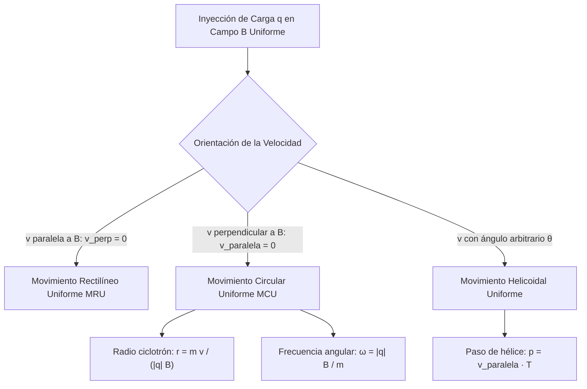
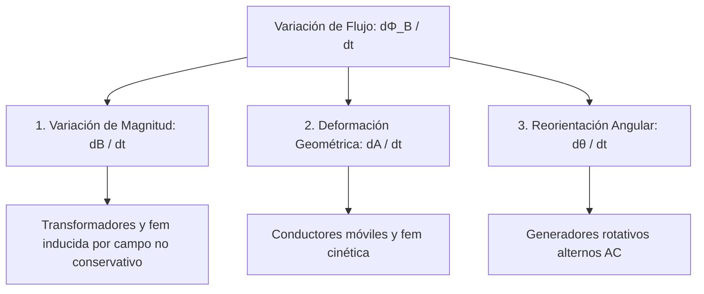
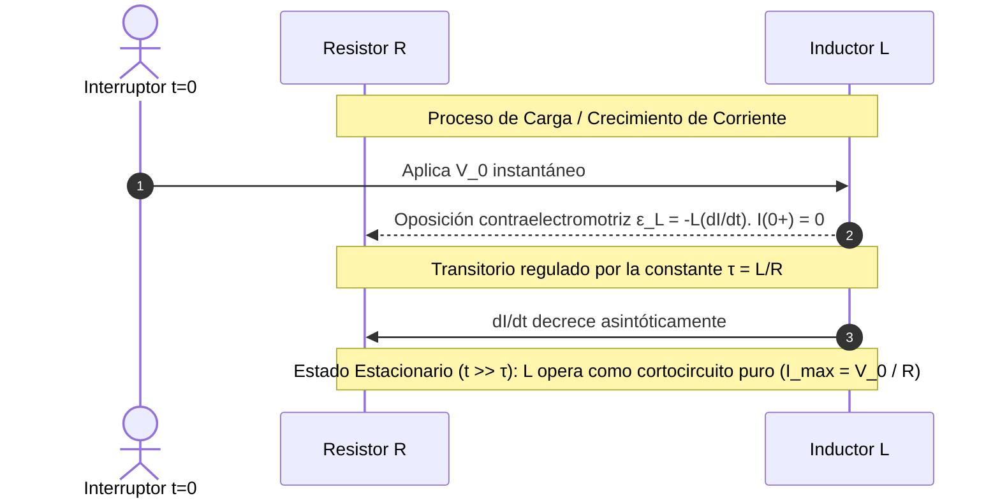
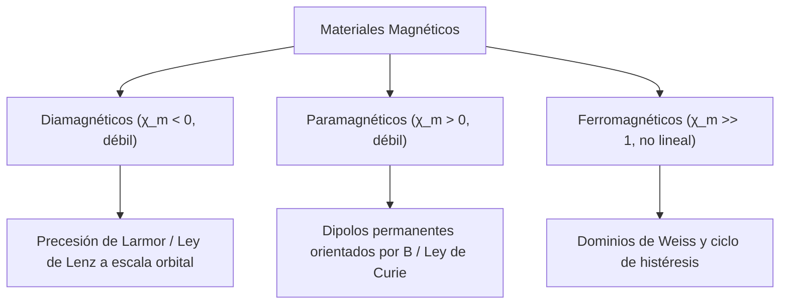

# Guía Exhaustiva de Estudio: Campo Magnético e Inducción Electromagnética

---

## 1. Origen y Fenomenología del Magnetismo

### 1.1 Reseña Histórica del Magnetismo, Imanes Naturales y Artificiales

* **Magnetita natural ($\text{Fe}_3\text{O}_4$):** Mineral de ferrimagnetismo natural documentado en la región griega de Magnesia. Atraía esquirlas de hierro y manifestaba polaridad espacial.
* **Brújula primitiva (China, dinastía Han / Song):** Primeras agujas magnetizadas suspendidas para navegación geodésica.
* **Petrus Peregrinus de Maricourt (1269, *Epistola de Magnete*):** Mapea las líneas de convergencia con limaduras de hierro sobre una piedra imán esférica e introduce el concepto fundamental de **polos magnéticos** (Norte y Sur). Demuestra empíricamente la indivisibilidad de los polos magnéticos (imposibilidad de aislar un monopolo mediante fractura mecánica).
* **William Gilbert (1600):** Propone el modelo de la Tierra como un dipolo esférico masivo.
* **Tipos de imanes:**
  * **Naturales:** Magnetita y minerales afines con magnetización espontánea geológica.
  * **Artificiales temporales:** Hierro dulce o aleaciones de bajo campo coercitivo; se magnetizan en presencia de un campo inductor externo y se desmagnetizan rápidamente al retirarlo.
  * **Artificiales permanentes:** Aleaciones duras con alto campo coercitivo y remanencia elevada (e.g., Alnico, ferritas de bario/estroncio, tierras raras como Neodimio-Hierro-Boro $\text{Nd}_2\text{Fe}_{14}\text{B}$ y Samario-Cobalto $\text{SmCo}_5$).

---

### 1.2 Campo Magnético ($\vec{B}$), Vector Inducción Magnética y Geomagnetismo Terrestre

El vector campo magnético $\vec{B}$ (también denominado **inducción magnética** o **densidad de flujo magnético**) describe la perturbación vectorial del espacio a través de la cual los momentos magnéticos y las cargas eléctricas en movimiento experimentan fuerzas mecánicas perpendiculares a su trayectoria.

#### Geomagnetismo Terrestre
La Tierra se comporta, en primera aproximación, como un dipolo magnético inclinado aproximadamente $11.5^\circ$ respecto a su eje de rotación geográfico:
* El **Polo Norte Magnético** terrestre se localiza geográficamente en el hemisferio sur magnético (atrae el polo norte orientador de la aguja de la brújula).
* **Parámetros geomagnéticos clave:**
  * **Declinación magnética ($\delta$):** Ángulo entre el norte geográfico (meridiano verdadero) y el norte magnético horizontal.
  * **Inclinación magnética ($I$):** Ángulo vertical subtendido por el vector $\vec{B}_{\text{tierra}}$ respecto al plano tangente local a la superficie.
* **Mecanismo:** Modelo geodinamo magnetohidrodinámico (MHD) autosostenido generado por corrientes de convección helicoidales en el núcleo exterior metálico fluido de hierro-níquel acopladas a la aceleración de Coriolis.

---

### 1.3 Líneas de Inducción de Campo Magnético y sus Características

1. **Tangencia:** El vector $\vec{B}(\vec{r})$ es estrictamente tangente a la línea de inducción en cada punto.
2. **Trayectorias cerradas continuas:** A diferencia de las líneas electrostáticas (que inician en cargas positivas y terminan en negativas), las líneas de $\vec{B}$ **no poseen fuentes ni sumideros puntuales**. Forman lazos continuos cerrados sobre sí mismos.
3. **Sentido convencional:** En el exterior de una fuente dipolar, emergen del polo Norte e ingresan al polo Sur; en el interior del material se propagan de Sur a Norte.
4. **Densidad geométrica:** El número de líneas por unidad de superficie transversal es directamente proporcional a la magnitud $|\vec{B}|$.

---

### 1.4 Experiencias de Oersted: Acoplamiento Electro-Magnético

En 1820, Hans Christian Oersted constató que una corriente estacionaria $I$ circulando por un alambre rectilíneo deflectaba una aguja imantada colocada en su proximidad inmediata:

$$\vec{B} \propto I, \quad \vec{B} \perp \vec{r}_{\text{alambre}}$$

* **Implicación física:** El magnetismo deja de considerarse un fenómeno dipolar segregado e invariable de los minerales; queda formalmente establecido que **las cargas eléctricas en movimiento macroscópico constituyen la fuente de los campos magnéticos**.

---

## 2. Fuerza Magnética y Dinámica de Partículas Cargadas

### 2.1 Fuerza de Lorentz sobre Partículas Cargadas

Para una partícula puntual de carga $q$ que se traslada con velocidad instantánea $\vec{v}$ inmersa en una región con campo eléctrico $\vec{E}$ y campo magnético $\vec{B}$, la fuerza electrodinámica total neta (Fuerza de Lorentz) es:

$$\vec{F} = q(\vec{E} + \vec{v} \times \vec{B})$$

* **Componente puramente magnética:**
  $$\vec{F}_B = q(\vec{v} \times \vec{B}) \implies |\vec{F}_B| = |q| v B \sin\theta$$
* **Propiedades fundamentales:**
  1. $\vec{F}_B \perp \vec{v}$ y $\vec{F}_B \perp \vec{B}$ simultáneamente.
  2. Si $\vec{v} \parallel \vec{B}$ ($\theta = 0$ o $\pi$), $\vec{F}_B = \vec{0}$.
  3. Si la carga está en reposo relativo ($\vec{v} = \vec{0}$), $\vec{F}_B = \vec{0}$.
  4. **Trabajo magnético nulo:** La potencia instantánea transmitida a una carga puntual libre por el campo magnético es idénticamente cero:
     $$P_B = \vec{F}_B \cdot \vec{v} = q(\vec{v} \times \vec{B}) \cdot \vec{v} \equiv 0$$
     El campo magnético estacionario **no realiza trabajo termodinámico sobre una carga puntual en el vacío**; modifica la dirección del vector velocidad (aceleración centrípeta), pero conserva invariante la energía cinética ($dK/dt = 0$) y la rapidez ($|\vec{v}| = \text{cte}$).

---

### 2.2 Trayectorias de Partículas Cargadas en Campos Magnéticos Uniformes

Considere un campo magnético espacialmente homogéneo $\vec{B} = B\hat{k}$ y una velocidad inicial descompuesta en sus proyecciones paralela y perpendicular: $\vec{v} = \vec{v}_\parallel + \vec{v}_\perp$.



#### A. Movimiento Circular Uniforme ($\vec{v}_\parallel = \vec{0}$)
La fuerza magnética opera como fuerza centrípeta pura:

$$|q| v_\perp B = \frac{m v_\perp^2}{r}$$

* **Radio de giro (Radio de Larmor o radio de ciclotrón):**
  $$r = \frac{m v_\perp}{|q| B} = \frac{p_\perp}{|q| B}$$
* **Velocidad angular y frecuencia del ciclotrón ($\omega_c, f_c$):**
  $$\omega_c = \frac{v_\perp}{r} = \frac{|q| B}{m}$$
  $$f_c = \frac{\omega_c}{2\pi} = \frac{|q| B}{2\pi m}$$
* **Período de revolución ($T$):**
  $$T = \frac{2\pi r}{v_\perp} = \frac{2\pi m}{|q| B}$$

> [!NOTE]
> En régimen clásico no relativista ($v \ll c$), el período $T$ y la frecuencia angular $\omega_c$ son **rigurosamente independientes** del radio orbital $r$ y de la energía cinética de la partícula.

#### B. Movimiento Helicoidal ($\vec{v}_\parallel \ne \vec{0}$ y $\vec{v}_\perp \ne \vec{0}$)
* En el eje axial ($\parallel \vec{B}$): $F_\parallel = 0 \implies v_\parallel(t) = \text{constante}$.
* En el plano transversal ($\perp \vec{B}$): Trayectoria circular de radio $r = \frac{m v_\perp}{|q| B}$.
* **Paso de la hélice ($p$):** Desplazamiento axial completado en una revolución periódica:
  $$p = v_\parallel T = v_\parallel \left( \frac{2\pi m}{|q| B} \right)$$

---

### 2.3 Unidades en el Sistema Internacional (S.I.)

* **Unidad base de inducción magnética (Tesla, $\text{T}$):**
  $$[\vec{B}] = \frac{[\vec{F}]}{[q][v]} = \frac{\text{N}}{\text{C}\cdot\frac{\text{m}}{\text{s}}} = \frac{\text{N}}{\text{A}\cdot\text{m}} = \text{kg}\cdot\text{s}^{-2}\cdot\text{A}^{-1}$$
* **Subunidad cegesimal común (Gauss, $\text{G}$):**
  $$1\ \text{T} = 10^4\ \text{G} \iff 1\ \text{G} = 10^{-4}\ \text{T}$$
  *(Ejemplo: El campo magnético terrestre en superficie oscila entre $0.3\ \text{G}$ y $0.6\ \text{G}$).*

---

### 2.4 Aplicaciones Experimentales y Tecnológicas

#### A. El Ciclotrón y Aceleración de Partículas
Acelerador de partículas cíclico (desarrollado por Lawrence y Livingston) compuesto por dos electrodos metálicos huecos en forma de semicilindros ("Dés") inmersos en un campo magnético vertical uniforme $\vec{B}$, separados por un gap intermedio conectado a una fuente de tensión alterna de radiofrecuencia (RF):

1. Dentro de las Dés, $E = 0$ por blindaje electrostático conductor; $\vec{B}$ curva la partícula en un semicírculo en un tiempo $t_{\text{semi}} = \frac{\pi m}{|q| B}$.
2. En el gap intermedio, una diferencia de potencial alternante $\Delta V(t)$ invierte su polaridad a la frecuencia resonante exacta:
   $$f_{\text{RF}} = f_c = \frac{|q| B}{2\pi m}$$
3. La partícula cruza el gap ganando energía cinética $\Delta K = q \Delta V$ en cada semiciclo, ensanchando progresivamente su radio orbital $r$.
4. **Energía cinética máxima de extracción ($r \to R_{\text{D}}$):**
   $$v_{\text{máx}} = \frac{|q| B R_{\text{D}}}{m} \implies K_{\text{máx}} = \frac{1}{2} m v_{\text{máx}}^2 = \frac{q^2 B^2 R_{\text{D}}^2}{2m}$$

#### B. Experimento de J.J. Thomson (Relación Carga-Masa $e/m$, 1897)
Dispositivo de haz de rayos catódicos sometido a campos ortogonales cruzados $\vec{E} \perp \vec{B}$ (filtro de velocidades de Wien):

<div align="center">
  <svg width="420" height="150" viewBox="0 0 420 150" xmlns="http://www.w3.org/2000/svg">
    <!-- Haz catódico -->
    <line x1="20" y1="75" x2="380" y2="75" stroke="#38bdf8" stroke-width="2.5" stroke-dasharray="4,2"/>
    <!-- Placas de campo eléctrico -->
    <rect x="130" y="20" width="120" height="12" fill="#ef4444" rx="2"/>
    <text x="190" y="15" fill="#ef4444" font-size="10" font-family="sans-serif" text-anchor="middle">Placa (+V)</text>
    <rect x="130" y="118" width="120" height="12" fill="#3b82f6" rx="2"/>
    <text x="190" y="142" fill="#3b82f6" font-size="10" font-family="sans-serif" text-anchor="middle">Placa (-V)</text>
    <!-- Campo B entrante (X) -->
    <g fill="#64748b" font-size="11" font-family="sans-serif">
      <text x="150" y="60">⊗</text><text x="180" y="60">⊗</text><text x="210" y="60">⊗</text>
      <text x="150" y="100">⊗</text><text x="180" y="100">⊗</text><text x="210" y="100">⊗</text>
    </g>
    <text x="240" y="55" fill="#64748b" font-size="11" font-weight="bold">B (hacia adentro)</text>
    <!-- Pantalla reflectora -->
    <rect x="380" y="25" width="8" height="100" fill="#10b981" rx="2"/>
    <text x="384" y="138" fill="#047857" font-size="9" text-anchor="middle">Pantalla</text>
  </svg>
</div>

1. **Condición de Haz Rectilíneo sin Deflexión ($\vec{F}_E + \vec{F}_B = \vec{0}$):**
   $$e E = e v B \implies v = \frac{E}{B}$$
2. **Deflexión Magnética o Eléctrica Pura:** Retirando el campo magnético, la placa eléctrica de longitud $L$ provoca una aceleración vertical transversal $a_y = \frac{e E}{m}$. El desplazamiento vertical $y$ al abandonar las placas es:
   $$y = \frac{1}{2} a_y t^2 = \frac{1}{2}\left(\frac{e E}{m}\right)\left(\frac{L}{v}\right)^2$$
3. Sustituyendo $v = \frac{E}{B}$:
   $$y = \frac{e E L^2}{2 m \left(\frac{E}{B}\right)^2} = \frac{e}{m} \left( \frac{L^2 B^2}{2 E} \right) \implies \frac{e}{m} = \frac{2 y E}{L^2 B^2}$$
   Thomson determinó empíricamente $\frac{e}{m} \approx 1.76 \times 10^{11}\ \text{C/kg}$, descubriendo la primera partícula subatómica elemental (el electrón).

---

### 2.5 Fuerza y Torque sobre Conductores y Espiras

#### A. Fuerza Magnética sobre Conductores con Corriente (Ley de Laplace)
Integrando la fuerza microscópica sobre todos los portadores libres de un segmento diferencial $d\vec{\ell}$ atravesado por una densidad de corriente $\vec{J}$:

$$d\vec{F} = (n q\,A\,d\ell)(\vec{v}_d \times \vec{B}) = (n q v_d A)(d\vec{\ell} \times \vec{B}) = I (d\vec{\ell} \times \vec{B})$$

Para un conductor rectilíneo uniforme de longitud $L$ en un campo magnético homogéneo $\vec{B}$:

$$\vec{F} = I (\vec{L} \times \vec{B})$$

---

#### B. Torque Magnético sobre Espira Rectangular
Considere una espira rectangular plana de lados $a$ y $b$ (área $A = a b$), portando una corriente estacionaria $I$, inmersa en un campo magnético uniforme $\vec{B}$:

* Las fuerzas en los segmentos paralelos al eje de rotación tienen magnitud $F = I a B$ en sentidos contrarios, separadas por un brazo de palanca perpendicular $b \sin\theta$.
* **Torque neto resultante ($\vec{\tau}$):**
  $$\tau = F (b \sin\theta) = (I a B) (b \sin\theta) = I (a b) B \sin\theta = I A B \sin\theta$$
  Definiendo el vector de área $\vec{A} = A \hat{n}$ (según la regla de la mano derecha para la corriente):
  $$\vec{\tau} = I (\vec{A} \times \vec{B}) = \vec{\mu} \times \vec{B}$$

---

#### C. Principio del Galvanómetro de D'Arsonval
Bobina móvil de $N$ espiras montada sobre un núcleo cilíndrico de hierro dulce centrado entre piezas polares cóncavas para generar un campo magnético radial uniforme permanente:

* **Torque electromagnético:** $\tau_e = N I A B$.
* **Torque restaurador del resorte espiral:** $\tau_m = \kappa \theta$ ($\kappa$: constante de torsión de Hooke).
* **Equilibrio estático ($\tau_e = \tau_m$):**
  $$\kappa \theta = N I A B \implies \theta = \left(\frac{N A B}{\kappa}\right) I$$
  La deflexión angular $\theta$ es **estrictamente lineal** respecto a la intensidad de corriente $I$.

---

#### D. Principio de Funcionamiento del Motor de Corriente Continua (DC)
* **Par de rotación continuo:** Una espira en un campo uniforme se detendría al alcanzar el equilibrio en $\theta = 0$ ($\vec{\mu} \parallel \vec{B}$).
* **Conmutador de delgas partidas:** Invierte la dirección del sentido de corriente en la bobina cada medio ciclo de rotación mecánico ($180^\circ$), garantizando que el torque neto $\vec{\tau}$ mantenga siempre el mismo sentido angular y transforme energía eléctrica en energía mecánica rotacional continua.

---

## 3. Momento Magnético y Leyes del Campo Magnetostático

### 3.1 Dipolo Magnético: Momento Dipolar ($\vec{\mu}$), Torque y Energía

Para cualquier espira cerrada plana arbitraria de área $A$ recorrida por una corriente estacionaria $I$:

$$\vec{\mu} = I \vec{A} = I A\,\hat{n} \quad [\,\text{A}\cdot\text{m}^2\text{ o }\text{J/T}\,]$$

Para una bobina compacta de $N$ espiras: $\vec{\mu} = N I \vec{A}$.

* **Torque en campo externo:**
  $$\vec{\tau} = \vec{\mu} \times \vec{B}$$
* **Energía Potencial Magnetostática:**
  $$U_m = -\vec{\mu} \cdot \vec{B}$$
  * *Mínimo (Equilibrio estable):* $\vec{\mu} \parallel \vec{B} \implies U_{\text{mín}} = -\mu B$.
  * *Máximo (Equilibrio inestable):* $\vec{\mu} \ anti\parallel \vec{B} \implies U_{\text{máx}} = +\mu B$.
* **Fuerza en Campo No Uniforme:**
  $$\vec{F}_m = \vec{\nabla}(\vec{\mu} \cdot \vec{B})$$

---

### 3.2 Ley de Biot-Savart: Cálculo de Inducción Magnética

Formulación fundamental para corrientes eléctricas estacionarias en el vacío ($I = \text{cte}$, régimen magnetostático):

$$d\vec{B} = \frac{\mu_0}{4\pi} \frac{I (d\vec{\ell} \times \hat{u}_r)}{r^2} = \frac{\mu_0}{4\pi} \frac{I (d\vec{\ell} \times \vec{r})}{r^3}$$

* **Permeabilidad magnética del vacío:**
  $$\mu_0 = 4\pi \times 10^{-7}\ \text{T}\cdot\text{m/A} = 4\pi \times 10^{-7}\ \text{H/m} \approx 1.2566 \times 10^{-6}\ \text{H/m}$$
  *(En el marco actual del S.I., $\mu_0$ se mide experimentalmente acoplada a la constante de estructura fina).*
* **Integración total:**
  $$\vec{B}(\vec{r}) = \frac{\mu_0 I}{4\pi} \oint_{\mathcal{C}} \frac{d\vec{\ell}' \times (\vec{r} - \vec{r}')}{|\vec{r} - \vec{r}'|^3}$$

---

### 3.3 Ley de Ampère: Formulación Integral y Simetrías

Para corrientes estacionarias, la circulación del vector $\vec{B}$ a lo largo de cualquier curva geométrica cerrada orientada $\mathcal{C} = \partial S$ es proporcional a la corriente neta libre concatenada o encerrada ($I_{\text{enc}}$):

$$\oint_{\mathcal{C}} \vec{B} \cdot d\vec{\ell} = \mu_0 I_{\text{enc}} = \mu_0 \iint_S \vec{J} \cdot d\vec{A}$$

* **Forma Diferencial (Teorema de Stokes):**
  $$\vec{\nabla} \times \vec{B} = \mu_0 \vec{J}$$

> [!WARNING]
> La Ley de Ampère clásica solo es aplicable bajo **magnetostática estacionaria** ($\vec{\nabla} \cdot \vec{J} = 0$). Con campos variables en el tiempo se requiere la corrección de Maxwell con la corriente de desplazamiento: $\vec{\nabla} \times \vec{B} = \mu_0 \vec{J} + \mu_0 \varepsilon_0 \frac{\partial \vec{E}}{\partial t}$.

---

### 3.4 Aplicaciones Analíticas de Biot-Savart y Ampère

#### 1. Alambre Rectilíneo Infinito con Corriente $I$
* **Por Ampère:** Curva amperiana circular de radio $r$ centrada en el eje:
  $$\oint \vec{B} \cdot d\vec{\ell} = B(2\pi r) = \mu_0 I \implies \vec{B}(r) = \frac{\mu_0 I}{2\pi r}\hat{u}_\theta$$

#### 2. Espira Circular de Radio $R$ sobre su Eje de Simetría ($z$)
* **Por Biot-Savart:** Cada elemento $d\ell$ genera un campo inclinado con componente ortogonal anulada simétricamente por paridad:
  $$d B_z = \frac{\mu_0 I d\ell}{4\pi (R^2 + z^2)} \cos\alpha, \quad \cos\alpha = \frac{R}{\sqrt{R^2 + z^2}}$$
  $$B_z = \int_0^{2\pi R} \frac{\mu_0 I R}{4\pi (R^2 + z^2)^{3/2}} d\ell = \frac{\mu_0 I R (2\pi R)}{4\pi (R^2 + z^2)^{3/2}}$$
  $$\vec{B}(z) = \frac{\mu_0 I R^2}{2(R^2 + z^2)^{3/2}} \hat{u}_z$$
* En el centro de la espira ($z = 0$): $\vec{B}(0) = \frac{\mu_0 I}{2R}\hat{u}_z$.
* Límite dipolar lejano ($z \gg R$, con $\mu = I \pi R^2$):
  $$\vec{B}(z) \approx \frac{\mu_0 \mu}{2\pi z^3}\hat{u}_z$$

#### 3. Solenoide Ideal y Real
* **Solenoide Ideal ($L \gg R$, devanado denso de $n = N/L$ vueltas/metro):**
  * Campo interior axial homogéneo: $\vec{B} = \mu_0 n I \hat{u}_z$.
  * Campo exterior: $\vec{B} \approx \vec{0}$.
* **Solenoide Finito (Longitud $L$, radio $R$):** Sobre el eje central, integrando la contribución de espiras elementales entre los ángulos subtendidos $\theta_1$ y $\theta_2$ desde el punto de observación a los bordes:
  $$B_z(z) = \frac{1}{2} \mu_0 n I (\cos\theta_2 - \cos\theta_1)$$
  * En el centro exacto de un solenoide simétrico: $B \approx \mu_0 n I \left(1 - \frac{2R^2}{L^2}\right)$.
  * En los extremos exactos ($z = \pm L/2$ cuando $L \gg R$): $B_{\text{extremo}} = \frac{1}{2}\mu_0 n I$.

#### 4. Toroide con Corriente (Sección circular o rectangular, $N$ vueltas)
* Amperiana circular de radio $r$ centrada en el eje de revolución toroidal:
  * **Interior del bobinado ($r_{\text{int}} < r < r_{\text{ext}}$):** Encerra $N I$:
    $$B(2\pi r) = \mu_0 N I \implies \vec{B}(r) = \frac{\mu_0 N I}{2\pi r}\hat{u}_\theta$$
  * **Regiones exteriores ($r < r_{\text{int}}$ y $r > r_{\text{ext}}$):** Encerra corriente neta cero:
    $$\vec{B} = \vec{0}$$

---

### 3.5 Interacción entre Conductores Paralelos y Definición del Amperio

Dos alambres rectilíneos paralelos infinitos separados una distancia $d$, transportando corrientes $I_1$ e $I_2$:

1. El conductor 1 genera en la posición del 2 un campo: $B_1 = \frac{\mu_0 I_1}{2\pi d}$.
2. El conductor 2 experimenta una fuerza sobre una sección longitudinal $L$:
   $$F_{1 \to 2} = I_2 L B_1 = \frac{\mu_0 I_1 I_2 L}{2\pi d}$$
* **Fuerza por unidad de longitud:**
  $$\frac{F}{L} = \frac{\mu_0 I_1 I_2}{2\pi d}$$
* **Regla de polaridad:**
  * Corrientes en el **mismo sentido** $\implies$ **Atracción mutua**.
  * Corrientes en **sentidos opuestos** $\implies$ **Repulsión mutua**.

> [!NOTE]
> Esta ecuación definió formalmente el **Amperio** en el S.I. hasta la redefinición de 2019: *"Un amperio es la corriente constante que, mantenida en dos conductores rectilíneos paralelos de longitud infinita separados 1 metro en el vacío, produce entre ellos una fuerza de $2 \times 10^{-7}\ \text{N/m}$"*.

---

### 3.6 Flujo Magnético ($\Phi_B$) y Ley de Gauss para el Magnetismo

El flujo magnético a través de una superficie arbitraria $S$ es:

$$\Phi_B = \iint_S \vec{B} \cdot d\vec{A} \quad [\,\text{Weber (Wb)} = \text{T}\cdot\text{m}^2 = \text{V}\cdot\text{s}\,]$$

#### Ley de Gauss para el Magnetismo (Forma Integral)
Para cualquier **superficie cerrada** $\partial\mathcal{V}$:

$$\oint_{\partial\mathcal{V}} \vec{B} \cdot d\vec{A} = 0$$

#### Forma Diferencial (Segunda Ecuación de Maxwell)
Aplicando el teorema de la divergencia:

$$\vec{\nabla} \cdot \vec{B} = 0$$

* **Significado físico fundamental:**
  1. No existen monopolos magnéticos aislados en la naturaleza clásica.
  2. El campo magnético es de carácter **puramente solenoidal**; sus líneas son continuas y no poseen origen ni fin.
  3. Todo flujo entrante a un volumen arbitrario iguala con precisión el flujo saliente.

---

## 4. Inducción Electromagnética

### 4.1 Ley de Inducción de Faraday y Mecanismos de Inducción

Toda variación temporal del flujo magnético $\Phi_B$ a través del área delimitada por un circuito cerrado induce una fuerza electromotriz ($\mathcal{E}$) proporcional a su rapidez de cambio:

$$\mathcal{E} = -\frac{d\Phi_B}{dt} = -\frac{d}{dt} \iint_S \vec{B} \cdot d\vec{A}$$

Para una bobina compacta de $N$ espiras enlazadas:

$$\mathcal{E} = -N \frac{d\Phi_B}{dt}$$

Dado que $\Phi_B = \iint |\vec{B}| \cos\theta\,dA$, el flujo puede variar por tres mecanismos cinéticos independientes o combinados:



#### A. Fem Cinética por Movimiento de un Conductor
Para una barra conductora de longitud $L$ desplazándose con velocidad $\vec{v}$ sobre rieles conductores estacionarios inmersos en $\vec{B}$:

$$\vec{F}_B = q(\vec{v} \times \vec{B}) \implies \vec{E}_{\text{efectivo}} = \frac{\vec{F}_B}{q} = \vec{v} \times \vec{B}$$

$$\mathcal{E}_{\text{motriz}} = \int_0^L (\vec{v} \times \vec{B}) \cdot d\vec{\ell} = v B L$$

El balance cinético concuerda directamente con Faraday: $dA = L(v\,dt) \implies \frac{d\Phi_B}{dt} = B \frac{dA}{dt} = B L v$.

#### B. Campo Eléctrico No Conservativo (Inducido)
Cuando un circuito estacionario ($d\vec{A}/dt = 0$) experimenta un campo $\vec{B}(t)$ variable en el tiempo:

$$\mathcal{E} = \oint_{\mathcal{C}} \vec{E}_{\text{ind}} \cdot d\vec{\ell} = -\iint_S \frac{\partial \vec{B}}{\partial t} \cdot d\vec{A}$$

Aplicando Stokes, se obtiene la **Tercera Ecuación de Maxwell**:

$$\vec{\nabla} \times \vec{E} = -\frac{\partial \vec{B}}{\partial t}$$

> [!NOTE]
> El campo eléctrico inducido $\vec{E}_{\text{ind}}$ **no es conservativo** ($\vec{\nabla} \times \vec{E}_{\text{ind}} \ne \vec{0}$). Carece de sentido físico asociarle una función de potencial electrostático escalar unívoco, dado que la integral de camino sobre una trayectoria cerrada es no nula ($\oint \vec{E}_{\text{ind}} \cdot d\vec{\ell} \ne 0$).

---

### 4.2 Ley de Lenz y Sentido de las Corrientes Inducidas

> **Enunciado de Lenz:** La polaridad de la fuerza electromotriz inducida genera una corriente eléctrica cuyo campo magnético secundario **se opone activamente al cambio temporal del flujo magnético original** que la produce.

* El signo negativo en la formulación de Faraday ($\mathcal{E} = -\frac{d\Phi}{dt}$) encapsula la Ley de Lenz y es un requerimiento ineludible del **Principio de Conservación de la Energía**:
  * Si el flujo entrante aumenta ($\Delta\Phi_B > 0$), la corriente inducida genera un campo $\vec{B}_{\text{ind}}$ opuesto a $\vec{B}_{\text{ext}}$ para frenar el incremento.
  * Si el flujo exterior disminuye ($\Delta\Phi_B < 0$), la corriente inducida circula para que $\vec{B}_{\text{ind}}$ refuerce al campo exterior, ralentizando el decrecimiento.

---

### 4.3 Corrientes de Foucault (Corrientes Parásitas o Eddy Currents)

Corrientes cerradas que circulan en trayectorias macroscópicas dentro de masas sólidas conductoras expuestas a campos magnéticos variables en el tiempo o en movimiento transversal a través de un gradiente magnético:

* **Efectos Disipativos:** Provocan severas pérdidas por efecto Joule ($P = I_{\text{eddy}}^2 R$) en núcleos macizos de transformadores y máquinas eléctricas.
* **Solución Constructiva:** Se sustituyen los núcleos macizos por **láminas de acero al silicio ensambladas y aisladas eléctricamente** entre sí mediante capas delgadas de barniz dieléctrico perpendicularmente a las líneas de circulación de las corrientes.
* **Aplicaciones Industriales Positivas:**
  * **Frenos electromagnéticos:** Disipación cinética controlada y frenado sin fricción mecánica en trenes de alta velocidad y montañas rusas.
  * **Hornos de inducción:** Fusión metalúrgica por calentamiento Joule concentrado.
  * **Amortiguamiento electromagnético:** Supresión rápida de oscilaciones parásitas en balanzas analíticas y galvanómetros.

---

### 4.4 Generador Elemental de Corriente Alterna (AC)

Bobina de $N$ espiras de área $A$ que gira con velocidad angular constante $\omega$ en un campo magnético estático homogéneo $\vec{B}$:

$$\theta(t) = \omega t + \theta_0$$

$$\Phi_B(t) = N \vec{B} \cdot \vec{A} = N B A \cos(\omega t)$$

Aplicando Faraday:

$$\mathcal{E}(t) = -\frac{d\Phi_B}{dt} = -N B A \frac{d}{dt}[\cos(\omega t)] = N B A \omega \sin(\omega t)$$

$$\mathcal{E}(t) = \mathcal{E}_{\text{pico}} \sin(\omega t), \quad \mathcal{E}_{\text{pico}} = N B A \omega$$

La tensión inducida es sinusoidal pura; al ser recolectada mediante anillos rozantes y escobillas fijas suministra potencia de corriente alterna periódica.

---

## 5. Inductancia y Circuitos Magnéticos

### 5.1 Autoinducción y Autoinductancia ($L$)

Cuando la corriente $I(t)$ que circula por un circuito varía con el tiempo, genera un flujo magnético variable $\Phi_B(t)$ que atraviesa al propio circuito. La **autoinductancia** ($L$) es la constante geométrica de proporcionalidad entre el flujo magnético enlazado y la corriente que lo engendra:

$$L = \frac{N \Phi_B}{I}$$

* **Fem autoinducida (Fem contraelectromotriz):**
  $$\mathcal{E}_L = -L \frac{dI}{dt}$$
* **Unidad en el S.I. (Henrio, $\text{H}$):**
  $$[L] = \frac{[\Phi_B]}{[I]} = \frac{\text{Wb}}{\text{A}} = \frac{\text{V}\cdot\text{s}}{\text{A}} = \frac{\text{J}}{\text{A}^2} = \Omega\cdot\text{s} = \text{kg}\cdot\text{m}^2\cdot\text{s}^{-2}\cdot\text{A}^{-2}$$

---

### 5.2 Cálculo de Inductancias Clásicas

#### A. Solenoide Ideal (Longitud $l$, radio $R$, sección $A = \pi R^2$, $N$ espiras)
1. Campo interno: $B = \mu_0 \left(\frac{N}{l}\right) I$
2. Flujo por espira: $\Phi_B = B A = \mu_0 \frac{N}{l} I A$
3. Flujo total concatenado: $\lambda = N \Phi_B = \mu_0 \frac{N^2 A}{l} I$
4. **Autoinductancia:**
   $$L = \frac{\mu_0 N^2 A}{l} = \mu_0 n^2 A l = \mu_0 n^2 \text{Vol}$$

#### B. Toroide de Sección Rectangular (Radios $a$ y $b$, altura $h$, $N$ vueltas)
1. Campo a distancia radial $r$: $B(r) = \frac{\mu_0 N I}{2\pi r}$
2. Flujo sobre una espira transversal:
   $$\Phi_B = \int_a^b B(r) (h\,dr) = \frac{\mu_0 N I h}{2\pi} \int_a^b \frac{dr}{r} = \frac{\mu_0 N I h}{2\pi} \ln\left(\frac{b}{a}\right)$$
3. **Autoinductancia total:**
   $$L = \frac{N \Phi_B}{I} = \frac{\mu_0 N^2 h}{2\pi}\ln\left(\frac{b}{a}\right)$$

---

### 5.3 Energía Magnética y Densidad Volumétrica ($u_m$)

Para establecer una corriente $I$ contra la fem contraelectromotriz autoinducida $\mathcal{E}_L$, el circuito debe transferir una potencia externa $P(t) = -\mathcal{E}_L I = L I \frac{dI}{dt}$:

$$U_m = \int_0^T P(t)\,dt = \int_0^I L I'\,dI' = \frac{1}{2} L I^2$$

Calculando para un solenoide ideal ($L = \mu_0 n^2 A l$ y $B = \mu_0 n I \implies I = \frac{B}{\mu_0 n}$):

$$U_m = \frac{1}{2} (\mu_0 n^2 A l) \left( \frac{B^2}{\mu_0^2 n^2} \right) = \frac{B^2}{2\mu_0} (A l)$$

Como el volumen del campo magnético es $\text{Vol} = A l$, la **densidad volumétrica de energía magnética** en el vacío es:

$$u_m = \frac{dU_m}{d\text{Vol}} = \frac{B^2}{2\mu_0} = \frac{1}{2}\mu_0 |\vec{H}|^2 = \frac{1}{2} \vec{B} \cdot \vec{H} \quad \left[\frac{\text{J}}{\text{m}^3}\right]$$

---

### 5.4 Asociación de Inductores

Bajo la condición de acoplamiento magnético mutuo despreciable ($k \to 0$):

* **Asociación en Serie:**
  $$L_{\text{eq, serie}} = \sum_{i=1}^N L_i = L_1 + L_2 + \dots + L_N$$
* **Asociación en Paralelo:**
  $$\frac{1}{L_{\text{eq, paralelo}}} = \sum_{i=1}^N \frac{1}{L_i} \implies L_{\text{eq}} = \left( \frac{1}{L_1} + \frac{1}{L_2} + \dots + \frac{1}{L_N} \right)^{-1}$$

---

### 5.5 Circuitos $R-L$ en Corriente Continua



#### A. Crecimiento de Corriente (Energización con Fuente $V_0$)
Ecuación diferencial de malla según Kirchhoff:

$$V_0 - I R - L \frac{dI}{dt} = 0 \implies \frac{dI}{dt} + \frac{R}{L}I = \frac{V_0}{L}$$

Integrando con la condición inicial $I(0) = 0$:

$$I(t) = \frac{V_0}{R} \left( 1 - e^{-t/\tau_L} \right)$$

* **Constante de tiempo inductiva ($\tau_L$):**
  $$\tau_L = \frac{L}{R} \quad [\,\text{segundos}\,]$$
* **Tensiones transitorias asociadas:**
  $$V_R(t) = I(t)R = V_0 \left( 1 - e^{-t/\tau_L} \right)$$
  $$V_L(t) = L \frac{dI}{dt} = V_0 e^{-t/\tau_L}$$

#### B. Desconexión / Extinción de Corriente
Circuito cerrado sin fuente disipando la energía magnética almacenada previamente en régimen estacionario $I_0 = \frac{V_0}{R}$:

$$I R + L \frac{dI}{dt} = 0 \implies I(t) = I_0 e^{-t/\tau_L}$$

$$V_L(t) = -I_0 R e^{-t/\tau_L}$$

Toda la energía acumulada en el campo magnético del inductor se transfiere íntegramente a calor disipado en la resistencia por efecto Joule:

$$E_{\text{disipada}} = \int_0^\infty I^2(t) R\,dt = \int_0^\infty I_0^2 R e^{-2Rt/L} dt = I_0^2 R \left[\frac{L}{2R}\right] = \frac{1}{2} L I_0^2$$

---

### 5.6 Aplicaciones de Alta Tensión: Bobina de Encendido Automotriz (*Ignition Coil*)

Transformador de pulsos de alto voltaje basado en la apertura ultrarrápida de un circuito $R-L$:
1. Una corriente primaria elevada satura el núcleo ferromagnético cerrado acumulando energía magnética $U_m = \frac{1}{2} L_p I_p^2$.
2. Al abrir mecánicamente (platinos) o electrónicamente (transistor IGBT) el devanado primario, la tasa de decrecimiento de corriente es abrupta ($dt \approx 10^{-6}\ \text{s} \implies \frac{dI}{dt} \to \infty$).
3. La colosal fem autoinducida en el primario y multiplicada por inducción mutua hacia el secundario con una relación de transformación elevada ($N_s / N_p \sim 100$) genera picos de tensión de $20\ \text{kV}$ a $40\ \text{kV}$, suficientes para ionizar la mezcla combustible-aire y saltar en chispa disruptiva en los electrodos de la bujía.

---

### 5.7 Inducción Mutua ($M$), Bobinas Acopladas y Transformador Ideal

#### A. Coeficiente de Inducción Mutua ($M$)
Si una corriente $I_1$ en el circuito 1 genera un flujo magnético $\Phi_{21}$ que enlaza las $N_2$ espiras del circuito 2:

$$M_{21} = \frac{N_2 \Phi_{21}}{I_1}$$

Por el **teorema de reciprocidad de Neumann**:

$$M_{12} = M_{21} \equiv M$$

$$\mathcal{E}_2 = -M \frac{dI_1}{dt}, \quad \mathcal{E}_1 = -M \frac{dI_2}{dt}$$

* **Coeficiente de Acoplamiento Magnético ($k$):**
  $$M = k \sqrt{L_1 L_2}, \quad 0 \le k \le 1$$
  * $k = 1$: Acoplamiento magnético perfecto (todo el flujo del primario concatena el secundario).
  * $k = 0$: Bobinas magnéticamente aisladas en cuadratura o a distancia infinita.

#### B. El Transformador Eléctrico Ideal
Máquina estática compuesta por dos devanados acoplados sobre un núcleo ferromagnético cerrado de reluctancia despreciable ($\mu_r \to \infty$) sin pérdidas ohmicas ($R_1 = R_2 = 0$) ni dispersión ($k = 1$):

$$\Phi_1(t) = \Phi_2(t) = \Phi_{\text{núcleo}}(t)$$

$$V_1 = -N_1 \frac{d\Phi}{dt}, \quad V_2 = -N_2 \frac{d\Phi}{dt}$$

* **Relación de Transformación de Voltajes ($a$):**
  $$\frac{V_1}{V_2} = \frac{N_1}{N_2} = a$$
* **Conservación de la Potencia Aparente ($S_1 = S_2 \implies V_1 I_1 = V_2 I_2$):**
  $$\frac{I_1}{I_2} = \frac{N_2}{N_1} = \frac{1}{a}$$
* **Transformación de Impedancia Reflejada ($Z_{\text{in}}$):**
  $$Z_{\text{in}} = \frac{V_1}{I_1} = \frac{a V_2}{I_2 / a} = a^2 \left(\frac{V_2}{I_2}\right) = a^2 Z_L = \left(\frac{N_1}{N_2}\right)^2 Z_L$$

---

## 6. Propiedades Magnéticas de la Materia

### 6.1 Magnetización de Materiales y Vector Magnetización ($\vec{M}$)

El comportamiento magnético de la materia tiene origen atómico cuántico en dos contribuciones fundamentales:
1. El movimiento orbital de los electrones alrededor del núcleo (momento magnético orbital $\vec{\mu}_L$).
2. El momento dipolar magnético intrínseco de espín del electrón ($\vec{\mu}_S = -\frac{g_s e}{2m_e}\vec{S}$, Magnetón de Bohr $\mu_B = \frac{e\hbar}{2m_e} \approx 9.274 \times 10^{-24}\ \text{J/T}$).

El **Vector Magnetización** ($\vec{M}$) es la densidad volumétrica macroscópica de momentos dipolares magnéticos inducidos o permanentes:

$$\vec{M} = \lim_{\Delta\mathcal{V} \to 0} \frac{1}{\Delta\mathcal{V}} \sum_{i \in \Delta\mathcal{V}} \vec{\mu}_i \quad \left[\frac{\text{A}}{\text{m}}\right]$$

* **Corrientes Ligadas o Amperianas:**
  * Densidad volumétrica de corriente ligada: $\vec{J}_b = \vec{\nabla} \times \vec{M}$
  * Densidad superficial de corriente ligada: $\vec{K}_b = \vec{M} \times \hat{n}$

---

### 6.2 Vector Intensidad de Campo Magnético ($\vec{H}$) y Permeabilidad

En un medio material, la densidad total de corriente es la suma de las corrientes libres de conducción ($\vec{J}_f$) y las corrientes ligadas de magnetización ($\vec{J}_b$):

$$\frac{1}{\mu_0} (\vec{\nabla} \times \vec{B}) = \vec{J}_{\text{total}} = \vec{J}_f + \vec{J}_b = \vec{J}_f + (\vec{\nabla} \times \vec{M})$$

Agrupando los rotores:

$$\vec{\nabla} \times \left( \frac{\vec{B}}{\mu_0} - \vec{M} \right) = \vec{J}_f$$

Definiendo el **Vector Intensidad Magnética** ($\vec{H}$):

$$\vec{H} \equiv \frac{\vec{B}}{\mu_0} - \vec{M} \iff \vec{B} = \mu_0(\vec{H} + \vec{M}) \quad \left[\frac{\text{A}}{\text{m}}\right]$$

* **Ley de Ampère Generalizada para Medios Materiales:**
  $$\vec{\nabla} \times \vec{H} = \vec{J}_f \iff \oint_{\mathcal{C}} \vec{H} \cdot d\vec{\ell} = I_{f,\text{enc}}$$
* **Relaciones Constitutivas en Medios Lineales, Homogéneos e Isótropos (LHI):**
  $$\vec{M} = \chi_m \vec{H}$$
  Donde $\chi_m$ es la **susceptibilidad magnética** adimensional.
  $$\vec{B} = \mu_0(\vec{H} + \chi_m\vec{H}) = \mu_0(1 + \chi_m)\vec{H} = \mu \vec{H}$$
* **Permeabilidad magnética relativa ($\mu_r$) y absoluta ($\mu$):**
  $$\mu_r = 1 + \chi_m \implies \mu = \mu_0 \mu_r$$

---

### 6.3 Clasificación de los Materiales Magnéticos



#### A. Diamagnetismo
* **Estructura Atómica:** Capas electrónicas completamente cerradas. Momento dipolar atómico neto intrínseco nulo ($\vec{\mu}_0 = \vec{0}$). Presente universalmente en toda la materia, pero enmascarado si existen momentos permanentes.
* **Mecanismo Físico (Teorema de Precesión de Larmor):** La aplicación de un campo exterior $\vec{B}$ altera el radio orbital e induce una precesión de los orbitales atómicos con frecuencia de Larmor:
  $$\omega_L = \frac{e B}{2 m_e}$$
  Esta precesión induce un momento dipolar microscópico que, conforme a la **Ley de Lenz cuántica**, apunta en **sentido estrictamente opuesto** al campo aplicado:
  $$\Delta \vec{\mu} = -\frac{e^2 \langle r^2 \rangle}{6 m_e} \vec{B}$$
* **Propiedades:**
  * Susceptibilidad $\chi_m$ negativa, pequeña y prácticamente independiente de la temperatura: $-10^{-5} \lesssim \chi_m < 0$.
  * Son repelidos débilmente por gradientes de campo magnético intenso.
  * *Ejemplos:* Bismuto ($\text{Bi}$), Cobre ($\text{Cu}$), Plata ($\text{Ag}$), Plomo ($\text{Pb}$), Agua.
* **Superconductores (Diamagnetismo Perfecto - Efecto Meissner):**
  Bajo su temperatura crítica $T_c$, expulsan activamente todo campo magnético de su interior:
  $$\vec{B}_{\text{int}} = \vec{0} \implies \vec{M} = -\vec{H} \implies \chi_m = -1, \quad \mu_r = 0$$

#### B. Paramagnetismo
* **Estructura Atómica:** Átomos, iones o moléculas con electrones desparejados en subcapas incompletas, lo que produce momentos dipolares magnéticos permanentes intrínsecos ($\vec{\mu}_0 \ne \vec{0}$).
* **Mecanismo:** En ausencia de campo, la agitación térmica orienta estocásticamente los dipolos ($\langle \vec{\mu} \rangle = \vec{0}$). Un campo externo $\vec{B}$ ejerce un torque que alinea parcialmente los dipolos en su misma dirección.
* **Propiedades:**
  * Susceptibilidad $\chi_m$ positiva y pequeña: $0 < \chi_m \ll 1$ ($10^{-5}$ a $10^{-3}$).
  * Son atraídos suavemente por gradientes magnéticos.
  * *Ejemplos:* Aluminio ($\text{Al}$), Platino ($\text{Pt}$), Titanio ($\text{Ti}$), Oxígeno líquido ($O_2$).
* **Dependencia Térmica (Ley de Curie):**
  Para campos moderados y temperaturas no extremadamente bajas:
  $$\chi_m = \frac{C}{T} \implies M = \frac{C B}{\mu_0 T} \quad (C: \text{constante de Curie})$$

#### C. Ferromagnetismo
* **Estructura Atómica:** Metales de transición con subcapas $3d$ o $4f$ incompletas. Interacción mecanocuántica de canje (*exchange interaction*) que estabiliza el paralelismo de espines vecinos contra la agitación térmica.
* **Dominios Magnéticos (Dominios de Weiss):** Regiones microscópicas ($1\ \mu\text{m}$ a $1\ \text{mm}$) donde todos los espines están espontáneamente magnetizados a saturación en una misma dirección cristalográfica. Las fronteras de transición estructural entre dominios adyacentes se denominan **Paredes de Bloch**.
* **Propiedades:**
  * Susceptibilidad no lineal y colosal: $\chi_m \sim 10^3 - 10^6$.
  * Comportamiento con histéresis (memoria magnética de estados previos).
  * *Ejemplos:* Hierro ($\text{Fe}$), Cobalto ($\text{Co}$), Níquel ($\text{Ni}$), Gadolinio ($\text{Gd}$), NdFeB.
* **Temperatura de Curie ($T_C$):** Por encima de $T_C$, la energía térmica destruye el ordenamiento de canje y el material se comporta puramente como **paramagnético**, siguiendo la **Ley de Curie-Weiss**:
  $$\chi_m = \frac{C}{T - T_C} \quad (T > T_C)$$
  *(Hierro: $T_C \approx 1043\ \text{K} \approx 770^\circ\text{C}$).*

---

### 6.4 Ciclo de Histéresis Magnética

<div align="center">
  <svg width="380" height="260" viewBox="0 0 380 260" xmlns="http://www.w3.org/2000/svg">
    <!-- Ejes coordenados -->
    <line x1="20" y1="130" x2="360" y2="130" stroke="#475569" stroke-width="1.5"/>
    <text x="355" y="145" fill="#475569" font-size="11" font-weight="bold">H (A/m)</text>
    <line x1="190" y1="10" x2="190" y2="250" stroke="#475569" stroke-width="1.5"/>
    <text x="200" y="20" fill="#475569" font-size="11" font-weight="bold">B (Tesla)</text>
    <!-- Curva de histéresis -->
    <path d="M 190 130 Q 230 110, 270 40 
             Q 220 50, 190 65 
             Q 150 85, 120 130 
             Q 100 180, 110 220 
             Q 160 210, 190 195 
             Q 230 175, 260 130 
             Q 280 80, 270 40" 
          fill="none" stroke="#2563eb" stroke-width="2.5"/>
    <!-- Puntos críticos -->
    <!-- Saturación -->
    <circle cx="270" cy="40" r="4" fill="#dc2626"/>
    <text x="280" y="40" fill="#dc2626" font-size="10" font-weight="bold">B_sat</text>
    <!-- Remanencia -->
    <circle cx="190" cy="65" r="4" fill="#16a34a"/>
    <text x="200" y="70" fill="#16a34a" font-size="10" font-weight="bold">B_r (Remanencia)</text>
    <!-- Coercitividad -->
    <circle cx="120" cy="130" r="4" fill="#9333ea"/>
    <text x="75" y="125" fill="#9333ea" font-size="10" font-weight="bold">-H_c (Coercitivo)</text>
  </svg>
</div>

1. **Magnetización de Saturación ($B_{\text{sat}}$):** Punto donde todos los dominios de Weiss han alineado completamente sus momentos magnéticos con el campo excitador $\vec{H}$.
2. **Inducción Remanente ($B_r$):** Campo magnético retenido por el material cuando el campo excitador exterior se anula completamente ($H = 0$).
3. **Fuerza Coercitiva o Campo Coercitivo ($H_c$):** Intensidad de campo desmagnetizante opuesto necesario para reducir a cero la inducción en el núcleo ($B = 0$).
4. **Pérdida Energética por Histéresis:** El trabajo magnético consumido por ciclo completo por unidad de volumen corresponde exactamente al área geométrica interior delimitada por el lazo:
   $$w_{\text{ciclo}} = \oint_{\text{ciclo}} H\,dB \quad \left[\frac{\text{J}}{\text{m}^3\cdot\text{ciclo}}\right]$$
5. **Clasificación según Coercitividad:**
   * **Materiales Magnéticos Blandos:** Estrecho ciclo de histéresis ($H_c$ bajo, área pequeña). Mínimas pérdidas de calor. Ideales para núcleos de transformadores, inductores y motores (e.g., ferritas blandas, chapa de acero al silicio, Permalloy).
   * **Materiales Magnéticos Duros:** Ciclo de histéresis sumamente ancho ($H_c$ y $B_r$ muy altos, producto de energía $(BH)_{\text{máx}}$ colosal). Resistentes a la desmagnetización. Diseñados para **imanes permanentes** industriales (e.g., Alnico, NdFeB).

---

## 7. Resolución Integral de Problemas y Ejercicios Cuantitativos

### Problema 1: Trayectoria de una Partícula Cargada en Selector de Velocidades y Espectrómetro de Masas

**Enunciado:**
Un ion monoatómico de masa $m = 3.20 \times 10^{-26}\ \text{kg}$ y carga $q = +1.60 \times 10^{-19}\ \text{C}$ se acelera desde el reposo mediante una diferencia de potencial electrostático $V_{\text{acel}} = 2000\ \text{V}$. A continuación, ingresa transversalmente a una cámara con campo magnético uniforme $B = 0.50\ \text{T}$ perpendicular al plano de movimiento. Determine:
1. La velocidad $v$ del ion al ingresar a la región magnética.
2. El radio de la trayectoria orbital $R$.
3. El tiempo de permanencia en el campo magnético si completa un semicírculo de $180^\circ$ antes de impactar en el detector.

**Solución Analítica:**

1. **Conservación de energía mecánica en la etapa aceleradora:**
   $$q V_{\text{acel}} = \frac{1}{2} m v^2 \implies v = \sqrt{\frac{2 q V_{\text{acel}}}{m}}$$
   $$v = \sqrt{\frac{2(1.60 \times 10^{-19}\ \text{C})(2000\ \text{V})}{3.20 \times 10^{-26}\ \text{kg}}} = \sqrt{\frac{6.40 \times 10^{-16}}{3.20 \times 10^{-26}}} = \sqrt{2.00 \times 10^{10}} \approx 1.414 \times 10^5\ \text{m/s}$$

2. **Radio orbital en la cámara de deflexión magnética:**
   $$R = \frac{m v}{q B} = \frac{(3.20 \times 10^{-26}\ \text{kg})(1.414 \times 10^5\ \text{m/s})}{(1.60 \times 10^{-19}\ \text{C})(0.50\ \text{T})} = \frac{4.525 \times 10^{-21}}{8.00 \times 10^{-20}} \approx 0.0566\ \text{m} = 5.66\ \text{cm}$$

3. **Tiempo de permanencia para un semicírculo:**
   $$t_{\text{semi}} = \frac{\pi R}{v} = \frac{\pi m}{q B}$$
   $$t_{\text{semi}} = \frac{\pi (3.20 \times 10^{-26}\ \text{kg})}{(1.60 \times 10^{-19}\ \text{C})(0.50\ \text{T})} = \frac{1.005 \times 10^{-25}}{8.00 \times 10^{-20}} \approx 1.257 \times 10^{-6}\ \text{s} = 1.26\ \mu\text{s}$$

---

### Problema 2: Fem Inducida en Espira Giratoria con Resistencia y Balance de Potencia

**Enunciado:**
Una espira cuadrada conductora de lado $L = 0.20\ \text{m}$ y resistencia total $R = 2.0\ \Omega$ rota con velocidad angular constante $\omega = 100\ \text{rad/s}$ respecto a un eje perpendicular a un campo magnético uniforme $B = 0.80\ \text{T}$.
1. Formule la expresión analítica de la corriente inducida instantánea $I(t)$.
2. Calcule la potencia disipada media por efecto Joule en un período.
3. Determine el torque mecánico externo medio $\langle \tau_{\text{ext}} \rangle$ necesario para mantener la rotación a velocidad angular constante.

**Solución Analítica:**

1. **Flujo magnético y fem instantánea:**
   $$\Phi_B(t) = B A \cos(\omega t), \quad A = L^2 = (0.20)^2 = 0.04\ \text{m}^2$$
   $$\mathcal{E}(t) = -\frac{d\Phi_B}{dt} = B A \omega \sin(\omega t) = (0.80)(0.04)(100)\sin(100t) = 3.20 \sin(100t)\ \text{V}$$
   $$\mathcal{E}_{\text{pico}} = 3.20\ \text{V}$$
   Por la ley de Ohm macroscópica:
   $$I(t) = \frac{\mathcal{E}(t)}{R} = \frac{3.20 \sin(100t)}{2.0} = 1.60 \sin(100t)\ \text{A}$$

2. **Potencia disipada media por efecto Joule:**
   $$P(t) = I(t)^2 R = (1.60)^2 (2.0) \sin^2(100t) = 5.12 \sin^2(100t)\ \text{W}$$
   Dado que el promedio temporal de $\langle \sin^2(\omega t) \rangle = \frac{1}{2}$:
   $$\langle P \rangle = \frac{5.12}{2} = 2.56\ \text{W}$$

3. **Balance de torque y potencia mecánica:**
   Por conservación de energía en régimen estacionario, la potencia mecánica suministrada por el motor externo debe equiparar exactamente la potencia eléctrica disipada:
   $$\langle P_{\text{mec}} \rangle = \langle \tau_{\text{ext}} \rangle \omega = \langle P_{\text{eléctrica}} \rangle$$
   $$\langle \tau_{\text{ext}} \rangle = \frac{\langle P \rangle}{\omega} = \frac{2.56\ \text{W}}{100\ \text{rad/s}} = 0.0256\ \text{N}\cdot\text{m} = 2.56 \times 10^{-2}\ \text{N}\cdot\text{m}$$

---

### Implementación Computacional: Simulación Dinámica de Trayectoria de Lorentz

```python
import numpy as np

def simular_particula_lorentz(
    q: float, 
    m: float, 
    r0: np.ndarray, 
    v0: np.ndarray, 
    E: np.ndarray, 
    B: np.ndarray, 
    dt: float = 1e-9, 
    pasos: int = 2000
) -> tuple[np.ndarray, np.ndarray]:
    """
    Integra la dinámica tridimensional relativista-clásica bajo la Fuerza de Lorentz
    empleando el esquema simplificado de integración por pasos (Euler-Cromer).
    """
    posiciones = np.zeros((pasos, 3))
    velocidades = np.zeros((pasos, 3))
    
    r = r0.astype(float)
    v = v0.astype(float)
    
    for i in range(pasos):
        posiciones[i] = r
        velocidades[i] = v
        
        # Evaluación vectorial de la aceleración: a = (q/m) * (E + v x B)
        fuerza_lorentz = q * (E + np.cross(v, B))
        aceleracion = fuerza_lorentz / m
        
        # Integración numérica
        v += aceleracion * dt
        r += v * dt
        
    return posiciones, velocidades

# Verificación numérica: Movimiento circular uniforme puro (E = 0, B = (0, 0, 1) T)
q_prot = 1.602e-19
m_prot = 1.673e-27
v_inicial = np.array([1.0e5, 0.0, 0.0])
r_inicial = np.array([0.0, 0.0, 0.0])
campo_E = np.array([0.0, 0.0, 0.0])
campo_B = np.array([0.0, 0.0, 1.0])

pos, vel = simular_particula_lorentz(q_prot, m_prot, r_inicial, v_inicial, campo_E, campo_B)
radio_teorico = (m_prot * np.linalg.norm(v_inicial)) / (q_prot * 1.0)
print(f"Radio Teórico: {radio_teorico * 1e3:.4f} mm")
```