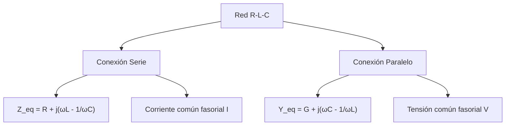
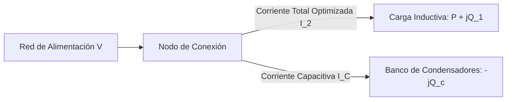

# Guía Exhaustiva de Estudio: Corriente Alterna (C.A.)

---

## 1. Generación y Valores Característicos de Señales Alternas

### 1.1 Principio Físico de Generación de Fuerza Electromotriz Sinusoidal

La generación electromecánica de tensión alterna se fundamenta en la **Ley de Inducción de Faraday-Lenz**. Una espira o devanado rígido plano de $N$ vueltas y área $A$ rota con velocidad angular mecánica constante $\omega$ en el seno de un campo magnético estático y uniforme $\vec{B}$:

$$\theta(t) = \omega t + \alpha$$

El flujo magnético concatenado instantáneo que atraviesa el área de la espira es:

$$\Phi_B(t) = \iint_S \vec{B} \cdot d\vec{A} = B A \cos(\omega t + \alpha)$$

Derivando respecto al tiempo, la fuerza electromotriz ($\mathcal{E}$) inducida en terminales resulta:

$$\mathcal{E}(t) = -N \frac{d\Phi_B(t)}{dt} = -N B A \frac{d}{dt}\left[\cos(\omega t + \alpha)\right] = N B A \omega \sin(\omega t + \alpha)$$

Definiendo el valor de cresta o amplitud máxima como $V_m = N B A \omega$:

$$v(t) = V_m \sin(\omega t + \phi_v) = V_m \cos\left(\omega t + \phi_v - \frac{\pi}{2}\right)$$


---

### 1.2 Parámetros Fundamentales de Ondas Alternas

Para una función armónica general $x(t) = X_m \sin(\omega t + \phi)$:

* **Amplitud o Valor Pico ($X_m$):** Desviación extrema máxima respecto al nivel de referencia cero.
* **Valor Pico a Pico ($X_{pp}$):** Diferencia algebraica entre la cresta positiva y el valle negativo:
  $$X_{pp} = 2 X_m$$
* **Periodo ($T$):** Intervalo de tiempo mínimo e invariable requerido para completar un ciclo ondulatorio completo:
  $$[T] = \text{segundos}\ (\text{s})$$
* **Frecuencia Cíclica ($f$):** Número de ciclos completados por unidad de tiempo:
  $$f = \frac{1}{T} \quad [\,\text{Hertz (Hz)} = \text{s}^{-1}\,]$$
* **Frecuencia Angular ($\omega$):** Tasa de cambio de la fase angular en el tiempo:
  $$\omega = 2\pi f = \frac{2\pi}{T} \quad \left[\frac{\text{rad}}{\text{s}}\right]$$
* **Valor Instantáneo ($x(t)$):** Magnitud de la señal evaluada en un instante temporal específico $t$.

#### A. Valor Medio ($X_{\text{med}}$)
Es el promedio temporal evaluado sobre un período $T$:

$$X_{\text{med}} = \frac{1}{T} \int_0^T x(t)\,dt$$

> [!NOTE]
> Para cualquier onda sinusoidal pura simétrica evaluada en un período completo:
> $$X_{\text{med, ciclo}} = \frac{1}{T}\int_0^T X_m \sin(\omega t)\,dt = 0$$
> En electrotecnia y rectificación, por **valor medio** se entiende convencionalmente el promedio del semiciclo positivo (o rectificado de onda completa):
> $$X_{\text{med}} = \frac{1}{\pi} \int_0^\pi X_m \sin(\theta)\,d\theta = \frac{X_m}{\pi} [-\cos\theta]_0^\pi = \frac{2}{\pi} X_m \approx 0.6366\,X_m$$

---

#### B. Valor Eficaz o Media Cuadrática (RMS - *Root Mean Square*)
El **valor eficaz** ($X_{\text{rms}}$ o $X$) representa el valor equivalente de corriente continua (DC) que, al circular a través de un resistor óhmico idéntico $R$, disipa la misma cantidad media de calor por efecto Joule durante un período:

$$P_{\text{media}} = I_{\text{rms}}^2 R = \frac{1}{T} \int_0^T i^2(t) R\,dt \implies I_{\text{rms}} = \sqrt{\frac{1}{T}\int_0^T i^2(t)\,dt}$$

Deducción para una señal armónica pura $x(t) = X_m \sin(\omega t)$:

$$X_{\text{rms}}^2 = \frac{1}{T}\int_0^T X_m^2 \sin^2(\omega t)\,dt = \frac{X_m^2}{T}\int_0^T \frac{1 - \cos(2\omega t)}{2} dt = \frac{X_m^2}{2T} \left[ t - \frac{\sin(2\omega t)}{2\omega} \right]_0^T$$

Como la integral del término oscilante doble $\cos(2\omega t)$ en un período es nula:

$$X_{\text{rms}}^2 = \frac{X_m^2}{2T} (T - 0) = \frac{X_m^2}{2} \implies X_{\text{rms}} = \frac{X_m}{\sqrt{2}} \approx 0.7071\,X_m$$

---

### 1.3 Factor de Forma ($k_f$) y Factor de Cresta ($k_c$)

Parámetros adimensionales que cuantifican la distorsión y perfil morfológico de una forma de onda periódica:

* **Factor de Forma ($k_f$):** Cociente entre el valor eficaz y el valor medio absoluto:
  $$k_f = \frac{X_{\text{rms}}}{X_{\text{med}}}$$
  * Para una sinusoide pura:
    $$k_f = \frac{X_m / \sqrt{2}}{2 X_m / \pi} = \frac{\pi}{2\sqrt{2}} \approx 1.1107$$
* **Factor de Cresta ($k_c$):** Razón entre la cresta máxima y el valor eficaz:
  $$k_c = \frac{X_m}{X_{\text{rms}}}$$
  * Para una sinusoide pura:
    $$k_c = \frac{X_m}{X_m / \sqrt{2}} = \sqrt{2} \approx 1.4142$$

| Forma de Onda Periódica | Valor Medio ($X_{\text{med}}$) | Valor Eficaz ($X_{\text{rms}}$) | Factor de Forma ($k_f$) | Factor de Cresta ($k_c$) |
| :--- | :--- | :--- | :--- | :--- |
| **Sinusoidal Pura** | $\frac{2}{\pi}X_m \approx 0.637\,X_m$ | $\frac{X_m}{\sqrt{2}} \approx 0.707\,X_m$ | $\frac{\pi}{2\sqrt{2}} \approx 1.111$ | $\sqrt{2} \approx 1.414$ |
| **Onda Cuadrada Simétrica** | $X_m$ | $X_m$ | $1.000$ | $1.000$ |
| **Triangular / Diente Sierra**| $\frac{1}{2}X_m = 0.500\,X_m$ | $\frac{X_m}{\sqrt{3}} \approx 0.577\,X_m$ | $\frac{2}{\sqrt{3}} \approx 1.155$ | $\sqrt{3} \approx 1.732$ |

---

### 1.4 Potencia Instantánea, Potencia Media y Potencia Activa Elemental

Considere una red dipolar pasiva alimentada por una tensión y corriente con desfase relativo arbitrario $\phi = \phi_v - \phi_i$:

$$v(t) = V_m \cos(\omega t + \phi_v)$$

$$i(t) = I_m \cos(\omega t + \phi_i)$$

La **potencia instantánea** $p(t)$ entregada al dipolo es:

$$p(t) = v(t) \cdot i(t) = V_m I_m \cos(\omega t + \phi_v)\cos(\omega t + \phi_i)$$

Aplicando la identidad trigonométrica $\cos\alpha \cos\beta = \frac{1}{2}[\cos(\alpha - \beta) + \cos(\alpha + \beta)]$:

$$p(t) = \frac{V_m I_m}{2}\cos(\phi_v - \phi_i) + \frac{V_m I_m}{2}\cos(2\omega t + \phi_v + \phi_i)$$

Expresando en función de valores eficaces ($V = V_{\text{rms}} = \frac{V_m}{\sqrt{2}}$, $I = I_{\text{rms}} = \frac{I_m}{\sqrt{2}}$) y definiendo $\phi = \phi_v - \phi_i$:

$$p(t) = \underbrace{V I \cos\phi}_{\text{Término constante (Potencia Media)}} + \underbrace{V I \cos(2\omega t + \phi_v + \phi_i)}_{\text{Término oscilatorio a frecuencia } 2\omega}$$

* **Potencia Media o Potencia Activa Elemental ($P$):**
  Integrando $p(t)$ a lo largo de un período $T$:
  $$P = \langle p(t) \rangle = \frac{1}{T} \int_0^T p(t)\,dt = V I \cos\phi \quad [\,\text{Watts (W)}\,]$$
  El término oscilante promedia exactamente cero en el ciclo, evidenciando que **solo la componente constante representa transporte neto unidireccional e irreversible de energía** hacia el dispositivo.

---

## 2. Respuesta de Elementos Pasivos y Formulación Fasorial

### 2.1 Representación Fasorial en el Plano Complejo

La formulación fasorial (introducida formalmente por Charles Proteus Steinmetz) transforma ecuaciones diferenciales lineales ordinarias temporales en ecuaciones algebraicas complejas equivalentes, bajo régimen sinusoidal permanente.

Mediante la **Identidad de Euler** ($e^{j\theta} = \cos\theta + j\sin\theta$, donde $j = \sqrt{-1}$):

$$v(t) = V_m \cos(\omega t + \phi) = \operatorname{Re}\left\{ V_m e^{j(\omega t + \phi)} \right\} = \operatorname{Re}\left\{ \sqrt{2} \mathbf{V}_{\text{rms}} e^{j\omega t} \right\}$$

Se define el **Fasor** $\mathbf{V}$ (en valor eficaz o de amplitud; en electrotecnia se asume valor RMS):

$$\mathbf{V} = V_{\text{rms}} e^{j\phi} = V \angle \phi = V \cos\phi + j V \sin\phi$$

#### Transformación de Operadores de Cálculo a Álgebra Fasorial
* **Derivación Temporal (Adelanto angular de $+90^\circ$):**
  $$\frac{d}{dt}[x(t)] \longleftrightarrow j\omega \mathbf{X}$$
* **Integración Temporal (Retraso angular de $-90^\circ$):**
  $$\int x(t)\,dt \longleftrightarrow \frac{\mathbf{X}}{j\omega} = -\frac{j}{\omega}\mathbf{X}$$

<div align="center">
  <svg width="340" height="180" viewBox="0 0 340 180" xmlns="http://www.w3.org/2000/svg">
    <!-- Ejes complejos -->
    <line x1="20" y1="150" x2="310" y2="150" stroke="#64748b" stroke-width="1.5"/>
    <text x="315" y="155" fill="#64748b" font-size="11" font-family="sans-serif">Re (+σ)</text>
    <line x1="60" y1="170" x2="60" y2="20" stroke="#64748b" stroke-width="1.5"/>
    <text x="65" y="25" fill="#64748b" font-size="11" font-family="sans-serif">+j Im</text>
    <!-- Fasor V -->
    <line x1="60" y1="150" x2="230" y2="60" stroke="#2563eb" stroke-width="3" marker-end="url(#arrowBlue)"/>
    <text x="235" y="55" fill="#2563eb" font-weight="bold" font-size="12">V = |V|∠ϕ</text>
    <!-- Arco de Fase -->
    <path d="M 120 150 A 60 60 0 0 0 115 121" fill="none" stroke="#dc2626" stroke-width="1.5"/>
    <text x="128" y="135" fill="#dc2626" font-size="11">ϕ</text>
    <!-- Proyecciones -->
    <line x1="230" y1="60" x2="230" y2="150" stroke="#94a3b8" stroke-dasharray="3,3"/>
    <line x1="60" y1="60" x2="230" y2="60" stroke="#94a3b8" stroke-dasharray="3,3"/>
    <text x="145" y="165" fill="#334155" font-size="10" text-anchor="middle">|V| cos(ϕ)</text>
    <text x="25" y="105" fill="#334155" font-size="10" text-anchor="middle">|V| sin(ϕ)</text>
  </svg>
</div>

---

### 2.2 Comportamiento de Elementos Elementales en C.A.

#### A. Circuito Puramente Resistivo ($R$)
Ecuación diferencial: $v(t) = R\,i(t)$.

Sustituyendo $i(t) = I_m \cos(\omega t)$:

$$v(t) = R I_m \cos(\omega t) = V_m \cos(\omega t)$$

En el dominio fasorial:

$$\mathbf{V}_R = R \mathbf{I}$$

* **Relación de fase:** Tensión y corriente están **estrictamente en fase** ($\phi = \phi_v - \phi_i = 0$).
* **Impedancia fasorial:** $\mathbf{Z}_R = R + j0 = R\angle 0^\circ$.

---

#### B. Circuito Puramente Capacitivo ($C$)
Ecuación constitutiva: $i(t) = C \frac{dv(t)}{dt}$.

Si $v(t) = V_m \cos(\omega t)$:

$$i(t) = C \frac{d}{dt}[V_m \cos(\omega t)] = -\omega C V_m \sin(\omega t) = \omega C V_m \cos\left(\omega t + \frac{\pi}{2}\right)$$

En el dominio fasorial:

$$\mathbf{I} = j\omega C \mathbf{V} \implies \mathbf{V}_C = \frac{1}{j\omega C}\mathbf{I} = \left(-j\frac{1}{\omega C}\right)\mathbf{I}$$

* **Reactancia Capacitiva ($X_C$):** Oposición a la corriente alterna debida a la capacidad del elemento:
  $$X_C = \frac{1}{\omega C} = \frac{1}{2\pi f C} \quad [\,\Omega\,]$$
* **Impedancia Compleja:**
  $$\mathbf{Z}_C = -j X_C = \frac{1}{j\omega C} = X_C \angle -90^\circ$$
* **Relación de fase:** La corriente **adelanta $90^\circ$ ($\pi/2$)** respecto a la tensión aplicada.

---

#### C. Circuito Puramente Inductivo ($L$)
Ecuación constitutiva: $v(t) = L \frac{di(t)}{dt}$.

Si $i(t) = I_m \cos(\omega t)$:

$$v(t) = L \frac{d}{dt}[I_m \cos(\omega t)] = -\omega L I_m \sin(\omega t) = \omega L I_m \cos\left(\omega t + \frac{\pi}{2}\right)$$

En el dominio fasorial:

$$\mathbf{V}_L = j\omega L \mathbf{I}$$

* **Reactancia Inductiva ($X_L$):** Oposición al flujo de corriente alterna provocada por la fem autoinducida:
  $$X_L = \omega L = 2\pi f L \quad [\,\Omega\,]$$
* **Impedancia Compleja:**
  $$\mathbf{Z}_L = +j X_L = j\omega L = X_L \angle +90^\circ$$
* **Relación de fase:** La corriente **se retrasa $90^\circ$ ($\pi/2$)** respecto a la tensión aplicada.

| Elemento Pasivo | Tensión / Corriente Temporal | Impedancia $\mathbf{Z}$ | Ángulo de Fase ($\phi = \phi_v - \phi_i$) | Relación Fenomenológica |
| :--- | :--- | :--- | :--- | :--- |
| **Resistor ($R$)** | $v(t) = R i(t)$ | $\mathbf{Z}_R = R \angle 0^\circ$ | $0^\circ$ | Tensión y corriente en fase. |
| **Capacitor ($C$)**| $i(t) = C \frac{dv}{dt}$ | $\mathbf{Z}_C = \frac{1}{\omega C}\angle -90^\circ$ | $-90^\circ$ ($-\pi/2$) | Corriente adelanta $90^\circ$ a la tensión. |
| **Inductor ($L$)** | $v(t) = L \frac{di}{dt}$ | $\mathbf{Z}_L = \omega L \angle +90^\circ$ | $+90^\circ$ ($+\pi/2$) | Corriente retrasa $90^\circ$ ante la tensión. |

---

## 3. Impedancia, Admitancia y Análisis de Redes R-L-C

### 3.1 Impedancia Compleja ($\mathbf{Z}$) y Admitancia Compleja ($\mathbf{Y}$)

La **Impedancia** ($\mathbf{Z}$) generaliza la ley de Ohm para cualquier red pasiva lineal bajo excitación armónica permanente:

$$\mathbf{Z} = \frac{\mathbf{V}}{\mathbf{I}} = R + jX = |\mathbf{Z}|\angle\theta_z \quad [\,\Omega\,]$$

* **Resistencia ($R = \operatorname{Re}\{\mathbf{Z}\}$):** Componente disipativa pura en fase.
* **Reactancia ($X = \operatorname{Im}\{\mathbf{Z}\}$):** Componente reactiva de almacenamiento no disipativo de energía:
  * Si $X > 0$: Carácter inductivo predominante.
  * Si $X < 0$: Carácter capacitivo predominante.
  * Si $X = 0$: Resonancia pura (red puramente resistiva).
* **Módulo y Ángulo:**
  $$|\mathbf{Z}| = \sqrt{R^2 + X^2}, \quad \theta_z = \arctan\left(\frac{X}{R}\right)$$

La **Admitancia** ($\mathbf{Y}$) es el inverso algebraico de la impedancia:

$$\mathbf{Y} = \frac{1}{\mathbf{Z}} = \frac{1}{R + jX} = \frac{R - jX}{R^2 + X^2} = G + jB = |\mathbf{Y}|\angle\theta_y \quad [\,\text{Siemens (S)}\,]$$

* **Conductancia ($G$):**
  $$G = \frac{R}{R^2 + X^2} = \frac{R}{|\mathbf{Z}|^2}$$
* **Susceptancia ($B$):**
  $$B = -\frac{X}{R^2 + X^2} = -\frac{X}{|\mathbf{Z}|^2}$$

> [!WARNING]
> La conductancia $G$ **no es** en general el inverso simple de la resistencia ($G \ne 1/R$), salvo cuando la reactancia reactiva es estrictamente cero ($X = 0$). Análogamente, $B \ne -1/X$ excepto si $R = 0$.

---

### 3.2 Circuitos R-L-C Serie y Paralelo



#### A. Circuito R-L-C Serie
Conectados secuencialmente a una fuente común $\mathbf{V}$. La corriente $\mathbf{I}$ es idéntica en toda la malla:

$$\mathbf{V} = \mathbf{V}_R + \mathbf{V}_L + \mathbf{V}_C = \mathbf{I}\left( R + j\omega L + \frac{1}{j\omega C} \right) = \mathbf{I}\left[ R + j\left(\omega L - \frac{1}{\omega C}\right) \right]$$

$$\mathbf{Z}_{\text{serie}} = R + j\left(X_L - X_C\right) = R + j\left(\omega L - \frac{1}{\omega C}\right)$$

$$\mathbf{I} = \frac{\mathbf{V}}{\mathbf{Z}_{\text{serie}}} = \frac{\mathbf{V}}{\sqrt{R^2 + \left(\omega L - \frac{1}{\omega C}\right)^2} \angle \arctan\left(\frac{\omega L - \frac{1}{\omega C}}{R}\right)}$$

---

#### B. Circuito R-L-C Paralelo
Conectados en paralelo bajo la misma diferencia de potencial fasorial $\mathbf{V}$:

$$\mathbf{I}_{\text{total}} = \mathbf{I}_R + \mathbf{I}_L + \mathbf{I}_C = \mathbf{V}\left( \frac{1}{R} + \frac{1}{j\omega L} + j\omega C \right) = \mathbf{V}\left[ \frac{1}{R} + j\left(\omega C - \frac{1}{\omega L}\right) \right]$$

$$\mathbf{Y}_{\text{paralelo}} = \frac{1}{R} + j\left(\omega C - \frac{1}{\omega L}\right) = G + j\left(B_C - B_L\right)$$

---

### 3.3 Fenómeno de Resonancia Eléctrica

La **resonancia** en un circuito de C.A. ocurre cuando la reactancia equivalente de entrada se anula idénticamente ($X_{\text{eq}} = 0 \implies \operatorname{Im}\{\mathbf{Z}\} = 0$), provocando que la red presente comportamiento puramente resistivo con factor de potencia unitario ($\cos\phi = 1$).

#### A. Resonancia Serie
Condición analítica:

$$X_L - X_C = 0 \implies \omega_0 L = \frac{1}{\omega_0 C}$$

* **Frecuencia angular de resonancia ($\omega_0$):**
  $$\omega_0 = \frac{1}{\sqrt{LC}} \quad \left[\frac{\text{rad}}{\text{s}}\right] \iff f_0 = \frac{1}{2\pi\sqrt{LC}} \quad [\,\text{Hz}\,]$$
* **Comportamiento en $\omega = \omega_0$:**
  * La impedancia alcanza su **mínimo absoluto**: $|\mathbf{Z}_{\text{mín}}| = R$.
  * La corriente suministrada alcanza su **máximo pico posible**: $|\mathbf{I}_{\text{máx}}| = \frac{V}{R}$.
  * Las sobretensiones en el inductor y capacitor se igualan y desfasan $180^\circ$, cancelándose externamente: $\mathbf{V}_L = -\mathbf{V}_C$.

#### B. Factor de Calidad ($Q$) y Selectividad
El **factor de calidad** ($Q$) cuantifica la selectividad espectral del circuito resonante, definido energéticamente como:

$$Q = 2\pi \frac{\text{Energía máxima instantánea almacenada}}{\text{Energía disipada por ciclo en resonancia}}$$

Para resonancia serie:

$$Q = \frac{\omega_0 L}{R} = \frac{1}{\omega_0 R C} = \frac{1}{R}\sqrt{\frac{L}{C}}$$

* **Sobretensión reactiva:**
  $$|\mathbf{V}_L(\omega_0)| = |\mathbf{V}_C(\omega_0)| = Q |\mathbf{V}_{\text{fuente}}|$$
  Si $Q \gg 1$, las tensiones en las reactancias aisladas pueden superar catastróficamente a la tensión de entrada por órdenes de magnitud.

#### C. Ancho de Banda ($\Delta\omega$ o $BW$)
Frecuencias de corte de media potencia ($\omega_1, \omega_2$) donde la potencia disipada cae a la mitad de su valor resonante ($I = I_{\text{máx}}/\sqrt{2}$):

$$BW = \Delta\omega = \omega_2 - \omega_1 = \frac{R}{L}$$

$$Q = \frac{\omega_0}{\Delta\omega} = \frac{f_0}{\Delta f}$$

```python
import numpy as np

def respuesta_rlc_serie(R: float, L: float, C: float, f_rango: np.ndarray, V_rms: float = 220.0):
    """
    Evalua el barrido en frecuencia de la impedancia, corriente y factor Q
    para un circuito RLC serie.
    """
    omega = 2.0 * np.pi * f_rango
    X_L = omega * L
    X_C = 1.0 / (omega * C)
    Z_compleja = R + 1j * (X_L - X_C)
    
    I_rms = V_rms / np.abs(Z_compleja)
    
    # Parametros resonantes teoricos
    f0 = 1.0 / (2.0 * np.pi * np.sqrt(L * C))
    Q = (1.0 / R) * np.sqrt(L / C)
    BW = f0 / Q
    
    return {
        "f0": f0,
        "Q": Q,
        "BW": BW,
        "I_max": V_rms / R,
        "I_rms": I_rms
    }

# Prueba de cálculo para R=5 Ohm, L=10 mH, C=10 uF
frecuencias = np.linspace(100, 1000, 500)
datos_resonancia = respuesta_rlc_serie(R=5.0, L=0.010, C=10e-6, f_rango=frecuencias)
print(f"Frecuencia Resonancia f0: {datos_resonancia['f0']:.2f} Hz | Factor Q: {datos_resonancia['Q']:.2f}")
```

---

## 4. Potencia en Corriente Alterna y Corrección del Factor de Potencia

### 4.1 El Triángulo de Potencias y Formulación Compleja

Se define la **Potencia Compleja** ($\mathbf{S}$) como el producto del fasor de tensión por el conjugado complejo del fasor de corriente:

$$\mathbf{S} = \mathbf{V} \cdot \mathbf{I}^* = (V e^{j\phi_v})(I e^{-j\phi_i}) = V I e^{j(\phi_v - \phi_i)} = V I e^{j\phi} = V I \cos\phi + j V I \sin\phi$$

$$\mathbf{S} = P + j Q$$

<div align="center">
  <svg width="340" height="170" viewBox="0 0 340 170" xmlns="http://www.w3.org/2000/svg">
    <!-- Triángulo de potencias inductivo -->
    <!-- Cateto Adyacente (P) -->
    <line x1="30" y1="130" x2="250" y2="130" stroke="#16a34a" stroke-width="3"/>
    <text x="140" y="150" fill="#16a34a" font-weight="bold" font-size="12" text-anchor="middle">P = S cos(ϕ) [Watts]</text>
    <!-- Cateto Opuesto (Q) -->
    <line x1="250" y1="130" x2="250" y2="30" stroke="#dc2626" stroke-width="3"/>
    <text x="260" y="85" fill="#dc2626" font-weight="bold" font-size="12">Q = S sin(ϕ) [VAr]</text>
    <!-- Hipotenusa (S) -->
    <line x1="30" y1="130" x2="250" y2="30" stroke="#2563eb" stroke-width="3"/>
    <text x="120" y="70" fill="#2563eb" font-weight="bold" font-size="12" text-anchor="middle">S = V·I [VA]</text>
    <!-- Arco de Ángulo phi -->
    <path d="M 80 130 A 50 50 0 0 0 74 110" fill="none" stroke="#334155" stroke-width="1.5"/>
    <text x="88" y="122" fill="#334155" font-size="11">ϕ</text>
  </svg>
</div>

#### 1. Potencia Activa ($P$)
* Representa el ritmo de transformación irreversible de energía eléctrica en trabajo mecánico, luz o calor disipado en las resistencias.
* Se mide en **Watts** ($\text{W}$):
  $$P = \operatorname{Re}\{\mathbf{S}\} = V I \cos\phi$$

#### 2. Potencia Reactiva ($Q$)
* Mide la tasa de intercambio oscilatorio alternante de energía reactiva acumulada periódicamente en los campos magnéticos inductivos y eléctricos capacitivos, sin conversión térmica neta.
* Se mide en **Volt-Amperios Reactivos** ($\text{VAr}$):
  $$Q = \operatorname{Im}\{\mathbf{S}\} = V I \sin\phi$$
  * **Cargas Inductivas:** Demandan potencia reactiva ($\phi > 0 \implies Q > 0$).
  * **Cargas Capacitivas:** Entregan potencia reactiva ($\phi < 0 \implies Q < 0$).

#### 3. Potencia Aparente ($S$)
* Representa la capacidad nominal total de transporte que debe soportar la infraestructura de generación, líneas y transformadores.
* Se mide en **Volt-Amperios** ($\text{VA}$):
  $$S = |\mathbf{S}| = \sqrt{P^2 + Q^2} = V_{\text{rms}} I_{\text{rms}}$$

---

### 4.2 Factor de Potencia ($FP = \cos\phi$) e Implicancias Técnico-Económicas

El **Factor de Potencia** es la relación adimensional entre la potencia útil activa transferida y la capacidad aparente total suministrada:

$$FP = \frac{P}{S} = \frac{V I \cos\phi}{V I} = \cos\phi$$

* **En adelanto (*leading*):** La corriente adelanta a la tensión $\implies$ Carga reactiva capacitiva neta.
* **En atraso (*lagging*):** La corriente retrasa a la tensión $\implies$ Carga reactiva inductiva neta (caso general de motores eléctricos, inductancias de alumbrado y transformadores).

#### Implicancias Técnico-Económicas de un Bajo Factor de Potencia ($\cos\phi \ll 1$):
1. **Sobredimensionamiento de Corriente de Línea:** Para suministrar una potencia mecánica útil fija $P$, la corriente $I = \frac{P}{V \cos\phi}$ se dispara asintóticamente cuando $\cos\phi \to 0$.
2. **Incremento de Pérdidas Joule en Redes ($\Delta P = I^2 R_{\text{línea}}$):** Se cuadruplican o multiplican las pérdidas de transporte y distribución en conductores.
3. **Mayores Caídas de Tensión Inductivas ($\Delta V = I Z_L$):** Degradación del perfil de tensión terminal en los centros de carga y subestaciones.
4. **Saturación Térmica de Transformadores:** Los transformadores se saturan por límite de potencia aparente en $\text{kVA}$, subutilizando la potencia real entregada.
5. **Penalizaciones Tarifarias Severas:** Los entes reguladores y distribuidoras eléctricas aplican recargos tarifarios por consumo de energía reactiva cuando $\cos\phi < 0.90 - 0.95$.

---

### 4.3 Corrección del Factor de Potencia Mediante Banco de Condensadores

Para corregir el factor de potencia de una carga inductiva inicial desde $\cos\phi_1$ hasta un valor objetivo optimizado $\cos\phi_2$ ($\cos\phi_2 > \cos\phi_1$), se conecta un banco de condensadores en **paralelo** directo a la acometida.



#### Deducción Analítica del Banco de Condensadores:
1. La carga absorbe una potencia activa constante $P$ y una reactiva inductiva inicial:
   $$Q_1 = P \tan\phi_1$$
2. Con el banco de condensadores en derivación suministrando $-Q_C$, la potencia reactiva neta requerida a la red disminuye a:
   $$Q_2 = P \tan\phi_2$$
3. Por el principio de conservación de potencias complejas (Teorema de Boucherot):
   $$Q_2 = Q_1 - Q_C \implies Q_C = Q_1 - Q_2 = P (\tan\phi_1 - \tan\phi_2)$$
4. La potencia reactiva suministrada por un banco capacitivo puro en paralelo bajo tensión eficaz $V$ es:
   $$Q_C = \frac{V^2}{X_C} = \frac{V^2}{\frac{1}{\omega C}} = \omega C V^2$$
5. Igualando y despejando la **Capacidad Requerida ($C$)**:
   $$\omega C V^2 = P (\tan\phi_1 - \tan\phi_2)$$
   $$C = \frac{P \left(\tan\phi_1 - \tan\phi_2\right)}{\omega V^2} = \frac{P \left(\tan\phi_1 - \tan\phi_2\right)}{2\pi f V^2}$$

#### Banco Trifásico Equilibrado en Conexión Triángulo ($\Delta$) vs. Estrella ($Y$):
* **Conexión en Triángulo ($\Delta$):** Los condensadores soportan la tensión de línea completa $V_L$:
  $$C_\Delta = \frac{P_{3\phi} (\tan\phi_1 - \tan\phi_2)}{3 \omega V_L^2}$$
* **Conexión en Estrella ($Y$):** Soportan la tensión simple de fase $V_F = V_L/\sqrt{3}$:
  $$C_Y = \frac{P_{3\phi} (\tan\phi_1 - \tan\phi_2)}{\omega V_L^2} = 3\,C_\Delta$$

> [!TIP]
> En aplicaciones industriales se prefiere conectar los bancos trifásicos en **Triángulo ($\Delta$)**, ya que para compensar exactamente la misma potencia reactiva $Q_C$ se requiere una capacitancia física tres veces menor ($C_\Delta = C_Y / 3$), reduciendo drásticamente el coste volumétrico y constructivo del banco de compensación.