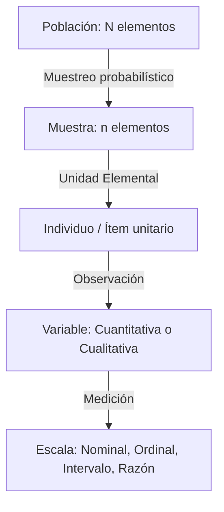
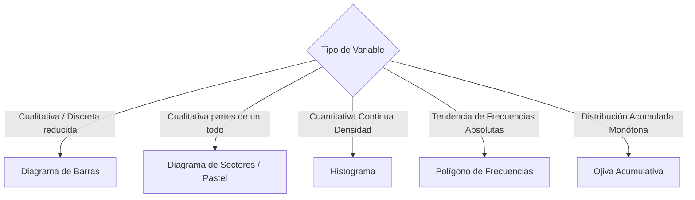
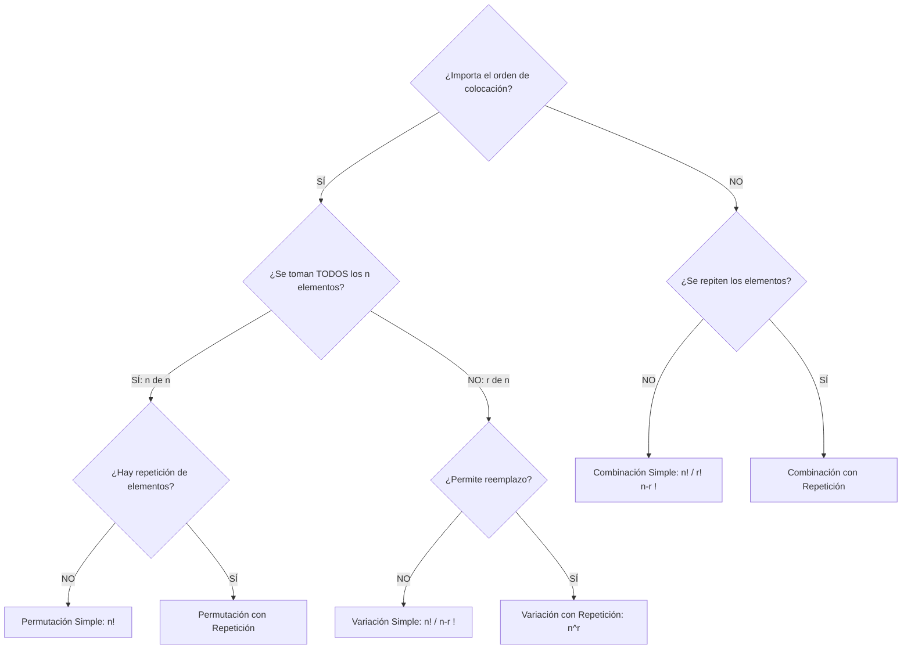
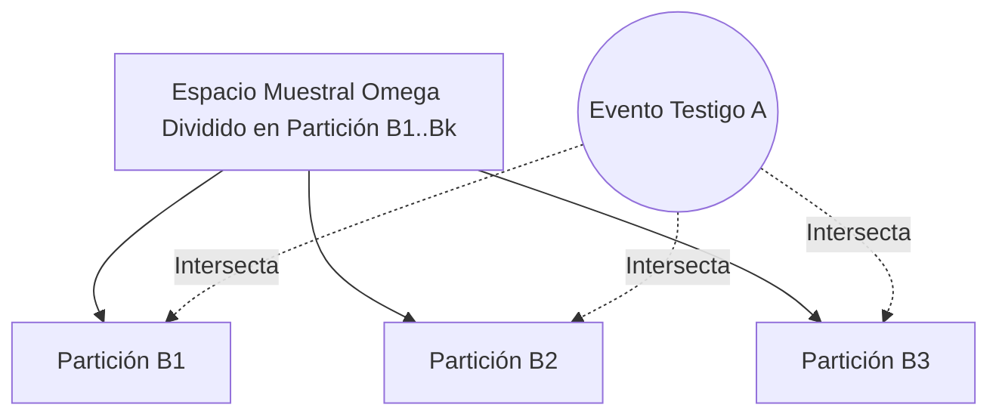

# Estadística Descriptiva y Probabilidad:

---

## 1. Fundamentos y Estadística Descriptiva Unidimensional y Bidimensional

### 1.1 Conceptos Básicos

La inferencia y el análisis descriptivo descansan sobre la delimitación estricta del conjunto de estudio y la naturaleza métrica de las propiedades observadas.



- **Población ($N$):** Conjunto total y exhaustivo de elementos, especímenes, transacciones o individuos que comparten características observables comunes y bien delimitadas en tiempo y espacio.
- **Muestra ($n$):** Subconjunto representativo y aleatorio extraído de la población con el fin de proyectar estimaciones o contrastar hipótesis ($n \le N$).
- **Unidad Elemental:** La entidad indivisible mínima (sujeto, sensor, lote de producción) sobre la cual se efectúa una medición concreta.
- **Variable ($X, Y$):** Característica susceptible de adoptar distintos valores numéricos o categorías entre las unidades elementales.
  - **Cualitativa (Categórica):** Describe cualidades no aritméticas.
    - *Nominal:* Categorías sin jerarquía ni orden intrínseco (ej. tipo de fallo de software, género, estado de una conexión: `ACK`, `SYN`, `FIN`).
    - *Ordinal:* Categorías con un orden o gradación natural verificable, pero sin distancia métrica constante entre rangos (ej. nivel de severidad de error: `Bajo`, `Medio`, `Crítico`; escala Likert).
  - **Cuantitativa (Numérica):** Magnitudes medibles o contables sujetas a operaciones aritméticas.
    - *Discreta:* Valores pertenecientes a un conjunto numerable (generalmente $\mathbb{Z}_{\ge 0}$), resultado de conteos (ej. número de paquetes TCP perdidos, hilos concurrentes activos).
    - *Continua:* Valores dentro de un continuo no numerable ($\mathbb{R}$ o intervalos de él), resultado de mediciones físicas (ej. latencia de red en ms, temperatura de CPU en $^{\circ}\text{C}$).

| Escala de Medición | Operaciones Matemáticas Permitidas | Cero Absoluto | Ejemplos Técnicos |
| :--- | :--- | :--- | :--- |
| **Nominal** | Igualdad ($=$) / Diferencia ($\ne$) | No | Protocolo (`HTTP`, `FTP`, `SSH`), Tipo de Fallo |
| **Ordinal** | Comparación ($<$, $>$, $\le$, $\ge$) | No | Prioridad de ejecución (`P1` $>$ `P2` $>$ `P3`), Nivel SLA |
| **Intervalo** | Adición ($+$) / Sustracción ($-$) | No (arbitrario) | Temperatura en $^{\circ}\text{C}$ o $^{\circ}\text{F}$, Fecha de calendario |
| **Razón** | Multiplicación ($\times$) / División ($\div$) | Sí (origen real) | Ancho de banda ($\text{Mbps}$), Tasa de error ($\%$), Tiempo de CPU ($s$) |

> [!WARNING]
> En la escala de **Intervalo**, el valor $0$ no denota la ausencia de la propiedad medida (el cero en $^{\circ}\text{C}$ no implica carencia de energía térmica). Por ende, no es matemáticamente válido afirmar que $40^{\circ}\text{C}$ es "el doble de caliente" que $20^{\circ}\text{C}$. Dicha proporción solo es admisible en la escala de **Razón**.

---

### 1.2 Organización y Presentación de Datos: Tablas de Frecuencias

#### Tablas Unidimensionales
Permiten sintetizar una serie de $n$ datos mediante clases o intervalos mutuamente excluyentes y colectivamente exhaustivos.

Para variables cuantitativas continuas, se definen $k$ intervalos de clase $[L_{i-1}, L_i)$:
- Regla de Sturges para estimar el número de clases $k$:
$$
k = 1 + 3.322 \cdot \log_{10}(n) \quad \text{o bien} \quad k = \lceil 1 + \log_2(n) \rceil
$$
- Rango muestral: $R = x_{\max} - x_{\min}$.
- Amplitud de intervalo constante: $c = \frac{R}{k}$.
- Marca de clase (punto medio del intervalo): $m_i = \frac{L_{i-1} + L_i}{2}$.

Relaciones estructurales de frecuencias:
- Frecuencia absoluta ($f_i$): Conteo de observaciones en la clase $i$, donde $\sum_{i=1}^k f_i = n$.
- Frecuencia relativa ($h_i$): Proporción respecto al total: $h_i = \frac{f_i}{n}$, donde $\sum_{i=1}^k h_i = 1$.
- Frecuencia absoluta acumulada ($F_i$): $F_i = \sum_{j=1}^i f_j$, con $F_k = n$.
- Frecuencia relativa acumulada ($H_i$): $H_i = \sum_{j=1}^i h_j$, con $H_k = 1.0$.

#### Tablas Bidimensionales (Tablas de Contingencia)
Organizan simultáneamente dos variables $X$ (con $r$ categorías/filas) e $Y$ (con $c$ categorías/columnas) para examinar interdependencias.

| $X \setminus Y$ | $y_1$ | $y_2$ | $\dots$ | $y_j$ | $\dots$ | $y_c$ | Total Marginal $X$ ($f_{i\cdot}$) |
| :---: | :---: | :---: | :---: | :---: | :---: | :---: | :---: |
| **$x_1$** | $f_{11}$ | $f_{12}$ | $\dots$ | $f_{1j}$ | $\dots$ | $f_{1c}$ | $f_{1\cdot}$ |
| **$x_2$** | $f_{21}$ | $f_{22}$ | $\dots$ | $f_{2j}$ | $\dots$ | $f_{2c}$ | $f_{2\cdot}$ |
| $\vdots$ | $\vdots$ | $\vdots$ | $\ddots$ | $\vdots$ | $\ddots$ | $\vdots$ | $\vdots$ |
| **$x_i$** | $f_{i1}$ | $f_{i2}$ | $\dots$ | $f_{ij}$ | $\dots$ | $f_{ic}$ | $f_{i\cdot}$ |
| $\vdots$ | $\vdots$ | $\vdots$ | $\ddots$ | $\vdots$ | $\ddots$ | $\vdots$ | $\vdots$ |
| **$x_r$** | $f_{r1}$ | $f_{r2}$ | $\dots$ | $f_{rj}$ | $\dots$ | $f_{rc}$ | $f_{r\cdot}$ |
| **Total Marginal $Y$ ($f_{\cdot j}$)** | $f_{\cdot 1}$ | $f_{\cdot 2}$ | $\dots$ | $f_{\cdot j}$ | $\dots$ | $f_{\cdot c}$ | $n = \sum \sum f_{ij}$ |

- Frecuencia marginal de filas: $f_{i\cdot} = \sum_{j=1}^c f_{ij}$
- Frecuencia marginal de columnas: $f_{\cdot j} = \sum_{i=1}^r f_{ij}$
- Distribuciones condicionales:
$$
h(x_i \mid y_j) = \frac{f_{ij}}{f_{\cdot j}}, \quad h(y_j \mid x_i) = \frac{f_{ij}}{f_{i\cdot}}
$$

---

### 1.3 Representación Gráfica según el Tipo de Variable



- **Diagrama de Barras:** Barras separadas (el ancho es arbitrario; la altura es proporcional a $f_i$ o $h_i$). Empleado en escalas nominales y ordinales.
- **Diagrama de Sectores:** Ángulo central $\theta_i = h_i \cdot 360^{\circ}$. Útil únicamente si el número de categorías es bajo ($\le 5$) y se desea visualizar composición proporcional.
- **Histograma:** Conjunto de rectángulos continuos adyacentes. La base corresponde al intervalo $[L_{i-1}, L_i)$ y el **área** del rectángulo representa la frecuencia. Si los anchos son heterogéneos, la altura debe ser la densidad de frecuencia: $d_i = \frac{f_i}{c_i}$.
- **Polígono de Frecuencias:** Gráfico de líneas que une los puntos formados por las marcas de clase y su respectiva frecuencia: $(m_i, f_i)$. Se cierra intersectando el eje horizontal en marcas de clase ficticias adyacentes anterior y posterior con frecuencia 0.
- **Ojiva:** Curva poligonal creciente que representa las frecuencias absolutas o relativas acumuladas ($F_i$ o $H_i$) respecto a los límites superiores de clase $(L_i, F_i)$. Permite determinar visualmente cuantiles.

---

### 1.4 Medidas de Resumen Estadístico

#### Medidas de Tendencia Central
Localizan el centro gravitacional de los datos en el eje real.

1. **Media Aritmética ($\bar{x}$ o $\mu$):**
   - Datos simples:
   $$
   \bar{x} = \frac{1}{n}\sum_{i=1}^n x_i
   $$
   - Datos agrupados en intervalos:
   $$
   \bar{x} = \frac{1}{n}\sum_{i=1}^k f_i \cdot m_i
   $$
   - *Propiedad fundamental:* $\sum_{i=1}^n (x_i - \bar{x}) = 0$. Es altamente sensible a valores atípicos (*outliers*).

2. **Mediana ($\text{Me}$):** Valor que divide la muestra ordenada en dos mitades del 50%.
   - Datos simples ordenados:
   $$
   \text{Me} = \begin{cases} x_{(\frac{n+1}{2})} & \text{si } n \text{ es impar} \\ \frac{x_{(\frac{n}{2})} + x_{(\frac{n}{2} + 1)}}{2} & \text{si } n \text{ es par} \end{cases}
   $$
   - Datos agrupados: Se localiza la clase que contiene a la mediana tal que $F_i \ge \frac{n}{2}$:
   $$
   \text{Me} = L_{i-1} + c \cdot \left[ \frac{\frac{n}{2} - F_{i-1}}{f_i} \right]
   $$
   donde $L_{i-1}$ es el límite inferior de la clase mediana, $F_{i-1}$ la frecuencia acumulada anterior, $f_i$ la frecuencia de la clase y $c$ la amplitud.

3. **Moda ($\text{Mo}$):** Valor o valores más frecuentes.
   - Datos agrupados (fórmula de interpolación multimodal):
   $$
   \text{Mo} = L_{i-1} + c \cdot \left[ \frac{\Delta_1}{\Delta_1 + \Delta_2} \right]
   $$
   donde $\Delta_1 = f_i - f_{i-1}$ y $\Delta_2 = f_i - f_{i+1}$, correspondientes a la clase modal (la de mayor $f_i$).

---

#### Medidas de Posición No Central (Cuantiles)
Valores que dividen la distribución ordenada en proporciones parametrizadas.

- **Cuartiles ($Q_k, k \in \{1, 2, 3\}$):** Dividen la distribución en 4 partes ($25\%$, $50\%$, $75\%$).
- **Deciles ($D_k, k \in \{1, \dots, 9\}$):** Dividen en 10 partes iguales.
- **Percentiles ($P_k, k \in \{1, \dots, 99\}$):** Dividen en 100 partes iguales.

Fórmula general de interpolación para el percentil $k$-ésimo ($P_k$) en datos agrupados:
$$
P_k = L_{i-1} + c \cdot \left[ \frac{\frac{k \cdot n}{100} - F_{i-1}}{f_i} \right]
$$
Equivalencias funcionales: $P_{25} = Q_1$, $P_{50} = Q_2 = \text{Me} = D_5$, $P_{75} = Q_3$.

---

#### Medidas de Dispersión
Cuantifican el grado de variabilidad o alejamiento de las observaciones respecto a las medidas de tendencia central.

1. **Rango ($R$):**
   $$
   R = x_{\max} - x_{\min}
   $$
2. **Rango Intercuartílico ($\text{IQR}$):**
   $$
   \text{IQR} = Q_3 - Q_1
   $$
3. **Varianza Poblacional ($\sigma^2$) y Muestral ($s^2$):**
   - Varianza Poblacional:
   $$
   \sigma^2 = \frac{1}{N} \sum_{i=1}^N (x_i - \mu)^2 = \frac{1}{N}\sum_{i=1}^N x_i^2 - \mu^2
   $$
   - Varianza Muestral (Corrección de Bessel para insesgadez):
   $$
   s^2 = \frac{1}{n-1} \sum_{i=1}^n (x_i - \bar{x})^2 = \frac{\sum_{i=1}^n x_i^2 - \frac{(\sum x_i)^2}{n}}{n-1}
   $$
4. **Desviación Estándar ($s$):** Magnitud en las mismas unidades de la variable original:
   $$
   s = \sqrt{s^2}
   $$
5. **Coeficiente de Variación ($\text{CV}$):** Dispersión relativa adimensional, válida exclusivamente para variables en escala de razón con $\bar{x} > 0$:
   $$
   \text{CV} = \frac{s}{|\bar{x}|} \times 100\%
   $$
   - Criterio de homogeneidad: Si $\text{CV} \le 15\%-20\%$, la distribución se considera homogénea y la media aritmética es altamente representativa.

---

#### Medidas de Forma

1. **Coeficiente de Asimetría de Fisher ($g_1$ o $\gamma_1$):**
   Basado en el tercer momento central ($m_3 = \frac{1}{n}\sum(x_i - \bar{x})^3$):
   $$
   g_1 = \frac{\frac{1}{n}\sum_{i=1}^n (x_i - \bar{x})^3}{s^3}
   $$
   - $g_1 = 0$: Distribución simétrica ($\bar{x} \approx \text{Me} \approx \text{Mo}$).
   - $g_1 > 0$: Asimetría positiva (cola alargada a la derecha, $\bar{x} > \text{Me} > \text{Mo}$).
   - $g_1 < 0$: Asimetría negativa (cola alargada a la izquierda, $\text{Mo} > \text{Me} > \bar{x}$).

2. **Coeficiente de Curtosis de Fisher ($g_2$):**
   Basado en el cuarto momento central ($m_4 = \frac{1}{n}\sum(x_i - \bar{x})^4$):
   $$
   g_2 = \frac{\frac{1}{n}\sum_{i=1}^n (x_i - \bar{x})^4}{s^4} - 3
   $$
   - $g_2 = 0$: **Mesocúrtica** (morfología idéntica a la distribución normal canónica).
   - $g_2 > 0$: **Leptocúrtica** (pico apuntado central pronunciado y colas pesadas).
   - $g_2 < 0$: **Platicúrtica** (distribución aplanada con colas ligeras).

<div align="center">
  <svg width="600" height="150" viewBox="0 0 600 150" xmlns="http://www.w3.org/2000/svg">
    <!-- Asim Positiva -->
    <path d="M 20 130 Q 50 130 70 30 Q 90 80 180 130 Z" fill="#3b82f6" fill-opacity="0.3" stroke="#2563eb" stroke-width="2"/>
    <text x="100" y="145" text-anchor="middle" font-size="11" fill="#334155" font-family="sans-serif">Sesgo Positivo (Derecha)</text>
    <!-- Simetrica -->
    <path d="M 220 130 Q 270 130 300 20 Q 330 130 380 130 Z" fill="#10b981" fill-opacity="0.3" stroke="#059669" stroke-width="2"/>
    <text x="300" y="145" text-anchor="middle" font-size="11" fill="#334155" font-family="sans-serif">Simétrica (Normal)</text>
    <!-- Asim Negativa -->
    <path d="M 420 130 Q 510 80 530 30 Q 550 130 580 130 Z" fill="#ef4444" fill-opacity="0.3" stroke="#dc2626" stroke-width="2"/>
    <text x="500" y="145" text-anchor="middle" font-size="11" fill="#334155" font-family="sans-serif">Sesgo Negativo (Izquierda)</text>
  </svg>
</div>

---

### 1.5 Análisis Exploratorio de Datos (EDA)

#### Diagrama de Tallo y Hoja (Stem-and-Leaf)
Segmenta cada dato en un "tallo" (dígitos ordenados de mayor peso) y una "hoja" (último dígito de menor peso). Conserva la identidad original de las observaciones individuales a la vez que despliega el perfil de densidad.

```text
Ejemplo: Datos de Latencia en ms = [12, 15, 18, 22, 22, 27, 31, 35, 43]
Tallo | Hojas
  1   | 2 5 8
  2   | 2 2 7
  3   | 1 5
  4   | 3
```

#### Diagrama de Caja y Bigotes (Boxplot) y Criterio de Tukey para Detección de Outliers
El boxplot se estructura sobre el resumen de los cinco números de Tukey: $[\min_{\text{no-atípico}}, Q_1, \text{Me}, Q_3, \max_{\text{no-atípico}}]$.

<div align="center">
  <svg width="600" height="180" viewBox="0 0 600 180" xmlns="http://www.w3.org/2000/svg">
    <!-- Bigote inferior -->
    <line x1="80" y1="90" x2="180" y2="90" stroke="#1e293b" stroke-width="2"/>
    <line x1="80" y1="70" x2="80" y2="110" stroke="#1e293b" stroke-width="2"/>
    <!-- Caja -->
    <rect x="180" y="50" width="220" height="80" fill="#93c5fd" stroke="#1d4ed8" stroke-width="2"/>
    <!-- Mediana -->
    <line x1="270" y1="50" x2="270" y2="130" stroke="#b91c1c" stroke-width="3"/>
    <!-- Bigote superior -->
    <line x1="400" y1="90" x2="500" y2="90" stroke="#1e293b" stroke-width="2"/>
    <line x1="500" y1="70" x2="500" y2="110" stroke="#1e293b" stroke-width="2"/>
    <!-- Outliers -->
    <circle cx="40" cy="90" r="4" fill="#ef4444" stroke="#991b1b" stroke-width="1.5"/>
    <circle cx="550" cy="90" r="4" fill="#ef4444" stroke="#991b1b" stroke-width="1.5"/>
    <!-- Etiquetas -->
    <text x="40" y="115" font-size="10" text-anchor="middle" font-family="sans-serif">Outlier</text>
    <text x="80" y="130" font-size="11" text-anchor="middle" font-family="sans-serif">Límite Inf.</text>
    <text x="180" y="145" font-size="11" text-anchor="middle" font-family="sans-serif">Q1</text>
    <text x="270" y="40" font-size="11" text-anchor="middle" fill="#b91c1c" font-weight="bold" font-family="sans-serif">Mediana (Q2)</text>
    <text x="400" y="145" font-size="11" text-anchor="middle" font-family="sans-serif">Q3</text>
    <text x="500" y="130" font-size="11" text-anchor="middle" font-family="sans-serif">Límite Sup.</text>
    <text x="550" y="115" font-size="10" text-anchor="middle" font-family="sans-serif">Outlier</text>
  </svg>
</div>

Regla formal de demarcación de fronteras (Criterio de Tukey):
- Rango intercuartílico: $\text{IQR} = Q_3 - Q_1$.
- Valla interior inferior: $LI = Q_1 - 1.5 \cdot \text{IQR}$.
- Valla interior superior: $LS = Q_3 + 1.5 \cdot \text{IQR}$.
- Valla exterior inferior: $EI = Q_1 - 3.0 \cdot \text{IQR}$.
- Valla exterior superior: $ES = Q_3 + 3.0 \cdot \text{IQR}$.

Clasificación de anomalías:
1. **Dato Atípico Moderado:** $x \in [LI, EI) \cup (LS, ES]$.
2. **Dato Atípico Extremo:** $x < EI$ o $x > ES$.
3. **Extremos de los Bigotes:** El bigote no se extiende hasta la valla teórica, sino hasta el dato muestral real más lejano que aún permanezca dentro del intervalo $[LI, LS]$.

---

### 1.6 Aplicación Práctica: Análisis e Interpretación a partir de un Artículo Científico

Implementación en Python utilizando bibliotecas científicas de análisis univariado, robustez de medidas centrales y filtrado formal de datos aberrantes conforme al estándar de publicación técnica:

```python
import numpy as np
import pandas as pd
from scipy import stats

def pipeline_eda_investigacion(datos: np.ndarray) -> dict:
    """
    Computa el conjunto formal de estadísticas descriptivas y
    aisla outliers según el criterio de Tukey para un paper técnico.
    """
    q1 = np.percentile(datos, 25)
    q2 = np.median(datos)
    q3 = np.percentile(datos, 75)
    iqr = q3 - q1
    
    # Límites de Tukey
    li = q1 - 1.5 * iqr
    ls = q3 + 1.5 * iqr
    outliers = datos[(datos < li) | (datos > ls)]
    
    media = np.mean(datos)
    desv = np.std(datos, ddof=1) # ddof=1 aplica la corrección n-1
    cv = (desv / media) * 100 if media != 0 else np.nan
    
    return {
        "n": len(datos),
        "Media": float(np.round(media, 4)),
        "Mediana": float(np.round(q2, 4)),
        "Desv_Std": float(np.round(desv, 4)),
        "CV_pct": float(np.round(cv, 2)),
        "IQR": float(np.round(iqr, 4)),
        "Asimetria_Fisher": float(np.round(stats.skew(datos, bias=False), 4)),
        "Curtosis_Fisher": float(np.round(stats.kurtosis(datos, bias=False), 4)),
        "Total_Outliers": int(len(outliers)),
        "Lista_Outliers": outliers.tolist()
    }

# Simulación: Tiempos de respuesta de microservicios (ms) con cola asimétrica
np.random.seed(42)
latencias_ms = np.concatenate([np.random.exponential(scale=20, size=200) + 5, [145.2, 189.7, 210.5]])
metricas = pipeline_eda_investigacion(latencias_ms)
print(metricas)
```

> [!NOTE]
> **Pauta de interpretación para reportes científicos:**
> Cuando la asimetría $|g_1| > 1$ o existen outliers extremos confirmados, la media aritmética $(\bar{x})$ y la desviación estándar $(s)$ pierden representatividad técnica. En dichos escenarios se reporta obligatoriamente la mediana $(\text{Me})$ y el rango intercuartílico $(\text{IQR})$ como estadísticos de robustez.

---

## 2. Teoría de Probabilidades y Cálculo Combinatorio

### 2.1 Experimentos Aleatorios, Espacio Muestral y Álgebra de Eventos

- **Experimento Aleatorio ($\mathcal{E}$):** Proceso reproducible bajo idénticas condiciones nominales cuyo resultado individual no puede predecirse con certeza antes de su ejecución, pero cuyo conjunto total de salidas admisibles es conocido a priori.
- **Espacio Muestral ($\Omega$ o $S$):** Conjunto universal de todos los resultados elementales posibles del experimento $\mathcal{E}$.
  - *Discreto Finito:* Lanzar un dado hexafásico, $\Omega = \{1, 2, 3, 4, 5, 6\}$.
  - *Discreto Infinito Numerable:* Conteo de intentos de retransmisión hasta lograr un socket exitoso, $\Omega = \{1, 2, 3, \dots\} = \mathbb{N}$.
  - *Continuo:* Tiempo hasta la degradación de un componente, $\Omega = \{t \in \mathbb{R} \mid t > 0\}$.
- **Evento o Suceso ($A, B, C \subseteq \Omega$):** Subconjunto de resultados del espacio muestral dotado de estructura algebraica formal.

Operaciones de Álgebra de Eventos (Álgebra de Boole):
- **Unión ($A \cup B$):** Ocurre el evento $A$, ocurre el evento $B$, o ambos suceden simultáneamente.
- **Intersección ($A \cap B$ o $AB$):** Ocurren $A$ y $B$ concurrentemente. Si $A \cap B = \emptyset$, los eventos se definen como **mutuamente excluyentes** o disjuntos.
- **Complemento ($A^c$ o $\bar{A}$):** Ocurre todo resultado elemental perteneciente a $\Omega$ que no pertenece a $A$.
- **Diferencia ($A \setminus B$ o $A - B$):** Ocurre $A$ pero no ocurre $B$: $A \setminus B = A \cap B^c$.
- **Leyes de De Morgan:**
$$
(A \cup B)^c = A^c \cap B^c \qquad (A \cap B)^c = A^c \cup B^c
$$

---

### 2.2 Técnicas de Conteo

Modelan la cardinalidad del espacio muestral $|\Omega|$ y de sus eventos $|A|$ sin requerir enumeración exhaustiva elemento por elemento.



1. **Principio Multiplicativo:** Si un procedimiento global se divide en $k$ etapas secuenciales independientes donde la etapa $i$ puede materializarse de $n_i$ formas posibles, el total de secuencias ordenadas posibles es:
   $$
   N_{\text{total}} = n_1 \cdot n_2 \cdot n_3 \cdots n_k = \prod_{i=1}^k n_i
   $$
2. **Principio Aditivo:** Si un evento $E$ puede realizarse ya sea a través de un procedimiento exclusivo $A$ (con $m$ salidas) o de una alternativa exclusiva $B$ (con $n$ salidas), no pudiendo ejecutarse ambos a la vez ($A \cap B = \emptyset$):
   $$
   N_{\text{total}} = m + n
   $$
3. **Permutaciones Simples:** Arreglos ordenados de todos los $n$ elementos disponibles:
   $$
   P_n = n!
   $$
4. **Permutaciones con Repetición:** Arreglos ordenados de $n$ elementos donde existen grupos repetidos idénticos ($n_1$ del tipo 1, $n_2$ del tipo 2, con $\sum n_i = n$):
   $$
   P_n^{n_1, n_2, \dots, n_k} = \frac{n!}{n_1! \, n_2! \cdots n_k!}
   $$
5. **Variaciones / Permutaciones de $r$ en $n$:** Selección ordenada de $r$ objetos tomados de un pool disponible de $n$ ($r \le n$):
   $$
   V(n, r) = P(n, r) = \frac{n!}{(n - r)!}
   $$
   Si se permite repetición sistemática:
   $$
   VR(n, r) = n^r
   $$
6. **Combinaciones Simples:** Formación de subconjuntos de tamaño $r$ seleccionados de un total de $n$ elementos donde el orden de agrupación carece de relevancia:
   $$
   C(n, r) = \binom{n}{r} = \frac{n!}{r!(n - r)!}
   $$
7. **Combinaciones con Repetición:** Agrupaciones no ordenadas de $r$ elementos donde cada elemento puede ser elegido reiteradamente de entre $n$ alternativas:
   $$
   CR(n, r) = \binom{n + r - 1}{r} = \frac{(n + r - 1)!}{r!(n - 1)!}
   $$

---

### 2.3 Definición de Probabilidad: Enfoques

#### Enfoque Clásico o a Priori (Laplace)
Requiere que todos los resultados elementales del espacio muestral finito $\Omega$ sean rigurosamente equiprobables (*principio de indiferencia*):
$$
P(A) = \frac{|A|}{|\Omega|} = \frac{\text{Número de casos favorables al evento } A}{\text{Número total de casos posibles en } \Omega}
$$

#### Enfoque Frecuentista o a Posteriori (Von Mises)
La probabilidad converge como el límite empírico de la frecuencia relativa observada al repetir el experimento infinitas veces bajo condiciones idénticas:
$$
P(A) = \lim_{n \to \infty} \frac{n_A}{n}
$$
donde $n_A$ es la cantidad de veces que el evento $A$ ocurre en las $n$ realizaciones.

#### Enfoque Axiomático (Kolmogorov)
Sea $\Omega$ el espacio muestral y $\mathcal{F}$ una $\sigma$-álgebra de eventos sobre $\Omega$. Una medida de probabilidad es una función funcional $P: \mathcal{F} \to \mathbb{R}$ que satisface indefectiblemente los siguientes tres axiomas:

- **Axioma 1 (No negatividad):**
$$
P(A) \ge 0, \quad \forall A \in \mathcal{F}
$$
- **Axioma 2 (Certidumbre unitaria):**
$$
P(\Omega) = 1
$$
- **Axioma 3 ($\sigma$-Aditividad o Aditividad Contable):** Para cualquier secuencia infinita de eventos disjuntos dos a dos ($A_i \cap A_j = \emptyset$ para todo $i \ne j$):
$$
P\left( \bigcup_{i=1}^{\infty} A_i \right) = \sum_{i=1}^{\infty} P(A_i)
$$

---

### 2.4 Propiedades y Teoremas Fundamentales del Cálculo de Probabilidades

Deducidos analíticamente a partir de los axiomas de Kolmogorov:

1. **Probabilidad del Suceso Vacío:**
   $$
   P(\emptyset) = 0
   $$
2. **Complementación:**
   $$
   P(A^c) = 1 - P(A)
   $$
3. **Acotamiento:**
   $$
   0 \le P(A) \le 1, \quad \forall A \subseteq \Omega
   $$
4. **Monotonía:**
   $$
   \text{Si } A \subseteq B \implies P(A) \le P(B)
   $$
5. **Resta de Eventos:**
   $$
   P(A \setminus B) = P(A \cap B^c) = P(A) - P(A \cap B)
   $$
6. **Regla de la Adición (Ley de la Unión):**
   - Para dos eventos cualesquiera (compatibles o no):
   $$
   P(A \cup B) = P(A) + P(B) - P(A \cap B)
   $$
   - Para tres eventos:
   $$
   P(A \cup B \cup C) = P(A) + P(B) + P(C) - P(A \cap B) - P(A \cap C) - P(B \cap C) + P(A \cap B \cap C)
   $$
   - Si los eventos son mutuamente excluyentes ($A \cap B = \emptyset$):
   $$
   P(A \cup B) = P(A) + P(B)
   $$

---

## 3. Probabilidad Condicional e Independencia

### 3.1 Definición y Cálculo de la Probabilidad Condicional

La probabilidad condicional evalúa la reponderación de certidumbre de un evento $A$ dado que se ha confirmado la ocurrencia previa o simultánea de otro evento condicionante $B$ ($P(B) > 0$). Esto equivale a contraer formalmente el espacio muestral original $\Omega$ al espacio reducido $B$.

$$
P(A \mid B) = \frac{P(A \cap B)}{P(B)}, \quad \text{con } P(B) > 0
$$

> [!WARNING]
> Confundir $P(A \mid B)$ con $P(B \mid A)$ constituye la **falacia del condicional transpuesto** (o falacia del fiscal). Salvo que $P(A) = P(B)$, en términos generales:
> $$
> P(A \mid B) \neq P(B \mid A)
> $$

---

### 3.2 Representación Mediante Diagramas de Árbol para Secuencias de Eventos

Permiten descomponer procesos estocásticos de etapas múltiples. En cada nodo, la bifurcación representa ramas exhaustivas y disjuntas donde:
1. La suma de las probabilidades directas de las ramas que divergen de un nodo común es siempre igual a $1$.
2. La probabilidad de alcanzar una trayectoria específica se calcula mediante el producto directo de las probabilidades a lo largo de sus segmentos componentes.

```mermaid
flowchart LR
    Root((Raíz)) -->|P A| A[Evento A]
    Root -->|P A^c| Ac[Evento A^c]
    
    A -->|P B|A| AB[Nodo: A y B]
    A -->|P B^c|A| ABc[Nodo: A y B^c]
    
    Ac -->|P B|A^c| AcB[Nodo: A^c y B]
    Ac -->|P B^c|A^c| AcBc[Nodo: A^c y B^c]
```

Cálculo de trayectorias terminales:
- $P(A \cap B) = P(A) \cdot P(B \mid A)$
- $P(A \cap B^c) = P(A) \cdot P(B^c \mid A)$
- $P(A^c \cap B) = P(A^c) \cdot P(B \mid A^c)$
- $P(A^c \cap B^c) = P(A^c) \cdot P(B^c \mid A^c)$

---

### 3.3 Regla o Teorema de la Multiplicación

Permite calcular la probabilidad de la intersección simultánea de múltiples eventos dependientes:

- Para dos eventos:
$$
P(A \cap B) = P(A) \cdot P(B \mid A) = P(B) \cdot P(A \mid B)
$$
- Forma general (Regla de la Cadena para $n$ eventos):
$$
P\left( \bigcap_{i=1}^n A_i \right) = P(A_1) \cdot P(A_2 \mid A_1) \cdot P(A_3 \mid A_1 \cap A_2) \cdots P\left(A_n \mid \bigcap_{j=1}^{n-1} A_j\right)
$$

---

### 3.4 Partición del Espacio Muestral y Teorema de la Probabilidad Total

#### Definición de Partición
Una colección de eventos $\{B_1, B_2, \dots, B_k\}$ constituye una partición formal del espacio muestral $\Omega$ si cumple taxativamente dos condiciones:
1. Son disjuntos dos a dos (mutuamente excluyentes): $B_i \cap B_j = \emptyset, \; \forall i \ne j$.
2. Son exhaustivos (su unión abarca todo el espacio muestral): $\bigcup_{i=1}^k B_i = \Omega$.
3. $P(B_i) > 0, \; \forall i$.



#### Enunciado del Teorema de la Probabilidad Total
Si $\{B_1, B_2, \dots, B_k\}$ es una partición de $\Omega$, entonces la probabilidad no condicionada de cualquier evento arbitrario $A \subseteq \Omega$ se descompone como la suma ponderada de sus secciones intersecadas:

$$
P(A) = \sum_{i=1}^k P(A \cap B_i) = \sum_{i=1}^k P(B_i) \cdot P(A \mid B_i)
$$

---

### 3.5 Teorema de Bayes y Cálculo de Probabilidades a Posteriori

El Teorema de Bayes permite la actualización del grado de certidumbre de una hipótesis causal $B_j$ a la luz de nueva evidencia confirmada $A$.

- **Probabilidad a Priori ($P(B_j)$):** Probabilidad inicial de la causa o estado del sistema antes del experimento.
- **Verosimilitud ($P(A \mid B_j)$):** Probabilidad de que se observe la evidencia $A$ asumiendo la ocurrencia de la hipótesis $B_j$.
- **Probabilidad a Posteriori ($P(B_j \mid A)$):** Probabilidad condicional revisada de la hipótesis $B_j$ una vez observada la evidencia confirmada $A$.

#### Ecuación Fundamental del Teorema de Bayes:
$$
P(B_j \mid A) = \frac{P(B_j \cap A)}{P(A)} = \frac{P(B_j) \cdot P(A \mid B_j)}{\sum_{i=1}^k P(B_i) \cdot P(A \mid B_i)}
$$

> [!EXAMPLE]
> **Diagnóstico en Filtro Anti-Spam:**
> Un servidor de correo clasifica el tráfico en dos categorías: $B_1 = \text{Legítimo}$ con $P(B_1)=0.80$, y $B_2 = \text{Spam}$ con $P(B_2)=0.20$.
> Se detecta un vector de texto sospechoso $A = \{\text{"Premio Inmediato"}\}$. Se determinan empíricamente las verosimilitudes:
> - $P(A \mid B_2) = 0.95$ (el $95\%$ de los spams contienen el texto).
> - $P(A \mid B_1) = 0.01$ (solo el $1\%$ de los correos legítimos lo contienen).
>
> 1. Aplicando el **Teorema de la Probabilidad Total** para hallar $P(A)$:
> $$
> P(A) = P(B_1)P(A \mid B_1) + P(B_2)P(A \mid B_2) = (0.80 \cdot 0.01) + (0.20 \cdot 0.95) = 0.008 + 0.190 = 0.198
> $$
> 2. Aplicando el **Teorema de Bayes** para derivar la probabilidad a posteriori de que sea spam:
> $$
> P(B_2 \mid A) = \frac{P(B_2) \cdot P(A \mid B_2)}{P(A)} = \frac{0.190}{0.198} \approx 0.9596 \; (95.96\%)
> $$

---

### 3.6 Independencia de Eventos

#### Definición Formal
Dos eventos $A$ y $B$ son estocásticamente independientes si y solo si la verificación de uno no altera en absoluto la distribución de probabilidad del otro:

$$
P(A \cap B) = P(A) \cdot P(B)
$$

Criterios operacionales alternativos (válidos si $P(A) > 0$ y $P(B) > 0$):
- $P(A \mid B) = P(A)$
- $P(B \mid A) = P(B)$

#### Independencia Mutua de Múltiples Eventos ($n \ge 3$)
Para que un conjunto finito de $n$ eventos $\{A_1, A_2, \dots, A_n\}$ sea formalmente independiente en su totalidad, no basta con la independencia por pares. Deben satisfacerse simultáneamente las ecuaciones multiplicativas para todas las combinaciones posibles tomadas de 2 en 2, de 3 en 3, hasta de $n$ en $n$:

$$
P\left( \bigcap_{i \in J} A_i \right) = \prod_{i \in J} P(A_i), \quad \forall J \subseteq \{1, 2, \dots, n\} \text{ tal que } |J| \ge 2
$$

Total de restricciones de independencia a verificar: $2^n - n - 1$ igualdades funcionales.

#### Propiedades Fundamentales de la Independencia
1. Si los eventos $A$ y $B$ son independientes, entonces sus familias de complementos también lo son indefectiblemente:
   - $A$ y $B^c$ son independientes: $P(A \cap B^c) = P(A) \cdot P(B^c)$.
   - $A^c$ y $B$ son independientes: $P(A^c \cap B) = P(A^c) \cdot P(B)$.
   - $A^c$ y $B^c$ son independientes: $P(A^c \cap B^c) = P(A^c) \cdot P(B^c)$.
2. Si un evento $E$ es tal que $P(E) = 0$ o $P(E) = 1$, entonces $E$ es trivialmente independiente de cualquier otro evento del espacio muestral, incluido de sí mismo.

> [!WARNING]
> **Mutuamente Excluyentes vs. Independientes:**
> - **Mutuamente Excluyentes:** Condición geométrica donde $A \cap B = \emptyset \implies P(A \cap B) = 0$. Los eventos no pueden concurrir juntos.
> - **Independientes:** Condición informacional donde $P(A \cap B) = P(A) \cdot P(B)$.
>
> *Deducción clave:* Dos eventos disjuntos con probabilidades no nulas ($P(A) > 0, P(B) > 0$) **NUNCA** pueden ser independientes, ya que:
> $$
> P(A \cap B) = 0 \neq P(A) \cdot P(B) > 0
> $$
> Si ocurre $A$, la probabilidad condicional de ocurrencia de $B$ cae automáticamente a 0, revelando máxima dependencia mutua.