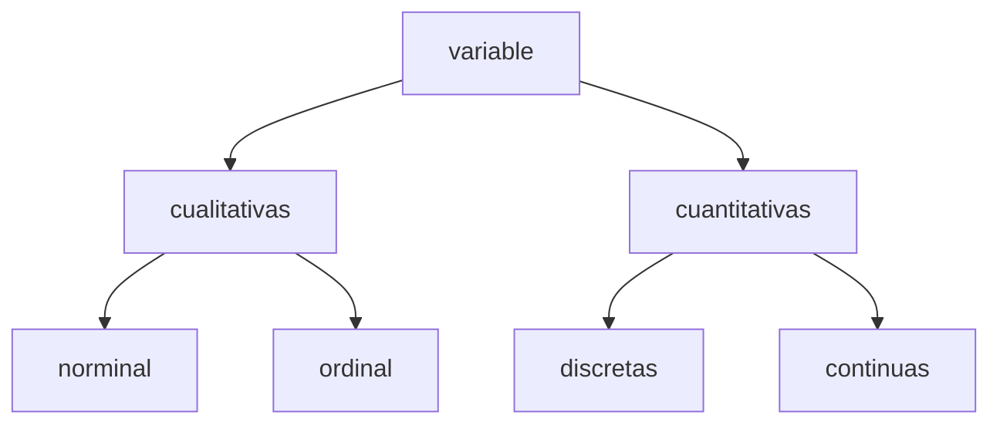

# Estadística Descriptiva y Probabilidad

## 1. Fundamentos y estadística descriptiva unidimensional y bidimensional

### Conceptos básicos

- **Población:** Conjunto total de elementos (individuos, objetos, mediciones) que poseen una característica común observable de interés.

- **Muestra:** Subconjunto representativo seleccionado de la población sobre el cual se realizan las mediciones u observaciones reales.

- **Unidad elemental (o unidad estadística):** Cada uno de los elementos individuales que componen la población y sobre los cuales se estudia la variable.

- **Variables:** Característica o propiedad medible de las unidades elementales que puede tomar diferentes valores. Se dividen en:

### Organización y presentación de datos: tablas de frecuencias unidimensionales y bidimensionales

- **Tablas de frecuencias unidimensionales:** Estructuras que muestran para una sola variable los valores posibles y sus frecuencias:
  - Frecuencia absoluta ($n_i$): Número de observaciones que toman el valor $x_i$.
  - Frecuencia relativa ($h_i = \frac{n_i}{N}$, donde $N = \sum n_i$).
  - Frecuencia absoluta acumulada ($N_i = \sum_{j=1}^i n_j$).
  - Frecuencia relativa acumulada ($H_i = \frac{N_i}{N}$).

- **Tablas de frecuencias bidimensionales (tablas de contingencia):** Cruzan la información de dos variables simultáneamente para analizar su asociación, mostrando frecuencias conjuntas $n_{ij}$ junto con las frecuencias marginales de cada variable.

### Representación gráfica según el tipo de variable

- **Diagrama de barras:** Para variables cualitativas o cuantitativas discretas. Las alturas de las barras son proporcionales a las frecuencias.

- **Diagrama de sectores (pastel):** Para variables cualitativas, mostrando proporciones mediante áreas circulares proporcionales a los porcentajes.

- **Histograma:** Para variables cuantitativas continuas agrupadas en intervalos. Las áreas de los rectángulos son proporcionales a las frecuencias.

- **Polígono de frecuencias:** Línea quebrada que une los puntos medios superiores (marcas de clase) de los rectángulos del histograma.

- **Ojiva:** Gráfico de frecuencias acumuladas (ascendente o descendente), útil para estimar percentiles de manera gráfica.

### Medidas de resumen estadístico

#### Medidas de tendencia central

- **Media aritmética:** Promedio ponderado de los valores, definido para datos no agrupados como:

  $$
  \bar{x} = \frac{1}{N} \sum_{i=1}^N x_i
  $$

- **Mediana (**$M_e$**):** Valor central que divide al conjunto de datos ordenados en dos partes iguales (50% superior y 50% inferior).

- **Moda (**$M_o$**):** Valor o valores que presentan la mayor frecuencia absoluta en la distribución.

#### Medidas de posición no centra-

- **Cuartiles (**$Q_1, Q_2, Q_3$**):** Dividen los datos ordenados en 4 partes iguales (25%, 50% y 75%).

- **Deciles (**$D_1, D_2, \dots, D_9$**):** Dividen los datos en 10 partes iguales.

- **Percentiles (**$P_1, P_2, \dots, P_{99}$**):** Dividen los datos en 100 partes iguales.

#### Medidas de dispersión

- **Rango:** Diferencia entre el valor máximo y el valor mínimo: $R = x_{\text{max}} - x_{\text{min}}$.

- **Varianza (**$s^2$ **o** $\sigma^2$**):** Media aritmética de los cuadrados de las desviaciones respecto a la media:

  $$
  s^2 = \frac{\sum_{i=1}^n (x_i - \bar{x})^2}{n - 1}
  $$

- **Desviación estándar (**$s$ **o** $\sigma$**):** Raíz cuadrada positiva de la varianza:

  $$
  s = \sqrt{s^2}
  $$

- **Coeficiente de variación (**$CV$**):** Medida de dispersión relativa que permite comparar la variabilidad de conjuntos con distintas unidades o escalas:

  $$
  CV = \frac{s}{\bar{x}} \times 100\%
  $$

#### Medidas de forma

- **Coeficiente de asimetría (Skewness):** Mide el grado de simetría de la distribución respecto a la media (asimetría positiva, simétrica o negativa).

- **Coeficiente de curtosis (Kurtosis):** Mide el grado de apuntamiento o concentración de los datos alrededor de la región central en comparación con la distribución normal (leptocúrtica, mesocúrtica o platicúrtica).

### Análisis exploratorio de datos

- **Diagrama de tallo y hoja (Stem-and-Leaf):** Técnica de visualización rápida que separa cada número en un "tallo" (dígitos principales) y una "hoja" (último dígito), conservando los datos originales.

- **Diagrama de caja y bigotes (Boxplot):** Representación visual basada en los cinco números resumen: mínimo, $Q_1$, mediana ($Q_2$), $Q_3$ y máximo.

- **Detección de datos atípicos (Outliers):** Identificación de valores extremos usando los límites del boxplot, típicamente definidos como aquellos valores fuera del intervalo:
  

  $$
  [Q_1 - 1.5 \times (Q_3 - Q_1), \quad Q_3 + 1.5 \times (Q_3 - Q_1)]
  $$

### Aplicación práctica

- *Análisis e interpretación de datos a partir de un artículo científico:* Consiste en aplicar los conceptos anteriores de estadística unidimensional y bidimensional (como medias, tablas de contingencia y gráficos descriptivos) para interpretar los resultados empíricos presentados en la literatura científica de la especialidad.

## 2. Teoría de probabilidades y cálculo combinatorio

### Experimentos aleatorios, espacio muestral y álgebra de eventos

- **Experimento aleatorio:** Proceso o fenómeno cuyo resultado no se puede predecir con certeza antes de realizarlo, aun bajo las mismas condiciones.

- **Espacio muestral (**$\Omega$**):** Conjunto de todos los resultados posibles de un experimento aleatorio.

- **Álgebra de eventos:** Subconjuntos del espacio muestral $\Omega$ sujetos a operaciones teóricas de conjuntos:

  - *Unión (*$A \cup B$*):* Ocurrencia del evento $A$, del evento $B$, o de ambos.

  - *Intersección (*$A \cap B$*):* Ocurrencia simultánea de los eventos $A$ y $B$.

  - *Complemento (*$A^c$ *o* $\bar{A}$*):* Ocurrencia de cualquier resultado que no pertenezca al evento $A$.

### Técnicas de conteo

- **Principio multiplicativo:** Si un procedimiento se realiza en $s$ etapas sucesivas, donde la primera tiene $n_1$ formas, la segunda $n_2$ formas, ..., el total de formas es $n_1 \times n_2 \times \cdots \times n_s$.

- **Principio aditivo:** Si un evento puede ocurrir de $m$ formas disjuntas y otro de $n$ formas disjuntas, el total de formas alternativas es $m + n$.

- **Permutaciones:** Arreglos ordenados de elementos donde el orden importa:
  

  $$
  P_n = n! \quad \text{o arreglos de $n$ tomados de $r$ en $r$:} \quad P_{r}^{n} = \frac{n!}{(n-r)!}
  $$

- **Combinaciones:** Selecciones de elementos donde el orden **no** importa:
  

  $$
  C_{r}^{n} = \binom{n}{r} = \frac{n!}{r!(n-r)!}
  $$

### Definición de probabilidad

- **Enfoque clásico (Laplace):** Cociente entre el número de casos favorables y el número total de casos posibles igualmente probables:
  

  $$
  P(A) = \frac{\text{Casos favorables}}{\text{Casos totales}}
  $$

- **Enfoque frecuentista:** Límite de la frecuencia relativa de ocurrencia del evento a medida que el número de repeticiones del experimento tiende a infinito.

- **Enfoque axiomático (Kolmogorov):** Sistema formal donde una probabilidad es una función de conjunto $P$ que satisface tres axiomas:

  1. $P(A) \geq 0$ para todo evento $A$.

  2. $P(\Omega) = 1$.

  3. Si $A_1, A_2, \dots$ son eventos mutuamente excluyentes ($A_i \cap A_j = \emptyset$), entonces:
     

     $$
     P\left(\bigcup_{i=1}^{\infty} A_i\right) = \sum_{i=1}^{\infty} P(A_i)
     $$

### Propiedades y teoremas fundamentales del cálculo de probabilidades

- $P(\emptyset) = 0$.

- $P(A^c) = 1 - P(A)$.

- Si $A \subset B$, entonces $P(A) \leq P(B)$.

- Para cualquier evento $A$, $0 \leq P(A) \leq 1$.

- **Regla de la suma general:**
  

  $$
  P(A \cup B) = P(A) + P(B) - P(A \cap B)
  $$

## 3. Probabilidad condicional e independencia

### Definición y cálculo de la probabilidad condicional

- La probabilidad de que ocurra un evento $A$ dado que ya ha ocurrido un evento $B$ (con $P(B) > 0$) se define como:
  

  $$
  P(A \mid B) = \frac{P(A \cap B)}{P(B)}
  $$

### Representación mediante diagramas de árbol

- Herramienta gráfica que desglosa secuencias de eventos dependientes o independientes, donde las ramas representan probabilidades condicionales y las rutas completas permiten calcular intersecciones mediante productos.

### Regla o teorema de la multiplicación

- Despejada de la probabilidad condicional, permite calcular la probabilidad de la intersección de dos o más eventos:
  

  $$
  P(A \cap B) = P(B) \cdot P(A \mid B) = P(A) \cdot P(B \mid A)
  $$

### Partición del espacio muestral y Teorema de la Probabilidad Total

- Sea $\{A_1, A_2, \dots, A_n\}$ una partición de $\Omega$ (eventos mutuamente excluyentes cuya unión es $\Omega$), la probabilidad total de un evento $B$ se calcula como:
  

  $$
  P(B) = \sum_{i=1}^n P(B \mid A_i) \cdot P(A_i)
  $$

### Teorema de Bayes

- Permite calcular probabilidades a posteriori actualizadas a partir de probabilidades a priori y condicionales:
  

  $$
  P(A_i \mid B) = \frac{P(B \mid A_i) \cdot P(A_i)}{\sum_{j=1}^n P(B \mid A_j) \cdot P(A_j)}
  $$

### Independencia de eventos

- **Definición:** Dos eventos $A$ y $B$ son estadísticamente independientes si la ocurrencia de uno no afecta la probabilidad de ocurrencia del otro:
  

  $$
  P(A \mid B) = P(A) \quad \text{o equivalentemente:} \quad P(A \cap B) = P(A) \cdot P(B)
  $$