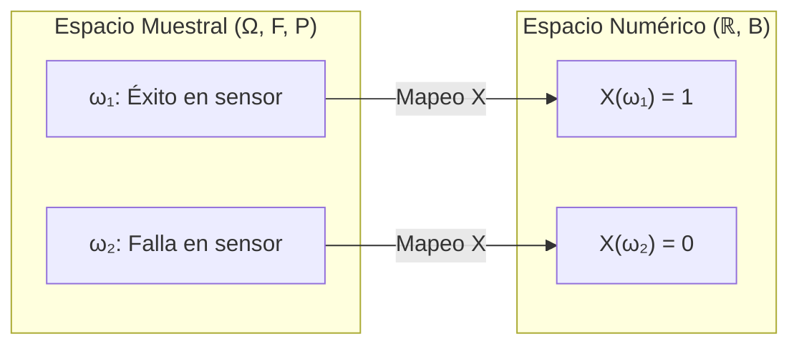

# Variable Aleatoria y Distribuciones de Probabilidad: Manual Técnico de Estudio y Repaso

---

## 1. Concepto y Caracterización de Variables Aleatorias

### 1.1 Definición Matemática y Clasificación
Una **variable aleatoria (v.a.)** es formalmente una función medible $X: \Omega \to \mathbb{R}$ que asigna un valor numérico real a cada resultado elemental $\omega$ del espacio muestral $\Omega$ asociado a un espacio de probabilidad $(\Omega, \mathcal{F}, P)$:

$$\forall B \in \mathcal{B}(\mathbb{R}), \quad X^{-1}(B) = \{\omega \in \Omega : X(\omega) \in B\} \in \mathcal{F}$$



#### Clasificación Fundamental

| Tipo de Variable | Soporte / Rango $R_X$ | Naturaleza de la Medida | Herramienta Principal |
| :--- | :--- | :--- | :--- |
| **Discreta** | Finito o infinito numerable: $\{x_1, x_2, \dots\}$ | Medida de conteo (saltos de masa puntual) | Función de masa $P(X = x)$ |
| **Continua** | Intervalo o unión de intervalos en $\mathbb{R}$ | Medida de Lebesgue ($P(X = c) = 0, \forall c \in \mathbb{R}$) | Función de densidad $f_X(x)$ |

---

### 1.2 Variables Aleatorias Discretas

#### Función de Probabilidad o Masa de Probabilidad $P(X = x)$
Define la probabilidad puntual asignada a cada valor admisible $x_i \in R_X$:
$$p(x_i) = P(X = x_i)$$

**Axiomas reguladores:**
1. $p(x_i) \ge 0, \quad \forall x_i \in R_X$
2. $\sum_{x_i \in R_X} p(x_i) = 1$

#### Función de Distribución Acumulada $F(x)$
Representa la probabilidad de que la variable adopte valores menores o iguales a $x$:
$$F(x) = P(X \le x) = \sum_{x_i \le x} p(x_i)$$

Es una función escalonada, no decreciente, continua por la derecha, con:
$$\lim_{x \to -\infty} F(x) = 0, \quad \lim_{x \to +\infty} F(x) = 1$$

#### Parámetros de Posición y Dispersión

- **Esperanza Matemática (Media $\mu$):**
  $$E[X] = \mu = \sum_{x \in R_X} x \cdot P(X = x)$$
  *(Linealidad estricta: $E[aX + bY + c] = aE[X] + bE[Y] + c$)*

- **Varianza ($\sigma^2$ o $\operatorname{Var}(X)$):**
  $$\operatorname{Var}(X) = \sigma^2 = E[(X - \mu)^2] = E[X^2] - (E[X])^2$$
  Donde el segundo momento ordinario se calcula como:
  $$E[X^2] = \sum_{x \in R_X} x^2 \cdot P(X = x)$$
  *Propiedad de escalamiento: $\operatorname{Var}(aX + b) = a^2 \operatorname{Var}(X)$*.

---

### 1.3 Variables Aleatorias Continuas

#### Función de Densidad de Probabilidad (FDP) $f(x)$
La función $f(x)$ no representa una probabilidad directa en un punto, sino una intensidad o densidad de probabilidad por unidad de medida:
$$P(a \le X \le b) = \int_{a}^{b} f(x) \, dx$$

**Condiciones analíticas obligatorias:**
1. $f(x) \ge 0, \quad \forall x \in \mathbb{R}$
2. $\int_{-\infty}^{+\infty} f(x) \, dx = 1$
3. $P(X = c) = \int_{c}^{c} f(x) \, dx = 0, \quad \forall c \in \mathbb{R}$

> [!WARNING]
> Dado que $P(X = c) = 0$, para variables continuas se cumple:
> $$P(a < X < b) = P(a \le X \le b) = P(a \le X < b) = P(a < X \le b)$$
> A diferencia del caso discreto, incluir o excluir el límite de integración no altera la probabilidad.

#### Función de Distribución Acumulada (FDA) $F(x)$
$$F(x) = P(X \le x) = \int_{-\infty}^{x} f(t) \, dt$$

Por el Teorema Fundamental del Cálculo, si $f(x)$ es continua en $x$:
$$f(x) = \frac{d}{dx} F(x)$$

#### Parámetros de Posición y Dispersión

- **Esperanza Matemática:**
  $$E[X] = \mu = \int_{-\infty}^{+\infty} x \cdot f(x) \, dx$$
- **Varianza:**
  $$\operatorname{Var}(X) = \sigma^2 = \int_{-\infty}^{+\infty} (x - \mu)^2 f(x) \, dx = \int_{-\infty}^{+\infty} x^2 f(x) \, dx - \mu^2$$

<div align="center">
  <svg width="500" height="180" viewBox="0 0 500 180" xmlns="http://www.w3.org/2000/svg">
    <!-- Ejes -->
    <line x1="30" y1="150" x2="470" y2="150" stroke="#64748b" stroke-width="2"/>
    <line x1="50" y1="160" x2="50" y2="20" stroke="#64748b" stroke-width="2"/>
    <text x="475" y="155" fill="#64748b" font-family="sans-serif" font-size="12">x</text>
    <text x="35" y="20" fill="#64748b" font-family="sans-serif" font-size="12">f(x)</text>
    <!-- Área sombreada entre a y b -->
    <path d="M 150 150 L 150 78 Q 200 40 250 40 Q 285 40 320 78 L 320 150 Z" fill="#3b82f6" fill-opacity="0.3"/>
    <!-- Curva de densidad continua -->
    <path d="M 60 148 Q 150 145 200 60 Q 250 25 300 60 Q 360 145 450 148" fill="none" stroke="#2563eb" stroke-width="3"/>
    <!-- Delimitadores a y b -->
    <line x1="150" y1="150" x2="150" y2="78" stroke="#ef4444" stroke-width="2" stroke-dasharray="4"/>
    <line x1="320" y1="150" x2="320" y2="78" stroke="#ef4444" stroke-width="2" stroke-dasharray="4"/>
    <text x="146" y="168" fill="#1e293b" font-family="sans-serif" font-size="12" font-weight="bold">a</text>
    <text x="316" y="168" fill="#1e293b" font-family="sans-serif" font-size="12" font-weight="bold">b</text>
    <text x="205" y="115" fill="#1e40af" font-family="sans-serif" font-size="13" font-weight="bold">P(a ≤ X ≤ b) = ∫ f(x)dx</text>
  </svg>
</div>

---

## 2. Distribuciones de Probabilidad de Variables Discretas

### 2.1 Ensayo y Distribución de Bernoulli

Modela un único experimento con únicamente dos resultados disjuntos y exhaustivos: **Éxito** ($X = 1$) con probabilidad $p$, y **Fracaso** ($X = 0$) con probabilidad $q = 1 - p$.

- **Soporte:** $R_X = \{0, 1\}$
- **Función de masa:**
  $$P(X = x) = p^x (1 - p)^{1 - x}, \quad x \in \{0, 1\}$$
- **Momentos:**
  $$E[X] = p$$
  $$\operatorname{Var}(X) = p(1 - p) = pq$$

---

### 2.2 Distribución Binomial: Modelado de Conteos y Propiedades

Modela la variable $X$ definida como el **número total de éxitos** al repetir $n$ ensayos independientes e idénticos de Bernoulli con probabilidad constante de éxito $p$. Notación: $X \sim \mathcal{B}(n, p)$.

- **Soporte:** $R_X = \{0, 1, 2, \dots, n\}$
- **Función de Masa:**
  $$P(X = k) = \binom{n}{k} p^k (1 - p)^{n - k} = \frac{n!}{k!(n - k)!} p^k (1 - p)^{n - k}$$
- **Momentos fundamentales:**
  $$E[X] = np$$
  $$\operatorname{Var}(X) = np(1 - p)$$
  $$\sigma = \sqrt{np(1 - p)}$$

> [!NOTE]
> **Propiedad Aditiva de la Binomial:**
> Si $X_1 \sim \mathcal{B}(n_1, p)$ y $X_2 \sim \mathcal{B}(n_2, p)$ son mutuamente independientes y comparten el **mismo parámetro $p$**:
> $$Y = X_1 + X_2 \sim \mathcal{B}(n_1 + n_2, p)$$

---

### 2.3 Proceso y Distribución de Poisson

#### El Proceso de Poisson y Eventos Raros
Un proceso de Poisson modela el conteo de eventos puntuales discretos que ocurren de forma continua en un intervalo temporal, espacial o de volumen, bajo los siguientes postulados:
1. **Homogeneidad:** La probabilidad de que ocurra exactamente un evento en un subintervalo infinitesimal $\Delta t$ es proporcional a la longitud del intervalo: $P(1 \text{ evento en } \Delta t) \approx \lambda \Delta t$.
2. **Independencia en intervalos disjuntos:** El conteo de eventos en intervalos no solapados es estocásticamente independiente.
3. **No simultaneidad (orden):** La probabilidad de dos o más eventos simultáneos en $\Delta t$ es despreciable: $o(\Delta t)$.

Si $X$ es el número de ocurrencias en una ventana de observación fija con tasa promedio $\lambda > 0$, entonces $X \sim \operatorname{Poisson}(\lambda)$.

- **Soporte:** $R_X = \{0, 1, 2, \dots, \infty\}$
- **Función de Masa:**
  $$P(X = k) = \frac{e^{-\lambda} \lambda^k}{k!}$$
- **Equidispersión:**
  $$E[X] = \lambda, \quad \operatorname{Var}(X) = \lambda$$

> [!TIP]
> **Aproximación de Poisson a la Binomial (Ley de Eventos Raros):**
> Cuando $n \to \infty$ y $p \to 0$ tal que el producto $np = \lambda$ se mantiene constante (en la práctica: $n \ge 30$ y $p \le 0.05$):
> $$\binom{n}{k} p^k (1 - p)^{n - k} \approx \frac{e^{-np} (np)^k}{k!}$$

---

### 2.4 Propiedad Reproductiva de la Distribución de Poisson

Si se suman variables de Poisson independientes, la distribución resultante se preserva dentro de la misma familia, sumando directamente sus tasas promedio.

$$\text{Sean } X_1 \sim \operatorname{Poisson}(\lambda_1) \text{ y } X_2 \sim \operatorname{Poisson}(\lambda_2) \text{ independientes. Entonces:}$$
$$Y = X_1 + X_2 \sim \operatorname{Poisson}(\lambda_1 + \lambda_2)$$

**Demostración analítica mediante convolución discreta:**
$$P(Y = k) = \sum_{j=0}^{k} P(X_1 = j) P(X_2 = k - j) = \sum_{j=0}^{k} \frac{e^{-\lambda_1} \lambda_1^j}{j!} \frac{e^{-\lambda_2} \lambda_2^{k-j}}{(k - j)!}$$
$$= e^{-(\lambda_1 + \lambda_2)} \frac{1}{k!} \sum_{j=0}^{k} \frac{k!}{j!(k-j)!} \lambda_1^j \lambda_2^{k-j} = \frac{e^{-(\lambda_1 + \lambda_2)}}{k!} (\lambda_1 + \lambda_2)^k$$
Demostrando formalmente la estructura de una variable $\operatorname{Poisson}(\lambda_1 + \lambda_2)$.

---

## 3. Distribuciones de Probabilidad de Variables Continuas

### 3.1 Distribución Uniforme Continua

Modela una variable continua cuyos valores están acotados en el intervalo cerrado $[a, b]$, con densidad rigurosamente constante en todo el intervalo. Notación: $X \sim \mathcal{U}(a, b)$.

- **Función de Densidad:**
  $$f(x) = \begin{cases} \dfrac{1}{b - a}, & a \le x \le b \\ 0, & \text{en otro caso} \end{cases}$$
- **Función de Distribución Acumulada:**
  $$F(x) = \begin{cases} 0, & x < a \\ \dfrac{x - a}{b - a}, & a \le x \le b \\ 1, & x > b \end{cases}$$
- **Parámetros:**
  $$E[X] = \frac{a + b}{2}, \quad \operatorname{Var}(X) = \frac{(b - a)^2}{12}$$

---

### 3.2 Distribución Exponencial

#### Relación con el Proceso de Poisson
Si el número de eventos en un intervalo sigue una distribución $\operatorname{Poisson}(\lambda)$, entonces la variable aleatoria continua $T$, definida como el **tiempo transcurrido hasta la ocurrencia del primer evento** (o entre eventos consecutivos), sigue una distribución Exponencial con parámetro $\lambda > 0$. Notación: $T \sim \operatorname{Exp}(\lambda)$.

- **Función de Densidad:**
  $$f(t) = \begin{cases} \lambda e^{-\lambda t}, & t \ge 0 \\ 0, & t < 0 \end{cases}$$
- **Función de Distribución Acumulada y de Supervivencia:**
  $$F(t) = 1 - e^{-\lambda t}, \quad S(t) = P(T > t) = e^{-\lambda t}$$
- **Momentos:**
  $$E[T] = \frac{1}{\lambda}, \quad \operatorname{Var}(T) = \frac{1}{\lambda^2}, \quad \sigma_T = \frac{1}{\lambda}$$

#### Propiedad de Pérdida de Memoria (Memoryless)
La probabilidad condicional de que el sistema opere durante $t$ unidades de tiempo adicionales, dado que ya ha sobrevivido $s$ unidades de tiempo, depende únicamente del nuevo lapso $t$:

$$P(T > s + t \mid T > s) = P(T > t), \quad \forall s, t \ge 0$$

$$\text{Demostración: } \frac{P(T > s + t \cap T > s)}{P(T > s)} = \frac{P(T > s + t)}{P(T > s)} = \frac{e^{-\lambda(s + t)}}{e^{-\lambda s}} = e^{-\lambda t} = P(T > t)$$

> [!NOTE]
> La distribución exponencial es la **única distribución continua** que satisface la propiedad de pérdida de memoria.

---

### 3.3 Distribución Normal

#### Propiedades de la Campana de Gauss
Una variable aleatoria continua $X$ sigue una distribución Normal con media $\mu \in \mathbb{R}$ y varianza $\sigma^2 > 0$, denotada como $X \sim \mathcal{N}(\mu, \sigma^2)$, si su densidad es:
$$f(x) = \frac{1}{\sigma \sqrt{2\pi}} \exp\left( -\frac{(x - \mu)^2}{2\sigma^2} \right), \quad -\infty < x < \infty$$

**Propiedades estructurales:**
1. **Simetría:** Es perfectamente simétrica respecto a $x = \mu \implies \text{Asimetría} = 0$. Coinciden media, mediana y moda en $\mu$.
2. **Puntos de Inflexión:** La segunda derivada se anula exactamente en $x = \mu \pm \sigma$.
3. **Curtosis Mesocúrtica:** Coeficiente de curtosis estándar de Fisher $= 0$ (o exceso $= 3$ sin centrar).
4. **Regla Empírica (68 - 95 - 99.7):**
   - $P(\mu - \sigma \le X \le \mu + \sigma) \approx 0.6827$
   - $P(\mu - 2\sigma \le X \le \mu + 2\sigma) \approx 0.9545$
   - $P(\mu - 3\sigma \le X \le \mu + 3\sigma) \approx 0.9973$

<div align="center">
  <svg width="500" height="170" viewBox="0 0 500 170" xmlns="http://www.w3.org/2000/svg">
    <!-- Eje X -->
    <line x1="20" y1="140" x2="480" y2="140" stroke="#64748b" stroke-width="2"/>
    <!-- Curva Normal -->
    <path d="M 30 139 C 120 138, 170 120, 210 60 C 235 25, 265 25, 290 60 C 330 120, 380 138, 470 139" fill="none" stroke="#0284c7" stroke-width="3"/>
    <!-- Líneas de desviación -->
    <line x1="250" y1="140" x2="250" y2="30" stroke="#0369a1" stroke-width="2" stroke-dasharray="3"/>
    <line x1="185" y1="140" x2="185" y2="82" stroke="#64748b" stroke-width="1.5" stroke-dasharray="2"/>
    <line x1="315" y1="140" x2="315" y2="82" stroke="#64748b" stroke-width="1.5" stroke-dasharray="2"/>
    <!-- Etiquetas -->
    <text x="246" y="156" fill="#0f172a" font-family="sans-serif" font-size="12" font-weight="bold">μ</text>
    <text x="165" y="156" fill="#334155" font-family="sans-serif" font-size="11">μ - σ</text>
    <text x="300" y="156" fill="#334155" font-family="sans-serif" font-size="11">μ + σ</text>
    <text x="220" y="85" fill="#0284c7" font-family="sans-serif" font-size="12" font-weight="bold">~68.3%</text>
  </svg>
</div>

#### Estandarización ($Z$)
La transformación lineal afín $Z = \frac{X - \mu}{\sigma}$ traslada la distribución a una Normal Estándar con media nula y varianza unitaria: $Z \sim \mathcal{N}(0, 1)$.

$$P(a \le X \le b) = P\left( \frac{a - \mu}{\sigma} \le Z \le \frac{b - \mu}{\sigma} \right) = \Phi\left(\frac{b - \mu}{\sigma}\right) - \Phi\left(\frac{a - \mu}{\sigma}\right)$$
Donde $\Phi(z) = \int_{-\infty}^{z} \frac{1}{\sqrt{2\pi}} e^{-t^2/2} \, dt$ es la función acumulada tipificada.

#### Propiedad Reproductiva de la Normal
Cualquier combinación lineal finita de variables aleatorias normales **mutuamente independientes** $X_i \sim \mathcal{N}(\mu_i, \sigma_i^2)$ preserva la normalidad de forma exacta:

$$Y = \sum_{i=1}^{k} c_i X_i \implies Y \sim \mathcal{N}\left( \sum_{i=1}^{k} c_i \mu_i, \; \sum_{i=1}^{k} c_i^2 \sigma_i^2 \right)$$

---

### 3.4 Teoremas de Aproximación: Teorema de De Moivre-Laplace

Si $X \sim \mathcal{B}(n, p)$, a medida que $n \to \infty$, la forma de la función de masa binomial converge asintóticamente a una densidad normal continua con media $\mu = np$ y varianza $\sigma^2 = np(1 - p)$.

**Criterios de aplicabilidad:**
$$np \ge 5 \quad \text{y} \quad n(1 - p) \ge 5 \quad (\text{preferiblemente } np(1-p) > 9)$$

#### Factor de Corrección por Continuidad (de Yates)
Dado que se aproxima una masa discreta concentrada en barras de ancho 1 centradas en $k$ mediante una integral continua sobre $\mathbb{R}$, cada punto entero $k$ debe expandirse al intervalo continuo $[k - 0.5, k + 0.5]$:

$$P(X = k) \approx P\left( k - 0.5 \le Y \le k + 0.5 \right)$$
$$P(X \le k) \approx P(Y \le k + 0.5) = \Phi\left( \frac{k + 0.5 - np}{\sqrt{np(1-p)}} \right)$$
$$P(X \ge k) \approx P(Y \ge k - 0.5) = 1 - \Phi\left( \frac{k - 0.5 - np}{\sqrt{np(1-p)}} \right)$$

---

## 4. Distribuciones Continuas Derivadas del Muestreo Normal

```mermaid
flowchart TD
    Z["Z ~ N(0, 1) Normal Estándar"] -->|Suma de cuadrados Z²| Chi["Chi-cuadrado: χ²(k)"]
    Z -->|Cociente Z / √(χ²/k)| Stud["t de Student: t(k)"]
    Chi -->|Razón de dos χ² independientes: (χ₁²/d₁) / (χ₂²/d₂)| Sned["F de Snedecor: F(d₁, d₂)"]
```

---

### 4.1 Distribución Chi-cuadrado ($\chi^2$)

#### Definición y Génesis
Sean $Z_1, Z_2, \dots, Z_k$ variables aleatorias continuas independientes con distribución normal estándar $Z_i \sim \mathcal{N}(0, 1)$. La suma de sus cuadrados define una variable Chi-cuadrado con $k$ grados de libertad:

$$X = \sum_{i=1}^{k} Z_i^2 \sim \chi^2(k)$$

- **Soporte:** $x \in (0, \infty)$
- **Función de Densidad:**
  $$f(x) = \frac{1}{2^{k/2} \Gamma(k/2)} x^{(k/2) - 1} e^{-x/2}, \quad x > 0$$
- **Momentos:**
  $$E[X] = k, \quad \operatorname{Var}(X) = 2k$$

#### Propiedad Reproductiva de la $\chi^2$
Si $X_1 \sim \chi^2(k_1)$ y $X_2 \sim \chi^2(k_2)$ son mutuamente independientes:
$$Y = X_1 + X_2 \sim \chi^2(k_1 + k_2)$$

---

### 4.2 Distribución $t$ de Student

#### Definición y Génesis Estocástica
Surge para estimar la media de una población con distribución normal cuando el tamaño muestral es pequeño ($n < 30$) y la varianza poblacional $\sigma^2$ es desconocida, debiendo sustituirse por la varianza muestral $S^2$.

Sean $Z \sim \mathcal{N}(0, 1)$ y $U \sim \chi^2(k)$ variables aleatorias mutuamente independientes. La variable $T$:
$$T = \frac{Z}{\sqrt{\dfrac{U}{k}}} \sim t(k)$$
sigue una distribución $t$ de Student con $k$ grados de libertad.

#### Características Estructurales
- **Forma:** Curva acampanada, estrictamente simétrica respecto al origen ($t = 0$).
- **Pesadez de colas (Leptocúrtica):** Sus colas decaen más lentamente (según una ley de potencias) que las colas de la normal (que decaen de forma exponencial cuadrática), reflejando mayor incertidumbre muestral.
- **Convergencia Asintótica:**
  $$\lim_{k \to \infty} t(k) \xrightarrow{\mathcal{D}} \mathcal{N}(0, 1)$$
- **Momentos:**
  $$E[T] = 0 \quad (\text{para } k > 1)$$
  $$\operatorname{Var}(T) = \frac{k}{k - 2} \quad (\text{para } k > 2)$$

---

### 4.3 Distribución $F$ de Snedecor / Fisher

#### Definición por Cociente de Varianzas
Surge para contrastar hipótesis sobre la igualdad de varianzas en poblaciones normales independientes y en el Análisis de Varianza (ANOVA).

Sean $U_1 \sim \chi^2(d_1)$ y $U_2 \sim \chi^2(d_2)$ variables independientes con $d_1$ y $d_2$ grados de libertad respectivamente. La variable $F$:
$$F = \frac{U_1 / d_1}{U_2 / d_2} \sim \mathcal{F}(d_1, d_2)$$

- **Soporte:** $x \in (0, \infty)$
- **Propiedad de Inversión Recíproca:**
  $$P(F \ge c) = P\left( \frac{1}{F} \le \frac{1}{c} \right) \implies F_{1 - \alpha, \, d_1, \, d_2} = \frac{1}{F_{\alpha, \, d_2, \, d_1}}$$
- **Relación directa con la distribución $t$:**
  $$T \sim t(k) \implies T^2 \sim \mathcal{F}(1, k)$$

---

### 4.4 Distribución de Weibull

#### Modelado de Tiempos y Tasas de Falla Variables
A diferencia de la distribución exponencial (cuya tasa de fallas instantánea es estrictamente constante), la distribución de Weibull modela procesos de envejecimiento, desgaste mecánico y confiabilidad de sistemas con tasas de falla dinámicas en el tiempo.

Una variable aleatoria continua $T$ sigue una distribución de Weibull con parámetro de forma $\beta > 0$ y parámetro de escala $\eta > 0$ ($T \sim \operatorname{Weibull}(\beta, \eta)$):

- **Función de Densidad:**
  $$f(t) = \frac{\beta}{\eta} \left( \frac{t}{\eta} \right)^{\beta - 1} \exp\left( -\left( \frac{t}{\eta} \right)^\beta \right), \quad t \ge 0$$
- **Función de Distribución Acumulada:**
  $$F(t) = 1 - \exp\left( -\left( \frac{t}{\eta} \right)^\beta \right), \quad t \ge 0$$
- **Función de Tasa de Falla / Hazard Rate $h(t)$:**
  $$h(t) = \frac{f(t)}{1 - F(t)} = \frac{\beta}{\eta} \left( \frac{t}{\eta} \right)^{\beta - 1}$$

#### Comportamiento del Parámetro de Forma $\beta$ (Curva de la Bañera)

| Valor del Parámetro $\beta$ | Tasa de Falla $h(t)$ | Interpretación en Ingeniería / Confiabilidad |
| :--- | :--- | :--- |
| $\beta < 1$ | **Decreciente** | Fallas prematuras ("mortalidad infantil" o defectos de fabricación). |
| $\beta = 1$ | **Constante** ($h(t) = 1/\eta$) | Se reduce exactamente a la distribución **Exponencial** ($\lambda = 1/\eta$). |
| $\beta > 1$ | **Creciente** | Desgaste estructural, fatiga de materiales y envejecimiento activo. |
| $\beta \approx 3.4$ | Creciente y simétrica | Se asemeja estrechamente a la campana de Gauss. |

---

## 5. Implementación Computacional y Simulación de Distribuciones

El siguiente bloque en Python sintetiza la evaluación analítica, el cálculo de densidades y la aproximación de De Moivre-Laplace:

```python
import numpy as np
from scipy import stats

def evaluar_modelos_estocasticos():
    # 1. Distribución Binomial y Poisson (Caso Raro)
    n, p = 100, 0.02
    k = 2
    prob_binom = stats.binom.pmf(k, n, p)
    prob_poiss = stats.poisson.pmf(k, mu=n * p)
    print(f"[Discretas] P(X = {k}): Binomial={prob_binom:.5f} | Poisson={prob_poiss:.5f}")

    # 2. Pérdida de memoria en la Exponencial
    # P(T > s + t | T > s) == P(T > t)
    lambd = 0.5
    s, t = 4.0, 2.0
    p_cond = (1 - stats.expon.cdf(s + t, scale=1/lambd)) / (1 - stats.expon.cdf(s, scale=1/lambd))
    p_direct = 1 - stats.expon.cdf(t, scale=1/lambd)
    np.testing.assert_almost_equal(p_cond, p_direct)
    print(f"[Exponencial] Memoryless test superado: P(T > {s}+{t} | T > {s}) = {p_cond:.4f}")

    # 3. Teorema de De Moivre-Laplace (Aproximación con corrección de continuidad)
    n_aprox, p_aprox = 50, 0.4
    k_aprox = 25
    mu = n_aprox * p_aprox
    sigma = np.sqrt(n_aprox * p_aprox * (1 - p_aprox))

    # P(X <= 25) real vs aproximada
    p_exacta = stats.binom.cdf(k_aprox, n_aprox, p_aprox)
    # Corrección por continuidad: P(X <= k) -> P(Y <= k + 0.5)
    p_aprox_normal = stats.norm.cdf(k_aprox + 0.5, loc=mu, scale=sigma)
    print(f"[De Moivre-Laplace] P(X <= {k_aprox}): Binomial={p_exacta:.5f} | Normal-Yates={p_aprox_normal:.5f}")

if __name__ == "__main__":
    evaluar_modelos_estocasticos()
```

---

## 6. Cuadro Resumen Sinóptico de Distribuciones

| Distribución | Parámetros | Soporte $R_X$ | Esperanza $E[X]$ | Varianza $\operatorname{Var}(X)$ | Propiedad Destacada |
| :--- | :--- | :--- | :--- | :--- | :--- |
| **Bernoulli** | $p \in [0, 1]$ | $\{0, 1\}$ | $p$ | $p(1 - p)$ | Base de procesos binarios |
| **Binomial** | $n \in \mathbb{N}, p \in [0, 1]$ | $\{0, 1, \dots, n\}$ | $np$ | $np(1 - p)$ | Aditiva para igual $p$ |
| **Poisson** | $\lambda > 0$ | $\{0, 1, 2, \dots\}$ | $\lambda$ | $\lambda$ | Equidispersión y reproductiva |
| **Uniforme** | $a < b \in \mathbb{R}$ | $[a, b]$ | $\dfrac{a + b}{2}$ | $\dfrac{(b - a)^2}{12}$ | Máxima entropía continua acotada |
| **Exponencial** | $\lambda > 0$ | $[0, \infty)$ | $\dfrac{1}{\lambda}$ | $\dfrac{1}{\lambda^2}$ | Pérdida de memoria |
| **Normal** | $\mu \in \mathbb{R}, \sigma > 0$ | $(-\infty, \infty)$ | $\mu$ | $\sigma^2$ | Simétrica; Teorema Central del Límite |
| **$\chi^2$** | $k \in \mathbb{N}$ | $(0, \infty)$ | $k$ | $2k$ | Reproductiva en grados de libertad |
| **$t$-Student** | $k \in \mathbb{N}$ | $(-\infty, \infty)$ | $0 \; (k > 1)$ | $\dfrac{k}{k - 2} \; (k > 2)$ | Colas pesadas; robustez ante muestras pequeñas |
| **$F$-Fisher** | $d_1, d_2 \in \mathbb{N}$ | $(0, \infty)$ | $\dfrac{d_2}{d_2 - 2} \; (d_2 > 2)$ | Función de $d_1, d_2$ | Cociente de varianzas muestrales |
| **Weibull** | $\beta > 0, \eta > 0$ | $[0, \infty)$ | $\eta \Gamma\left(1 + \frac{1}{\beta}\right)$ | $\eta^2 \left[\Gamma\left(1 + \frac{2}{\beta}\right) - \Gamma^2\left(1 + \frac{1}{\beta}\right)\right]$ | Tasa de falla dependiente del tiempo |