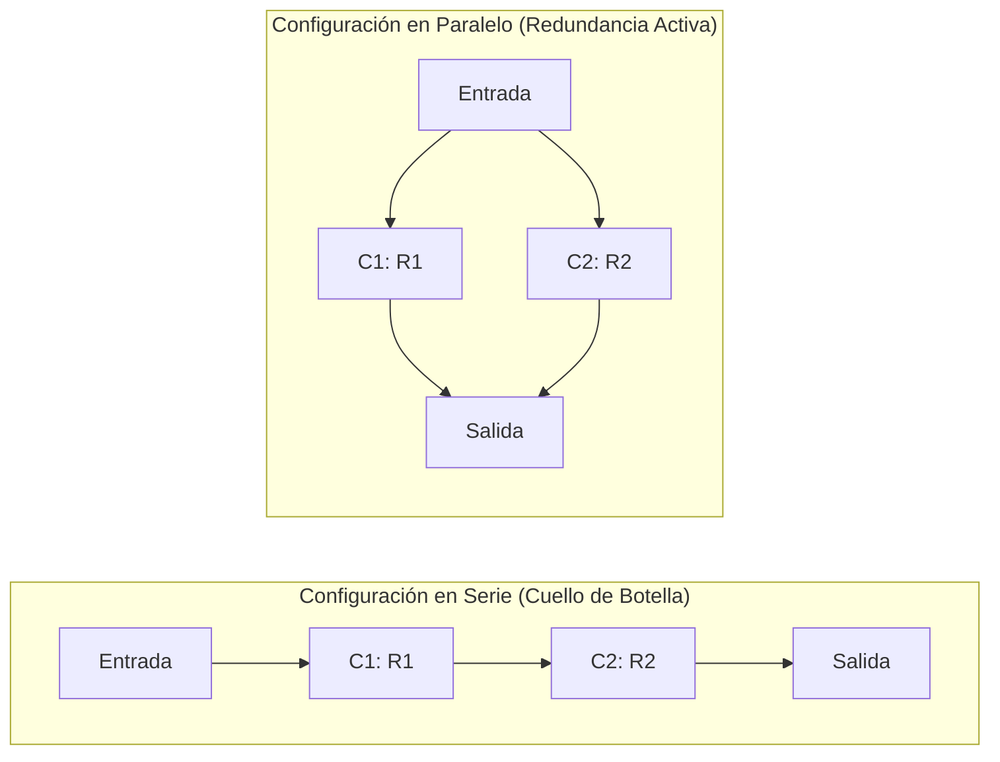
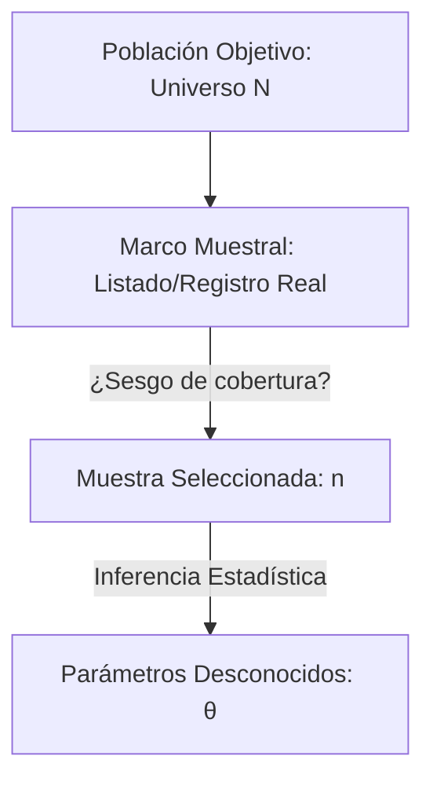
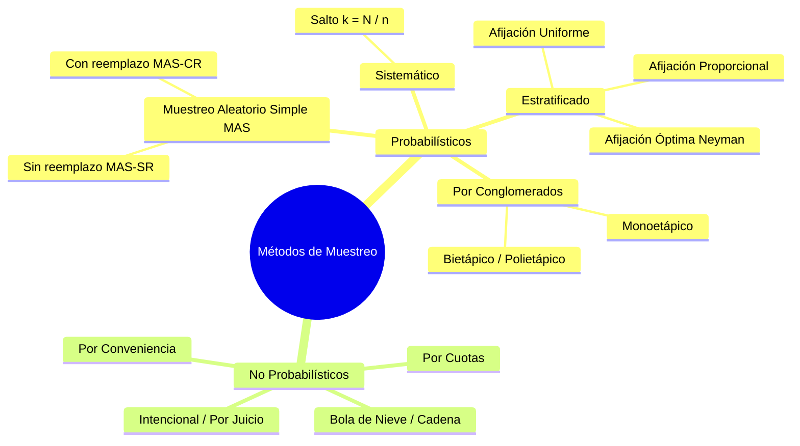
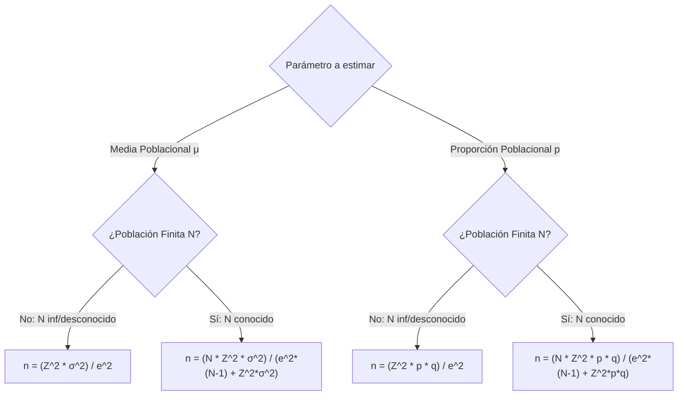
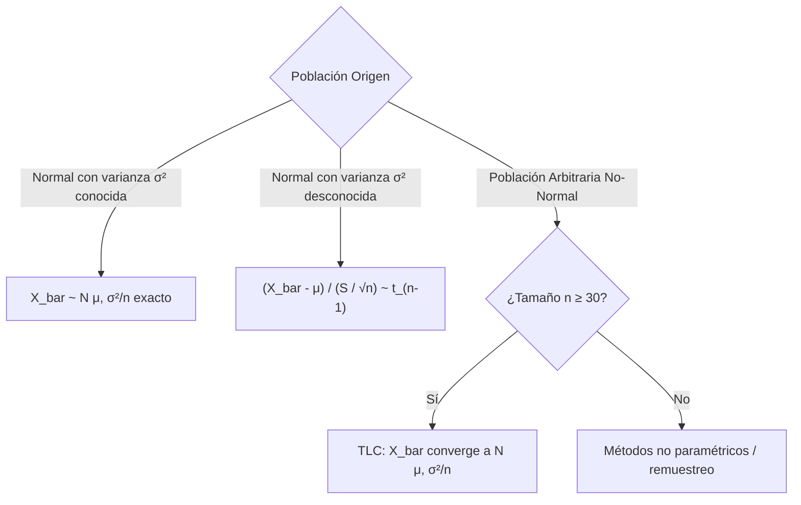
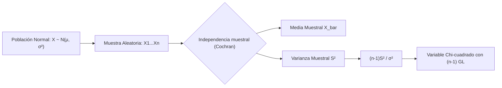

# Teoría de Confiabilidad y Distribuciones Muestrales: Manual Técnico de Estudio y Repaso

---

## 1. Fundamentos de la Teoría de Confiabilidad

### 1.1 Concepto de Confiabilidad Aplicada a Productos, Componentes y Sistemas

La **confiabilidad** $R(t)$ se define formalmente como la probabilidad condicional de que un componente, equipo o sistema desempeñe satisfactoriamente la función requerida, bajo condiciones operativas y ambientales especificadas, durante un intervalo de tiempo $[0, t]$, dado que operaba correctamente en $t = 0$.

Sea $T$ una variable aleatoria continua no negativa que modela el tiempo hasta la falla ($T \ge 0$), con función de densidad de probabilidad $f(t)$ y función de distribución acumulada $F(t) = P(T \le t)$ (probabilidad de falla acumulada o no-confiabilidad):

$$
R(t) = P(T > t) = 1 - F(t) = \int_{t}^{\infty} f(u)\,du
$$

#### Propiedades Fundamentales de $R(t)$
1. $R(0) = 1$ (el elemento está en perfecto estado operativo en el origen).
2. $\lim_{t \to \infty} R(t) = 0$ (degradación total a tiempo infinito).
3. Monótona no creciente: $\frac{d R(t)}{dt} = -f(t) \le 0, \quad \forall t \ge 0$.

#### Confiabilidad Estructural en Sistemas
Para subsistemas con componentes estocásticamente independientes:

- **Sistema en Serie (Arquitectura $k$-out-of-$n$ con $k=n$):** La falla de cualquier componente colapsa el sistema.
  $$
  R_{\text{serie}}(t) = \prod_{i=1}^{n} R_i(t)
  $$
- **Sistema en Paralelo Activo (Arquitectura 1-out-of-$n$):** El sistema opera si al menos un componente sobrevive.
  $$
  R_{\text{paralelo}}(t) = 1 - \prod_{i=1}^{n} \left[1 - R_i(t)\right]
  $$



---

### 1.2 Función de Supervivencia y Función de Riesgo ($\lambda(t)$)

#### Función de Supervivencia
En análisis bioestadístico e ingeniería de confiabilidad, la **función de supervivencia** $S(t)$ es formal y matemáticamente idéntica a la función de confiabilidad $R(t)$:

$$
S(t) \equiv R(t) = P(T > t)
$$

#### Función de Riesgo / Tasa Instantánea de Falla ($\lambda(t)$ o $h(t)$)
Mide la propensión al colapso por unidad de tiempo en el instante $t$, condicionada a que la unidad haya sobrevivido hasta dicho instante:

$$
\lambda(t) = \lim_{\Delta t \to 0} \frac{P(t < T \le t + \Delta t \mid T > t)}{\Delta t} = \lim_{\Delta t \to 0} \frac{P(t < T \le t + \Delta t)}{\Delta t \cdot P(T > t)}
$$

Puesto que $P(t < T \le t + \Delta t) = F(t + \Delta t) - F(t)$:

$$
\lambda(t) = \frac{f(t)}{R(t)} = \frac{-\frac{d}{dt}R(t)}{R(t)} = -\frac{d}{dt} \left[\ln R(t)\right]
$$

#### Relación Integral Inversa y Función de Riesgo Acumulado
Integrando la ecuación diferencial con condición inicial $R(0) = 1$:

$$
H(t) = \int_{0}^{t} \lambda(u)\,du \quad \implies \quad R(t) = \exp\left( -\int_{0}^{t} \lambda(u)\,du \right) = e^{-H(t)}
$$

La densidad de probabilidad de fallas queda unívocamente determinada por la tasa instantánea:

$$
f(t) = \lambda(t) \exp\left( -\int_{0}^{t} \lambda(u)\,du \right)
$$

#### Tiempo Medio Hasta la Falla (MTTF)
Para variables continuas $T \ge 0$, aplicando integración por partes:

$$
\text{MTTF} = E[T] = \int_{0}^{\infty} t f(t)\,dt = \int_{0}^{\infty} R(t)\,dt
$$

> [!NOTE]
> La tasa de falla $\lambda(t)$ **no** es una probabilidad: puede superar el valor unitario ($1.0$) y posee dimensiones de $\text{tiempo}^{-1}$ (por ejemplo, fallas por hora o FITs: $1 \text{ FIT} = 10^{-9} \text{ fallas/hora}$).

---

### 1.3 Modelos Probabilísticos de Tiempos de Fallas

#### Modelo con Distribución Exponencial (Tasa de Falla Constante)
Modela componentes no sujetos a envejecimiento físico prematuro ni acumulación de fatiga mecánica, gobernados exclusivamente por eventos de estrés externo poissoniano.

- **Parámetro:** $\lambda > 0$ (tasa constante de fallas).
- **Densidad:** $f(t) = \lambda e^{-\lambda t}, \quad t \ge 0$.
- **Confiabilidad:** $R(t) = e^{-\lambda t}$.
- **Tasa de falla:** $\lambda(t) = \frac{\lambda e^{-\lambda t}}{e^{-\lambda t}} = \lambda \quad (\text{constante})$.
- **Métricas:** $\text{MTTF} = \frac{1}{\lambda}$, $\quad \operatorname{Var}(T) = \frac{1}{\lambda^2}$.

> [!WARNING]
> La hipótesis de tasa constante ($\lambda(t) = \lambda$) implica la **pérdida total de memoria**:
> $$P(T > t + s \mid T > s) = P(T > t)$$
> Un componente usado que aún funciona es estocásticamente idéntico a uno recién salido de fábrica. Es inapropiado para modelar sistemas mecánicos sujetos a desgaste, fricción o corrosión.

---

#### Modelo con Distribución Weibull (Tasas de Falla Variables y Curva de la Bañera)
Modela sistemas con tasas de falla dependientes del tiempo, permitiendo caracterizar las tres etapas de la vida operativa mediante su parámetro de forma.

- **Parámetro de forma ($\beta > 0$ o $k$):** Determina la geometría de la tasa de falla.
- **Parámetro de escala ($\eta > 0$ o $\lambda_0$):** Vida característica (tiempo al cual el $63.2\%$ de las unidades ha fallado, pues $F(\eta) = 1 - e^{-1} \approx 0.6321$).

$$
f(t) = \frac{\beta}{\eta}\left(\frac{t}{\eta}\right)^{\beta - 1} \exp\left[-\left(\frac{t}{\eta}\right)^\beta\right], \quad t \ge 0
$$

$$
R(t) = \exp\left[-\left(\frac{t}{\eta}\right)^\beta\right], \quad \lambda(t) = \frac{\beta}{\eta}\left(\frac{t}{\eta}\right)^{\beta - 1}
$$

$$
\text{MTTF} = \eta \, \Gamma\left(1 + \frac{1}{\beta}\right)
$$

Donde $\Gamma(z) = \int_{0}^{\infty} u^{z-1} e^{-u} du$ es la función Gamma de Euler.

| Valor de $\beta$ | Comportamiento de $\lambda(t)$ | Fase Física de Falla | Mecanismo Físico Típico |
| :--- | :--- | :--- | :--- |
| $\beta < 1$ | Monótona decreciente ($\lambda'(t) < 0$) | **Mortalidad infantil** / Rodaje inicial | Defectos de manufactura, soldaduras frías, errores de ensamble. |
| $\beta = 1$ | Constante ($\lambda(t) = \frac{1}{\eta}$) | **Vida útil** / Fallas aleatorias | Se reduce a la distribución Exponencial. Sobrecargas externas imprevistas. |
| $\beta > 1$ | Monótona creciente ($\lambda'(t) > 0$) | **Desgaste** / Fin de vida | Fatiga de materiales, corrosión, abrasión, degradación térmica. |

<div align="center">
  <svg width="600" height="230" viewBox="0 0 600 230" xmlns="http://www.w3.org/2000/svg">
    <!-- Ejes -->
    <line x1="60" y1="180" x2="560" y2="180" stroke="#64748b" stroke-width="2" />
    <line x1="60" y1="180" x2="60" y2="20" stroke="#64748b" stroke-width="2" />
    <text x="560" y="200" fill="#64748b" font-size="12" font-family="sans-serif">Tiempo (t)</text>
    <text x="20" y="30" fill="#64748b" font-size="12" font-family="sans-serif" transform="rotate(-90 20,30)">Tasa de falla λ(t)</text>

    <!-- Zonas delimitadas por líneas punteadas -->
    <line x1="200" y1="20" x2="200" y2="180" stroke="#94a3b8" stroke-dasharray="4" />
    <line x1="420" y1="20" x2="420" y2="180" stroke="#94a3b8" stroke-dasharray="4" />

    <!-- Curva de la bañera -->
    <path d="M 70 40 Q 150 140 200 140 L 420 140 Q 480 140 540 30" fill="none" stroke="#2563eb" stroke-width="3.5" />

    <!-- Etiquetas de regiones -->
    <rect x="75" y="45" width="115" height="30" rx="4" fill="#fee2e2" />
    <text x="132" y="65" fill="#991b1b" font-size="11" font-weight="bold" text-anchor="middle" font-family="sans-serif">Fase I: β &lt; 1</text>
    <text x="132" y="115" fill="#475569" font-size="10" text-anchor="middle" font-family="sans-serif">Mortalidad Infantil</text>

    <rect x="250" y="45" width="120" height="30" rx="4" fill="#dcfce7" />
    <text x="310" y="65" fill="#166534" font-size="11" font-weight="bold" text-anchor="middle" font-family="sans-serif">Fase II: β = 1</text>
    <text x="310" y="115" fill="#475569" font-size="10" text-anchor="middle" font-family="sans-serif">Vida Útil (Exponencial)</text>

    <rect x="435" y="45" width="115" height="30" rx="4" fill="#fef3c7" />
    <text x="492" y="65" fill="#92400e" font-size="11" font-weight="bold" text-anchor="middle" font-family="sans-serif">Fase III: β &gt; 1</text>
    <text x="492" y="115" fill="#475569" font-size="10" text-anchor="middle" font-family="sans-serif">Envejecimiento</text>
  </svg>
</div>

```python
import numpy as np

def weibull_reliability_metrics(t: float, beta: float, eta: float) -> dict:
    """Calcula métricas clave de confiabilidad bajo modelo de Weibull de 2 parámetros."""
    if beta <= 0 or eta <= 0 or t < 0:
        raise ValueError("Parámetros y tiempo deben ser estrictamente positivos.")
    
    # R(t) = exp(-(t/eta)^beta)
    r_t = np.exp(- (t / eta) ** beta)
    f_t = (beta / eta) * ((t / eta) ** (beta - 1)) * r_t
    hazard_lambda_t = (beta / eta) * ((t / eta) ** (beta - 1))
    
    return {
        "Confiabilidad_R(t)": float(r_t),
        "Densidad_f(t)": float(f_t),
        "Tasa_Instantanea_lambda(t)": float(hazard_lambda_t)
    }

# Prueba: Sistema en fase de desgaste (beta=2.5, vida característica eta=1000 horas)
print(weibull_reliability_metrics(t=500.0, beta=2.5, eta=1000.0))
```

---

## 2. Teoría del Muestreo y Estimación

### 2.1 Conceptos Generales, Representatividad y Marco Muestral



- **Población Objetivo:** Conjunto exhaustivo de elementos o unidades elementales sobre los cuales recae el estudio.
- **Marco Muestral:** Dispositivo material, registro, base de datos o cartografía que permite individualizar e identificar operativamente a cada unidad de la población. 
- **Error de Cobertura:** Discrepancia entre la población objetivo y el marco muestral (subcobertura si faltan unidades, sobrecobertura si hay duplicados o elementos extraños).
- **Representatividad:** Condición estocástica de una muestra cuya estructura reproduce proporcionalmente las características, heterogeneidad y variabilidad intrínseca de la población bajo análisis. Requiere diseños de selección aleatoria objetiva.

---

### 2.2 Métodos y Tipos de Muestreo



#### Métodos Probabilísticos
Todo elemento de la población tiene una probabilidad de selección conocida e idénticamente no nula: $\pi_i = P(i \in \text{Muestra}) > 0$.

1. **Muestreo Aleatorio Simple (MAS):**
   - Cada posible combinación de $n$ elementos tiene la misma probabilidad de selección: $\binom{N}{n}^{-1}$.
   - Homogeneidad requerida en la población.

2. **Muestreo Sistemático:**
   - Selección de unidades a intervalos regulares: $k = \lfloor N/n \rfloor$.
   - Se selecciona un punto de arranque aleatorio $A \sim \mathcal{U}\{1, k\}$, seleccionando luego $\{A, A+k, A+2k, \dots, A+(n-1)k\}$.
   - **Riesgo:** Pérdida de representatividad si la lista presenta periodicidades cíclicas que sincronicen con $k$.

3. **Muestreo Estratificado:**
   - La población se divide en $L$ estratos mutuamente excluyentes y conjuntamente exhaustivos ($N = \sum N_h$), donde las unidades son internamente homogéneas ($\sigma_h^2$ mínima) y heterogéneas entre estratos.
   - **Afijación de la muestra ($n = \sum n_h$):**
     - *Proporcional:* $n_h = n \left(\frac{N_h}{N}\right)$.
     - *Óptima de Neyman (minimiza la varianza del estimador bajo costos iguales):*
       $$
       n_h = n \frac{N_h \sigma_h}{\sum_{j=1}^{L} N_j \sigma_j}
       $$

4. **Muestreo por Conglomerados:**
   - La población se divide en grupos naturalmente formados (clusters) internamente heterogéneos y homogéneos entre sí (cada conglomerado funciona como una versión a escala reducida de la población).
   - Se seleccionan conglomerados completos al azar (monoetápico) o submuestras dentro de ellos (bietápico). Alta eficiencia logística y bajo costo por unidad.

#### Métodos No Probabilísticos
La probabilidad de inclusión $\pi_i$ es indeterminada o nula para sectores de la población. No permiten cuantificar formalmente el margen de error probabilístico ni realizar inferencias estadísticas válidas sin suposiciones de modelo arbitrarias.
- **Por Conveniencia:** Selección de unidades de acceso inmediato al investigador.
- **Por Cuotas:** Asignación de cuotas de perfiles demográficos sin aleatorización en la captación final.
- **Bola de Nieve:** Casos iniciales refieren nuevos sujetos (diseñado para poblaciones ocultas o marginales).
- **Intencional (por juicio):** Selección discrecional basada en conocimiento de expertos.

---

### 2.3 Determinación del Tamaño Óptimo de Muestra

El tamaño muestral $n$ equilibra precisión estadística (error máximo tolerable $e$) y nivel de confianza $(1-\alpha)$, cuantificado por el cuantil normal estándar $Z_{1-\alpha/2}$.



#### Para la Estimación de la Media ($\mu$)
- **Población Infinita (o $N$ desconocido / muestreo con reemplazo):**
  $$
  n_0 = \frac{Z_{1-\alpha/2}^2 \cdot \sigma^2}{e^2}
  $$
- **Población Finita ($N$ conocido, sin reemplazo):**
  $$
  n = \frac{N \cdot Z_{1-\alpha/2}^2 \cdot \sigma^2}{e^2 (N - 1) + Z_{1-\alpha/2}^2 \cdot \sigma^2} = \frac{n_0}{1 + \frac{n_0 - 1}{N}}
  $$

#### Para la Estimación de la Proporción ($p$)
- **Población Infinita:**
  $$
  n_0 = \frac{Z_{1-\alpha/2}^2 \cdot p(1-p)}{e^2}
  $$
- **Población Finita:**
  $$
  n = \frac{N \cdot Z_{1-\alpha/2}^2 \cdot p(1-p)}{e^2 (N - 1) + Z_{1-\alpha/2}^2 \cdot p(1-p)}
  $$

> [!TIP]
> Si la proporción poblacional $p$ es desconocida y no existen estudios piloto previos, se adopta el criterio conservador de **máxima varianza poblacional**: $p = q = 0.5 \implies p(1-p) = 0.25$, lo que maximiza el tamaño muestral requerido garantizando el error $e$.

---

### 2.4 Estadísticas vs. Parámetros Poblacionales

| Atributo | Parámetro Poblacional | Estadística (Estadístico Muestral) |
| :--- | :--- | :--- |
| **Definición** | Constante fija numérica que sintetiza una propiedad de la población entera. | Función medible calculada exclusivamente a partir de las observaciones muestrales: $T = g(X_1, X_2, \dots, X_n)$. |
| **Naturaleza** | Valor determinístico (generalmente desconocido). | **Variable aleatoria**; fluctúa con distribución de probabilidad propia de una muestra a otra. |
| **Notación Típica** | Letras griegas: $\mu$ (media), $\sigma^2$ (varianza), $p$ (proporción). | Letras latinas o con circunflejo: $\bar{X}$, $S^2$, $\hat{p}$, $\hat{\theta}$. |
| **Dependencia** | Función de las $N$ observaciones poblacionales. | Función explícita de la muestra $(X_1, \dots, X_n)$; libre de parámetros desconocidos. |

---

### 2.5 Estimadores Puntuales: Propiedades Deseables

Un estimador puntual $\hat{\theta} = g(X_1, \dots, X_n)$ es una estadística utilizada para aproximar un parámetro poblacional $\theta \in \Theta$.

#### 1. Insesgadez (Exactitud Promedio)
Un estimador es insesgado si el valor esperado de su distribución muestral coincide con el parámetro poblacional:

$$
E[\hat{\theta}] = \theta \quad \iff \quad \operatorname{Sesgo}(\hat{\theta}) = E[\hat{\theta}] - \theta = 0
$$

- **Ejemplo:** La media muestral $\bar{X}$ es siempre un estimador insesgado de $\mu$. 
- La varianza muestral sesgada $S_n^2 = \frac{1}{n} \sum (X_i - \bar{X})^2$ tiene $E[S_n^2] = \frac{n-1}{n}\sigma^2$. Por tanto, el factor de corrección de Bessel introduce el estimador insesgado:
  $$
  S^2 = \frac{1}{n-1} \sum_{i=1}^n (X_i - \bar{X})^2 \implies E[S^2] = \sigma^2
  $$

#### 2. Eficiencia (Varianza Mínima)
Dados dos estimadores insesgados $\hat{\theta}_1$ y $\hat{\theta}_2$ del parámetro $\theta$, $\hat{\theta}_1$ es **más eficiente** que $\hat{\theta}_2$ si:

$$
\operatorname{Var}(\hat{\theta}_1) < \operatorname{Var}(\hat{\theta}_2)
$$

- **Cota Inferior de Cramér-Rao (CICR):** Para cualquier estimador insesgado $\hat{\theta}$:
  $$
  \operatorname{Var}(\hat{\theta}) \ge \frac{1}{I_n(\theta)} = \frac{1}{n \cdot E\left[ \left( \frac{\partial \ln f(X; \theta)}{\partial \theta} \right)^2 \right]}
  $$
  Donde $I_n(\theta)$ es la **Información de Fisher** de la muestra. Si $\operatorname{Var}(\hat{\theta})$ alcanza la cota, se denomina *Estimador Insesgado de Varianza Mínima Uniforme (UMVUE)*.

#### 3. Consistencia (Comportamiento Asintótico)
Un estimador es consistente si converge estocásticamente en probabilidad hacia el parámetro conforme el tamaño de muestra tiende a infinito:

$$
\forall \epsilon > 0, \quad \lim_{n \to \infty} P(|\hat{\theta}_n - \theta| < \epsilon) = 1 \quad (\hat{\theta}_n \xrightarrow{P} \theta)
$$

- **Condición Suficiente para Consistencia:**
  $$
  \lim_{n \to \infty} E[\hat{\theta}_n] = \theta \quad \text{y} \quad \lim_{n \to \infty} \operatorname{Var}(\hat{\theta}_n) = 0
  $$

#### Error Cuadrático Medio (ECM)
Criterio unificador que pondera simultáneamente variabilidad y sesgo:

$$
\operatorname{ECM}(\hat{\theta}) = E\left[(\hat{\theta} - \theta)^2\right] = \operatorname{Var}(\hat{\theta}) + \left[\operatorname{Sesgo}(\hat{\theta})\right]^2
$$

---

### 2.6 Métodos de Estimación Puntual

#### Método de Momentos (MM)
Consiste en igualar los momentos teóricos o poblacionales $\mu_k = E[X^k]$ con los momentos muestrales empíricos $m_k = \frac{1}{n}\sum_{i=1}^{n} X_i^k$, resolviendo el sistema de $k$ ecuaciones respecto a los parámetros $\theta_1, \dots, \theta_k$:

$$
\begin{cases}
\mu_1(\theta_1, \dots, \theta_k) = m_1 = \bar{X} \\
\mu_2(\theta_1, \dots, \theta_k) = m_2 = \frac{1}{n} \sum X_i^2 \\
\vdots \\
\mu_k(\theta_1, \dots, \theta_k) = m_k = \frac{1}{n} \sum X_i^k
\end{cases}
$$

> [!NOTE]
> Los estimadores por momentos suelen ser consistentes y computacionalmente triviales, pero rara vez son óptimos en términos de eficiencia respecto a la cota de Cramér-Rao.

---

#### Método de Máxima Verosimilitud (MLE)
Busca aquel vector de parámetros $\hat{\theta}_{\text{MLE}}$ que maximice la plausibilidad de haber observado la muestra concreta $x_1, x_2, \dots, x_n$.

Dada una muestra i.i.d. con densidad/masa $f(x; \theta)$:

1. **Función de Verosimilitud:**
   $$
   L(\theta; \mathbf{x}) = \prod_{i=1}^{n} f(x_i; \theta)
   $$
2. **Función de Log-Verosimilitud:**
   $$
   \ell(\theta; \mathbf{x}) = \ln L(\theta; \mathbf{x}) = \sum_{i=1}^{n} \ln f(x_i; \theta)
   $$
3. **Ecuación de Score:**
   $$
   \frac{\partial \ell(\theta; \mathbf{x})}{\partial \theta} \Bigg|_{\hat{\theta}} = 0, \quad \text{con condición de máximo: } \frac{\partial^2 \ell}{\partial \theta^2} < 0
   $$


#### Propiedades Asintóticas del MLE
Bajo condiciones de regularidad estadística:
- **Consistencia:** $\hat{\theta}_{\text{MLE}} \xrightarrow{P} \theta_0$.
- **Normalidad Asintótica:** $\sqrt{n}(\hat{\theta}_{\text{MLE}} - \theta_0) \xrightarrow{d} \mathcal{N}\left(0, \frac{1}{I_1(\theta_0)}\right)$.
- **Eficiencia Asintótica:** Alcanza la cota de Cramér-Rao asintóticamente.
- **Invarianza Funcional:** Si $\hat{\theta}$ es el MLE de $\theta$, entonces $g(\hat{\theta})$ es el MLE de $g(\theta)$.

```python
import numpy as np
from scipy.optimize import minimize

# Estimación MLE para una distribución Exponencial con datos censurados o completos
# f(x; lambda) = lambda * exp(-lambda * x) -> ln f = ln(lambda) - lambda * x
data = np.array([1.2, 3.5, 0.8, 2.4, 1.9, 4.1, 0.5, 2.2])

def negative_log_likelihood(params, x):
    lam = params[0]
    if lam <= 0:
        return 1e10
    # Retorna el negativo de la log-verosimilitud para usar algoritmos de minimización
    return - (len(x) * np.log(lam) - lam * np.sum(x))

res = minimize(negative_log_likelihood, x0=[1.0], args=(data,), bounds=[(1e-5, None)])
lambda_mle_num = res.x[0]
lambda_mle_analytical = 1.0 / np.mean(data)

print(f"Lambda MLE Analítico: {lambda_mle_analytical:.4f}")
print(f"Lambda MLE Numérico:  {lambda_mle_num:.4f}")
```

---

## 3. Distribuciones Muestrales Fundamentales

Una **distribución muestral** es la distribución de probabilidad de un estadístico cuando se consideran todas las muestras aleatorias posibles de tamaño $n$ extraídas de la misma población objetivo.

---

### 3.1 Distribución Muestral de la Media Muestral ($\bar{X}$)

Sea una muestra aleatoria $X_1, X_2, \dots, X_n$ de variables independientes e idénticamente distribuidas (i.i.d.) con $E[X_i] = \mu$ y $\operatorname{Var}(X_i) = \sigma^2$.

#### Propiedades del Operador Esperanza y Varianza
$$
E[\bar{X}] = E\left[\frac{1}{n}\sum_{i=1}^{n} X_i\right] = \frac{1}{n} \sum_{i=1}^n E[X_i] = \mu
$$

$$
\operatorname{Var}(\bar{X}) = \operatorname{Var}\left(\frac{1}{n}\sum_{i=1}^{n} X_i\right) = \frac{1}{n^2}\sum_{i=1}^n \operatorname{Var}(X_i) = \frac{n\sigma^2}{n^2} = \frac{\sigma^2}{n}
$$

El **Error Estándar de la Media (EEM)** mide la dispersión del estimador:
$$
\sigma_{\bar{X}} = \frac{\sigma}{\sqrt{n}}
$$

Para poblaciones finitas de tamaño $N$ sin reemplazo, interviene el **Factor de Corrección por Población Finita (FCPF)**:
$$
\sigma_{\bar{X}} = \frac{\sigma}{\sqrt{n}}\sqrt{\frac{N - n}{N - 1}}
$$



#### Comportamiento Bajo Poblaciones Normales
Si $X_i \sim \mathcal{N}(\mu, \sigma^2)$ de forma exacta:
1. **Con $\sigma^2$ conocida:** La media muestral tiene distribución normal para **cualquier** valor de $n \ge 1$:
   $$
   \bar{X} \sim \mathcal{N}\left(\mu, \frac{\sigma^2}{n}\right) \iff Z = \frac{\bar{X} - \mu}{\sigma / \sqrt{n}} \sim \mathcal{N}(0, 1)
   $$
2. **Con $\sigma^2$ desconocida:** Al reemplazar $\sigma$ por la desviación estándar muestral $S = \sqrt{\frac{1}{n-1}\sum (X_i - \bar{X})^2}$, la variable resultante sigue una **distribución $t$ de Student** con $\nu = n - 1$ grados de libertad:
   $$
   T = \frac{\bar{X} - \mu}{S / \sqrt{n}} \sim t_{(n-1)}
   $$

#### Teorema del Límite Central (TLC)
Para variables independientes e idénticamente distribuidas extraídas de **cualquier** población con media $\mu$ y varianza finita $\sigma^2 \in (0, \infty)$ (sin importar si la distribución base es asimétrica, bimodal o discreta):

$$
Z_n = \frac{\bar{X} - \mu}{\sigma / \sqrt{n}} = \frac{\sum_{i=1}^n X_i - n\mu}{\sigma \sqrt{n}} \xrightarrow{d} \mathcal{N}(0, 1) \quad \text{cuando } n \to \infty
$$

Formalmente, la función de distribución acumulada de $Z_n$ converge uniformemente a la normal estándar:

$$
\lim_{n \to \infty} P(Z_n \le z) = \Phi(z) = \int_{-\infty}^{z} \frac{1}{\sqrt{2\pi}} e^{-u^2/2} du
$$

> [!NOTE]
> Convencionalmente se utiliza el umbral operativo $n \ge 30$ para asumir normalidad en distribuciones continuas moderadamente simétricas. No obstante, para distribuciones con asimetría extrema o colas pesadas (por ejemplo, Lognormal o Pareto), se requieren tamaños muestrales significativamente mayores ($n > 100$) para asegurar convergencia en las colas.

---

### 3.2 Distribución Muestral de la Varianza Muestral ($S^2$) y Distribución Chi-cuadrado

Sea una muestra aleatoria $X_1, X_2, \dots, X_n$ procedente de una población con distribución normal exacta: $X_i \overset{\text{iid}}{\sim} \mathcal{N}(\mu, \sigma^2)$.

La varianza muestral insesgada se define como:
$$
S^2 = \frac{1}{n - 1}\sum_{i=1}^{n}(X_i - \bar{X})^2
$$

#### Teorema de Cochran y Distribución Chi-cuadrado
La suma total de desvíos cuadráticos estandarizados respecto a la media poblacional se descompone aditivamente en:

$$
\sum_{i=1}^{n}\left(\frac{X_i - \mu}{\sigma}\right)^2 = \sum_{i=1}^{n}\left(\frac{X_i - \bar{X}}{\sigma}\right)^2 + n\left(\frac{\bar{X} - \mu}{\sigma}\right)^2
$$

Reescribiendo en términos de estadísticos muestrales:

$$
\sum_{i=1}^{n} Z_i^2 = \frac{(n-1)S^2}{\sigma^2} + Z^2
$$

Dado que $\sum_{i=1}^n Z_i^2 \sim \chi^2_{(n)}$ y $Z^2 \sim \chi^2_{(1)}$, y en virtud del **Teorema de Cochran**, la media muestral $\bar{X}$ y la varianza muestral $S^2$ son **estocásticamente independientes** bajo poblaciones normales.

Por consiguiente:
$$
Q = \frac{(n - 1)S^2}{\sigma^2} \sim \chi^2_{(n - 1)}
$$



#### Propiedades del Estadístico $S^2$
A partir de los momentos de la distribución Chi-cuadrado con $\nu = n-1$ grados de libertad:
- $E\left[\chi^2_{(n-1)}\right] = n - 1$
- $\operatorname{Var}\left(\chi^2_{(n-1)}\right) = 2(n - 1)$

Calculamos los parámetros teóricos de $S^2$:

$$
E[S^2] = E\left[ \frac{\sigma^2}{n-1} \chi^2_{(n-1)} \right] = \frac{\sigma^2}{n-1} (n - 1) = \sigma^2 \quad \text{(Insesgadez)}
$$

$$
\operatorname{Var}(S^2) = \operatorname{Var}\left( \frac{\sigma^2}{n-1} \chi^2_{(n-1)} \right) = \left(\frac{\sigma^2}{n-1}\right)^2 \cdot 2(n - 1) = \frac{2\sigma^4}{n - 1}
$$

> [!WARNING]
> La deducción $\frac{(n-1)S^2}{\sigma^2} \sim \chi^2_{(n-1)}$ es **extremadamente sensible a violaciones del supuesto de normalidad**. Si la población de origen presenta colas pesadas o exceso de curtosis ($\gamma_2 \ne 0$), la varianza real de $S^2$ es asintóticamente:
> $$
> \operatorname{Var}(S^2) \approx \frac{\sigma^4}{n}\left(\gamma_2 + 2\right)
> $$
> Por tanto, la inferencia sobre varianzas ($\chi^2$ o prueba $F$) carece de robustez ante alejamientos de la normalidad, a diferencia de la inferencia sobre medias respaldada por el TLC.

---

### 3.3 Cuadro Sinóptico de Distribuciones Muestrales Clave

| Estadístico Muestral | Supuesto Poblacional | Distribución Exacta / Límite | Parámetros / Grados de Libertad |
| :--- | :--- | :--- | :--- |
| $Z = \frac{\bar{X} - \mu}{\sigma/\sqrt{n}}$ | Normal con $\sigma$ conocida (o cualquier población con $n \ge 30$) | $\mathcal{N}(0, 1)$ | $\mu = 0, \, \sigma = 1$ |
| $T = \frac{\bar{X} - \mu}{S/\sqrt{n}}$ | Normal con $\sigma$ desconocida | $t$ de Student | $\nu = n - 1$ |
| $Q = \frac{(n-1)S^2}{\sigma^2}$ | Normal estricta | $\chi^2$ (Chi-cuadrado) | $\nu = n - 1$ |
| $F = \frac{S_1^2 / \sigma_1^2}{S_2^2 / \sigma_2^2}$ | Dos poblaciones normales independientes | $F$ de Snedecor | $\nu_1 = n_1 - 1, \, \nu_2 = n_2 - 1$ |
| $Z = \frac{\hat{p} - p}{\sqrt{\frac{p(1-p)}{n}}}$ | Bernoulli i.i.d., $np \ge 5$ y $n(1-p) \ge 5$ | $\mathcal{N}(0, 1)$ (Aprox. Normal) | $\mu = 0, \, \sigma = 1$ |