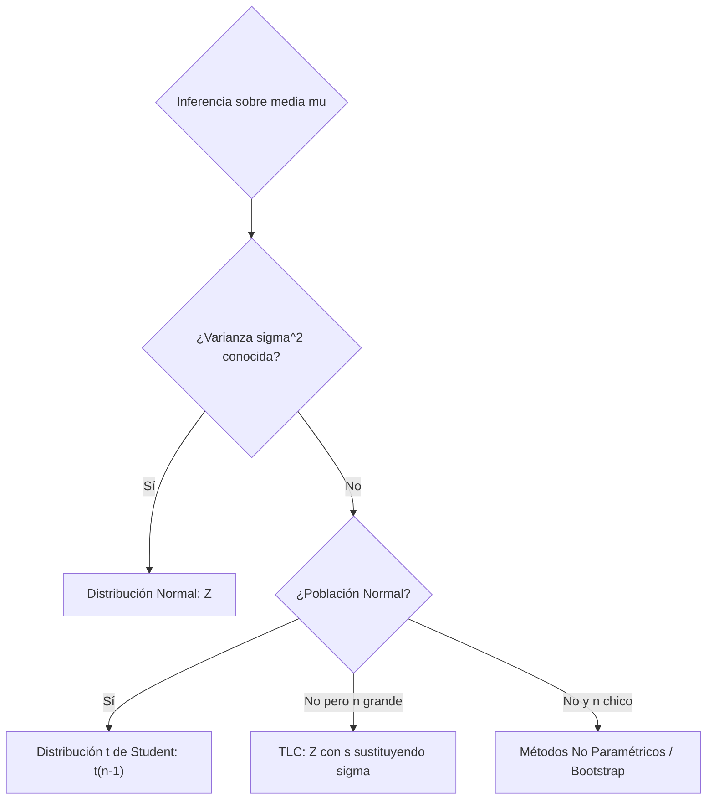
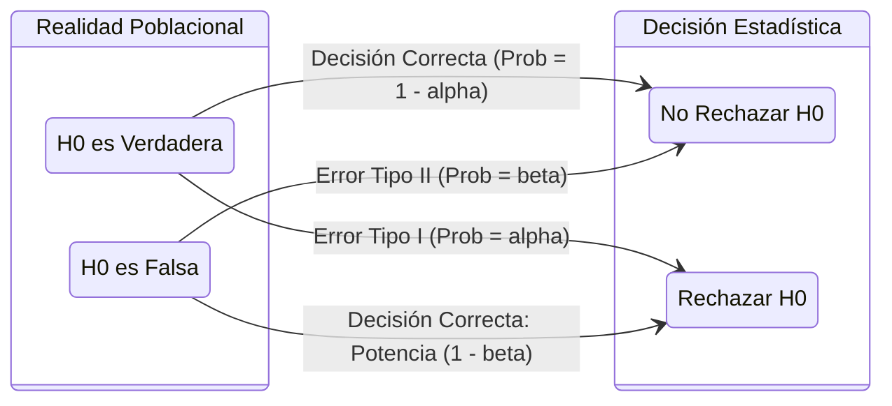
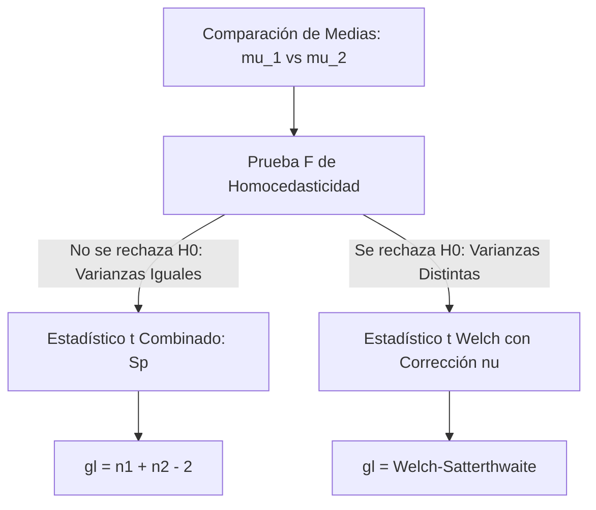

# Intervalos de Confianza y Pruebas de Hipótesis: Manual Técnico de Estudio y Repaso

## 1. Inferencia Paramétrica: Estimación por Intervalos de Confianza

### 1.1 Conceptos Fundamentales: Nivel de Confianza, Significancia y Margen de Error

La estimación por intervalos asigna a un parámetro poblacional desconocido $\theta \in \Theta$ un intervalo aleatorio $[L_i, L_s]$ tal que la probabilidad de que contenga al parámetro sea igual a un valor prefijado $1 - \alpha$.


*   **Nivel de Confianza ($1 - \alpha$):** Proporción a largo plazo de intervalos calculados a partir de muestras independientes del mismo tamaño que contendrían el verdadero parámetro $\theta$.
$$
P(L_i \le \theta \le L_s) = 1 - \alpha
$$
*   **Nivel de Significancia ($\alpha$):** Probabilidad residual o tasa de error nominal tolerated; representa la probabilidad de que el intervalo construido no capture el verdadero parámetro:
$$
\alpha = 1 - (1 - \alpha)
$$
*   **Margen de Error ($E$):** Semi-longitud del intervalo de confianza simétrico:
$$
E = \frac{L_s - L_i}{2} = (\text{Valor Crítico}) \times \sigma_{\hat{\theta}}
$$
    *   Si el tamaño muestral $n$ se multiplica por $k$, el margen de error se reduce en un factor de $\sqrt{k}$.
    *   A mayor nivel de confianza ($1 - \alpha \uparrow$), el valor crítico aumenta, ensanchando el intervalo ($E \uparrow$) para un mismo tamaño muestral.

> [!WARNING]
> **Falacia Frecuentista Típica:** Un intervalo calculado numérico, como $[12.4, 18.2]$, no tiene una probabilidad del $95\%$ de contener a $\mu$. Una vez sustituidos los datos muestrales, el intervalo es determinista: o contiene a $\mu$ o no lo contiene ($P \in \{0, 1\}$). El $95\%$ aplica al *procedimiento de construcción repetido*.

---

### 1.2 Intervalos de Confianza para una Sola Población

#### 1.2.1 Media Poblacional ($\mu$) con Varianza Conocida ($\sigma^2$)

Sea $X_1, X_2, \dots, X_n$ una muestra aleatoria independiente e idénticamente distribuida (m.a.s.) de una población con media $\mu$ y varianza $\sigma^2$ conocida. Por normalidad exacta o por el Teorema del Límite Central ($n \ge 30$), la cantidad pivotal es:

$$
Z = \frac{\bar{X} - \mu}{\frac{\sigma}{\sqrt{n}}} \sim \mathcal{N}(0, 1)
$$

El intervalo bilateral al $100(1-\alpha)\%$ es:

$$
\text{IC}_{1-\alpha}(\mu) = \left[ \bar{X} - z_{1 - \alpha/2} \frac{\sigma}{\sqrt{n}}, \quad \bar{X} + z_{1 - \alpha/2} \frac{\sigma}{\sqrt{n}} \right]
$$

donde $z_{1 - \alpha/2}$ es el cuantil $(1 - \alpha/2)$ de la distribución normal estándar.

#### 1.2.2 Media Poblacional ($\mu$) con Varianza Desconocida ($\sigma^2$)

Al desconocer $\sigma^2$, se aproxima por la cuasivarianza muestral $S^2 = \frac{1}{n-1}\sum_{i=1}^n (X_i - \bar{X})^2$. Bajo la premisa estricta de que la población sigue una distribución normal $\mathcal{N}(\mu, \sigma^2)$, la cantidad pivotal sigue una distribución $t$ de Student:

$$
T = \frac{\bar{X} - \mu}{\frac{S}{\sqrt{n}}} \sim t_{(n-1)}
$$

El intervalo de confianza al $100(1-\alpha)\%$ se define:

$$
\text{IC}_{1-\alpha}(\mu) = \left[ \bar{X} - t_{1 - \alpha/2, \, n-1} \frac{S}{\sqrt{n}}, \quad \bar{X} + t_{1 - \alpha/2, \, n-1} \frac{S}{\sqrt{n}} \right]
$$



#### 1.2.3 Varianza Poblacional ($\sigma^2$) mediante la Distribución Chi-cuadrado

Dada una muestra $X_1, \dots, X_n \sim \mathcal{N}(\mu, \sigma^2)$, la cantidad pivotal fundamental es:

$$
Q = \frac{(n-1)S^2}{\sigma^2} \sim \chi^2_{(n-1)}
$$

Dado que la distribución $\chi^2$ es asimétrica y de soporte estrictamente no negativo $[0, \infty)$, los cuantiles críticos $\chi^2_{\alpha/2, \, n-1}$ y $\chi^2_{1-\alpha/2, \, n-1}$ dividen el área de probabilidad en dos colas iguales de masa $\alpha/2$:

$$
P\left(\chi^2_{\alpha/2, \, n-1} \le \frac{(n-1)S^2}{\sigma^2} \le \chi^2_{1 - \alpha/2, \, n-1}\right) = 1 - \alpha
$$

Invirtiendo las desigualdades algebraicamente:

$$
\text{IC}_{1-\alpha}(\sigma^2) = \left[ \frac{(n-1)S^2}{\chi^2_{1 - \alpha/2, \, n-1}}, \quad \frac{(n-1)S^2}{\chi^2_{\alpha/2, \, n-1}} \right]
$$

El intervalo para la desviación estándar poblacional $\sigma$ se obtiene calculando la raíz cuadrada de ambos límites:

$$
\text{IC}_{1-\alpha}(\sigma) = \left[ \sqrt{\frac{(n-1)S^2}{\chi^2_{1 - \alpha/2, \, n-1}}}, \quad \sqrt{\frac{(n-1)S^2}{\chi^2_{\alpha/2, \, n-1}}} \right]
$$

> [!WARNING]
> La cantidad pivotal para $\sigma^2$ es altamente sensible a la violación del supuesto de normalidad poblacional. Si los datos provienen de distribuciones leptocúrticas (colas pesadas), la cobertura real del intervalo diverge significativamente del nominal $1-\alpha$.

---

### 1.3 Intervalos de Confianza para Comparar Dos Poblaciones Independientes

Sean dos muestras independientes:
*   Muestra 1: $X_{11}, X_{12}, \dots, X_{1n_1}$ de una población con media $\mu_1$ y varianza $\sigma_1^2$.
*   Muestra 2: $X_{21}, X_{22}, \dots, X_{2n_2}$ de una población con media $\mu_2$ y varianza $\sigma_2^2$.

#### 1.3.1 Diferencia de Medias ($\mu_1 - \mu_2$)

##### Caso A: Varianzas Conocidas ($\sigma_1^2, \sigma_2^2$)
Por independencia, $\operatorname{Var}(\bar{X}_1 - \bar{X}_2) = \frac{\sigma_1^2}{n_1} + \frac{\sigma_2^2}{n_2}$:

$$
\text{IC}_{1-\alpha}(\mu_1 - \mu_2) = (\bar{X}_1 - \bar{X}_2) \pm z_{1 - \alpha/2} \sqrt{\frac{\sigma_1^2}{n_1} + \frac{\sigma_2^2}{n_2}}
$$

##### Caso B: Varianzas Desconocidas Iguales ($\sigma_1^2 = \sigma_2^2 = \sigma^2$, Homocedasticidad)
Se construye el estimador insesgado de la varianza combinada ponderada (*pooled variance*):

$$
S_p^2 = \frac{(n_1 - 1)S_1^2 + (n_2 - 1)S_2^2}{n_1 + n_2 - 2}
$$

La variable pivotal sigue una distribución $t$ con $(n_1 + n_2 - 2)$ grados de libertad:

$$
\text{IC}_{1-\alpha}(\mu_1 - \mu_2) = (\bar{X}_1 - \bar{X}_2) \pm t_{1 - \alpha/2, \, n_1 + n_2 - 2} \cdot S_p \sqrt{\frac{1}{n_1} + \frac{1}{n_2}}
$$

##### Caso C: Varianzas Desconocidas Desiguales ($\sigma_1^2 \ne \sigma_2^2$, Heterocedasticidad - Corrección de Welch-Satterthwaite)
El error estándar estimado es $\sqrt{\frac{S_1^2}{n_1} + \frac{S_2^2}{n_2}}$. La distribución se aproxima por una $t$ con grados de libertad corregidos $\nu$:

$$
\nu = \frac{\left( \frac{S_1^2}{n_1} + \frac{S_2^2}{n_2} \right)^2}{\frac{\left(\frac{S_1^2}{n_1}\right)^2}{n_1 - 1} + \frac{\left(\frac{S_2^2}{n_2}\right)^2}{n_2 - 1}}
$$

El intervalo resultante es:

$$
\text{IC}_{1-\alpha}(\mu_1 - \mu_2) = (\bar{X}_1 - \bar{X}_2) \pm t_{1 - \alpha/2, \, \lfloor \nu \rfloor} \sqrt{\frac{S_1^2}{n_1} + \frac{S_2^2}{n_2}}
$$

> [!TIP]
> Si los tamaños muestrales son balanceados ($n_1 = n_2$), el estadístico de Student es robusto ante moderadas desviaciones de homocedasticidad. Ante muestras desbalanceadas ($n_1 \ne n_2$), usar siempre la formulación de Welch.

#### 1.3.2 Razón de Varianzas Poblacionales ($\sigma_1^2 / \sigma_2^2$) mediante la Distribución $F$ de Fisher

Para contrastar o calcular el cociente de dispersión entre poblaciones normales, la razón de cuasivarianzas divididas por sus varianzas poblacionales da lugar a la cantidad pivotal:

$$
F = \frac{S_1^2 / \sigma_1^2}{S_2^2 / \sigma_2^2} = \frac{S_1^2}{S_2^2} \cdot \frac{\sigma_2^2}{\sigma_1^2} \sim \mathcal{F}_{(n_1 - 1, \, n_2 - 1)}
$$

Dado que $P\left( f_{\alpha/2, \, n_1-1, \, n_2-1} \le F \le f_{1 - \alpha/2, \, n_1-1, \, n_2-1} \right) = 1 - \alpha$, y recordando la propiedad de reciprocidad de la distribución $F$:

$$
f_{\alpha/2, \, \nu_1, \, \nu_2} = \frac{1}{f_{1 - \alpha/2, \, \nu_2, \, \nu_1}}
$$

El intervalo de confianza para el cociente $\frac{\sigma_1^2}{\sigma_2^2}$ se despeja como:

$$
\text{IC}_{1-\alpha}\left(\frac{\sigma_1^2}{\sigma_2^2}\right) = \left[ \frac{S_1^2}{S_2^2} \cdot \frac{1}{f_{1 - \alpha/2, \, n_1 - 1, \, n_2 - 1}}, \quad \frac{S_1^2}{S_2^2} \cdot f_{1 - \alpha/2, \, n_2 - 1, \, n_1 - 1} \right]
$$

Si el intervalo calculado engloba al valor $1$, no existe evidencia estadística para rechazar la hipótesis de homocedasticidad ($\sigma_1^2 = \sigma_2^2$) al nivel de significancia $\alpha$.

---

## 2. Inferencia Paramétrica: Pruebas de Hipótesis Estadísticas

### 2.1 Estructura General de una Prueba de Hipótesis

Una prueba de hipótesis es una regla de decisión basada en datos muestrales para dirimir entre dos conjeturas excluyentes relativas al espacio paramétrico $\Theta$:

*   **Hipótesis Nula ($H_0$):** Postulado de no efecto, estado basal o igualdad ($\theta = \theta_0$). Debe contener siempre la igualdad en la formulación matemática ($\le, =, \ge$).
*   **Hipótesis Alternativa ($H_1$):** Afirmación de investigación que contradice a $H_0$ ($\theta \ne \theta_0$, $\theta > \theta_0$ o $\theta < \theta_0$).



| Decisión Estadística | $H_0$ es Verdadera | $H_0$ es Falsa |
| :--- | :--- | :--- |
| **No Rechazar $H_0$** | Decisión Correcta ($1 - \alpha$) | **Error Tipo II ($\beta$)** |
| **Rechazar $H_0$** | **Error Tipo I ($\alpha$)** | **Potencia de la Prueba ($1 - \beta$)** |

*   **Error Tipo I ($\alpha$):** Rechazar $H_0$ cuando $H_0$ es estrictamente verdadera. Corresponde al nivel de significancia fijado *a priori*.
$$
\alpha = P(\text{Rechazar } H_0 \mid H_0 \text{ es verdadera})
$$
*   **Error Tipo II ($\beta$):** No rechazar $H_0$ cuando $H_0$ es falsa en beneficio de una condición específica de $H_1$.
$$
\beta = P(\text{No rechazar } H_0 \mid H_1 \text{ es verdadera con } \theta = \theta_1)
$$
*   **Potencia de la Prueba ($1 - \beta$):** Probabilidad de rechazar $H_0$ correctamente cuando la hipótesis alternativa es cierta:
$$
\text{Potencia} = 1 - \beta = P(\text{Rechazar } H_0 \mid \theta = \theta_1)
$$
*   **Valor $p$ ($p\text{-value}$):** Nivel de significancia mínimo al cual los datos observados obligarían al rechazo de $H_0$. Es la probabilidad de obtener un valor muestral tan o más extremo que el observado, asumiendo que $H_0$ es verdadera.
    *   Si $p\text{-value} \le \alpha \implies$ Rechazar $H_0$.
    *   Si $p\text{-value} > \alpha \implies$ No rechazar $H_0$.

<div align="center">
  <svg width="480" height="200" viewBox="0 0 480 200" xmlns="http://www.w3.org/2000/svg">
    <!-- Eje X -->
    <line x1="30" y1="160" x2="450" y2="160" stroke="#334155" stroke-width="2"/>
    <!-- Curva Normal H0 -->
    <path d="M 40,158 Q 120,155 170,110 Q 210,60 240,30 Q 270,60 310,110 Q 360,155 440,158" fill="none" stroke="#2563eb" stroke-width="2.5"/>
    <!-- Zona de Rechazo Derecha (Cola) -->
    <path d="M 345,124 Q 380,150 440,158 L 345,158 Z" fill="#ef4444" opacity="0.6"/>
    <!-- Línea Crítica -->
    <line x1="345" y1="20" x2="345" y2="160" stroke="#dc2626" stroke-width="2" stroke-dasharray="4"/>
    <!-- Textos -->
    <text x="240" y="20" fill="#2563eb" font-size="12" text-anchor="middle" font-family="sans-serif" font-weight="bold">Distribución bajo H0</text>
    <text x="200" y="145" fill="#1e293b" font-size="12" text-anchor="middle" font-family="sans-serif">Región de Aceptación (1 - alpha)</text>
    <text x="390" y="110" fill="#dc2626" font-size="11" text-anchor="middle" font-family="sans-serif">Región Crítica (alpha)</text>
    <text x="345" y="175" fill="#dc2626" font-size="11" text-anchor="middle" font-family="sans-serif">Valor Crítico</text>
  </svg>
</div>

---

### 2.2 Pruebas de Hipótesis para una Sola Población

#### 2.2.1 Pruebas para la Media Poblacional ($\mu$)

| Condición | Estadístico de Prueba | Distribución Nula ($H_0$) | Región Crítica Bilateral ($H_1: \mu \ne \mu_0$) |
| :--- | :--- | :--- | :--- |
| **$\sigma^2$ conocida** | $Z_{\text{calc}} = \frac{\bar{X} - \mu_0}{\sigma / \sqrt{n}}$ | $\mathcal{N}(0, 1)$ | $|Z_{\text{calc}}| > z_{1 - \alpha/2}$ |
| **$\sigma^2$ desconocida** | $T_{\text{calc}} = \frac{\bar{X} - \mu_0}{S / \sqrt{n}}$ | $t_{(n-1)}$ | $|T_{\text{calc}}| > t_{1 - \alpha/2, \, n-1}$ |

Criterios de rechazo según la hipótesis alternativa para prueba $t$:
*   $H_1: \mu > \mu_0 \implies T_{\text{calc}} > t_{1 - \alpha, \, n-1}$ (Cola derecha).
*   $H_1: \mu < \mu_0 \implies T_{\text{calc}} < -t_{1 - \alpha, \, n-1}$ (Cola izquierda).
*   $H_1: \mu \ne \mu_0 \implies |T_{\text{calc}}| > t_{1 - \alpha/2, \, n-1}$ (Dos colas).

#### 2.2.2 Prueba para la Varianza Poblacional ($\sigma^2$)

Dada una hipótesis nula $H_0: \sigma^2 = \sigma_0^2$ sobre una población normal, se evalúa el estadístico:

$$
\chi^2_{\text{calc}} = \frac{(n-1)S^2}{\sigma_0^2} \sim \chi^2_{(n-1)}
$$

Regiones de rechazo según la hipótesis alternativa:
*   $H_1: \sigma^2 > \sigma_0^2 \implies \chi^2_{\text{calc}} > \chi^2_{1 - \alpha, \, n-1}$
*   $H_1: \sigma^2 < \sigma_0^2 \implies \chi^2_{\text{calc}} < \chi^2_{\alpha, \, n-1}$
*   $H_1: \sigma^2 \ne \sigma_0^2 \implies \chi^2_{\text{calc}} < \chi^2_{\alpha/2, \, n-1} \quad \text{o} \quad \chi^2_{\text{calc}} > \chi^2_{1 - \alpha/2, \, n-1}$

---

### 2.3 Pruebas de Hipótesis para Dos Poblaciones Independientes

#### 2.3.1 Prueba de Igualdad de Varianzas ($\sigma_1^2$ vs $\sigma_2^2$) mediante Estadístico $F$

La comparación de medias requiere contrastar preliminarmente la igualdad de dispersiones.
*   $H_0: \sigma_1^2 = \sigma_2^2$ frente a $H_1: \sigma_1^2 \ne \sigma_2^2$

Estadístico de prueba:

$$
F_{\text{calc}} = \frac{S_1^2}{S_2^2} \sim \mathcal{F}_{(n_1 - 1, \, n_2 - 1)}
$$

Regla de decisión bilateral:
$$
\text{Rechazar } H_0 \iff F_{\text{calc}} > f_{1 - \alpha/2, \, n_1 - 1, \, n_2 - 1} \quad \text{o} \quad F_{\text{calc}} < \frac{1}{f_{1 - \alpha/2, \, n_2 - 1, \, n_1 - 1}}
$$

> [!TIP]
> Por convención algorítmica, se suele colocar la mayor cuasivarianza muestral en el numerador ($S_{\max}^2 / S_{\min}^2$), comparando directamente contra el valor crítico unilateral $f_{1 - \alpha/2}$ con sus correspondientes grados de libertad ordenados.

#### 2.3.2 Prueba para la Diferencia de Medias ($\mu_1 - \mu_2$)

Hipótesis estándar: $H_0: \mu_1 - \mu_2 = \Delta_0$ (típicamente $\Delta_0 = 0$).



##### Caso Homocedástico ($\sigma_1^2 = \sigma_2^2$)
Estadístico de Student agrupado:

$$
T_{\text{calc}} = \frac{(\bar{X}_1 - \bar{X}_2) - \Delta_0}{S_p \sqrt{\frac{1}{n_1} + \frac{1}{n_2}}} \sim t_{(n_1 + n_2 - 2)}
$$

donde $S_p = \sqrt{\frac{(n_1-1)S_1^2 + (n_2-1)S_2^2}{n_1 + n_2 - 2}}$.

##### Caso Heterocedástico ($\sigma_1^2 \ne \sigma_2^2$, Prueba de Welch)
Estadístico de Welch:

$$
T_{\text{calc}}^* = \frac{(\bar{X}_1 - \bar{X}_2) - \Delta_0}{\sqrt{\frac{S_1^2}{n_1} + \frac{S_2^2}{n_2}}} \sim t_{(\lfloor \nu \rfloor)}
$$

con grados de libertad calculados mediante la fórmula de Welch-Satterthwaite mostrada en la Sección 1.3.1.

---

### 2.4 Implementación Computacional: Pipeline Completo de Contraste

El siguiente script en Python ejecuta la rutina completa de inferencia paramétrica para dos grupos: validación de homocedasticidad mediante prueba $F$, selección del estadístico adecuado ($t$ agrupado vs Welch) y cálculo de intervalos de confianza.

```python
import numpy as np
from scipy import stats

def inferencia_dos_muestras_independientes(
    g1: np.ndarray, 
    g2: np.ndarray, 
    alpha: float = 0.05
) -> dict:
    """
    Ejecuta el protocolo de contraste para dos muestras continuas independientes:
    1. Estimaciones descriptivas y prueba F de homocedasticidad.
    2. Prueba t adecuada (Student o Welch).
    3. Construcción del IC para (mu_1 - mu_2).
    """
    n1, n2 = len(g1), len(g2)
    m1, m2 = np.mean(g1), np.mean(g2)
    s1_sq, s2_sq = np.var(g1, ddof=1), np.var(g2, ddof=1)
    
    # 1. Prueba F de igualdad de varianzas
    f_stat = s1_sq / s2_sq
    df1, df2 = n1 - 1, n2 - 1
    # p-valor bilateral para prueba F
    p_f = 2 * min(stats.f.cdf(f_stat, df1, df2), 1 - stats.f.cdf(f_stat, df1, df2))
    iguales_var = p_f > alpha
    
    # 2. Selección de la prueba t
    diff_mean = m1 - m2
    if iguales_var:
        # Varianza combinada (Pooled)
        sp_sq = ((n1 - 1) * s1_sq + (n2 - 1) * s2_sq) / (n1 + n2 - 2)
        se_diff = np.sqrt(sp_sq * (1/n1 + 1/n2))
        gl = n1 + n2 - 2
        tipo_prueba = "Student (Varianzas Iguales)"
    else:
        # Corrección de Welch
        se_diff = np.sqrt(s1_sq / n1 + s2_sq / n2)
        gl = ((s1_sq / n1 + s2_sq / n2) ** 2) / (
            ((s1_sq / n1) ** 2) / (n1 - 1) + ((s2_sq / n2) ** 2) / (n2 - 1)
        )
        tipo_prueba = "Welch (Varianzas Desiguales)"
        
    t_stat = diff_mean / se_diff
    p_t = 2 * (1 - stats.t.cdf(np.abs(t_stat), df=gl))
    
    # 3. Intervalo de Confianza para la diferencia de medias
    t_crit = stats.t.ppf(1 - alpha / 2, df=gl)
    ic_inf = diff_mean - t_crit * se_diff
    ic_sup = diff_mean + t_crit * se_diff
    
    return {
        "tipo_prueba": tipo_prueba,
        "f_prueba": {"f_stat": float(f_stat), "p_value": float(p_f), "homocedasticidad": iguales_var},
        "t_prueba": {"t_stat": float(t_stat), "df": float(gl), "p_value": float(p_t)},
        "ic_diferencia": (float(ic_inf), float(ic_sup)),
        "significativo": p_t < alpha
    }

# Ejemplo reproducible
if __name__ == "__main__":
    np.random.seed(42)
    grupo_control = np.random.normal(loc=50.0, scale=6.0, size=25)
    grupo_tratado = np.random.normal(loc=55.5, scale=9.0, size=20)
    
    resultado = inferencia_dos_muestras_independientes(grupo_tratado, grupo_control)
    print(f"Método seleccionado: {resultado['tipo_prueba']}")
    print(f"P-valor prueba F: {resultado['f_prueba']['p_value']:.4f}")
    print(f"Estadístico t: {resultado['t_prueba']['t_stat']:.4f} (gl={resultado['t_prueba']['df']:.2f})")
    print(f"P-valor prueba t: {resultado['t_prueba']['p_value']:.4e}")
    print(f"IC 95% (mu1 - mu2): [{resultado['ic_diferencia'][0]:.3f}, {resultado['ic_diferencia'][1]:.3f}]")
```

---

## 3. Matriz de Síntesis de Pruebas e Intervalos

| Parámetro Objetivo | Supuestos / Condiciones | Estadístico Clave | Distribución Muestral | Límite / Margen de Error ($E$) |
| :--- | :--- | :--- | :--- | :--- |
| **$\mu$** | $\sigma$ conocida, datos normales o $n \ge 30$ | $Z = \frac{\bar{X} - \mu}{\sigma/\sqrt{n}}$ | $\mathcal{N}(0, 1)$ | $z_{1-\alpha/2}\frac{\sigma}{\sqrt{n}}$ |
| **$\mu$** | $\sigma$ desconocida, datos normales | $T = \frac{\bar{X} - \mu}{S/\sqrt{n}}$ | $t_{(n-1)}$ | $t_{1-\alpha/2, \, n-1}\frac{S}{\sqrt{n}}$ |
| **$\sigma^2$** | Población normal | $\chi^2 = \frac{(n-1)S^2}{\sigma^2}$ | $\chi^2_{(n-1)}$ | Asimétrico: $\left[\frac{(n-1)S^2}{\chi^2_{1-\alpha/2}}, \frac{(n-1)S^2}{\chi^2_{\alpha/2}}\right]$ |
| **$\mu_1 - \mu_2$** | Muestras ind., $\sigma_1^2 = \sigma_2^2$ desconocidas | $T = \frac{(\bar{X}_1 - \bar{X}_2) - \Delta}{S_p\sqrt{\frac{1}{n_1} + \frac{1}{n_2}}}$ | $t_{(n_1 + n_2 - 2)}$ | $t_{1-\alpha/2, \, n_1+n_2-2} S_p\sqrt{\frac{1}{n_1} + \frac{1}{n_2}}$ |
| **$\mu_1 - \mu_2$** | Muestras ind., $\sigma_1^2 \ne \sigma_2^2$ desconocidas | $T^* = \frac{(\bar{X}_1 - \bar{X}_2) - \Delta}{\sqrt{\frac{S_1^2}{n_1} + \frac{S_2^2}{n_2}}}$ | $t_{(\nu \text{ Welch})}$ | $t_{1-\alpha/2, \, \lfloor\nu\rfloor}\sqrt{\frac{S_1^2}{n_1} + \frac{S_2^2}{n_2}}$ |
| **$\sigma_1^2 / \sigma_2^2$** | Poblaciones normales independientes | $F = \frac{S_1^2 / \sigma_1^2}{S_2^2 / \sigma_2^2}$ | $\mathcal{F}_{(n_1-1, \, n_2-1)}$ | Asimétrico vía cuantiles $\mathcal{F}$ |