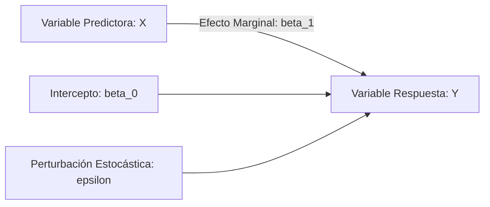
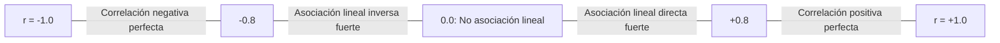

# Análisis de Regresión y Correlación Lineal: Manual Técnico de Estudio y Repaso

---

## 1. Modelado de Regresión Lineal

### 1.1 Modelo de Regresión Lineal Simple y Supuestos Clásicos de MCO

El modelo poblacional de regresión lineal simple formaliza la relación funcional entre una variable dependiente (o explicada) $Y$ y una variable independiente (o predictora) $X$:

$$
Y_i = \beta_0 + \beta_1 X_i + \varepsilon_i, \quad i = 1, 2, \dots, n
$$

Donde $\beta_0$ es el intercepto poblacional, $\beta_1$ es la pendiente poblacional y $\varepsilon_i$ es la perturbación aleatoria no observable.



Para que los estimadores obtenidos por **Mínimos Cuadrados Ordinarios (MCO)** sean los **Mejores Estimadores Lineales Insesgados (MELI / BLUE - *Best Linear Unbiased Estimator*)** bajo el Teorema de Gauss-Márkov y permitan inferencia exacta, deben cumplirse rigurosamente los supuestos sobre el término de error $\varepsilon_i$:

1. **Linealidad en los parámetros:** La relación condicional esperada es lineal respecto a los coeficientes:
   $$
   \mathbb{E}[\varepsilon_i \mid X_i] = 0 \implies \mathbb{E}[Y_i \mid X_i] = \beta_0 + \beta_1 X_i
   $$
2. **Homocedasticidad (Varianza constante del error):** La dispersión del error no depende del valor asumido por $X_i$:
   $$
   \operatorname{Var}(\varepsilon_i \mid X_i) = \sigma^2 < \infty, \quad \forall i
   $$
3. **Independencia (Ausencia de autocorrelación):** Los errores de observaciones distintas no covarían:
   $$
   \operatorname{Cov}(\varepsilon_i, \varepsilon_j \mid X_i, X_j) = 0, \quad \forall i \neq j
   $$
4. **Normalidad (Requerida para inferencia en muestras finitas):** Los errores siguen una distribución gaussiana:
   $$
   \varepsilon_i \overset{\text{iid}}{\sim} \mathcal{N}(0, \sigma^2)
   $$

<div align="center">
  <svg width="520" height="200" viewBox="0 0 520 200" xmlns="http://www.w3.org/2000/svg">
    <!-- Ejes -->
    <line x1="40" y1="170" x2="490" y2="170" stroke="#64748b" stroke-width="2" />
    <line x1="40" y1="170" x2="40" y2="20" stroke="#64748b" stroke-width="2" />
    <text x="495" y="175" fill="#64748b" font-size="12" font-family="sans-serif">X</text>
    <text x="35" y="15" fill="#64748b" font-size="12" font-family="sans-serif">Y</text>
    
    <!-- Recta de regresión -->
    <line x1="60" y1="150" x2="460" y2="40" stroke="#2563eb" stroke-width="3" />
    <text x="400" y="30" fill="#2563eb" font-size="12" font-weight="bold" font-family="sans-serif">E[Y|X] = β₀ + β₁X</text>

    <!-- Curvas de densidad normal en 3 puntos X (Homocedasticidad) -->
    <!-- X1 = 140, Y_hat = 128 -->
    <path d="M 140 128 C 115 128, 115 105, 140 90 C 165 75, 165 128, 140 128" fill="#93c5fd" opacity="0.4" stroke="#1d4ed8" stroke-width="1.5"/>
    <circle cx="140" cy="128" r="3" fill="#1e40af" />
    
    <!-- X2 = 260, Y_hat = 95 -->
    <path d="M 260 95 C 235 95, 235 72, 260 57 C 285 42, 285 95, 260 95" fill="#93c5fd" opacity="0.4" stroke="#1d4ed8" stroke-width="1.5"/>
    <circle cx="260" cy="95" r="3" fill="#1e40af" />

    <!-- X3 = 380, Y_hat = 62 -->
    <path d="M 380 62 C 355 62, 355 39, 380 24 C 405 9, 405 62, 380 62" fill="#93c5fd" opacity="0.4" stroke="#1d4ed8" stroke-width="1.5"/>
    <circle cx="380" cy="62" r="3" fill="#1e40af" />

    <text x="210" y="190" fill="#334155" font-size="11" font-family="sans-serif">Varianzas idénticas: σ² constante en todo el dominio</text>
  </svg>
</div>

> [!WARNING]
> Si falla la homocedasticidad (**heterocedasticidad**) o la independencia (**autocorrelación**), los estimadores MCO siguen siendo insesgados y consistentes, pero **dejan de ser eficientes** (no son de varianza mínima) y los errores estándar calculados usualmente son sesgados, invalidando las pruebas $t$ y $F$.

---

### 1.2 Estimación de Coeficientes de Regresión e Interpretación Analítica

El criterio de Mínimos Cuadrados Ordinarios minimiza la función objetivo de la suma de cuadrados de los residuos ($S_{CR}$ o $SCE$):

$$
S(\hat{\beta}_0, \hat{\beta}_1) = \sum_{i=1}^{n} e_i^2 = \sum_{i=1}^{n} \left( Y_i - (\hat{\beta}_0 + \hat{\beta}_1 X_i) \right)^2
$$

Derivando parcialmente e igualando a cero ($\frac{\partial S}{\partial \hat{\beta}_0} = 0$ y $\frac{\partial S}{\partial \hat{\beta}_1} = 0$), se obtienen las **Ecuaciones Normales**:

$$
\begin{cases}
n \hat{\beta}_0 + \hat{\beta}_1 \sum X_i = \sum Y_i \\
\hat{\beta}_0 \sum X_i + \hat{\beta}_1 \sum X_i^2 = \sum X_i Y_i
\end{cases}
$$

Resolviendo el sistema:

$$
\hat{\beta}_1 = \frac{\sum_{i=1}^{n} (X_i - \bar{X})(Y_i - \bar{Y})}{\sum_{i=1}^{n} (X_i - \bar{X})^2} = \frac{S_{XY}}{S_{XX}}
$$

$$
\hat{\beta}_0 = \bar{Y} - \hat{\beta}_1 \bar{X}
$$

| Coeficiente | Fórmula Operativa | Interpretación Analítica |
| :--- | :--- | :--- |
| **Pendiente ($\hat{\beta}_1$)** | $\frac{n\sum X_i Y_i - (\sum X_i)(\sum Y_i)}{n\sum X_i^2 - (\sum X_i)^2}$ | Magnitud y signo del cambio marginal estimado en $\mathbb{E}[Y]$ ante un incremento unitario de $X$. |
| **Intercepto ($\hat{\beta}_0$)** | $\frac{\sum Y_i - \hat{\beta}_1 \sum X_i}{n}$ | Valor esperado estimado de $Y$ cuando $X = 0$. Solo tiene sentido práctico si $X = 0$ está dentro del rango observado y tiene significado físico. |

> [!NOTE]
> La recta de regresión calculada por MCO **siempre** pasa por el centro de gravedad muestral $(\bar{X}, \bar{Y})$.

---

### 1.3 Introducción al Modelo de Regresión Lineal Múltiple: Formulación y Ajuste Matricial

Cuando intervienen $k$ variables regresoras independientes:

$$
Y_i = \beta_0 + \beta_1 X_{i1} + \beta_2 X_{i2} + \dots + \beta_k X_{ik} + \varepsilon_i, \quad i = 1, \dots, n
$$

En notación matricial compacta:

$$
\mathbf{Y} = \mathbf{X}\boldsymbol{\beta} + \boldsymbol{\varepsilon}
$$

Donde:

$$
\mathbf{Y} = \begin{bmatrix} Y_1 \\ Y_2 \\ \vdots \\ Y_n \end{bmatrix}_{n \times 1}, \quad
\mathbf{X} = \begin{bmatrix} 
1 & X_{11} & X_{12} & \dots & X_{1k} \\
1 & X_{21} & X_{22} & \dots & X_{2k} \\
\vdots & \vdots & \vdots & \ddots & \vdots \\
1 & X_{n1} & X_{n2} & \dots & X_{nk} 
\end{bmatrix}_{n \times (k+1)}, \quad
\boldsymbol{\beta} = \begin{bmatrix} \beta_0 \\ \beta_1 \\ \vdots \\ \beta_k \end{bmatrix}_{(k+1) \times 1}, \quad
\boldsymbol{\varepsilon} = \begin{bmatrix} \varepsilon_1 \\ \varepsilon_2 \\ \vdots \\ \varepsilon_n \end{bmatrix}_{n \times 1}
$$

Supuestos matriciales de Gauss-Márkov:
- $\mathbb{E}[\boldsymbol{\varepsilon} \mid \mathbf{X}] = \mathbf{0}$
- $\operatorname{Var}(\boldsymbol{\varepsilon} \mid \mathbf{X}) = \sigma^2 \mathbf{I}_n$
- $\operatorname{rango}(\mathbf{X}) = k + 1 \leq n$ (No existe multicolinealidad perfecta; $\mathbf{X}^\top \mathbf{X}$ es invertible).

#### Minimización Cuadrática Matricial

$$
S(\boldsymbol{\beta}) = \boldsymbol{\varepsilon}^\top \boldsymbol{\varepsilon} = (\mathbf{Y} - \mathbf{X}\boldsymbol{\beta})^\top (\mathbf{Y} - \mathbf{X}\boldsymbol{\beta}) = \mathbf{Y}^\top \mathbf{Y} - 2\boldsymbol{\beta}^\top \mathbf{X}^\top \mathbf{Y} + \boldsymbol{\beta}^\top \mathbf{X}^\top \mathbf{X}\boldsymbol{\beta}
$$

Optimizando mediante gradiente matricial:

$$
\frac{\partial S}{\partial \boldsymbol{\beta}} = -2 \mathbf{X}^\top \mathbf{Y} + 2 \mathbf{X}^\top \mathbf{X}\boldsymbol{\beta} = \mathbf{0} \implies \mathbf{X}^\top \mathbf{X}\boldsymbol{\beta} = \mathbf{X}^\top \mathbf{Y}
$$

Despejando el vector de estimadores:

$$
\hat{\boldsymbol{\beta}} = (\mathbf{X}^\top \mathbf{X})^{-1} \mathbf{X}^\top \mathbf{Y}
$$

Matriz de varianzas-covarianzas de los coeficientes:

$$
\operatorname{Var}(\hat{\boldsymbol{\beta}}) = \sigma^2 (\mathbf{X}^\top \mathbf{X})^{-1}
$$

Donde la varianza residual $\sigma^2$ se estima insesgadamente mediante la media cuadrática del error:

$$
s^2 = MCE = \frac{\mathbf{e}^\top \mathbf{e}}{n - (k + 1)} = \frac{\sum_{i=1}^{n} (Y_i - \hat{Y}_i)^2}{n - k - 1}
$$

---

## 2. Evaluación y Bondad de Ajuste del Modelo

### 2.1 Descomposición de la Variabilidad: Suma de Cuadrados

La desviación total de cada observación observada respecto a la media se descompone aditivamente en la desviación explicada por el modelo y la desviación residual:

$$
(Y_i - \bar{Y}) = (\hat{Y}_i - \bar{Y}) + (Y_i - \hat{Y}_i)
$$

Elevando al cuadrado y sumando sobre todas las observaciones (dado que el término de producto cruzado $\sum (\hat{Y}_i - \bar{Y})(Y_i - \hat{Y}_i) = 0$ por propiedades de MCO):

$$
\sum_{i=1}^{n} (Y_i - \bar{Y})^2 = \sum_{i=1}^{n} (\hat{Y}_i - \bar{Y})^2 + \sum_{i=1}^{n} (Y_i - \hat{Y}_i)^2
$$

$$
SCT = SCR + SCE
$$

```
Suma de Cuadrados Total (SCT)
 ├── Suma de Cuadrados de Regresión (SCR): Variabilidad explicada por el modelo
 └── Suma de Cuadrados del Error (SCE): Variabilidad aleatoria no capturada (residuos)
```

| Componente | Notación | Definición Matemática | Grados de Libertad ($GL$) |
| :--- | :--- | :--- | :--- |
| **Total** | $SCT$ ($SS_{tot}$) | $\sum (Y_i - \bar{Y})^2 = \mathbf{Y}^\top \mathbf{Y} - n\bar{Y}^2$ | $n - 1$ |
| **Regresión** | $SCR$ ($SS_{reg}$) | $\sum (\hat{Y}_i - \bar{Y})^2 = \hat{\boldsymbol{\beta}}^\top \mathbf{X}^\top \mathbf{Y} - n\bar{Y}^2$ | $k$ (número de variables predictoras) |
| **Residual / Error** | $SCE$ ($SS_{res}$) | $\sum (Y_i - \hat{Y}_i)^2 = \mathbf{e}^\top \mathbf{e} = \mathbf{Y}^\top \mathbf{Y} - \hat{\boldsymbol{\beta}}^\top \mathbf{X}^\top \mathbf{Y}$ | $n - k - 1$ |

---

### 2.2 Análisis de Varianza (ANOVA): Prueba F de Significancia Global

Evalúa simultáneamente si **al menos uno** de los regresores aporta información explicativa significativa sobre la respuesta.

#### Hipótesis del Test Global
$$
\begin{cases}
H_0: \beta_1 = \beta_2 = \dots = \beta_k = 0 \quad (\text{El modelo no explica la variabilidad}) \\
H_1: \exists \, j \in \{1, \dots, k\} \text{ tal que } \beta_j \neq 0 \quad (\text{Al menos un regresor es significativo})
\end{cases}
$$

#### Tabla ANOVA para Regresión Lineal

| Fuente de Variación | Suma de Cuadrados ($SC$) | Grados de Libertad ($GL$) | Cuadrado Medio ($CM$) | Estadístico de Prueba ($F_0$) |
| :--- | :--- | :--- | :--- | :--- |
| **Regresión** | $SCR$ | $k$ | $CMR = \frac{SCR}{k}$ | $F_0 = \frac{CMR}{CME}$ |
| **Residual / Error** | $SCE$ | $n - k - 1$ | $CME = \frac{SCE}{n - k - 1}$ | — |
| **Total** | $SCT$ | $n - 1$ | — | — |

Bajo $H_0$, el estadístico sigue una distribución $F$ de Snedecor:

$$
F_0 = \frac{CMR}{CME} \sim \mathcal{F}_{(k, \; n - k - 1)}
$$

**Regla de Decisión:**
- Rechazar $H_0$ si $F_0 > F_{\alpha, k, n - k - 1}$ o si el $p\text{-valor} < \alpha$.

> [!NOTE]
> En la **regresión lineal simple** ($k = 1$), la prueba global $F$ y la prueba individual $t$ para la pendiente son matemáticamente idénticas:
> $$
> F_0 = (t_{\hat{\beta}_1})^2
> $$

---

### 2.3 Inferencia sobre los Coeficientes Individuales de Regresión (Pruebas t)

Determina si una variable predictora específica $X_j$ contribuye significativamente al modelo en presencia de las demás.

#### Hipótesis Individual
$$
\begin{cases}
H_0: \beta_j = 0 \\
H_1: \beta_j \neq 0
\end{cases}
$$

El error estándar del coeficiente estimado proviene de la matriz de covarianzas:

$$
SE(\hat{\beta}_j) = \sqrt{\widehat{\operatorname{Var}}(\hat{\beta}_j)} = \sqrt{s^2 \cdot [(\mathbf{X}^\top \mathbf{X})^{-1}]_{jj}}
$$

Para regresión lineal simple ($j=1$):

$$
SE(\hat{\beta}_1) = \frac{s}{\sqrt{S_{XX}}} = \frac{\sqrt{CME}}{\sqrt{\sum (X_i - \bar{X})^2}}
$$

$$
SE(\hat{\beta}_0) = s \sqrt{\frac{1}{n} + \frac{\bar{X}^2}{S_{XX}}}
$$

#### Estadístico de Prueba e Intervalo de Confianza

$$
t_0 = \frac{\hat{\beta}_j - 0}{SE(\hat{\beta}_j)} \sim t_{(n - k - 1)}
$$

Intervalo de confianza al $(1 - \alpha) \cdot 100\%$:

$$
\hat{\beta}_j \pm t_{\alpha/2, \; n - k - 1} \cdot SE(\hat{\beta}_j)
$$

---

## 3. Medidas de Relación y Determinación Lineal

### 3.1 Coeficiente de Correlación Lineal de Pearson ($r$)

El coeficiente $r$ cuantifica la fuerza y la dirección de la asociación **lineal** entre dos variables continuas.

$$
r = \frac{\operatorname{Cov}(X, Y)}{S_X S_Y} = \frac{\sum_{i=1}^n (X_i - \bar{X})(Y_i - \bar{Y})}{\sqrt{\sum_{i=1}^n (X_i - \bar{X})^2} \sqrt{\sum_{i=1}^n (Y_i - \bar{Y})^2}} = \frac{S_{XY}}{\sqrt{S_{XX} S_{YY}}}
$$

Propiedades de $r$:
- **Acotación:** $-1 \leq r \leq 1$.
- **Invarianza:** No cambia ante transformaciones lineales crecientes de escala o desplazamiento ($X' = aX + b, Y' = cY + d$ con $a, c > 0$).
- **Simetría:** $r(X, Y) = r(Y, X)$.
- **Relación con la pendiente MCO:**
  $$
  \hat{\beta}_1 = r \cdot \frac{S_Y}{S_X}
  $$



#### Inferencia Estadística sobre el Parámetro Poblacional $\rho$

Para contrastar:
$$
\begin{cases}
H_0: \rho = 0 \\
H_1: \rho \neq 0
\end{cases}
$$

Se utiliza la transformación $t$:

$$
t_0 = \frac{r\sqrt{n - 2}}{\sqrt{1 - r^2}} \sim t_{(n - 2)}
$$

> [!WARNING]
> Correlación **no implica causalidad**. Un valor $r = 0$ solo certifica la ausencia de relación **lineal**, pero puede existir una dependencia determinista no lineal perfecta (por ejemplo, $Y = X^2$ en un dominio simétrico $[-a, a]$ tiene $r = 0$).

---

### 3.2 Coeficiente de Determinación ($R^2$ y $R^2$ Ajustado)

#### Coeficiente de Determinación Clásico ($R^2$)

Indica la proporción de la variación total observada en la variable dependiente $Y$ que es explicada por el conjunto de variables explicativas del modelo:

$$
R^2 = \frac{SCR}{SCT} = 1 - \frac{SCE}{SCT}
$$

- En **regresión lineal simple**, coincide estrictamente con el cuadrado de Pearson: $R^2 = r^2$.
- Rango: $0 \leq R^2 \leq 1$.

#### Coeficiente de Determinación Ajustado ($R^2_{\text{adj}}$)

El $R^2$ estándar presenta el defecto matemático de **aumentar monótonamente** (o permanecer igual) cada vez que se añade una nueva variable predictora al modelo, sin importar si dicha variable aporta o es puro ruido aleatorio:

$$
SCE_{\text{nuevo}} \leq SCE_{\text{anterior}} \implies R^2_{\text{nuevo}} \geq R^2_{\text{anterior}}
$$

El $R^2_{\text{adj}}$ penaliza la inclusión de variables no informativas al ponderar cada suma de cuadrados por sus respectivos grados de libertad:

$$
R^2_{\text{adj}} = 1 - \left[ \frac{\frac{SCE}{n - k - 1}}{\frac{SCT}{n - 1}} \right] = 1 - (1 - R^2) \frac{n - 1}{n - k - 1}
$$

| Métrica | Comportamiento al añadir variables superfluas | Utilidad Principal | Rango Posible |
| :--- | :--- | :--- | :--- |
| **$R^2$** | Monótonamente creciente no decreciente. | Evaluar la fracción global de varianza capturada. | $[0, 1]$ |
| **$R^2_{\text{adj}}$** | Disminuye si la variable añadida no reduce $SCE$ lo suficiente para compensar la pérdida de $1$ grado de libertad (específicamente si $t^2 < 1$ o $F < 1$). | Selección y comparación de modelos competitivos con diferente número de predictores. | $(-\infty, 1]$ (puede ser negativo en modelos pésimos) |

---

## 4. Implementación y Diagnóstico Computacional en Python

El siguiente script implementa el ajuste matricial de MCO, descompone la variabilidad mediante ANOVA y evalúa las pruebas de significancia sobre los coeficientes:

```python
import numpy as np
from scipy import stats

def regresion_lineal_completa(X: np.ndarray, y: np.ndarray):
    """
    Calcula la estimación MCO matricial, ANOVA y significancia individual.
    X: Matriz de predictores (n, k) sin columna de unos.
    y: Vector respuesta (n,)
    """
    n = len(y)
    k = X.shape[1] if X.ndim > 1 else 1
    if X.ndim == 1:
        X = X.reshape(-1, 1)

    # Matriz de diseño con vector de intercepto
    X_design = np.column_stack([np.ones(n), X])
    
    # 1. Estimación de coeficientes: beta_hat = (X'X)^(-1) X'y
    XtX = X_design.T @ X_design
    XtY = X_design.T @ y
    beta_hat = np.linalg.solve(XtX, XtY)
    
    # 2. Residuos y predicciones
    y_hat = X_design @ beta_hat
    residuos = y - y_hat
    
    # 3. Sumas de cuadrados (Descomposición de variabilidad)
    y_mean = np.mean(y)
    SCT = np.sum((y - y_mean)**2)
    SCE = np.sum(residuos**2)
    SCR = SCT - SCE
    
    # 4. Grados de libertad y Cuadrados Medios
    gl_reg = k
    gl_res = n - k - 1
    gl_tot = n - 1
    
    CMR = SCR / gl_reg
    CME = SCE / gl_res
    s_err = np.sqrt(CME)
    
    # 5. ANOVA: Estadístico F global
    F_stat = CMR / CME
    p_val_F = 1 - stats.f.cdf(F_stat, gl_reg, gl_res)
    
    # 6. Coeficientes de Determinación
    R2 = SCR / SCT
    R2_adj = 1 - (1 - R2) * (gl_tot / gl_res)
    
    # 7. Inferencia sobre coeficientes (Pruebas t)
    var_cov_beta = CME * np.linalg.inv(XtX)
    se_beta = np.sqrt(np.diag(var_cov_beta))
    t_stats = beta_hat / se_beta
    p_vals_t = 2 * (1 - stats.t.cdf(np.abs(t_stats), df=gl_res))
    
    return {
        "beta": beta_hat,
        "se": se_beta,
        "t_stats": t_stats,
        "p_vals_t": p_vals_t,
        "R2": R2,
        "R2_adj": R2_adj,
        "F_stat": F_stat,
        "p_val_F": p_val_F,
        "CME": CME
    }

# Prueba con datos sintéticos
if __name__ == "__main__":
    np.random.seed(42)
    X_sample = np.linspace(10, 50, 30)
    # y = 5.0 + 2.5*X + error normal
    y_sample = 5.0 + 2.5 * X_sample + np.random.normal(loc=0, scale=8.0, size=30)
    
    res = regresion_lineal_completa(X_sample, y_sample)
    print(f"Intercepto: {res['beta'][0]:.4f} (p={res['p_vals_t'][0]:.4e})")
    print(f"Pendiente:  {res['beta'][1]:.4f} (p={res['p_vals_t'][1]:.4e})")
    print(f"R²:         {res['R2']:.4f} | R² Aj.: {res['R2_adj']:.4f}")
    print(f"F-Stat:     {res['F_stat']:.4f} (p={res['p_val_F']:.4e})")
```

---

## 5. Matriz de Síntesis para Repaso Rápido

| Concepto / Prueba | Parámetro | Estadístico Muestral | Distribución Teórica bajo $H_0$ | Criterio de Rechazo |
| :--- | :--- | :--- | :--- | :--- |
| **Significancia Global** | $\beta_1 = \dots = \beta_k = 0$ | $F_0 = \frac{SCR / k}{SCE / (n - k - 1)}$ | $\mathcal{F}_{(k, \; n - k - 1)}$ | $F_0 > F_{\alpha, k, n - k - 1}$ |
| **Pendiente Individual** | $\beta_j = 0$ | $t_0 = \frac{\hat{\beta}_j}{SE(\hat{\beta}_j)}$ | $t_{(n - k - 1)}$ | $\|t_0\| > t_{\alpha/2, \; n - k - 1}$ |
| **Correlación Poblacional**| $\rho = 0$ | $t_0 = \frac{r\sqrt{n - 2}}{\sqrt{1 - r^2}}$ | $t_{(n - 2)}$ | $\|t_0\| > t_{\alpha/2, \; n - 2}$ |
| **Ajuste del Modelo** | Proporción de variabilidad | $R^2 = 1 - \frac{SCE}{SCT}$ | Métrica no paramétrica | Cercano a 1 (contexto experimental) |
| **Selección de Modelos** | Ajuste con penalización | $R^2_{\text{adj}} = 1 - \frac{CME}{CMT}$ | Métrica comparativa | Maximizar entre modelos anidados |