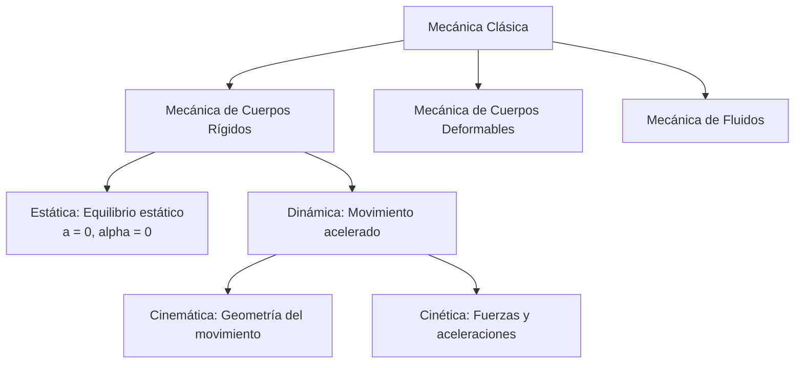
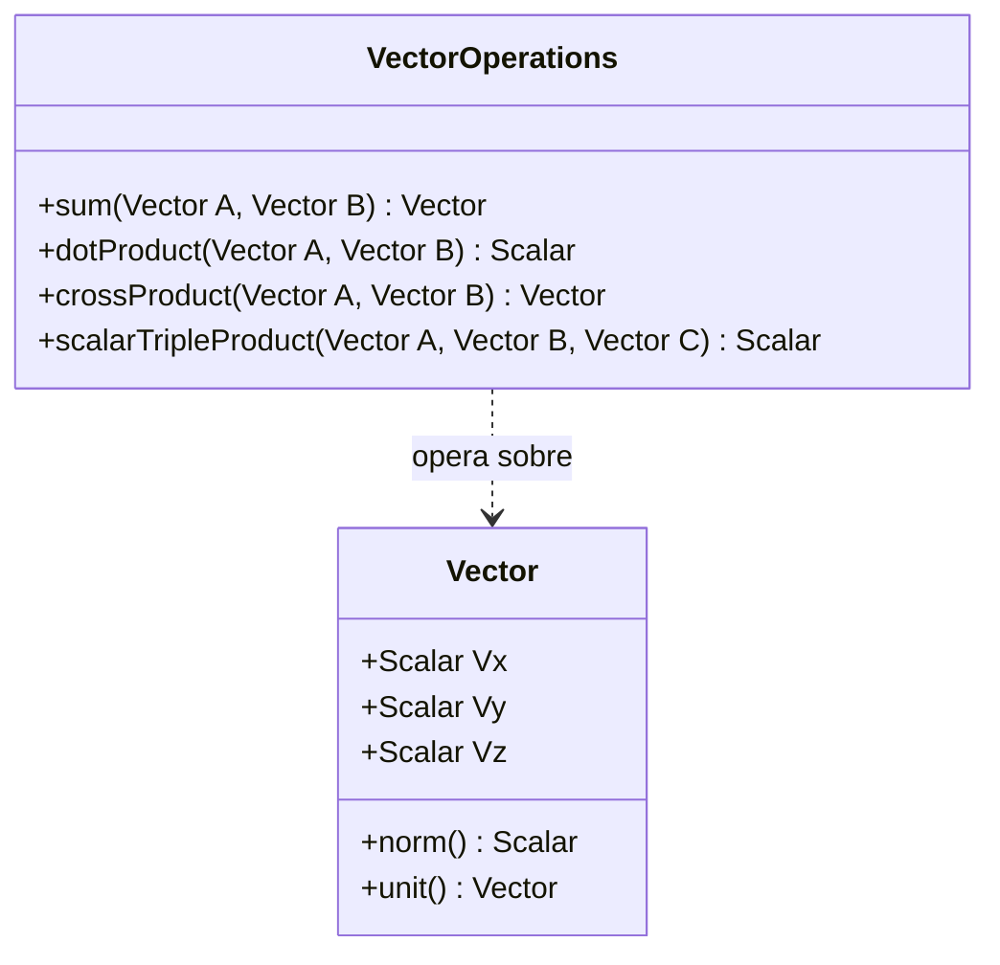
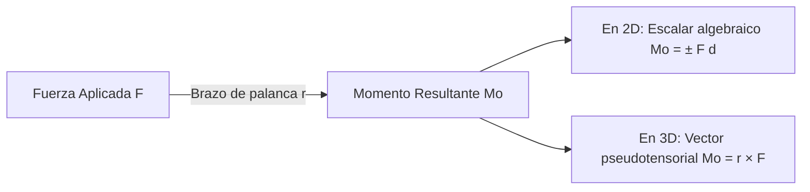
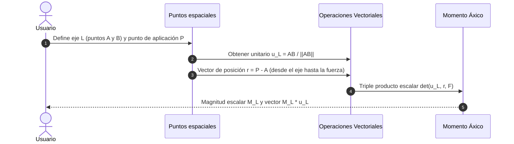

# Compendio de Repaso: Estática y Herramientas Vectoriales

---

## 1. Introducción

### 1.1 Fundamentos y herramientas vectoriales en estática

#### Principios fundamentales de la estática y ubicación del curso en la mecánica clásica

La **mecánica clásica** es la rama de la física dedicada a predecir el estado de reposo o movimiento de los cuerpos sometidos a la acción de fuerzas. Se divide canónicamente en tres áreas operativas:



* **Estática:** Estudio de los cuerpos en reposo relativo continuo o en movimiento a velocidad rectilínea uniforme (aceleración nula: $\vec{a} = \vec{0}$, $\vec{\alpha} = \vec{0}$). Garantiza la estabilidad y dimensionamiento previo de estructuras y mecanismos.
* **Hipótesis del Sólido Rígido:** Se asume que las deformaciones macroscópicas son despreciables frente a las dimensiones globales del elemento ($\Delta L \to 0$), permitiendo considerar invariable la distancia euclidiana entre dos puntos cualesquiera del cuerpo.

##### Los Seis Principios Fundamentales
1. **Ley del Paralelogramo para la Suma de Fuerzas:** Dos fuerzas que actúan sobre un mismo punto concurrente pueden sustituirse por una fuerza resultante $\vec{R}$ equivalente a la diagonal del paralelogramo formado por dichas fuerzas:
   $$
   \vec{R} = \vec{F}_1 + \vec{F}_2
   $$
2. **Principio de Transmisibilidad:** La acción de una fuerza sobre un cuerpo rígido permanece inalterada si dicha fuerza se traslada a lo largo de su propia **línea de acción**, siempre que se mantengan idénticos su magnitud, dirección y sentido.
   
   <div align="center">
     <svg width="420" height="110" viewBox="0 0 420 110" xmlns="http://www.w3.org/2000/svg">
       <!-- Sólido rígido -->
       <path d="M 50,30 Q 120,10 240,25 Q 360,40 370,75 Q 310,105 180,95 Q 60,100 50,30 Z" fill="#f1f5f9" stroke="#64748b" stroke-width="2" stroke-dasharray="4,4"/>
       <!-- Línea de acción -->
       <line x1="20" y1="60" x2="400" y2="60" stroke="#94a3b8" stroke-width="1.5" stroke-dasharray="5,5"/>
       <text x="360" y="52" fill="#64748b" font-size="11" font-family="sans-serif">Línea de acción</text>
       <!-- Vector en Punto A -->
       <circle cx="100" cy="60" r="4" fill="#0f172a"/>
       <text x="95" y="78" fill="#0f172a" font-size="12" font-family="sans-serif" font-weight="bold">A</text>
       <line x1="100" y1="60" x2="180" y2="60" stroke="#2563eb" stroke-width="3"/>
       <polygon points="180,56 190,60 180,64" fill="#2563eb"/>
       <text x="135" y="52" fill="#2563eb" font-size="12" font-family="sans-serif" font-weight="bold">F</text>
       <!-- Equivalencia -->
       <text x="215" y="65" fill="#475569" font-size="16" font-family="sans-serif" font-weight="bold">≡</text>
       <!-- Vector en Punto B -->
       <circle cx="270" cy="60" r="4" fill="#0f172a"/>
       <text x="265" y="78" fill="#0f172a" font-size="12" font-family="sans-serif" font-weight="bold">B</text>
       <line x1="270" y1="60" x2="350" y2="60" stroke="#16a34a" stroke-width="3"/>
       <polygon points="350,56 360,60 350,64" fill="#16a34a"/>
       <text x="305" y="52" fill="#16a34a" font-size="12" font-family="sans-serif" font-weight="bold">F</text>
     </svg>
   </div>

   > [!WARNING]
   > El principio de transmisibilidad solo es válido para estudiar los efectos **externos** (reacciones en apoyos y equilibrio estático global). **Falla críticamente** al evaluar esfuerzos internos y deformaciones: comprimir una barra no genera las mismas tensiones internas que traccionarla, aun sobre la misma línea de acción.

3. **Primera Ley de Newton (Inercia):** Todo cuerpo preserva su estado de reposo o movimiento rectilíneo uniforme a menos que actúe sobre él una fuerza neta no balanceada:
   $$
   \sum \vec{F} = \vec{0} \iff \vec{a} = \vec{0}
   $$
4. **Segunda Ley de Newton (Causalidad Dinámica):** La tasa temporal de cambio de la cantidad de movimiento lineal es proporcional a la fuerza resultante aplicada:
   $$
   \sum \vec{F} = \frac{d(m\vec{v})}{dt} = m\vec{a} \quad (\text{para } m = \text{cte})
   $$
5. **Tercera Ley de Newton (Acción y Reacción):** A toda fuerza ejercida por un cuerpo sobre otro le corresponde una fuerza de igual magnitud, colineal y de sentido estrictamente opuesto sobre el primero:
   $$
   \vec{F}_{A \to B} = -\vec{F}_{B \to A}
   $$
6. **Ley de Gravitación Universal de Newton:** Dos masas puntuales $m_1$ y $m_2$ se atraen mutuamente a lo largo de la recta que las une mediante una fuerza:
   $$
   F = G \frac{m_1 m_2}{r^2}
   $$
   donde $G \approx 6.67430 \times 10^{-11} \, \text{N}\cdot\text{m}^2/\text{kg}^2$.

---

#### Repaso de álgebra vectorial aplicada: operaciones vectoriales, producto escalar y producto vectorial

En el espacio euclidiano tridimensional $\mathbb{R}^3$, una magnitud física vectorial se define por su magnitud, dirección, sentido y punto/línea de aplicación.



##### 1. Representación Cartesiana y Cosenos Directores
Un vector $\vec{A}$ descompuesto en su base ortonormal estándar $\{\hat{i}, \hat{j}, \hat{k}\}$ se expresa:
$$
\vec{A} = A_x \hat{i} + A_y \hat{j} + A_z \hat{k}
$$
Su magnitud o norma euclidiana escalar es:
$$
A = \|\vec{A}\| = \sqrt{A_x^2 + A_y^2 + A_z^2}
$$
El **vector unitario** colineal $\hat{u}_A$ determina la orientación espacial:
$$
\hat{u}_A = \frac{\vec{A}}{\|\vec{A}\|} = \cos(\theta_x)\hat{i} + \cos(\theta_y)\hat{j} + \cos(\theta_z)\hat{k}
$$
Identidad fundamental de cosenos directores:
$$
\cos^2(\theta_x) + \cos^2(\theta_y) + \cos^2(\theta_z) = 1
$$

##### 2. Adición y Sustracción Vectorial
$$
\vec{C} = \vec{A} \pm \vec{B} = (A_x \pm B_x)\hat{i} + (A_y \pm B_y)\hat{j} + (A_z \pm B_z)\hat{k}
$$

##### 3. Producto Escalar (Punto)
Transforma dos vectores en un escalar puro mediante la proyección ortogonal de uno sobre otro:
$$
\vec{A} \cdot \vec{B} = \|\vec{A}\| \|\vec{B}\| \cos(\theta) = A_x B_x + A_y B_y + A_z B_z
$$
* **Cálculo del ángulo entre vectores:**
  $$
  \theta = \arccos\left(\frac{\vec{A} \cdot \vec{B}}{\|\vec{A}\| \|\vec{B}\|}\right)
  $$
* **Criterio de Ortogonalidad:**
  $$
  \vec{A} \perp \vec{B} \iff \vec{A} \cdot \vec{B} = 0 \quad (\text{para } \vec{A}, \vec{B} \neq \vec{0})
  $$
* **Componente y proyección sobre un eje dirigido $\vec{\lambda}$:**
  $$
  \text{Componente escalar: } A_{\lambda} = \vec{A} \cdot \hat{u}_{\lambda}
  $$
  $$
  \text{Vector proyección: } \vec{A}_{\parallel} = (\vec{A} \cdot \hat{u}_{\lambda}) \hat{u}_{\lambda}
  $$

##### 4. Producto Vectorial (Cruz)
Genera un pseudovector ortogonal al plano definido por los vectores originales:
$$
\vec{C} = \vec{A} \times \vec{B} = \left(\|\vec{A}\| \|\vec{B}\| \sin(\theta)\right) \hat{u}_n
$$
donde $\hat{u}_n$ sigue la **regla de la mano derecha**.

Formulación analítica mediante determinante mnemotécnico:
$$
\vec{A} \times \vec{B} = \begin{vmatrix} 
\hat{i} & \hat{j} & \hat{k} \\ 
A_x & A_y & A_z \\ 
B_x & B_y & B_z 
\end{vmatrix} = (A_y B_z - A_z B_y)\hat{i} - (A_x B_z - A_z B_x)\hat{j} + (A_x B_y - A_y B_x)\hat{k}
$$

| Propiedad | Producto Escalar ($\vec{A} \cdot \vec{B}$) | Producto Vectorial ($\vec{A} \times \vec{B}$) |
| :--- | :--- | :--- |
| **Naturaleza del resultado** | Escalar ($\mathbb{R}$) | Pseudovector ($\mathbb{R}^3$) |
| **Conmutatividad** | Conmutativo: $\vec{A} \cdot \vec{B} = \vec{B} \cdot \vec{A}$ | Anticonmutativo: $\vec{A} \times \vec{B} = -(\vec{B} \times \vec{A})$ |
| **Distributividad** | Distributivo respecto a la suma | Distributivo respecto a la suma |
| **Condición de Anulación** | $\vec{A} \perp \vec{B} \implies \theta = 90^\circ$ | $\vec{A} \parallel \vec{B} \implies \theta = 0^\circ \text{ o } 180^\circ$ |
| **Interpretación Geométrica** | Proyección longitudinal | Área del paralelogramo sustentado |

> [!TIP]
> Para el producto vectorial entre vectores unitarios cartesianos, sigue el ciclo dextrógiro:
> $\hat{i} \times \hat{j} = \hat{k}$, $\hat{j} \times \hat{k} = \hat{i}$, $\hat{k} \times \hat{i} = \hat{j}$. Cualquier inversión de sentido invierte el signo algebraico: $\hat{j} \times \hat{i} = -\hat{k}$.

---

### 1.2 Momento y sistemas de par

#### Momento central o momento de una fuerza respecto a un punto en el plano y en el espacio

El **momento de una fuerza** $\vec{M}_O$ cuantifica la tendencia física de dicha fuerza a inducir rotación en un cuerpo alrededor de un centro de momentos o punto de referencia $O$.



##### 1. Formulación Vectorial Tridimensional (Espacio)
Sea $P$ el punto de aplicación de la fuerza $\vec{F}$, y sea $O$ el centro de momentos arbitrario. El vector de posición relativo es $\vec{r}_{O \to P} = \vec{r}_P - \vec{r}_O$:
$$
\vec{M}_O = \vec{r} \times \vec{F} = \begin{vmatrix} 
\hat{i} & \hat{j} & \hat{k} \\ 
r_x & r_y & r_z \\ 
F_x & F_y & F_z 
\end{vmatrix}
$$

<div align="center">
  <svg width="340" height="220" viewBox="0 0 340 220" xmlns="http://www.w3.org/2000/svg">
    <!-- Centro O -->
    <circle cx="60" cy="170" r="5" fill="#0f172a"/>
    <text x="45" y="190" fill="#0f172a" font-size="13" font-family="sans-serif" font-weight="bold">O</text>
    <!-- Vector posición r -->
    <line x1="60" y1="170" x2="200" y2="100" stroke="#64748b" stroke-width="2.5"/>
    <polygon points="196,96 208,96 200,105" fill="#64748b"/>
    <text x="120" y="125" fill="#475569" font-size="13" font-family="sans-serif" font-weight="bold">r</text>
    <!-- Punto P -->
    <circle cx="200" cy="100" r="4" fill="#2563eb"/>
    <text x="195" y="85" fill="#2563eb" font-size="12" font-family="sans-serif" font-weight="bold">P</text>
    <!-- Vector Fuerza F -->
    <line x1="200" y1="100" x2="300" y2="70" stroke="#dc2626" stroke-width="3"/>
    <polygon points="296,65 308,68 300,77" fill="#dc2626"/>
    <text x="305" y="65" fill="#dc2626" font-size="14" font-family="sans-serif" font-weight="bold">F</text>
    <!-- Vector Momento Mo (perpendicular hacia arriba) -->
    <line x1="60" y1="170" x2="60" y2="40" stroke="#7c3aed" stroke-width="3"/>
    <polygon points="56,44 60,32 64,44" fill="#7c3aed"/>
    <text x="70" y="45" fill="#7c3aed" font-size="14" font-family="sans-serif" font-weight="bold">M_O = r × F</text>
    <!-- Arco de giro en O -->
    <path d="M 45,150 A 20 20 0 0 1 75,150" fill="none" stroke="#7c3aed" stroke-width="2"/>
    <polygon points="76,146 80,154 73,153" fill="#7c3aed"/>
  </svg>
</div>

* **Magnitud:**
  $$
  \|\vec{M}_O\| = \|\vec{r}\| \|\vec{F}\| \sin(\alpha) = F \cdot d
  $$
  donde $d = \|\vec{r}\|\sin(\alpha)$ es el **brazo de palanca** (la distancia mínima perpendicular medida desde $O$ hasta la línea de acción de $\vec{F}$).
* **Dirección:** Rigurosamente ortogonal al plano coplanar que contiene a $\vec{r}$ y $\vec{F}$.

##### 2. Formulación Escalar Bidimensional (Plano $xy$)
Cuando las fuerzas actúan en el plano cartográfico $xy$, el momento actúa puramente a lo largo del eje ortogonal $z$:
$$
M_O = \pm F \cdot d
$$
Convención de signos universal:
* **Sentido antihorario ($\circlearrowleft$):** Positivo ($+k$).
* **Sentido horario ($\circlearrowright$):** Negativo ($-k$).

Descompuesto por componentes ortogonales cartesianas:
$$
M_O = x F_y - y F_x
$$

> [!NOTE]
> La elección de $\vec{r}$ es independiente del punto específico elegido sobre la línea de acción. Si $P_1$ y $P_2$ yacen sobre la misma recta soporte de $\vec{F}$:
> $$
> \vec{r}_2 \times \vec{F} = (\vec{r}_1 + \Delta \vec{r}) \times \vec{F} = (\vec{r}_1 \times \vec{F}) + \underbrace{(\Delta \vec{r} \times \vec{F})}_{=\vec{0} \text{ pues } \Delta \vec{r} \parallel \vec{F}} = \vec{r}_1 \times \vec{F}
> $$

---

#### Teorema de Varignon y principio de momentos

El **Teorema de Varignon** (demostrado por Pierre Varignon, 1654-1722) establece:
> *"El momento de una fuerza resultante concurrente respecto a cualquier punto de referencia es exactamente igual a la suma vectorial de los momentos producidos por sus fuerzas componentes individuales respecto al mismo punto."*

Demostración analítica formal mediante distributividad del producto cruz:
Sea $\vec{R} = \sum_{i=1}^n \vec{F}_i$ el sistema de fuerzas concurrentes aplicadas en el punto $P$ ($\vec{r}$ común):
$$
\vec{M}_O^R = \vec{r} \times \vec{R} = \vec{r} \times \left( \sum_{i=1}^n \vec{F}_i \right)
$$
Por la propiedad distributiva lineal del producto vectorial sobre la adición:
$$
\vec{M}_O^R = \sum_{i=1}^n (\vec{r} \times \vec{F}_i) = \sum_{i=1}^n \vec{M}_O^{F_i}
$$


> [!TIP]
> **Estrategia práctica de resolución:** Nunca calcules distancias perpendiculares $d$ en geometrías complejas 2D o 3D. Descompón siempre la fuerza en sus componentes cartesianas $(F_x, F_y, F_z)$ y aplica Varignon utilizando las coordenadas ortogonales directas $(x, y, z)$.

---

#### Momento áxico: momento de una fuerza con respecto a un eje específico

El **momento de una fuerza con respecto a un eje** determinado cuantifica exclusivamente la efectividad cinemática o tendencia de dicha fuerza a inducir giro alrededor de una recta soporte arbitraria $L$.

Representa la proyección escalar del momento central sobre el vector unitario del eje director:
$$
M_L = \vec{M}_O \cdot \hat{u}_L = (\vec{r} \times \vec{F}) \cdot \hat{u}_L
$$
Por simetría e invariancia cíclica del **triple producto escalar** (producto mixto):
$$
M_L = \begin{vmatrix} 
u_{Lx} & u_{Ly} & u_{Lz} \\ 
r_{x} & r_{y} & r_{z} \\ 
F_x & F_y & F_z 
\end{vmatrix}
$$



Donde:
* $\hat{u}_L = \frac{\vec{L}}{\|\vec{L}\|}$ es el vector unitario director del eje $L$.
* $\vec{r}$ es un vector trazado **desde cualquier punto perteneciente al eje $L$** hacia cualquier punto situado sobre la línea de acción de la fuerza $\vec{F}$.
* $\vec{F}$ es el vector de fuerza aplicado.

Expresión vectorial completa del momento áxico:
$$
\vec{M}_L = M_L \, \hat{u}_L = \left[ (\vec{r} \times \vec{F}) \cdot \hat{u}_L \right] \hat{u}_L
$$

> [!WARNING]
> **Condiciones de anulación del Momento Áxico ($M_L = 0$):**
> 1. $\vec{F} \parallel \hat{u}_L$ (La línea de acción de la fuerza es paralela al eje).
> 2. La línea de acción de $\vec{F}$ intersecta directamente al eje $L$ ($\vec{r} \times \vec{F}$ genera un vector perpendicular a $\hat{u}_L$, anulando el producto punto).
> 
> *Conclusión:* Si una fuerza es coplanar con el eje o lo corta, no puede transferir torque torsional sobre él.

---

#### Par de fuerzas: definición, propiedades e invariancia del momento o torque de un par

Un **par de fuerzas** (o cupla) es un sistema mecánico constituido por dos fuerzas de igual magnitud, líneas de acción estrictamente paralelas, pero dirigidas en sentidos opuestos:

<div align="center">
  <svg width="380" height="150" viewBox="0 0 380 150" xmlns="http://www.w3.org/2000/svg">
    <!-- Puntos A y B -->
    <circle cx="100" cy="110" r="4" fill="#0f172a"/>
    <text x="85" y="125" fill="#0f172a" font-size="12" font-family="sans-serif" font-weight="bold">A</text>
    <circle cx="260" cy="50" r="4" fill="#0f172a"/>
    <text x="270" y="45" fill="#0f172a" font-size="12" font-family="sans-serif" font-weight="bold">B</text>
    <!-- Vector r_AB -->
    <line x1="100" y1="110" x2="260" y2="50" stroke="#64748b" stroke-width="2" stroke-dasharray="3,3"/>
    <polygon points="252,50 262,49 257,58" fill="#64748b"/>
    <text x="180" y="75" fill="#475569" font-size="12" font-family="sans-serif" font-weight="bold">r_AB</text>
    <!-- Brazo perpendicular d -->
    <line x1="100" y1="110" x2="160" y2="20" stroke="#94a3b8" stroke-width="1.5" stroke-dasharray="2,2"/>
    <text x="110" y="55" fill="#64748b" font-size="12" font-family="sans-serif">d</text>
    <!-- Fuerza -F en A -->
    <line x1="100" y1="110" x2="40" y2="70" stroke="#dc2626" stroke-width="3"/>
    <polygon points="45,67 33,65 40,76" fill="#dc2626"/>
    <text x="45" y="100" fill="#dc2626" font-size="13" font-family="sans-serif" font-weight="bold">-F</text>
    <!-- Fuerza +F en B -->
    <line x1="260" y1="50" x2="320" y2="90" stroke="#16a34a" stroke-width="3"/>
    <polygon points="315,93 327,95 320,84" fill="#16a34a"/>
    <text x="315" y="70" fill="#16a34a" font-size="13" font-family="sans-serif" font-weight="bold">+F</text>
  </svg>
</div>

##### 1. Fuerza Resultante Traslacional Nula
$$
\vec{R} = \vec{F} + (-\vec{F}) = \vec{0}
$$
Un par no acelera el centro de masa del cuerpo ni genera traslación lineal neta. Produce pura rotación.

##### 2. Demostración de la Invariancia del Momento (Vector Libre)
Sea $O$ un punto de referencia totalmente arbitrario en el espacio. Sean $\vec{r}_A$ y $\vec{r}_B$ los vectores de posición que localizan las aplicaciones de $-\vec{F}$ y $\vec{F}$ respectivamente:
$$
\vec{M} = (\vec{r}_A \times -\vec{F}) + (\vec{r}_B \times \vec{F}) = (\vec{r}_B - \vec{r}_A) \times \vec{F}
$$
Nótese que el vector diferencia $\vec{r}_{B/A} = \vec{r}_B - \vec{r}_A$ define el vector posición relativo directo que apunta de $A$ a $B$:
$$
\vec{M} = \vec{r}_{B/A} \times \vec{F}
$$
Como la posición del origen $O$ desaparece de la ecuación matemática final:

> [!NOTE]
> **Teorema de Independencia del Origen:** El momento producido por un par de fuerzas es un **vector libre**. Su magnitud, dirección y sentido son idénticos respecto a cualquier punto del universo, a diferencia del momento central de una fuerza única (que es un vector ligado a su punto de referencia).

##### Magnitud Escalar del Par
$$
M = F \cdot d
$$
donde $d$ es la distancia ortogonal estricta de separación entre las dos líneas de acción paralelas.

##### Resumen de Operaciones con Pares de Fuerzas
* **Traslación:** Un par puede trasladarse a cualquier punto del cuerpo sin alterar las condiciones de equilibrio.
* **Transformación equivalente:** Puede modificarse el valor de $F$ siempre que se ajuste el brazo $d$ manteniendo constante el producto escalar $F \cdot d$ en el mismo plano o planos paralelos.
* **Suma de Pares:** Dos o más pares actuando sobre un sólido rígido se combinan vectorialmente mediante suma directa:
  $$
  \vec{M}_R = \sum_{k=1}^m \vec{M}_k
  $$

---

## 2. Implementación de Cálculo Numérico

Script auxiliar en Python estructurado mediante `numpy` para validar cálculos vectoriales analíticos de momentos respecto a puntos y momentos sobre ejes concurrentes.

```python
import numpy as np

def momento_respecto_punto(r_origen_fuerza: np.ndarray, fuerza: np.ndarray) -> np.ndarray:
    """
    Calcula el vector momento Mo = r x F respecto a un punto origen.
    Ambos vectores deben pertenecer a R^3.
    """
    return np.cross(r_origen_fuerza, fuerza)

def momento_respecto_eje(
    pto_eje_origen: np.ndarray, 
    pto_eje_fin: np.ndarray, 
    pto_aplicacion_fuerza: np.ndarray, 
    fuerza: np.ndarray
) -> float:
    """
    Calcula la magnitud del momento axial M_L = (r x F) . u_L
    utilizando el producto mixto formal (determinante).
    """
    # Vector unitario del eje director
    eje_dir = pto_eje_fin - pto_eje_origen
    norm_eje = np.linalg.norm(eje_dir)
    if norm_eje == 0:
        raise ValueError("Los puntos de definición del eje no pueden ser coincidentes.")
    u_l = eje_dir / norm_eje

    # Vector desde cualquier punto del eje hasta la aplicación de la fuerza
    r = pto_aplicacion_fuerza - pto_eje_origen

    # Momento de la fuerza respecto al punto del eje
    m_o = np.cross(r, fuerza)

    # Proyección ortogonal (Producto Escalar)
    m_l = float(np.dot(m_o, u_l))
    return m_l

if __name__ == "__main__":
    # Ejemplo de verificación:
    # Fuerza F = (10i + 20j - 5k) N en P(2, 4, 1) m
    # Eje definido por A(0, 0, 0) y B(1, 2, 2)
    F = np.array([10.0, 20.0, -5.0])
    P = np.array([2.0, 4.0, 1.0])
    A = np.array([0.0, 0.0, 0.0])
    B = np.array([1.0, 2.0, 2.0])

    M_A = momento_respecto_punto(P - A, F)
    M_eje = momento_respecto_eje(A, B, P, F)

    print(f"Momento respecto a punto A: {M_A} N*m")
    print(f"Magnitud del Momento Áxico sobre eje AB: {M_eje:.4f} N*m")
```