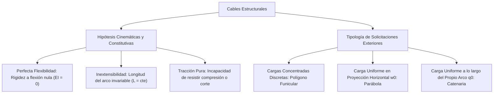
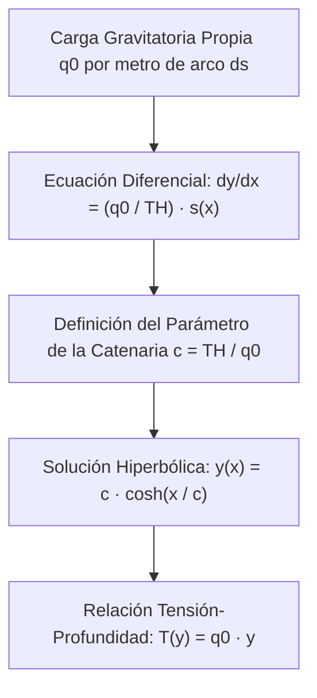

# Compendio de Repaso: Cables Flexibles y Catenarias

---

## 1. Fundamentos y Modelado Físico de Cables Flexibles

Un **cable** es un elemento estructural continuo cuya longitud es varios órdenes de magnitud superior a las dimensiones transversales de su sección, diseñado para transmitir cargas estructurales exclusivamente a través de esfuerzos axiales de tracción pura.



### 1.1 Hipótesis Fundamentales sobre Cables Flexibles

1. **Perfecta Flexibilidad ($\text{EI} = 0$):**
   * El cable no ofrece resistencia alguna a la flexión ni a la torsión ($M = 0$, $T = 0$).
   * No puede transmitir fuerzas cortantes transversales ($V = 0$).
   * Como consecuencia directa, **la fuerza interna de tensión $\vec{T}$ en cualquier sección transversal actúa estrictamente tangente al eje centroidal de la curva** descrita por el cable en todo punto:
   $$
   \vec{T}(s) = T(s) \cdot \hat{t}(s)
   $$
2. **Inextensibilidad Clásica:**
   * Se asume que el módulo de elasticidad axial es suficientemente grande ($EA \to \infty$) para que la deformación unitaria por tracción sea despreciable ($\varepsilon = \frac{\Delta L}{L_0} \approx 0$). La longitud de arco desarrollada coincide con la longitud geométrica nominal sin deformar.
3. **Incapacidad de Resistir Compresión:**
   * Si la fuerza axial se anula o tiende a comprimir ($T \le 0$), el cable experimenta pandeo cinemático instantáneo colapsando su geometría (inestabilidad por pérdida de tensión).
4. **Peso Despreciable (Salvo en el caso de la Catenaria):**
   * Al analizar cargas discretas o cargas superficiales transmitidas por péndolas secundarias, el peso gravitatorio propio del cable se asume despreciable frente a las acciones exteriores actuantes.

> [!WARNING]
> Dado que un cable carece de rigidez propia a la flexión, **su configuración geométrica espacial no es estática ni fija a priori**, sino que adopta una curvatura dependiente directamente del sistema de cargas exteriores aplicado (forma funicular activa).

---

## 2. Análisis de Cables Sometidos a Cargas Concentradas Discretas

Cuando un cable anclado entre dos soportes rígidos $A$ y $B$ soporta $n$ fuerzas verticales concentradas $P_1, P_2, \dots, P_n$, adopta una configuración geométrica poligonal conocida como **polígono funicular**.

<div align="center">
  <svg width="600" height="230" viewBox="0 0 600 230" xmlns="http://www.w3.org/2000/svg">
    <!-- Apoyo A -->
    <circle cx="60" cy="50" r="5" fill="#0f172a"/>
    <text x="45" y="45" fill="#0f172a" font-size="12" font-family="sans-serif" font-weight="bold">A</text>
    <line x1="60" y1="50" x2="60" y2="20" stroke="#dc2626" stroke-width="2"/>
    <text x="65" y="30" fill="#dc2626" font-size="11" font-family="sans-serif">A_y</text>
    <line x1="60" y1="50" x2="20" y2="50" stroke="#2563eb" stroke-width="2"/>
    <text x="15" y="65" fill="#2563eb" font-size="11" font-family="sans-serif">T_H</text>

    <!-- Nudos C y D -->
    <circle cx="210" cy="150" r="4.5" fill="#0f172a"/>
    <text x="200" y="140" fill="#0f172a" font-size="11" font-family="sans-serif" font-weight="bold">C</text>
    
    <circle cx="410" cy="120" r="4.5" fill="#0f172a"/>
    <text x="400" y="110" fill="#0f172a" font-size="11" font-family="sans-serif" font-weight="bold">D</text>

    <!-- Apoyo B -->
    <circle cx="540" cy="70" r="5" fill="#0f172a"/>
    <text x="550" y="70" fill="#0f172a" font-size="12" font-family="sans-serif" font-weight="bold">B</text>
    <line x1="540" y1="70" x2="540" y2="35" stroke="#dc2626" stroke-width="2"/>
    <text x="545" y="45" fill="#dc2626" font-size="11" font-family="sans-serif">B_y</text>

    <!-- Tramos de Cable -->
    <line x1="60" y1="50" x2="210" y2="150" stroke="#334155" stroke-width="3"/>
    <line x1="210" y1="150" x2="410" y2="120" stroke="#334155" stroke-width="3"/>
    <line x1="410" y1="120" x2="540" y2="70" stroke="#334155" stroke-width="3"/>

    <!-- Fuerzas Concentradas -->
    <line x1="210" y1="150" x2="210" y2="215" stroke="#dc2626" stroke-width="2.5"/>
    <polygon points="206,208 210,218 214,208" fill="#dc2626"/>
    <text x="218" y="210" fill="#dc2626" font-size="12" font-family="sans-serif" font-weight="bold">P1</text>

    <line x1="410" y1="120" x2="410" y2="190" stroke="#dc2626" stroke-width="2.5"/>
    <polygon points="406,183 410,193 414,183" fill="#dc2626"/>
    <text x="418" y="185" fill="#dc2626" font-size="12" font-family="sans-serif" font-weight="bold">P2</text>

    <!-- Flechas (Cotas y_C) -->
    <line x1="210" y1="50" x2="210" y2="148" stroke="#94a3b8" stroke-dasharray="3,3" stroke-width="1.5"/>
    <text x="215" y="100" fill="#64748b" font-size="11" font-family="sans-serif">y_C</text>
  </svg>
</div>

### 2.1 Ecuaciones de Equilibrio Seccional e Invarianza de la Componente Horizontal

Considerando un tramo rectilíneo $k$ del cable con pendiente geométrica $\theta_k$:
$$
\vec{T}_k = T_k \cos(\theta_k)\hat{i} + T_k \sin(\theta_k)\hat{j}
$$

Dado que no existen fuerzas exteriores en el eje longitudinal horizontal $x$ ($\sum F_x = 0$):
$$
T_1 \cos(\theta_1) = T_2 \cos(\theta_2) = \dots = T_k \cos(\theta_k) = T_H = \text{constante}
$$

* **Principio de Invarianza Horizontal:** La componente horizontal de la tensión $T_H$ es **rigurosamente constante e invariable** en cualquier punto a lo largo de todo el cable.

La tensión total resultante en cualquier segmento se vincula con la pendiente local mediante:
$$
T_k = \frac{T_H}{\cos(\theta_k)} = \sqrt{T_H^2 + T_{yk}^2}
$$

* **Criterio de Tensión Máxima ($T_{\max}$):** La tensión absoluta máxima ocurrirá en el tramo con la **mayor inclinación angular $\theta_{\max}$** respecto a la horizontal (comúnmente en el apoyo de mayor cota vertical):
$$
T_{\max} = \frac{T_H}{\cos(\theta_{\max})}
$$

### 2.2 Determinación de Flechas ($y_k$) mediante Momentos Flectores Equivalentes

Realizando un corte vertical imaginario en el nudo $k$ de coordenadas $(x_k, y_k)$, el equilibrio de momentos de la porción izquierda respecto al punto $k$ establece:
$$
\sum M_k = 0 \implies T_H \cdot y_k - A_y \cdot x_k + \sum_{i < k} P_i (x_k - x_i) = 0
$$

Nótese que el término $A_y \cdot x_k - \sum_{i < k} P_i (x_k - x_i)$ representa con exactitud matemática el momento flector $M_v(x_k)$ que existiría en una **viga ficticia simplemente apoyada** de la misma luz sometida al mismo conjunto de cargas exteriores:
$$
T_H \cdot y_k = M_v(x_k) \iff y_k = \frac{M_v(x_k)}{T_H}
$$

> [!TIP]
> **Analogía de la Viga Conjugada:** La flecha vertical $y(x)$ de un cable en cualquier punto de su trayectoria funicular es directamente proporcional al momento flector de una viga simplemente apoyada con idéntica luz y carga, escalada por la inversa de la componente horizontal de la tensión: $y(x) = \frac{M_v(x)}{T_H}$.

---

## 3. Cables Sometidos a Cargas Distribuidas Horizontalmente (Cable Parabólico)

Este modelo describe con precisión analítica puentes colgantes donde la plataforma vehicular rígida transmite una sobrecarga uniforme continua distribuida horizontalmente a través de tirantes verticales suspendidos (péndolas poco espaciadas).

```mermaid
flowchart LR
    w0[Carga Uniforme en Proyección Horizontal w0 N/m] --> DifEquil[Ecuación Diferencial dy/dx = w0 x / TH]
    DifEquil --> Int1[Perfil Geométrico: Parábola de 2do Grado]
    Int1 --> Tension[Tensión Total Variable: T = √(TH² + w0² x²)]
    Tension --> Longitud[Desarrollo en Serie de la Longitud del Cable S]
```

### 3.1 Deducción de la Ecuación Diferencial y Geometría de la Curva

Tomando un elemento diferencial de cable de longitud horizontal proyectada $dx$:

<div align="center">
  <svg width="420" height="190" viewBox="0 0 420 190" xmlns="http://www.w3.org/2000/svg">
    <!-- Tramo curvo diferencial -->
    <path d="M 120,130 Q 210,100 300,50" fill="none" stroke="#334155" stroke-width="3"/>
    
    <!-- Carga w0 distribuida -->
    <line x1="160" y1="20" x2="160" y2="85" stroke="#0284c7" stroke-width="1.5"/>
    <polygon points="157,80 160,88 163,80" fill="#0284c7"/>
    <line x1="210" y1="20" x2="210" y2="70" stroke="#0284c7" stroke-width="1.5"/>
    <polygon points="207,65 210,73 213,65" fill="#0284c7"/>
    <line x1="260" y1="20" x2="260" y2="45" stroke="#0284c7" stroke-width="1.5"/>
    <polygon points="257,40 260,48 263,40" fill="#0284c7"/>
    <text x="210" y="15" fill="#0284c7" font-size="12" font-family="sans-serif" text-anchor="middle">w_0 dx</text>

    <!-- Tensión izquierda T -->
    <line x1="120" y1="130" x2="60" y2="155" stroke="#dc2626" stroke-width="2.5"/>
    <polygon points="66,156 54,158 61,148" fill="#dc2626"/>
    <text x="50" y="145" fill="#dc2626" font-size="12" font-family="sans-serif" font-weight="bold">T</text>

    <!-- Tensión derecha T + dT -->
    <line x1="300" y1="50" x2="370" y2="15" stroke="#dc2626" stroke-width="2.5"/>
    <polygon points="364,22 376,12 370,26" fill="#dc2626"/>
    <text x="360" y="38" fill="#dc2626" font-size="12" font-family="sans-serif" font-weight="bold">T + dT</text>

    <!-- Triángulo diferencial dx, dy -->
    <line x1="120" y1="130" x2="300" y2="130" stroke="#94a3b8" stroke-width="1" stroke-dasharray="2,2"/>
    <line x1="300" y1="130" x2="300" y2="50" stroke="#94a3b8" stroke-width="1" stroke-dasharray="2,2"/>
    <text x="210" y="145" fill="#64748b" font-size="11" font-family="sans-serif" text-anchor="middle">dx</text>
    <text x="310" y="95" fill="#64748b" font-size="11" font-family="sans-serif">dy</text>
  </svg>
</div>

Equilibrio en un segmento que va desde el vértice inferior $O(0,0)$ (donde la pendiente tangencial es horizontal, $\theta = 0$) hasta un punto genérico $(x, y)$:
* Equilibrio horizontal: $T \cos(\theta) = T_H$
* Equilibrio vertical: $T \sin(\theta) = w_0 \cdot x$

Dividiendo ambas ecuaciones miembro a miembro:
$$
\tan(\theta) = \frac{dy}{dx} = \frac{w_0 x}{T_H}
$$

Integrando con la condición de frontera en el origen $y(0) = 0$:
$$
y(x) = \int_{0}^{x} \frac{w_0 \xi}{T_H} \, d\xi = \frac{w_0}{2 T_H} x^2
$$

* **Teorema Geométrico:** La directriz de un cable bajo carga uniforme horizontal proyectada adopta de forma analítica una **parábola cuadrática**.

### 3.2 Flecha Central y Campo de Tensiones

Para un cable con apoyos al mismo nivel separados una luz horizontal $L$, la flecha máxima $h$ ocurre en el punto medio $x = \frac{L}{2}$:
$$
h = y\left(\frac{L}{2}\right) = \frac{w_0 (L/2)^2}{2 T_H} = \frac{w_0 L^2}{8 T_H}
$$

Despejando la componente horizontal en función de la flecha $h$:
$$
T_H = \frac{w_0 L^2}{8 h}
$$

La ecuación cartesiana normalizada queda expresada como:
$$
y(x) = \frac{4 h}{L^2} x^2 \quad \left(\text{con origen en el centro}\right)
$$

Distribución de la tensión a lo largo del vano:
$$
T(x) = \sqrt{T_H^2 + (w_0 x)^2} = T_H \sqrt{1 + \left(\frac{w_0 x}{T_H}\right)^2}
$$

La **tensión máxima** ocurre en los anclajes exteriores ($x = \pm L/2$):
$$
T_{\max} = \sqrt{T_H^2 + \left(\frac{w_0 L}{2}\right)^2} = T_H \sqrt{1 + 16\left(\frac{h}{L}\right)^2}
$$

### 3.3 Longitud Desarrollada del Cable ($S$)

El diferencial de arco se define por $ds = \sqrt{dx^2 + dy^2} = \sqrt{1 + (y')^2} \, dx$:
$$
S = 2 \int_{0}^{L/2} \sqrt{1 + \left(\frac{w_0 x}{T_H}\right)^2} \, dx = 2 \int_{0}^{L/2} \sqrt{1 + \left(\frac{8 h x}{L^2}\right)^2} \, dx
$$

Expandiendo el integrando mediante la serie binomial para cables con flecha reducida ($\frac{h}{L} \le \frac{1}{10}$):
$$
\sqrt{1 + u} \approx 1 + \frac{1}{2}u - \frac{1}{8}u^2 + \dots \quad \text{donde } u = \left(\frac{8 h x}{L^2}\right)^2
$$

Integrando término a término:
$$
S \approx L \left[ 1 + \frac{8}{3}\left(\frac{h}{L}\right)^2 - \frac{32}{5}\left(\frac{h}{L}\right)^4 + \dots \right]
$$

---

## 4. Cables Sometidos a su Propio Peso (Ecuación de la Catenaria)

Cuando la carga gravitatoria no se reparte por metro horizontal proyectado, sino de forma uniforme por unidad de longitud real de cable $q_0$ $[\text{N/m}]$, la curva resultante de equilibrio físico se denomina **catenaria**.



### 4.1 Deducción Rigurosa de la Ecuación Diferencial

Analizando el equilibrio estático de un elemento diferencial de arco $ds$:
* Equilibrio horizontal: $d(T \cos\theta) = 0 \implies T \cos\theta = T_H = \text{constante}$
* Equilibrio vertical: $d(T \sin\theta) = q_0 \, ds$

Dividiendo ambas expresiones diferenciales:
$$
d\left( \frac{T \sin\theta}{T \cos\theta} \right) = d(\tan\theta) = \frac{q_0}{T_H} ds
$$

Dado que $\tan\theta = \frac{dy}{dx}$ y $ds = \sqrt{1 + \left(\frac{dy}{dx}\right)^2} \, dx$:
$$
\frac{d^2 y}{dx^2} = \frac{q_0}{T_H} \sqrt{1 + \left(\frac{dy}{dx}\right)^2}
$$

Definiendo el **parámetro característico de la catenaria** $c = \frac{T_H}{q_0}$ (con dimensiones de longitud $[m]$):
$$
\frac{d^2 y}{dx^2} = \frac{1}{c} \sqrt{1 + \left(\frac{dy}{dx}\right)^2}
$$

### 4.2 Resolución Mediante Funciones Hiperbólicas

Efectuando el cambio de variable cinemático $p = \frac{dy}{dx}$:
$$
\frac{dp}{\sqrt{1 + p^2}} = \frac{1}{c} dx
$$

Integrando a ambos lados:
$$
\text{arcsinh}(p) = \frac{x}{c} + C_1
$$

Imponiendo la condición de vértice horizontal en $x = 0 \implies p = \left.\frac{dy}{dx}\right|_{x=0} = 0 \implies C_1 = 0$:
$$
p = \frac{dy}{dx} = \sinh\left(\frac{x}{c}\right)
$$

Integrando nuevamente respecto a $x$:
$$
y(x) = c \cosh\left(\frac{x}{c}\right) + C_2
$$

Fijando el sistema de referencia para situar el eje $x$ a una distancia $c$ por debajo del vértice mínimo del cable ($y(0) = c$), resulta $C_2 = 0$:

$$
y(x) = c \cosh\left(\frac{x}{c}\right)
$$

### 4.3 Fórmulas Clave de la Catenaria

1. **Longitud de Arco ($s$) desde el vértice ($x=0$) hasta una cota $x$:**
   $$
   s(x) = \int_{0}^{x} \sqrt{1 + \sinh^2\left(\frac{\xi}{c}\right)} \, d\xi = \int_{0}^{x} \cosh\left(\frac{\xi}{c}\right) \, d\xi = c \sinh\left(\frac{x}{c}\right)
   $$
2. **Identidad Fundamental Geométrica de la Catenaria:**
   Utilizando la relación fundamental de las funciones hiperbólicas ($\cosh^2(u) - \sinh^2(u) = 1$):
   $$
   y^2 - s^2 = c^2 \cosh^2\left(\frac{x}{c}\right) - c^2 \sinh^2\left(\frac{x}{c}\right) = c^2
   $$
   $$
   y = \sqrt{c^2 + s^2}
   $$
3. **Ley de Tensión a Cualquier Profundidad ($T$):**
   $$
   T = \frac{T_H}{\cos\theta} = T_H \sqrt{1 + \tan^2\theta} = T_H \sqrt{1 + \sinh^2\left(\frac{x}{c}\right)} = T_H \cosh\left(\frac{x}{c}\right)
   $$
   Sustituyendo $T_H = q_0 \cdot c$:
   $$
   T(y) = q_0 \left[ c \cosh\left(\frac{x}{c}\right) \right] = q_0 \cdot y
   $$

> [!NOTE]
> **Teorema de la Tensión Hidrostática de la Catenaria:**
> La magnitud de la tensión interna total $T$ en cualquier punto del cable es numéricamente igual al **peso de un tramo vertical imaginario del mismo cable** suspendido desde dicho punto hasta la recta de directriz horizontal de referencia ($y = 0$).

4. **Flecha de la Catenaria ($h$):**
   Para apoyos al mismo nivel distanciados una luz $L$:
   $$
   h = y\left(\frac{L}{2}\right) - y(0) = c \left[ \cosh\left(\frac{L}{2c}\right) - 1 \right]
   $$

---

## 5. Tabla Comparativa: Cable Parabólico vs. Catenaria

| Parámetro / Propiedad | Cable Parabólico (Aproximación de Puente) | Catenaria Real (Tendido Eléctrico Libre) |
| :--- | :--- | :--- |
| **Distribución de Carga** | $w(x) = w_0$ constante por proyección horizontal | $q(s) = q_0$ constante a lo largo del arco |
| **Ecuación Directriz** | $y(x) = \frac{w_0}{2 T_H} x^2$ (Polinómica Grado 2) | $y(x) = c \cosh(x/c)$ (Trascendente Hiperbólica) |
| **Componente Horizontal** | $T_H = \text{constante}$ | $T_H = q_0 \cdot c = \text{constante}$ |
| **Tensión Total $T(x)$** | $T(x) = \sqrt{T_H^2 + (w_0 x)^2}$ | $T(x) = T_H \cosh(x/c) = q_0 y(x)$ |
| **Longitud de Arco $S$** | $S \approx L \left[ 1 + \frac{8}{3}\left(\frac{h}{L}\right)^2 \right]$ | $S = 2 c \sinh\left(\frac{L}{2c}\right)$ |
| **Error Relativo** | Despreciable si la flecha es baja: $h/L < 0.1$ | Exacto bajo peso propio continuo |

---

## 6. Implementación Numérica: Solucionador de Catenarias

El cálculo del parámetro trascendente $c$ para una catenaria dadas la luz $L$ y la longitud física del cable $S$ requiere resolver la ecuación no lineal $S = 2c \sinh\left(\frac{L}{2c}\right)$ mediante métodos numéricos como Newton-Raphson:

```python
import numpy as np
from scipy import optimize

def resolver_catenaria(luz_L: float, longitud_cable_S: float, peso_lineal_q0: float):
    """
    Resuelve los parámetros mecánicos y geométricos de una catenaria 
    con apoyos nivelados a la misma cota.
    
    :param luz_L: Distancia horizontal entre soportes [m]
    :param longitud_cable_S: Longitud desarrollada total del cable [m] (S > L)
    :param peso_lineal_q0: Peso propio por unidad de longitud [N/m]
    :return: Diccionario con los parámetros calculados (c, TH, h, T_max)
    """
    if longitud_cable_S <= luz_L:
        raise ValueError("La longitud del cable debe ser estrictamente mayor que la luz horizontal.")

    # Ecuación trascendente: S = 2*c*sinh(L / (2*c)) -> f(c) = 2*c*sinh(L/(2*c)) - S = 0
    def f_objetivo(c):
        return 2.0 * c * np.sinh(luz_L / (2.0 * c)) - longitud_cable_S

    # Estimación inicial basada en la aproximación parabólica:
    # S ≈ L + 8/3 * h^2/L  y  h ≈ L^2 / (8*c) -> c ≈ L / sqrt(24 * (S/L - 1))
    c_estimado = luz_L / np.sqrt(24.0 * (longitud_cable_S / luz_L - 1.0))

    sol = optimize.root_scalar(f_objetivo, x0=c_estimado, method='newton')
    if not sol.converged:
        raise RuntimeError("No convergió la solución numérica para el parámetro c.")

    c = sol.root
    T_H = peso_lineal_q0 * c
    # Flecha vertical en el centro h = c * (cosh(L / (2c)) - 1)
    flecha_h = c * (np.cosh(luz_L / (2.0 * c)) - 1.0)
    # Tensión máxima en los apoyos exteriores x = ± L/2: T_max = q0 * y_max = q0 * (c + h)
    T_max = peso_lineal_q0 * (c + flecha_h)

    # Comparación con aproximación parabólica
    h_parab = np.sqrt(3.0 * luz_L * (longitud_cable_S - luz_L) / 8.0)
    TH_parab = (peso_lineal_q0 * luz_L**2) / (8.0 * h_parab)

    return {
        "c_parametro [m]": c,
        "Tension_Horizontal_TH [N]": T_H,
        "Flecha_Catenaria_h [m]": flecha_h,
        "Tension_Maxima_Tmax [N]": T_max,
        "Flecha_Parabolica_Aprox [m]": h_parab,
        "TH_Parabolica_Aprox [N]": TH_parab,
        "Error_Relativo_Flecha [%]": abs(flecha_h - h_parab) / flecha_h * 100.0
    }

if __name__ == "__main__":
    # CASO PRÁCTICO: Línea de alta tensión
    # Luz horizontal L = 200 m, Cable tendido de S = 205 m, Peso q0 = 25 N/m
    L = 200.0
    S = 205.0
    q0 = 25.0

    resultados = resolver_catenaria(luz_L=L, longitud_cable_S=S, peso_lineal_q0=q0)
    
    print("================== RESULTADOS DE LA CATENARIA ==================")
    for k, v in resultados.items():
        print(f"{k:32s}: {v:12.4f}")
```