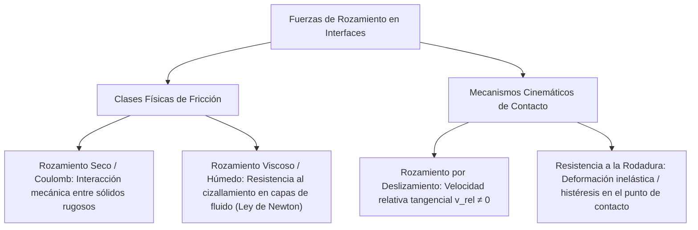
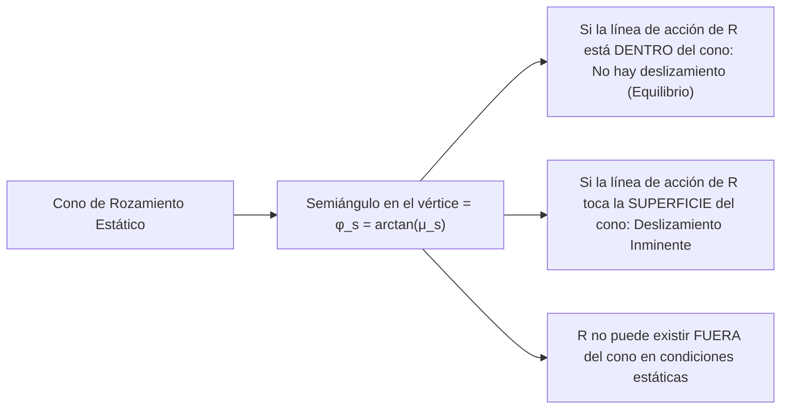
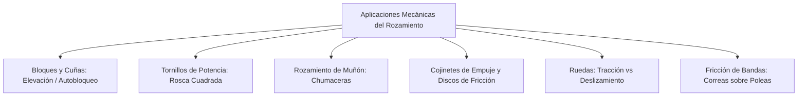
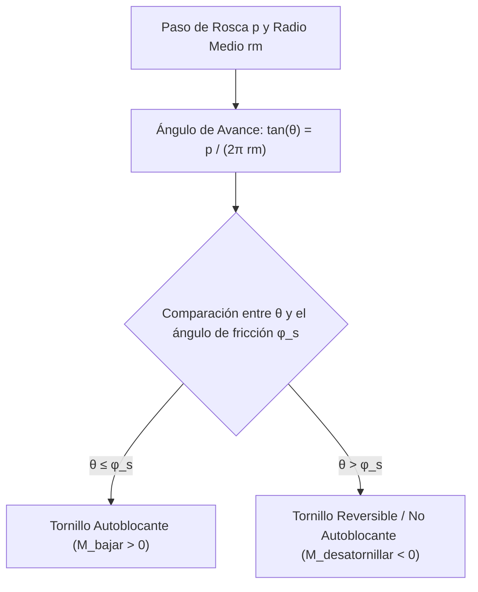
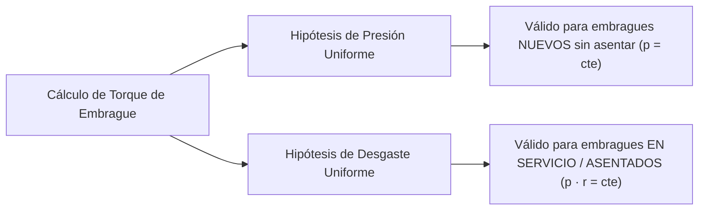
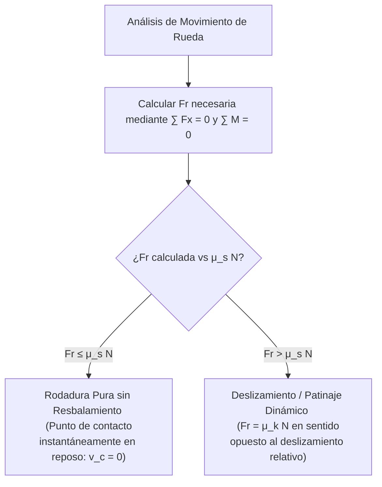

# Compendio de Repaso: Fuerzas de Rozamiento y Aplicaciones en Ingeniería

---

## 1. Naturaleza del Rozamiento y Leyes de Contacto

El **rozamiento** es la fuerza reactiva tangencial que se desarrolla en la interfaz física de dos cuerpos en contacto cuando existe una tendencia al movimiento relativo o movimiento relativo efectivo entre ellos.



---

### 1.1 Clases de Rozamiento: Seco (Coulomb) frente a Húmedo o Viscoso

| Característica / Parámetro | Rozamiento Seco (Coulomb) | Rozamiento Húmedo / Viscoso |
| :--- | :--- | :--- |
| **Medio de Interfaz** | Superficies sólidas en contacto directo sin lubricación o con lubricación límite | Película continua de fluido lubricante intermedio (régimen hidrodinámico) |
| **Mecanismo Físico** | Adhesión microscópica de asperezas e interferencia mecánica | Cizallamiento laminar del fluido ($\tau = \mu_{\text{visc}} \frac{dv}{dy}$) |
| **Dependencia de la Velocidad** | Casi independiente de la magnitud de la velocidad relativa una vez iniciado el movimiento | Fuertemente dependiente de la velocidad relativa ($F_r \propto v$ o $F_r \propto v^2$) |
| **Dependencia del Área Nominal** | Independiente del área aparente o geométrica macroscópica de contacto | Directamente proporcional al área superficial mojada de contacto |
| **Dependencia de la Carga Normal** | Directamente proporcional a la fuerza normal compresiva $N$ | Depende indirectamente a través del gradiente de presiones en el fluido |

---

### 1.2 Mecanismos de Contacto: Deslizamiento frente a Resistencia a la Rodadura

#### A. Rozamiento por Deslizamiento
Ocurre cuando las superficies experimentan traslación tangencial relativa. La fuerza de rozamiento $F_r$ actúa en el plano tangente común, en sentido estrictamente opuesto al vector velocidad relativa $\vec{v}_{\text{rel}}$ o a la tendencia inminente al desplazamiento.

#### B. Resistencia a la Rodadura
Cuando un cilindro o rueda de radio $r$ rueda sobre una superficie real deformable, la fuerza normal de contacto reactiva no actúa exactamente en la vertical centroidal, sino desplazada una distancia horizontal $b$ (**coeficiente de resistencia a la rodadura**, con dimensiones de longitud $[m]$ o $[mm]$) debido a la deformación histerética del material:

<div align="center">
  <svg width="420" height="210" viewBox="0 0 420 210" xmlns="http://www.w3.org/2000/svg">
    <!-- Superficie deformada -->
    <line x1="40" y1="160" x2="380" y2="160" stroke="#64748b" stroke-width="2"/>
    <path d="M 170,160 Q 210,168 250,160" fill="none" stroke="#64748b" stroke-width="2"/>
    <!-- Rueda -->
    <circle cx="210" cy="85" r="75" fill="#f8fafc" stroke="#334155" stroke-width="3"/>
    <!-- Centro O y Carga Vertical W -->
    <circle cx="210" cy="85" r="4" fill="#0f172a"/>
    <text x="195" y="80" fill="#0f172a" font-size="12" font-family="sans-serif" font-weight="bold">O</text>
    <line x1="210" y1="85" x2="210" y2="15" stroke="#2563eb" stroke-width="2.5"/>
    <polygon points="206,20 210,10 214,20" fill="#2563eb"/>
    <text x="218" y="30" fill="#2563eb" font-size="12" font-family="sans-serif" font-weight="bold">W (o N)</text>
    <!-- Fuerza Tractora P -->
    <line x1="210" y1="85" x2="285" y2="85" stroke="#16a34a" stroke-width="2.5"/>
    <polygon points="280,81 290,85 280,89" fill="#16a34a"/>
    <text x="270" y="75" fill="#16a34a" font-size="12" font-family="sans-serif" font-weight="bold">P</text>
    <!-- Línea central vertical punteada -->
    <line x1="210" y1="85" x2="210" y2="175" stroke="#94a3b8" stroke-width="1.5" stroke-dasharray="3,3"/>
    <!-- Reacción de Contacto R inclinada, desfasada una distancia b -->
    <line x1="235" y1="180" x2="210" y2="85" stroke="#dc2626" stroke-width="2.5"/>
    <polygon points="214,95 210,85 219,89" fill="#dc2626"/>
    <text x="235" y="145" fill="#dc2626" font-size="12" font-family="sans-serif" font-weight="bold">R</text>
    <!-- Distancia b -->
    <line x1="210" y1="180" x2="235" y2="180" stroke="#7c3aed" stroke-width="2"/>
    <text x="220" y="195" fill="#7c3aed" font-size="12" font-family="sans-serif" font-weight="bold">b</text>
  </svg>
</div>

Tomando sumatoria de momentos en el punto de contacto adelantado $A(x = b)$:
$$
\sum M_A = 0 \implies P \cdot (r \cos\theta) - W \cdot b = 0 \approx P \cdot r - W \cdot b = 0
$$
$$
P = \frac{W \cdot b}{r}
$$
* Como $b \ll r$, la fuerza de tracción requerida para rodar $P$ es órdenes de magnitud menor que la necesaria para deslizar ($P_{\text{desl}} = \mu W$).

---

### 1.3 Leyes Clásicas de Coulomb para el Rozamiento Seco

Formuladas experimentalmente por Guillaume Amontons (1699) y confirmadas por Charles-Augustin de Coulomb (1781):

1. **Primera Ley:** La fuerza máxima de rozamiento estático y cinético es directamente proporcional a la fuerza normal compresiva entre las superficies ($F_r \propto N$).
2. **Segunda Ley:** La fuerza de rozamiento es independiente del área aparente o geométrica macroscópica de contacto entre los dos cuerpos.
3. **Tercera Ley:** La fuerza de rozamiento cinético es prácticamente independiente de la velocidad relativa de deslizamiento, una vez iniciado el movimiento relativo.

---

### 1.4 Coeficientes y Ángulos de Rozamiento ($\mu_s, \phi_s, \mu_k, \phi_k$)

<div align="center">
  <svg width="480" height="210" viewBox="0 0 480 210" xmlns="http://www.w3.org/2000/svg">
    <!-- Ejes cartesianos Fr vs P -->
    <line x1="50" y1="170" x2="440" y2="170" stroke="#334155" stroke-width="2"/>
    <polygon points="435,167 443,170 435,173" fill="#334155"/>
    <text x="350" y="190" fill="#334155" font-size="12" font-family="sans-serif">Fuerza aplicada P</text>
    <line x1="60" y1="180" x2="60" y2="25" stroke="#334155" stroke-width="2"/>
    <polygon points="57,28 60,20 63,28" fill="#334155"/>
    <text x="20" y="30" fill="#334155" font-size="12" font-family="sans-serif">F_r</text>
    <!-- Región Estática (Rampa a 45 grados) -->
    <line x1="60" y1="170" x2="220" y2="50" stroke="#2563eb" stroke-width="3"/>
    <text x="110" y="90" fill="#2563eb" font-size="11" font-family="sans-serif" font-weight="bold">F_r = P (Equilibrio estático)</text>
    <!-- Punto Crítico de Deslizamiento Inminente -->
    <circle cx="220" cy="50" r="4.5" fill="#dc2626"/>
    <text x="210" y="40" fill="#dc2626" font-size="11" font-family="sans-serif" font-weight="bold">F_max = μ_s N</text>
    <!-- Caída y Meseta Cinética -->
    <path d="M 220,50 L 235,75 L 420,75" stroke="#16a34a" stroke-width="3"/>
    <text x="280" y="65" fill="#16a34a" font-size="11" font-family="sans-serif" font-weight="bold">F_k = μ_k N (Cinético)</text>
    <!-- Líneas divisorias -->
    <line x1="220" y1="170" x2="220" y2="45" stroke="#94a3b8" stroke-dasharray="3,3" stroke-width="1.5"/>
    <text x="120" y="185" fill="#64748b" font-size="11" font-family="sans-serif">Región Estática</text>
    <text x="270" y="185" fill="#64748b" font-size="11" font-family="sans-serif">Región Cinética (En movimiento)</text>
  </svg>
</div>

#### A. Regímenes de Comportamiento:
1. **Régimen Estático ($P < F_{\max}$):** El cuerpo permanece en reposo relativo. La fuerza de rozamiento es puramente reactiva:
   $$
   F_r = P \le F_s^{\max} = \mu_s N
   $$
2. **Deslizamiento Inminente ($P = F_{\max}$):** Umbral exacto en el cual el cuerpo está a punto de perder el reposo estático. Se satura la resistencia interfacial:
   $$
   F_r = F_s^{\max} = \mu_s N
   $$
3. **Régimen Cinético / Dinámico ($P > F_{\max}$):** Ruptura interfacial y movimiento relativo acelerado o uniforme. La resistencia decae a:
   $$
   F_k = \mu_k N \quad (\text{donde generalmente } \mu_k \approx 0.75 \text{ a } 0.85 \, \mu_s)
   $$

#### B. Ángulo y Cono de Rozamiento
La fuerza de reacción total de la superficie $\vec{R}$ es la resultante vectorial de la fuerza normal $\vec{N}$ y la fuerza de fricción $\vec{F}_r$:
$$
\vec{R} = \vec{N} + \vec{F}_r, \qquad R = \sqrt{N^2 + F_r^2}
$$

El ángulo $\phi$ formado entre la reacción total $\vec{R}$ y la normal $\vec{N}$ se define como:
$$
\tan(\phi) = \frac{F_r}{N}
$$
* **Ángulo de rozamiento estático ($\phi_s$):** En condición de deslizamiento inminente:
  $$
  \tan(\phi_s) = \frac{F_s^{\max}}{N} = \frac{\mu_s N}{N} = \mu_s \implies \phi_s = \arctan(\mu_s)
  $$
* **Ángulo de rozamiento cinético ($\phi_k$):** Durante el movimiento relativo:
  $$
  \tan(\phi_k) = \frac{F_k}{N} = \mu_k \implies \phi_k = \arctan(\mu_k)
  $$



> [!WARNING]
> **Falsa Suposición de $F_r = \mu_s N$:** En problemas de equilibrio estático donde no se especifique o verifique que el movimiento es *inminente*, **nunca** asumas $F_r = \mu_s N$. Trata $F_r$ como una incógnita algebraica independiente a resolver mediante las ecuaciones de equilibrio ($\sum F = 0$, $\sum M = 0$) y luego valida la condición física de no deslizamiento: $F_r \le \mu_s N$.

---

## 2. Aplicaciones Ingenieriles del Rozamiento



---

### 2.1 Bloques y Cuñas: Autobloqueo y Empuje

Las cuñas son máquinas simples utilizadas para levantar cargas pesadas o efectuar ajustes milimétricos mediante planos inclinados pequeños (ángulo de cuña $\alpha$).

<div align="center">
  <svg width="420" height="190" viewBox="0 0 420 190" xmlns="http://www.w3.org/2000/svg">
    <!-- Pared Vertical -->
    <line x1="60" y1="20" x2="60" y2="170" stroke="#334155" stroke-width="4"/>
    <!-- Bloque A (Carga W) -->
    <polygon points="62,30 180,30 180,110 62,110" fill="#f1f5f9" stroke="#334155" stroke-width="2"/>
    <text x="110" y="75" fill="#0f172a" font-size="13" font-family="sans-serif" font-weight="bold">Bloque A (W)</text>
    <line x1="120" y1="30" x2="120" y2="70" stroke="#dc2626" stroke-width="2.5"/>
    <polygon points="116,65 120,75 124,65" fill="#dc2626"/>
    <!-- Cuña B (Ángulo alpha) -->
    <polygon points="62,150 260,150 180,110 62,110" fill="#e2e8f0" stroke="#334155" stroke-width="2"/>
    <text x="130" y="135" fill="#0f172a" font-size="12" font-family="sans-serif" font-weight="bold">Cuña B</text>
    <text x="210" y="145" fill="#64748b" font-size="11" font-family="sans-serif">α</text>
    <!-- Fuerza de Empuje P -->
    <line x1="330" y1="130" x2="262" y2="130" stroke="#2563eb" stroke-width="3"/>
    <polygon points="268,126 258,130 268,134" fill="#2563eb"/>
    <text x="310" y="120" fill="#2563eb" font-size="13" font-family="sans-serif" font-weight="bold">P</text>
    <!-- Suelo horizontal -->
    <line x1="50" y1="150" x2="350" y2="150" stroke="#334155" stroke-width="3"/>
  </svg>
</div>

#### A. Fuerza para Insertar la Cuña (Elevar la Carga $W$)
En la condición de deslizamiento inminente hacia la izquierda de la cuña, todas las reacciones de contacto $\vec{R}_i$ se inclinan un ángulo $\phi_s$ respecto a las normales respectivas en sentido opuesto al avance:
$$
P = W \tan(\phi_1 + \phi_2 + \alpha)
$$
Si todos los coeficientes de fricción son iguales ($\phi_1 = \phi_2 = \phi_s$):
$$
P = W \tan(2\phi_s + \alpha)
$$

#### B. Condición de Autobloqueo (*Self-Locking*)
Una cuña es **autoblocante** si permanece firme en su posición soportando la carga vertical $W$ sin expulsarse espontáneamente cuando se retira la fuerza impulsora exterior ($P = 0$):
$$
\text{Condición de Autobloqueo: } \alpha \le \phi_1 + \phi_2 \implies \alpha \le 2\phi_s
$$
* Si $\alpha > 2\phi_s$, la cuña resbala hacia afuera expulsada por la carga $W$, requiriendo una fuerza de retención activa $P_{\text{ret}} > 0$.

---

### 2.2 Tornillos de Potencia con Rosca Cuadrada

Un tornillo de potencia transforma movimiento rotacional y torque aplicado $M_t$ en desplazamiento axial rectilíneo y fuerza axial de carga $W$. Cinemáticamente equivale al desarrollo de un plano inclinado helicoidal sobre un cilindro de radio medio $r_m$.



#### Parámetros Geométricos Básicos:
* $r_m = \frac{r_{\text{ext}} + r_{\text{int}}}{2}$: Radio medio de contacto de los filetes.
* $p$: Paso del tornillo (distancia axial recorrida en una vuelta completa para rosca simple).
* $\theta$: Ángulo de hélice o ángulo de avance (*lead angle*):
  $$
  \tan(\theta) = \frac{p}{2\pi r_m}
  $$

#### Fórmulas de Torque de Operación:

1. **Momento para Subir o Vencer la Carga ($W$):**
   $$
   M_{\text{subir}} = W r_m \tan(\theta + \phi_s) = W r_m \left[ \frac{\tan\theta + \mu_s}{1 - \mu_s \tan\theta} \right]
   $$
2. **Momento para Bajar la Carga ($W$):**
   * **Caso 1: Autoblocante ($\theta \le \phi_s$):** Debe aplicarse un torque positivo para forzar el descenso:
     $$
     M_{\text{bajar}} = W r_m \tan(\phi_s - \theta) = W r_m \left[ \frac{\mu_s - \tan\theta}{1 + \mu_s \tan\theta} \right]
     $$
   * **Caso 2: No autoblocante ($\theta > \phi_s$):** La carga hace girar el tornillo por sí sola. Para evitar que la carga caiga libremente, debe aplicarse un torque de frenado o retención:
     $$
     M_{\text{ret}} = W r_m \tan(\theta - \phi_s)
     $$

---

### 2.3 Chumaceras y Cojinetes en Ejes (Rozamiento de Muñón)

En un cojinete de contacto liso que soporta una carga radial $L$ sobre un eje giratorio de radio $r$, el contacto directo entre muñón y buje no ocurre en el punto inferior central, sino desplazado en sentido de la rotación:

<div align="center">
  <svg width="340" height="230" viewBox="0 0 340 230" xmlns="http://www.w3.org/2000/svg">
    <!-- Buje exterior -->
    <circle cx="170" cy="115" r="95" fill="#f8fafc" stroke="#64748b" stroke-width="4"/>
    <!-- Muñón / Eje interior (con holgura exagerada) -->
    <circle cx="180" cy="115" r="80" fill="#ffffff" stroke="#334155" stroke-width="3"/>
    <!-- Centro del eje O -->
    <circle cx="180" cy="115" r="4" fill="#0f172a"/>
    <text x="185" y="110" fill="#0f172a" font-size="12" font-family="sans-serif">O</text>
    <!-- Sentido de giro horario -->
    <path d="M 155,80 A 35 35 0 0 1 205,80" fill="none" stroke="#7c3aed" stroke-width="2.5"/>
    <polygon points="203,74 211,83 200,84" fill="#7c3aed"/>
    <text x="180" y="70" fill="#7c3aed" font-size="12" font-family="sans-serif" font-weight="bold">ω</text>
    <!-- Carga Radial L hacia abajo -->
    <line x1="180" y1="115" x2="180" y2="185" stroke="#2563eb" stroke-width="3"/>
    <polygon points="176,180 180,190 184,180" fill="#2563eb"/>
    <text x="188" y="180" fill="#2563eb" font-size="13" font-family="sans-serif" font-weight="bold">L</text>
    <!-- Círculo de Fricción rf = r * sin(phi_k) -->
    <circle cx="180" cy="115" r="28" fill="none" stroke="#dc2626" stroke-width="1.5" stroke-dasharray="3,3"/>
    <text x="212" y="125" fill="#dc2626" font-size="10" font-family="sans-serif">r_f</text>
    <!-- Reacción de Contacto R tangente al círculo de fricción -->
    <line x1="152" y1="180" x2="152" y2="50" stroke="#dc2626" stroke-width="2.5"/>
    <polygon points="148,55 152,45 156,55" fill="#dc2626"/>
    <text x="135" y="55" fill="#dc2626" font-size="12" font-family="sans-serif" font-weight="bold">R</text>
  </svg>
</div>

#### Círculo de Fricción:
La fuerza de contacto $\vec{R}$ debe equilibrar colinealmente a la carga radial $\vec{L}$ ($R = L$), pero resulta tangente a un círculo virtual concéntrico denominado **círculo de fricción**, de radio:
$$
r_f = r \sin(\phi_k) \approx r \mu_k \quad (\text{para ángulos pequeños } \sin\phi_k \approx \tan\phi_k = \mu_k)
$$

#### Par Resistente de Fricción en el Eje ($M_r$):
$$
M_r = R \cdot r_f = L \cdot r \sin(\phi_k) \approx \mu_k L r
$$

---

### 2.4 Cojinetes de Empuje Axial, Pivotes y Discos de Fricción

Transmiten cargas de compresión netas paralelas al eje longitudinal ($P$) sobre una superficie de contacto plana anular o circular (embragues y frenos de disco).



#### Hipótesis Clásicas de Diseño:

| Modelo / Hipótesis | Condición Mecánica | Presión Local $p(r)$ | Torque de Fricción Transmisible ($M_f$) |
| :--- | :--- | :--- | :--- |
| **Presión Uniforme (PU)** | Discos rígidos nuevos sin desgaste previo | $p = \frac{P}{\pi(R_{\text{ext}}^2 - R_{\text{int}}^2)}$ | $M_f = \frac{2}{3} \mu P \left[ \frac{R_{\text{ext}}^3 - R_{\text{int}}^3}{R_{\text{ext}}^2 - R_{\text{int}}^2} \right]$ |
| **Desgaste Uniforme (DU)** | Discos desgastados / asentados (Ley de Reye: $\dot{w} \propto p \cdot v$) | $p(r) \cdot r = C = \text{constante}$ | $M_f = \frac{1}{2} \mu P (R_{\text{ext}} + R_{\text{int}}) = \mu P R_{\text{medio}}$ |

* **Pivote plano macizo ($R_{\text{int}} = 0$, $R_{\text{ext}} = R$):**
  * Presión uniforme: $M_f = \frac{2}{3} \mu P R$
  * Desgaste uniforme: $M_f = \frac{1}{2} \mu P R$

> [!TIP]
> En el diseño conservador de embragues mecánicos industriales, se emplea siempre la **hipótesis de desgaste uniforme**, ya que produce un torque resistente menor ($M_{f,\text{DU}} \le M_{f,\text{PU}}$) garantizando que el embrague no patinará a lo largo de su vida útil.

---

### 2.5 Ruedas: Rodadura Pura frente a Deslizamiento Inminente

Para una rueda de tracción o frenado sometida a una fuerza de empuje o un momento motor $M$:



* En **rodadura pura**, la fuerza de rozamiento estático $F_r$ no tiene un valor fijo; puede tomar cualquier dirección y magnitud entre $0$ y $\mu_s N$ según se requiera para satisfacer la cinemática del movimiento sin resbalamiento.

---

### 2.6 Fajas y Correas sobre Poleas (Fricción de Bandas)

Modela la amplificación y retención de tensiones cuando una correa flexible rodea un tambor cilíndrico con un ángulo de contacto total $\beta$ (en radianes).

<div align="center">
  <svg width="380" height="220" viewBox="0 0 380 220" xmlns="http://www.w3.org/2000/svg">
    <!-- Polea Circular -->
    <circle cx="180" cy="110" r="70" fill="#f1f5f9" stroke="#334155" stroke-width="3"/>
    <circle cx="180" cy="110" r="4" fill="#0f172a"/>
    <!-- Arco de Contacto Beta -->
    <path d="M 180,40 A 70 70 0 0 1 250,110" fill="none" stroke="#7c3aed" stroke-width="4"/>
    <line x1="180" y1="110" x2="180" y2="40" stroke="#7c3aed" stroke-width="1.5" stroke-dasharray="3,3"/>
    <line x1="180" y1="110" x2="250" y2="110" stroke="#7c3aed" stroke-width="1.5" stroke-dasharray="3,3"/>
    <text x="200" y="85" fill="#7c3aed" font-size="13" font-family="sans-serif" font-weight="bold">β</text>
    <!-- Banda T2 (Tensión Alta) -->
    <line x1="250" y1="110" x2="250" y2="200" stroke="#dc2626" stroke-width="3.5"/>
    <polygon points="246,190 250,202 254,190" fill="#dc2626"/>
    <text x="260" y="180" fill="#dc2626" font-size="14" font-family="sans-serif" font-weight="bold">T_2 (Mayor)</text>
    <!-- Banda T1 (Tensión Baja) -->
    <line x1="180" y1="40" x2="60" y2="40" stroke="#2563eb" stroke-width="2.5"/>
    <polygon points="70,36 58,40 70,44" fill="#2563eb"/>
    <text x="80" y="30" fill="#2563eb" font-size="13" font-family="sans-serif" font-weight="bold">T_1 (Menor)</text>
  </svg>
</div>

#### A. Ecuación de Euler-Eytelwein (Correas Planas):
Deduciendo el equilibrio diferencial en un elemento de ángulo $d\theta$:
$$
\sum F_n = 0 \implies dN \approx T \, d\theta
$$
$$
\sum F_t = 0 \implies dT = dF_r = \mu \, dN = \mu T \, d\theta \implies \frac{dT}{T} = \mu \, d\theta
$$

Integrando entre la tensión menor $T_1$ y la mayor $T_2$ a lo largo del ángulo $\beta$:
$$
\int_{T_1}^{T_2} \frac{dT}{T} = \mu \int_{0}^{\beta} d\theta \implies \ln\left(\frac{T_2}{T_1}\right) = \mu \beta
$$

$$
T_2 = T_1 \, e^{\mu \beta}
$$

* $T_2 > T_1$: $T_2$ es la tensión en el ramal tensor (en la dirección del tirón inminente).
* $\mu$: Coeficiente de rozamiento estático ($\mu_s$) o cinético ($\mu_k$).
* $\beta$: Ángulo de abrazo expresado **estrictamente en radianes** ($\text{rad} = \text{grados} \times \frac{\pi}{180}$).

#### B. Correas Trapezoidales (en V):
Para poleas con ranura angular en $V$ de semiángulo lateral $\alpha$:
$$
T_2 = T_1 \, e^{\frac{\mu \beta}{\sin\alpha}}
$$
Dado que $\sin\alpha < 1$, el coeficiente de rozamiento aparente se amplifica a $\mu' = \frac{\mu}{\sin\alpha}$, incrementando sustancialmente la capacidad de transmisión de par sin resbalamiento.

---

## 3. Implementación Numérica: Solucionador de Fricción Aplicada

El siguiente script en Python permite calcular y validar las ecuaciones de fricción de bandas (Euler-Eytelwein) y el torque de tornillos de potencia de rosca cuadrada:

```python
import numpy as np

def resolver_friccion_bandas(T1: float, mu: float, beta_grados: float, es_trapezoidal: bool = False, semiangulo_v_grados: float = 20.0) -> dict:
    """
    Calcula la tensión máxima admisible T2 y la fuerza neta de arrastre
    mediante la formulación de Euler-Eytelwein.
    """
    beta_rad = np.radians(beta_grados)
    
    if es_trapezoidal:
        alpha_rad = np.radians(semiangulo_v_grados)
        mu_efectivo = mu / np.sin(alpha_rad)
    else:
        mu_efectivo = mu

    relacion_tensiones = np.exp(mu_efectivo * beta_rad)
    T2 = T1 * relacion_tensiones
    fuerza_friccion_neta = T2 - T1

    return {
        "Angulo_Abrazo_Rad": beta_rad,
        "Coeficiente_Efectivo": mu_efectivo,
        "Relacion_T2_T1": relacion_tensiones,
        "Tension_Mayor_T2 [N]": T2,
        "Fuerza_Friccion_Arrastre [N]": fuerza_friccion_neta
    }

def torque_tornillo_rosca_cuadrada(carga_W: float, radio_medio_rm: float, paso_p: float, mu_s: float) -> dict:
    """
    Calcula los torques necesarios para subir y bajar una carga con tornillo cuadrado,
    determinando el estado de autobloqueo.
    """
    # Ángulo de avance theta
    tan_theta = paso_p / (2.0 * np.pi * radio_medio_rm)
    theta_rad = np.arctan(tan_theta)
    
    # Ángulo de rozamiento estático phi_s
    phi_s_rad = np.arctan(mu_s)
    
    # Condición de autobloqueo: theta <= phi_s
    autoblocante = theta_rad <= phi_s_rad

    # Momentos torsores
    # M_subir = W * rm * tan(theta + phi_s)
    M_subir = carga_W * radio_medio_rm * np.tan(theta_rad + phi_s_rad)
    
    # M_bajar = W * rm * tan(phi_s - theta)
    M_bajar = carga_W * radio_medio_rm * np.tan(phi_s_rad - theta_rad)

    # Eficiencia mecánica del tornillo para elevación: W*p / (2*pi*M_subir)
    eficiencia = (carga_W * paso_p) / (2.0 * np.pi * M_subir) * 100.0

    return {
        "Angulo_Avance_deg": np.degrees(theta_rad),
        "Angulo_Friccion_deg": np.degrees(phi_s_rad),
        "Autoblocante": autoblocante,
        "Torque_Subir [N*m]": M_subir,
        "Torque_Bajar [N*m]": M_bajar,
        "Eficiencia_Mecanica [%]": eficiencia
    }

if __name__ == "__main__":
    print("=================== 1. FRICCIÓN DE BANDAS (POLEA) ===================")
    # Polea plana con T1 = 150 N, mu = 0.35, abrazo = 165 grados
    res_banda = resolver_friccion_bandas(T1=150.0, mu=0.35, beta_grados=165.0)
    for k, v in res_banda.items():
        print(f"{k:28s}: {v:10.4f}")

    print("\n================= 2. TORNILLO DE POTENCIA CUADRADO =================")
    # Carga W = 12000 N, rm = 18 mm, paso = 6 mm, mu_s = 0.12
    res_tornillo = torque_tornillo_rosca_cuadrada(carga_W=12000.0, radio_medio_rm=0.018, paso_p=0.006, mu_s=0.12)
    for k, v in res_tornillo.items():
        if isinstance(v, bool):
            print(f"{k:28s}: {v}")
        else:
            print(f"{k:28s}: {v:10.4f}")
```