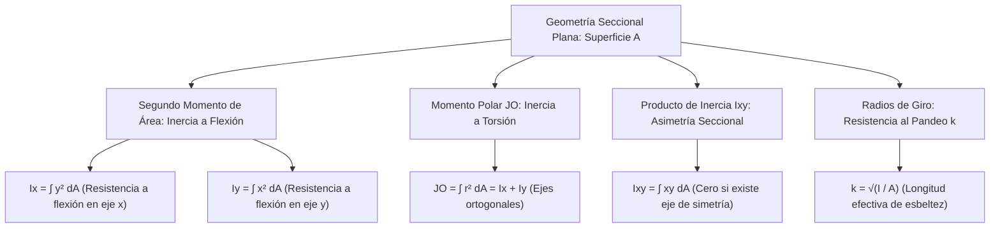

# Compendio de Repaso: Momentos de Inercia de Áreas y Parámetros Derivados

---

## 1. Segundo Momento de Área y Parámetros Derivados

En mecánica estructural y resistencia de materiales, el comportamiento de un elemento sometido a flexión o torsión depende críticamente de la **geometría y distribución espacial del área transversal** respecto a los ejes de referencia, con independencia del material del cual esté fabricado.



---

### 1.1 Definición Física y Matemática de Momentos de Inercia de Áreas ($I_x, I_y$)

#### A. Definición Matemática
Para una región plana de área total $A$ contenida en el plano cartesiano $xy$, los **momentos de segundo orden** (o segundos momentos de área) respecto a los ejes ortogonales cartesianos se definen mediante las integrales de superficie:

$$
I_x = \iint_A y^2 \, dA
$$

$$
I_y = \iint_A x^2 \, dA
$$

* **Dimensiones y Unidades:** Poseen dimensiones de longitud elevada a la cuarta potencia $[L^4]$. En el Sistema Internacional (SI) se expresan en $\text{m}^4$, $\text{cm}^4$ o $\text{mm}^4$; en el sistema inglés se expresan en $\text{in}^4$.
* **Signo Estricto:** Dado que las distancias $x$ e $y$ están elevadas al cuadrado ($x^2 \ge 0, y^2 \ge 0$) y el diferencial $dA > 0$, **$I_x$ e $I_y$ son cantidades estrictamente positivas** ($I_x > 0$, $I_y > 0$) para cualquier área no trivial.

<div align="center">
  <svg width="440" height="230" viewBox="0 0 440 230" xmlns="http://www.w3.org/2000/svg">
    <!-- Ejes coordenados -->
    <line x1="40" y1="190" x2="400" y2="190" stroke="#334155" stroke-width="2"/>
    <polygon points="398,186 408,190 398,194" fill="#334155"/>
    <text x="405" y="205" fill="#334155" font-size="13" font-family="sans-serif">x</text>

    <line x1="70" y1="210" x2="70" y2="25" stroke="#334155" stroke-width="2"/>
    <polygon points="66,27 70,17 74,27" fill="#334155"/>
    <text x="50" y="30" fill="#334155" font-size="13" font-family="sans-serif">y</text>

    <!-- Origen -->
    <circle cx="70" cy="190" r="3.5" fill="#0f172a"/>
    <text x="55" y="205" fill="#0f172a" font-size="12" font-family="sans-serif">O</text>

    <!-- Superficie arbitraria A -->
    <path d="M 140,160 C 130,90 190,50 280,60 C 360,70 380,130 330,170 C 270,200 180,185 140,160 Z" fill="#e0f2fe" stroke="#0284c7" stroke-width="2"/>
    <text x="320" y="85" fill="#0369a1" font-size="13" font-family="sans-serif" font-weight="bold">Área A</text>

    <!-- Diferencial de área dA -->
    <rect x="230" y="95" width="22" height="18" fill="#2563eb" rx="2"/>
    <text x="233" y="108" fill="#ffffff" font-size="9" font-family="sans-serif" font-weight="bold">dA</text>

    <!-- Cotas x e y -->
    <line x1="70" y1="104" x2="230" y2="104" stroke="#64748b" stroke-width="1.5" stroke-dasharray="3,3"/>
    <line x1="241" y1="113" x2="241" y2="190" stroke="#64748b" stroke-width="1.5" stroke-dasharray="3,3"/>
    <text x="145" y="98" fill="#475569" font-size="12" font-family="sans-serif">x</text>
    <text x="247" y="155" fill="#475569" font-size="12" font-family="sans-serif">y</text>

    <!-- Vector r desde O -->
    <line x1="70" y1="190" x2="230" y2="104" stroke="#7c3aed" stroke-width="2"/>
    <polygon points="225,103 234,101 228,110" fill="#7c3aed"/>
    <text x="135" y="140" fill="#7c3aed" font-size="12" font-family="sans-serif" font-weight="bold">r</text>
  </svg>
</div>

#### B. Interpretación Física en Mecánica Estructural
* **Flexión Elástica (Fórmula de Navier):** En una viga sometida a un momento flector $M_x$, la distribución de tensiones normales elásticas es $\sigma(y) = -\frac{M_x \cdot y}{I_x}$. Un valor elevado de $I_x$ disminuye los esfuerzos máximos en las fibras extremas y reduce drásticamente las deformaciones verticales (deflexiones).
* **Distribución de Masa Estructural:** Cuanto más alejada se encuentre la materia respecto al eje centroidal de flexión, mayor es su aporte por el factor cuadrático $y^2$. Esta es la razón física fundamental por la que los perfiles estructurales laminados (vigas $I$, $H$, perfiles cajón) concentran su masa en las alas exteriores unidas por un alma delgada.

---

### 1.2 Determinación por Integración Directa y Áreas Compuestas

#### A. Integración Directa en Secciones Simples
Se seleccionan diferenciales de área en forma de fajas paralelas al eje considerado para resolver una integral simple:

1. **Faja Paralela al Eje $x$ (Cálculo de $I_x$):**
   * Elemento diferencial: $dA = l(y) \, dy$.
   * Como todos los puntos de la faja están a la misma cota $y$:
   $$
   I_x = \int y^2 \, dA = \int y^2 \cdot l(y) \, dy
   $$
2. **Faja Paralela al Eje $y$ (Cálculo de $I_y$):**
   * Elemento diferencial: $dA = h(x) \, dx$.
   * Como todos los puntos están a la misma cota horizontal $x$:
   $$
   I_y = \int x^2 \, dA = \int x^2 \cdot h(x) \, dx
   $$

##### Deducción Canónica: Sección Rectangular ($b \times h$) respecto a sus Ejes Centroidales
Para un rectángulo de base $b$ y altura $h$ con origen en su centroide geométrico:
$$
\bar{I}_x = \int_{-h/2}^{h/2} y^2 (b \, dy) = b \left[ \frac{y^3}{3} \right]_{-h/2}^{h/2} = b \left( \frac{h^3}{24} - \left(-\frac{h^3}{24}\right) \right) = \frac{b h^3}{12}
$$
$$
\bar{I}_y = \int_{-b/2}^{b/2} x^2 (h \, dx) = h \left[ \frac{x^3}{3} \right]_{-b/2}^{b/2} = \frac{h b^3}{12}
$$

#### B. Teorema de los Ejes Paralelos (Teorema de Steiner)
Permite trasladar el momento de inercia desde los ejes centroidales propios ($\bar{x}, \bar{y}$) a cualquier conjunto de ejes paralelos ($x, y$) desplazados distancias $d_y$ y $d_x$:

$$
I_x = \bar{I}_{x'} + A \cdot d_y^2
$$

$$
I_y = \bar{I}_{y'} + A \cdot d_x^2
$$

donde:
* $\bar{I}_{x'}, \bar{I}_{y'}$ son los momentos de inercia respecto a los ejes que pasan **estrictamente por el centroide** del área.
* $d_y$ es la distancia perpendicular entre los ejes horizontales $x$ y $x'$.
* $d_x$ es la distancia perpendicular entre los ejes verticales $y$ e $y'$.

> [!WARNING]
> El Teorema de Steiner **solo puede aplicarse de forma directa tomando como pivote un eje centroidal**. Para trasladar un momento de inercia entre dos ejes arbitrarios no centroidales $A$ y $B$, se debe trasladar primero de $A$ al centroide $C$, y luego de $C$ al eje $B$:
> $$
> I_B = \left( I_A - A d_A^2 \right) + A d_B^2
> $$

#### C. Método de Descomposición en Áreas Compuestas
Para secciones de geometría compleja (perfiles $T$, $L$, $I$, secciones con vacíos o agujeros):

1. Se divide la figura en $n$ subáreas geométricas elementales conocidas (rectángulos, triángulos, círculos).
2. Se calculan las coordenadas del centroide global $(\bar{X}, \bar{Y})$ mediante momentos de primer orden:
   $$
   \bar{X} = \frac{\sum A_i \bar{x}_i}{\sum A_i}, \qquad \bar{Y} = \frac{\sum A_i \bar{y}_i}{\sum A_i}
   $$
3. Se aplica el teorema de Steiner a cada subsección respecto al eje centroidal global de la pieza compuesta:
   $$
   I_{x,\text{global}} = \sum_{i=1}^n \left( \bar{I}_{xi} + A_i d_{yi}^2 \right)
   $$
   $$
   I_{y,\text{global}} = \sum_{i=1}^n \left( \bar{I}_{yi} + A_i d_{xi}^2 \right)
   $$
   *Los huecos o áreas perforadas se introducen algebraicamente con signo negativo en el área y en sus momentos de inercia.*

---

### 1.3 Momento Polar de Inercia ($J_O$)

El **momento polar de inercia** cuantifica la resistencia que ofrece una sección plana a deformarse por esfuerzos de torsión angular alrededor de un polo o eje perpendicular que pasa por un punto $O$.

#### A. Formulación Matemática
$$
J_O = \iint_A r^2 \, dA
$$
donde $r$ es la distancia radial desde el polo $O$ hasta el diferencial $dA$: $r^2 = x^2 + y^2$.

Sustituyendo la descomposición pitagórica:
$$
J_O = \iint_A (x^2 + y^2) \, dA = \iint_A y^2 \, dA + \iint_A x^2 \, dA
$$

$$
J_O = I_x + I_y
$$

* **Teorema de los Ejes Perpendiculares:** El momento polar de inercia de cualquier área plana respecto a un polo $O$ es igual a la suma escalar directa de los momentos rectangulares de inercia respecto a dos ejes ortogonales cualesquiera que se intersequen en dicho polo $O$.

#### B. Teorema de Steiner para el Momento Polar
$$
J_O = \bar{J}_C + A \cdot d^2
$$
donde $d^2 = d_x^2 + d_y^2$ es el cuadrado de la distancia radial euclidiana entre el centroide $C$ y el polo exterior $O$.

---

### 1.4 Radio de Giro de un Área ($k_x, k_y, k_O$)

El **radio de giro** es un parámetro geométrico equivalente con dimensiones de longitud pura $[L]$ (generalmente $\text{mm}$ o $\text{cm}$) que representa la distancia radial a la cual debería concentrarse toda el área $A$ en una faja delgada para producir el mismo segundo momento de inercia que el área real original.


#### Fórmulas de Definición:
$$
I_x = k_x^2 \cdot A \implies k_x = \sqrt{\frac{I_x}{A}}
$$

$$
I_y = k_y^2 \cdot A \implies k_y = \sqrt{\frac{I_y}{A}}
$$

$$
J_O = k_O^2 \cdot A \implies k_O = \sqrt{\frac{J_O}{A}}
$$

#### Relación Ortogonal:
Dado que $J_O = I_x + I_y$:
$$
k_O^2 \cdot A = k_x^2 \cdot A + k_y^2 \cdot A \implies k_O^2 = k_x^2 + k_y^2
$$

> [!NOTE]
> **Importancia en Diseño de Columnas (Fórmula de Euler):**
> En el análisis de inestabilidad elástica por pandeo, la carga crítica de una columna de longitud efectiva $L_e$ es $P_{\text{cr}} = \frac{\pi^2 E I}{L_e^2} = \frac{\pi^2 E A}{(L_e / k)^2}$. El término $\lambda = \frac{L_e}{k_{\min}}$ es la **esbeltez mecánica**. Toda columna sometida a compresión axial pura pandeará alrededor del eje que tenga el **menor radio de giro ($k_{\min}$)**.

---

### 1.5 Producto de Inercia de un Área ($I_{xy}$): Definición, Cálculo y Simetría

#### A. Definición Matemática
El producto de inercia cuantifica la asimetría en la dispersión geométrica del área con respecto al cuadrante de los ejes de referencia:

$$
I_{xy} = \iint_A x y \, dA
$$

* **Naturaleza del Signo:** A diferencia de $I_x, I_y$ y $J_O$, el producto de inercia **puede ser positivo, negativo o idénticamente cero**, dependiendo de la distribución del área en los cuatro cuadrantes cartesianos.

<div align="center">
  <svg width="400" height="210" viewBox="0 0 400 210" xmlns="http://www.w3.org/2000/svg">
    <!-- Ejes -->
    <line x1="30" y1="105" x2="370" y2="105" stroke="#475569" stroke-width="2"/>
    <text x="375" y="110" fill="#475569" font-size="12" font-family="sans-serif">x</text>
    <line x1="200" y1="195" x2="200" y2="15" stroke="#475569" stroke-width="2"/>
    <text x="195" y="12" fill="#475569" font-size="12" font-family="sans-serif">y</text>

    <!-- Cuadrante I -->
    <rect x="230" y="35" width="100" height="50" rx="4" fill="#dcfce7" stroke="#16a34a" stroke-width="1.5"/>
    <text x="280" y="65" fill="#15803d" font-size="11" font-family="sans-serif" text-anchor="middle">Cuadrante I: xy &gt; 0</text>

    <!-- Cuadrante II -->
    <rect x="70" y="35" width="100" height="50" rx="4" fill="#fee2e2" stroke="#dc2626" stroke-width="1.5"/>
    <text x="120" y="65" fill="#b91c1c" font-size="11" font-family="sans-serif" text-anchor="middle">Cuadrante II: xy &lt; 0</text>

    <!-- Cuadrante III -->
    <rect x="70" y="125" width="100" height="50" rx="4" fill="#dcfce7" stroke="#16a34a" stroke-width="1.5"/>
    <text x="120" y="155" fill="#15803d" font-size="11" font-family="sans-serif" text-anchor="middle">Cuadrante III: xy &gt; 0</text>

    <!-- Cuadrante IV -->
    <rect x="230" y="125" width="100" height="50" rx="4" fill="#fee2e2" stroke="#dc2626" stroke-width="1.5"/>
    <text x="280" y="155" fill="#b91c1c" font-size="11" font-family="sans-serif" text-anchor="middle">Cuadrante IV: xy &lt; 0</text>
  </svg>
</div>

#### B. Teorema de los Ejes Paralelos para el Producto de Inercia
$$
I_{xy} = \bar{I}_{x'y'} + A \cdot d_x \cdot d_y
$$
donde:
* $\bar{I}_{x'y'}$ es el producto de inercia respecto a los ejes centroidales paralelos.
* $d_x, d_y$ son las coordenadas cartesianas con signo del centroide del área respecto al sistema $xy$.

#### C. Criterio Fundamental de Simetría
> [!NOTE]
> **Teorema de Anulación por Simetría:**
> Si un área plana posee al menos **un eje de simetría geométrica** (por ejemplo, el eje $x$ o el eje $y$), el producto de inercia respecto a ese conjunto de ejes ortogonales es **estrictamente nulo**:
> $$
> \text{Eje de Simetría presente} \implies I_{xy} = 0
> $$

**Demostración:** Supóngase que el eje $y$ es un eje de simetría. Para cada elemento de área $dA$ ubicado en $(x, y)$, existe un elemento idéntico $dA$ posicionado en $(-x, y)$. Al integrar sobre toda el área:
$$
I_{xy} = \int \left[ x y \, dA + (-x) y \, dA \right] = 0
$$

* **Ejes Principales de Inercia:** Cualquier par de ejes para los cuales el producto de inercia se anula ($I_{xy} = 0$) constituyen los **ejes principales de inercia** de la sección, sobre los cuales los momentos de segundo orden alcanzan sus valores extremos absolutos ($I_{\max}$ e $I_{\min}$). Todo eje de simetría es automáticamente un eje principal.

---

## 2. Tabla Resumen: Fórmulas Canónicas de Áreas Comunes

| Sección Geométrica | Dimensiones | Momento $\bar{I}_x$ (Centroidal) | Momento $\bar{I}_y$ (Centroidal) | Momento Polar $\bar{J}_C$ | Producto $\bar{I}_{xy}$ |
| :--- | :--- | :---: | :---: | :---: | :---: |
| **Rectángulo** | Base $b$, Altura $h$ | $\dfrac{b h^3}{12}$ | $\dfrac{h b^3}{12}$ | $\dfrac{b h}{12}(h^2 + b^2)$ | $0$ |
| **Triángulo Isósceles** | Base $b$, Altura $h$ | $\dfrac{b h^3}{36}$ | $\dfrac{h b^3}{48}$ | $\bar{I}_x + \bar{I}_y$ | $0$ |
| **Triángulo Rectángulo** | Catetos $b$ (en $x$) y $h$ (en $y$) | $\dfrac{b h^3}{36}$ | $\dfrac{h b^3}{36}$ | $\bar{I}_x + \bar{I}_y$ | $-\dfrac{b^2 h^2}{72}$ |
| **Círculo Completo** | Radio $r$ | $\dfrac{\pi r^4}{4}$ | $\dfrac{\pi r^4}{4}$ | $\dfrac{\pi r^4}{2}$ | $0$ |
| **Semicírculo** | Radio $r$ (Base horizontal) | $\left(\dfrac{\pi}{8} - \dfrac{8}{9\pi}\right) r^4 \approx 0.1098 r^4$ | $\dfrac{\pi r^4}{8}$ | $\bar{I}_x + \bar{I}_y$ | $0$ |
| **Tubo Circular Delgado**| Radio medio $r$, espesor $t \ll r$ | $\pi r^3 t$ | $\pi r^3 t$ | $2\pi r^3 t$ | $0$ |

---

## 3. Implementación Numérica: Calculador de Propiedades de Inercia para Secciones Compuestas

El siguiente script en Python utiliza el método de descomposición por áreas simples para calcular el centroide, momentos rectangulares de inercia, momento polar, radios de giro y producto de inercia global de una sección compuesta:

```python
import numpy as np

class ComponenteArea:
    """Representa una subárea elemental dentro de una sección compuesta."""
    def __init__(self, ancho: float, alto: float, x_c: float, y_c: float, es_hueco: bool = False):
        self.b = ancho
        self.h = alto
        self.xc = x_c
        self.yc = y_c
        self.signo = -1.0 if es_hueco else 1.0
        self.area = self.signo * (self.b * self.h)
        # Inercias locales respecto a sus propios ejes centroidales rectangulares
        self.I_x_local = (self.b * (self.h**3)) / 12.0
        self.I_y_local = ((self.b**3) * self.h) / 12.0
        self.I_xy_local = 0.0  # Nulo por simetría rectangular respecto a sus ejes propios

def calcular_propiedades_seccion(componentes: list):
    """
    Calcula centroide global, momentos de inercia (Ix, Iy), polar (JO),
    radios de giro (kx, ky, kO) y producto de inercia (Ixy).
    """
    # 1. Área Total y Centroide Global (X_bar, Y_bar)
    area_total = sum(c.area for c in componentes)
    if np.isclose(area_total, 0.0):
        raise ValueError("El área neta total no puede ser cero.")

    sum_Qx = sum(c.area * c.yc for c in componentes)
    sum_Qy = sum(c.area * c.xc for c in componentes)

    X_bar = sum_Qy / area_total
    Y_bar = sum_Qx / area_total

    # 2. Momentos de Inercia con Teorema de Steiner respecto a los ejes centroidales globales
    I_x_global = 0.0
    I_y_global = 0.0
    I_xy_global = 0.0

    for c in componentes:
        dx = c.xc - X_bar
        dy = c.yc - Y_bar
        # Contribución con signo del componente (positivo para sólidos, negativo para huecos)
        I_x_global += c.signo * c.I_x_local + c.area * (dy**2)
        I_y_global += c.signo * c.I_y_local + c.area * (dx**2)
        I_xy_global += c.signo * c.I_xy_local + c.area * dx * dy

    # 3. Momento Polar y Radios de Giro
    J_O_global = I_x_global + I_y_global
    k_x = np.sqrt(I_x_global / area_total)
    k_y = np.sqrt(I_y_global / area_total)
    k_O = np.sqrt(J_O_global / area_total)

    return {
        "Area_Total [mm²]": area_total,
        "Centroide_X [mm]": X_bar,
        "Centroide_Y [mm]": Y_bar,
        "I_x_Centroide [mm⁴]": I_x_global,
        "I_y_Centroide [mm⁴]": I_y_global,
        "I_xy_Centroide [mm⁴]": I_xy_global,
        "J_O_Polar [mm⁴]": J_O_global,
        "Radio_Giro_kx [mm]": k_x,
        "Radio_Giro_ky [mm]": k_y,
        "Radio_Giro_kO [mm]": k_O
    }

if __name__ == "__main__":
    # CASO PRÁCTICO: Perfil T Simétrico
    # Ala superior: b = 150 mm, h = 20 mm, centroide local en (0, 110) mm
    # Alma vertical: b = 20 mm, h = 100 mm, centroide local en (0, 50) mm
    # Origen de referencia en la base central del alma (y = 0)
    ala = ComponenteArea(ancho=150.0, alto=20.0, x_c=0.0, y_c=110.0)
    alma = ComponenteArea(ancho=20.0, alto=100.0, x_c=0.0, y_c=50.0)

    res = calcular_propiedades_seccion([ala, alma])

    print("================ PROPIEDADES SECCIONALES DEL PERFIL T ================")
    for k, v in res.items():
        print(f"{k:25s}: {v:14.4f}")
```