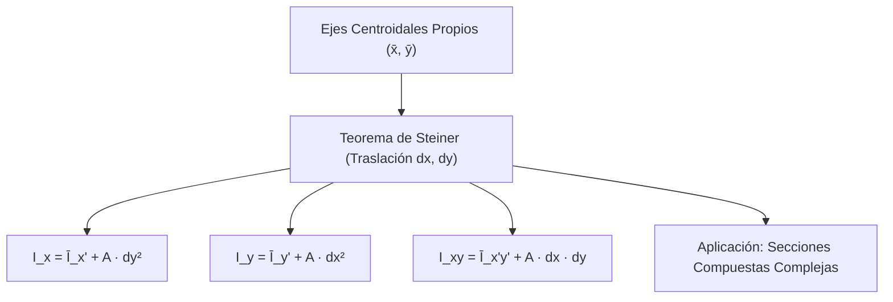
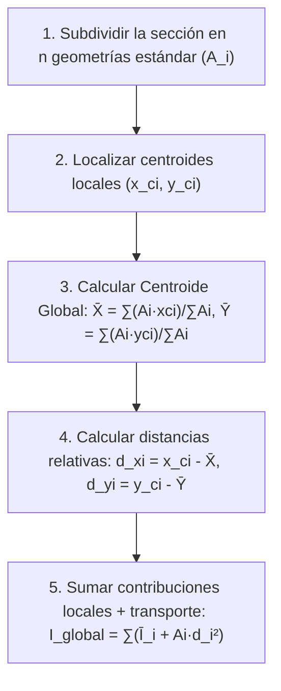

# Compendio de Repaso: Teorema de Steiner, Transformación de Coordenadas y Círculo de Mohr

---

## 1. Teorema de Steiner y Traslación de Ejes

El **Teorema de los Ejes Paralelos** (o Teorema de Steiner) permite determinar el momento y producto de inercia de un área plana respecto a cualquier sistema de ejes paralelos a sus ejes centroidales propios, evitando la necesidad de resolver integrales directas para cada nuevo sistema de referencia.



---

### 1.1 Enunciado y Formulación Analítica del Teorema de Steiner

#### A. Deducción para los Momentos Rectangulares de Inercia ($I_x, I_y$)

Sea un área plana continua $A$ contenida en el plano cartográfico $xy$. Definamos un sistema de coordenadas $(\bar{x}, \bar{y})$ con origen coincidente con el centroide $C$ del área, y un sistema de referencia arbitrario $(x, y)$ cuyos ejes son estrictamente paralelos a $(\bar{x}, \bar{y})$ y desplazados distancias cartesianas con signo $d_x$ y $d_y$:

$$
x = \bar{x} + d_x, \qquad y = \bar{y} + d_y
$$

<div align="center">
  <svg width="480" height="250" viewBox="0 0 480 250" xmlns="http://www.w3.org/2000/svg">
    <!-- Ejes coordenados globales (x, y) -->
    <line x1="40" y1="210" x2="440" y2="210" stroke="#334155" stroke-width="2"/>
    <polygon points="438,206 448,210 438,214" fill="#334155"/>
    <text x="445" y="225" fill="#334155" font-size="13" font-family="sans-serif">x</text>
    <line x1="70" y1="230" x2="70" y2="25" stroke="#334155" stroke-width="2"/>
    <polygon points="66,27 70,17 74,27" fill="#334155"/>
    <text x="50" y="30" fill="#334155" font-size="13" font-family="sans-serif">y</text>
    <!-- Origen global O -->
    <circle cx="70" cy="210" r="3.5" fill="#0f172a"/>
    <text x="55" y="225" fill="#0f172a" font-size="12" font-family="sans-serif">O</text>
    <!-- Superficie A -->
    <path d="M 180,180 C 160,110 220,60 310,70 C 390,80 410,140 370,185 C 310,210 220,195 180,180 Z" fill="#e0f2fe" stroke="#0284c7" stroke-width="2"/>
    <!-- Centroide C -->
    <circle cx="280" cy="130" r="4.5" fill="#dc2626"/>
    <text x="290" y="125" fill="#dc2626" font-size="12" font-family="sans-serif" font-weight="bold">C (x̄, ȳ)</text>
    <!-- Ejes centroidales paralelos -->
    <line x1="160" y1="130" x2="400" y2="130" stroke="#dc2626" stroke-width="1.5" stroke-dasharray="4,4"/>
    <text x="405" y="135" fill="#dc2626" font-size="11" font-family="sans-serif">x̄'</text>
    <line x1="280" y1="200" x2="280" y2="45" stroke="#dc2626" stroke-width="1.5" stroke-dasharray="4,4"/>
    <text x="285" y="45" fill="#dc2626" font-size="11" font-family="sans-serif">ȳ'</text>
    <!-- Cotas de traslación dx y dy -->
    <line x1="70" y1="210" x2="280" y2="210" stroke="#64748b" stroke-width="2"/>
    <text x="170" y="228" fill="#475569" font-size="12" font-family="sans-serif" font-weight="bold">dx</text>
    <line x1="70" y1="210" x2="70" y2="130" stroke="#64748b" stroke-width="2"/>
    <text x="50" y="175" fill="#475569" font-size="12" font-family="sans-serif" font-weight="bold">dy</text>
    <!-- Elemento diferencial dA -->
    <rect x="330" y="85" width="16" height="14" fill="#2563eb" rx="2"/>
    <text x="332" y="96" fill="#ffffff" font-size="8" font-family="sans-serif" font-weight="bold">dA</text>
  </svg>
</div>

Sustituyendo la transformación $y = \bar{y} + d_y$ en la definición de $I_x$:
$$
I_x = \iint_A y^2 \, dA = \iint_A (\bar{y} + d_y)^2 \, dA = \iint_A (\bar{y}^2 + 2 d_y \bar{y} + d_y^2) \, dA
$$

Desarrollando los tres términos integrales:
$$
I_x = \underbrace{\iint_A \bar{y}^2 \, dA}_{\bar{I}_{x'}} + 2 d_y \underbrace{\iint_A \bar{y} \, dA}_{= 0} + d_y^2 \underbrace{\iint_A dA}_{A}
$$

Como el sistema $(\bar{x}, \bar{y})$ es centroidal, el **primer momento de área (momento estático) respecto a los ejes que pasan por su propio centroide es idénticamente nulo**: $\iint_A \bar{y} \, dA = \bar{y}_c \cdot A = 0$.

Por tanto:
$$
I_x = \bar{I}_{x'} + A \cdot d_y^2
$$

Análogamente para el eje vertical $y$:
$$
I_y = \bar{I}_{y'} + A \cdot d_x^2
$$

* **Corolario de Inercia Mínima:** Dado que $A \cdot d^2 \ge 0$, **el momento de inercia respecto a un eje centroidal es el mínimo posible** frente a cualquier otro eje paralelo.

---

#### B. Deducción para el Producto de Inercia ($I_{xy}$)

Sustituyendo las relaciones de traslación en la definición del producto de inercia:
$$
I_{xy} = \iint_A x y \, dA = \iint_A (\bar{x} + d_x)(\bar{y} + d_y) \, dA
$$
$$
I_{xy} = \iint_A (\bar{x}\bar{y} + d_x \bar{y} + d_y \bar{x} + d_x d_y) \, dA
$$

Distribuyendo la integral sobre el área $A$:
$$
I_{xy} = \underbrace{\iint_A \bar{x}\bar{y} \, dA}_{\bar{I}_{x'y'}} + d_x \underbrace{\iint_A \bar{y} \, dA}_{= 0} + d_y \underbrace{\iint_A \bar{x} \, dA}_{= 0} + d_x d_y \underbrace{\iint_A dA}_{A}
$$

$$
I_{xy} = \bar{I}_{x'y'} + A \cdot d_x \cdot d_y
$$

> [!WARNING]
> A diferencia de los momentos rectangulares donde $d_x^2$ y $d_y^2$ son invariablemente positivos, en el producto de inercia **las distancias $d_x$ y $d_y$ deben sustituirse con sus signos algebraicos respectivos** medidos desde el centroide del área hacia el nuevo origen o desde el nuevo sistema hacia el centroide de la subsección.

---

### 1.2 Aplicación del Teorema de Steiner a Secciones Compuestas Complejas

Para perfiles estructurales asimétricos o discontinuos (como perfiles angulares $L$ de lados desiguales, perfiles $Z$, o ensamblajes soldados con placas de refuerzo):



#### Fórmulas Matriciales del Ensamblaje Global:
$$
I_{x,\text{total}} = \sum_{i=1}^n \left( \bar{I}_{x'i} + A_i \cdot (\bar{y}_i - \bar{Y})^2 \right)
$$
$$
I_{y,\text{total}} = \sum_{i=1}^n \left( \bar{I}_{y'i} + A_i \cdot (\bar{x}_i - \bar{X})^2 \right)
$$
$$
I_{xy,\text{total}} = \sum_{i=1}^n \left( \bar{I}_{x'y'i} + A_i \cdot (\bar{x}_i - \bar{X})(\bar{y}_i - \bar{Y}) \right)
$$

---

## 2. Transformación de Coordenadas y Ejes Principales

### 2.1 Ecuaciones Generales de Rotación de Ejes Inclinados

Consideremos un sistema de coordenadas ortogonales $x'y'$ rotado un ángulo contrarreloj $\theta$ respecto al sistema original $xy$:

<div align="center">
  <svg width="420" height="220" viewBox="0 0 420 220" xmlns="http://www.w3.org/2000/svg">
    <!-- Ejes originales xy -->
    <line x1="50" y1="180" x2="380" y2="180" stroke="#64748b" stroke-width="2"/>
    <text x="385" y="185" fill="#64748b" font-size="12" font-family="sans-serif">x</text>
    <line x1="120" y1="210" x2="120" y2="20" stroke="#64748b" stroke-width="2"/>
    <text x="110" y="25" fill="#64748b" font-size="12" font-family="sans-serif">y</text>
    <!-- Origen -->
    <circle cx="120" cy="180" r="4" fill="#0f172a"/>
    <text x="105" y="195" fill="#0f172a" font-size="12" font-family="sans-serif">O</text>
    <!-- Ejes rotados x'y' (rotados 30 grados) -->
    <line x1="60" y1="214" x2="360" y2="42" stroke="#2563eb" stroke-width="2.5"/>
    <polygon points="356,38 368,37 362,49" fill="#2563eb"/>
    <text x="375" y="45" fill="#2563eb" font-size="13" font-family="sans-serif" font-weight="bold">x'</text>
    <line x1="180" y1="214" x2="55" y2="40" stroke="#2563eb" stroke-width="2.5"/>
    <polygon points="50,44 52,32 62,37" fill="#2563eb"/>
    <text x="45" y="30" fill="#2563eb" font-size="13" font-family="sans-serif" font-weight="bold">y'</text>
    <!-- Arco de rotación theta -->
    <path d="M 220,180 A 100 100 0 0 0 206,130" fill="none" stroke="#dc2626" stroke-width="2"/>
    <polygon points="208,128 202,136 211,137" fill="#dc2626"/>
    <text x="215" y="155" fill="#dc2626" font-size="13" font-family="sans-serif" font-weight="bold">θ</text>
  </svg>
</div>

Las relaciones geométricas de transformación de coordenadas para un punto cualquiera son:
$$
x' = x \cos\theta + y \sin\theta
$$
$$
y' = -x \sin\theta + y \cos\theta
$$

Sustituyendo en las definiciones integrales:
$$
I_{x'} = \iint_A (y')^2 \, dA = \iint_A (-x \sin\theta + y \cos\theta)^2 \, dA
$$
$$
I_{y'} = \iint_A (x')^2 \, dA = \iint_A (x \cos\theta + y \sin\theta)^2 \, dA
$$
$$
I_{x'y'} = \iint_A x' y' \, dA = \iint_A (x \cos\theta + y \sin\theta)(-x \sin\theta + y \cos\theta) \, dA
$$

Desarrollando los binomios y aplicando identidades de ángulo doble ($\sin^2\theta = \frac{1 - \cos 2\theta}{2}$, $\cos^2\theta = \frac{1 + \cos 2\theta}{2}$, $\sin 2\theta = 2\sin\theta\cos\theta$):

$$
I_{x'} = \frac{I_x + I_y}{2} + \frac{I_x - I_y}{2} \cos(2\theta) - I_{xy} \sin(2\theta)
$$

$$
I_{y'} = \frac{I_x + I_y}{2} - \frac{I_x - I_y}{2} \cos(2\theta) + I_{xy} \sin(2\theta)
$$

$$
I_{x'y'} = \frac{I_x - I_y}{2} \sin(2\theta) + I_{xy} \cos(2\theta)
$$

#### Invariante Fundamental de la Transformación:
Sumando miembro a miembro las ecuaciones de $I_{x'}$ e $I_{y'}$:
$$
I_{x'} + I_{y'} = I_x + I_y = J_O = \text{constante}
$$
* **Primer Invariante Tensorial:** La suma de los momentos rectangulares respecto a dos ejes perpendiculares cualesquiera permanece invariante ante cualquier rotación geométrica del sistema de referencia.

---

### 2.2 Ejes Principales de Inercia y Momentos Principales ($I_{\max}, I_{\min}$)

Los **ejes principales de inercia** son aquellos para los cuales el producto de inercia se anula completamente ($I_{x'y'} = 0$). Sobre esta orientación particular, los momentos rectangulares de inercia alcanzan sus cotas extremas absolutas (máximo y mínimo).

#### A. Determinación del Ángulo Principal ($\theta_p$)
Imponiendo $I_{x'y'} = 0$:
$$
\frac{I_x - I_y}{2} \sin(2\theta_p) + I_{xy} \cos(2\theta_p) = 0 \implies \tan(2\theta_p) = -\frac{2 I_{xy}}{I_x - I_y}
$$

La función tangente tiene período $\pi$ ($180^\circ$), lo que entrega dos raíces para $2\theta_p$ separadas por $180^\circ$, y por ende **dos soluciones perpendiculares para $\theta_p$ separadas exactamente por $90^\circ$**:
* Un ángulo corresponde al eje de inercia máximo ($I_{\max}$).
* El otro ángulo ortogonal corresponde al eje de inercia mínimo ($I_{\min}$).

#### B. Momentos Principales de Inercia
Sustituyendo $\cos(2\theta_p)$ y $\sin(2\theta_p)$ en la expresión de $I_{x'}$:

$$
I_{\max, \min} = \frac{I_x + I_y}{2} \pm \sqrt{\left(\frac{I_x - I_y}{2}\right)^2 + I_{xy}^2}
$$

> [!NOTE]
> En los ejes principales de inercia, **la rigidez a flexión pura no genera desviaciones angulares**: un momento flector aplicado según un eje principal induce curvatura pura colineal con dicho eje sin componentes de flexión oblicua o alabeadas.

---

### 2.3 Representación Gráfica Mediante el Círculo de Mohr

El **Círculo de Mohr para momentos de inercia** es la representación geométrica directa de las ecuaciones paramétricas de transformación en un plano coordenado cartesiano $(I, I_{xy})$.

Reescribiendo las ecuaciones paramétricas:
$$
\left( I_{x'} - \frac{I_x + I_y}{2} \right)^2 + \left( I_{x'y'} \right)^2 = \left(\frac{I_x - I_y}{2}\right)^2 + I_{xy}^2
$$

Esta expresión responde exactamente a la ecuación algebraica de una circunferencia canónica:
$$
(I - I_{\text{prom}})^2 + I_{xy}^2 = R^2
$$

<div align="center">
  <svg width="520" height="280" viewBox="0 0 520 280" xmlns="http://www.w3.org/2000/svg">
    <!-- Ejes coordenados del plano de Mohr -->
    <line x1="30" y1="140" x2="490" y2="140" stroke="#334155" stroke-width="2"/>
    <polygon points="488,136 498,140 488,144" fill="#334155"/>
    <text x="470" y="160" fill="#334155" font-size="13" font-family="sans-serif" font-weight="bold">I</text>
    <line x1="260" y1="260" x2="260" y2="20" stroke="#334155" stroke-width="2"/>
    <polygon points="256,24 260,14 264,24" fill="#334155"/>
    <text x="240" y="28" fill="#334155" font-size="13" font-family="sans-serif" font-weight="bold">I_xy</text>
    <!-- Círculo de Mohr -->
    <circle cx="260" cy="140" r="100" fill="#f8fafc" stroke="#2563eb" stroke-width="2.5"/>
    <!-- Centro C -->
    <circle cx="260" cy="140" r="4.5" fill="#dc2626"/>
    <text x="265" y="132" fill="#dc2626" font-size="12" font-family="sans-serif" font-weight="bold">C (I_prom, 0)</text>
    <!-- Punto X (Ix, Ixy) y Punto Y (Iy, -Ixy) -->
    <line x1="330" y1="69" x2="190" y2="211" stroke="#64748b" stroke-width="2" stroke-dasharray="3,3"/>
    <circle cx="330" cy="69" r="4" fill="#0f172a"/>
    <text x="340" y="65" fill="#0f172a" font-size="12" font-family="sans-serif" font-weight="bold">X (I_x, I_xy)</text>
    <circle cx="190" cy="211" r="4" fill="#0f172a"/>
    <text x="135" y="225" fill="#0f172a" font-size="12" font-family="sans-serif" font-weight="bold">Y (I_y, -I_xy)</text>
    <!-- Puntos de corte principales: I_min e I_max -->
    <circle cx="360" cy="140" r="4.5" fill="#16a34a"/>
    <text x="365" y="160" fill="#16a34a" font-size="12" font-family="sans-serif" font-weight="bold">I_max</text>
    <circle cx="160" cy="140" r="4.5" fill="#16a34a"/>
    <text x="120" y="160" fill="#16a34a" font-size="12" font-family="sans-serif" font-weight="bold">I_min</text>
    <!-- Radio R -->
    <line x1="260" y1="140" x2="330" y2="69" stroke="#7c3aed" stroke-width="2"/>
    <text x="300" y="110" fill="#7c3aed" font-size="12" font-family="sans-serif" font-weight="bold">R</text>
    <!-- Ángulo 2θp -->
    <path d="M 290,140 A 30 30 0 0 1 281,118" fill="none" stroke="#dc2626" stroke-width="2"/>
    <text x="295" y="130" fill="#dc2626" font-size="11" font-family="sans-serif" font-weight="bold">2θ_p</text>
  </svg>
</div>

#### Elementos Operativos del Círculo:
1. **Coordenadas del Centro ($C$):**
   $$
   C = (I_{\text{prom}}, 0) = \left( \frac{I_x + I_y}{2}, \, 0 \right)
   $$
2. **Radio del Círculo ($R$):**
   $$
   R = \sqrt{\left(\frac{I_x - I_y}{2}\right)^2 + I_{xy}^2}
   $$
3. **Puntos Directores Iniciales:**
   * Punto de referencia del eje $x$: $X(I_x, I_{xy})$
   * Punto de referencia del eje $y$: $Y(I_y, -I_{xy})$
4. **Relación Angular (Factor 2):**
   * Una rotación de ángulo $\theta$ en la pieza real equivale a **una rotación angular de $2\theta$ en el mismo sentido dentro del Círculo de Mohr**.
5. **Cruce con el Eje Horizontal:**
   * $I_{\max} = I_{\text{prom}} + R$
   * $I_{\min} = I_{\text{prom}} - R$

---

## 3. Tabla Resumen: Fórmulas de Transformación

| Parámetro | Ecuación Analítica | Interpretación en Círculo de Mohr |
| :--- | :--- | :--- |
| **Inercia Promedio ($I_{\text{prom}}$)** | $\dfrac{I_x + I_y}{2}$ | Abscisa del centro geométrico $C$ |
| **Radio del Círculo ($R$)** | $\sqrt{\left(\dfrac{I_x - I_y}{2}\right)^2 + I_{xy}^2}$ | Distancia radial desde el centro al punto $(I_x, I_{xy})$ |
| **Momentos Principales** | $I_{\max, \min} = I_{\text{prom}} \pm R$ | Puntos de intersección del círculo con el eje $I$ |
| **Orientación Principal ($2\theta_p$)** | $\tan(2\theta_p) = -\dfrac{2 I_{xy}}{I_x - I_y}$ | Ángulo polar desde el diámetro $XY$ al eje horizontal |
| **Producto de Inercia Máximo** | $(I_{xy})_{\max} = R$ | Punto superior más alto del círculo |

---

## 4. Implementación Numérica: Solucionador de Transformación de Inercia y Círculo de Mohr

El siguiente script en Python permite calcular el tensor de inercia transformado para cualquier ángulo arbitrario, determinar los ejes principales y calcular las propiedades del Círculo de Mohr:

```python
import numpy as np

def resolver_transformacion_inercia(I_x: float, I_y: float, I_xy: float, theta_grados: float = 0.0):
    """
    Calcula la rotación de ejes y las propiedades principales de inercia.
    
    :param I_x: Momento de inercia respecto al eje x
    :param I_y: Momento de inercia respecto al eje y
    :param I_xy: Producto de inercia respecto a xy
    :param theta_grados: Ángulo de rotación del sistema de ejes (en grados, contrarreloj)
    :return: Diccionario con los parámetros del círculo de Mohr y valores transformados
    """
    theta_rad = np.radians(theta_grados)
    
    # 1. Propiedades del Círculo de Mohr
    I_prom = (I_x + I_y) / 2.0
    R = np.sqrt(((I_x - I_y) / 2.0)**2 + I_xy**2)
    
    I_max = I_prom + R
    I_min = I_prom - R
    
    # Ángulo principal (2*theta_p)
    # tan(2*theta_p) = -2*I_xy / (I_x - I_y)
    dos_theta_p_rad = np.arctan2(-2.0 * I_xy, I_x - I_y)
    theta_p1_deg = np.degrees(dos_theta_p_rad) / 2.0
    theta_p2_deg = theta_p1_deg + 90.0 if theta_p1_deg < 0 else theta_p1_deg - 90.0

    # 2. Rotación al ángulo específico theta
    cos_2t = np.cos(2.0 * theta_rad)
    sin_2t = np.sin(2.0 * theta_rad)
    
    I_x_rot = I_prom + ((I_x - I_y) / 2.0) * cos_2t - I_xy * sin_2t
    I_y_rot = I_prom - ((I_x - I_y) / 2.0) * cos_2t + I_xy * sin_2t
    I_xy_rot = ((I_x - I_y) / 2.0) * sin_2t + I_xy * cos_2t

    return {
        "Centro_Circulo_I_prom": I_prom,
        "Radio_Mohr_R": R,
        "Inercia_Principal_I_max": I_max,
        "Inercia_Principal_I_min": I_min,
        "Angulo_Principal_1 [deg]": theta_p1_deg,
        "Angulo_Principal_2 [deg]": theta_p2_deg,
        "I_x_rotado": I_x_rot,
        "I_y_rotado": I_y_rot,
        "I_xy_rotado": I_xy_rot,
        "Invariante_J0": I_x_rot + I_y_rot
    }

if __name__ == "__main__":
    # CASO PRÁCTICO: Sección angular de lados desiguales
    # I_x = 4500000 mm^4, I_y = 2000000 mm^4, I_xy = -1800000 mm^4
    # Evaluamos rotación a theta = 30°
    Ix_ejemplo = 4.5e6
    Iy_ejemplo = 2.0e6
    Ixy_ejemplo = -1.8e6
    angulo_rot = 30.0

    resultados = resolver_transformacion_inercia(
        I_x=Ix_ejemplo, 
        I_y=Iy_ejemplo, 
        I_xy=Ixy_ejemplo, 
        theta_grados=angulo_rot
    )

    print("================ RESULTADOS DE TRANSFORMACIÓN Y CÍRCULO DE MOHR ================")
    for k, v in resultados.items():
        print(f"{k:26s}: {v:16.4f}")
```