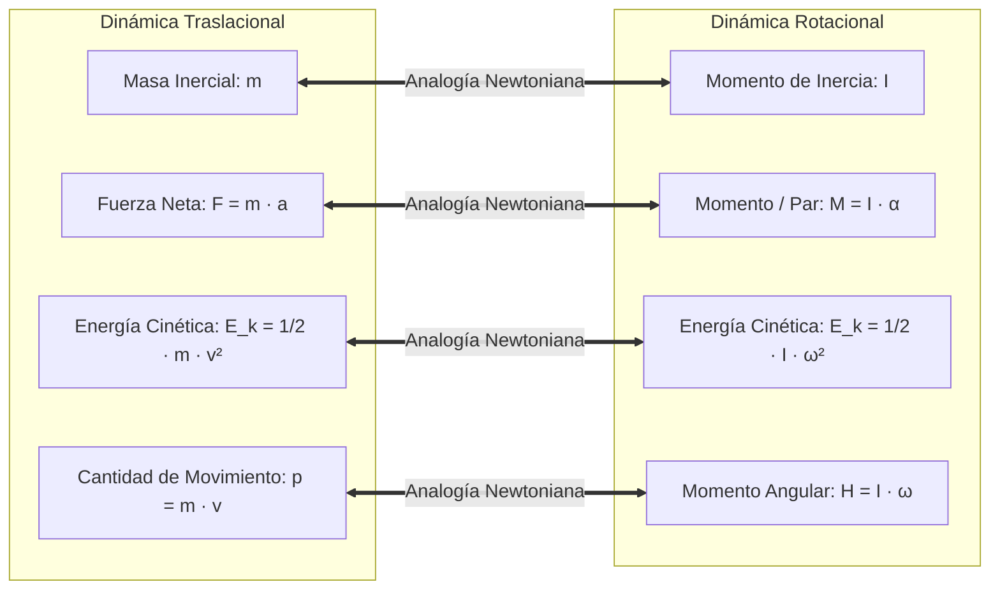
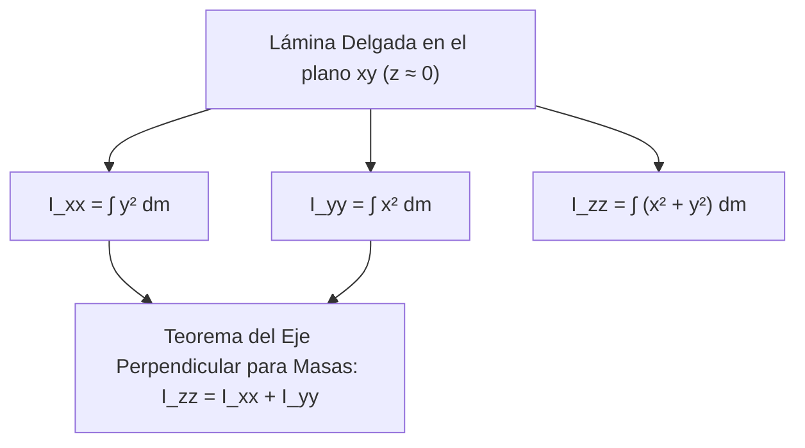
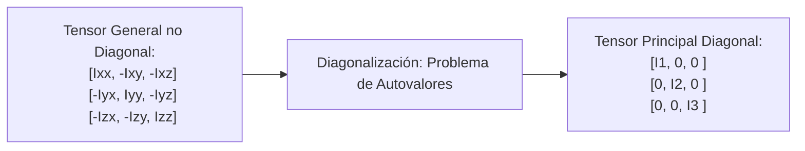

# Compendio de Repaso: Momento de Inercia de Masa y Tensores de Inercia

---

## 1. Inercia Rotacional en Cuerpos Tridimensionales

### 1.1 Definición del Momento de Inercia de Masa y su Rol Dinámico

El **momento de inercia de masa** cuantifica la resistencia que opone un cuerpo rígido tridimensional a experimentar aceleración angular ($\vec{\alpha}$) alrededor de un eje de rotación específico. Es el análogo rotacional directo de la masa inercial ($m$) en la traslación rectilínea.



#### A. Formulación Integral respecto a los Ejes Cartesianos
Sea un diferencial de masa $dm = \rho \, dV$ localizado en la posición tridimensional $\vec{r} = x\hat{i} + y\hat{j} + z\hat{k}$ respecto a un origen $O$:

<div align="center">
  <svg width="440" height="240" viewBox="0 0 440 240" xmlns="http://www.w3.org/2000/svg">
    <!-- Ejes espaciales -->
    <line x1="80" y1="180" x2="400" y2="180" stroke="#334155" stroke-width="2"/>
    <polygon points="398,176 408,180 398,184" fill="#334155"/>
    <text x="405" y="195" fill="#334155" font-size="13" font-family="sans-serif">y</text>
    <line x1="80" y1="180" x2="80" y2="25" stroke="#334155" stroke-width="2"/>
    <polygon points="76,27 80,17 84,27" fill="#334155"/>
    <text x="70" y="25" fill="#334155" font-size="13" font-family="sans-serif">z</text>
    <line x1="80" y1="180" x2="25" y2="225" stroke="#334155" stroke-width="2"/>
    <polygon points="23,220 20,230 30,227" fill="#334155"/>
    <text x="15" y="225" fill="#334155" font-size="13" font-family="sans-serif">x</text>
    <!-- Sólido 3D -->
    <path d="M 160,140 C 130,80 200,40 290,50 C 370,60 390,120 340,160 C 280,185 190,170 160,140 Z" fill="#e0f2fe" stroke="#0284c7" stroke-width="2"/>
    <!-- Diferencial dm -->
    <rect x="250" y="90" width="18" height="18" fill="#dc2626" rx="3"/>
    <text x="252" y="103" fill="#ffffff" font-size="9" font-family="sans-serif" font-weight="bold">dm</text>
    <!-- Distancia al eje z: r_z = sqrt(x^2 + y^2) -->
    <line x1="80" y1="99" x2="250" y2="99" stroke="#7c3aed" stroke-width="2" stroke-dasharray="3,3"/>
    <text x="140" y="90" fill="#7c3aed" font-size="11" font-family="sans-serif" font-weight="bold">r_z = √(x² + y²)</text>
  </svg>
</div>

La distancia perpendicular al cuadrado desde la partícula $dm$ hasta cada uno de los tres ejes cartesianos se deriva por geometría euclidiana:
* Distancia al eje $x$: $r_x^2 = y^2 + z^2$
* Distancia al eje $y$: $r_y^2 = x^2 + z^2$
* Distancia al eje $z$: $r_z^2 = x^2 + y^2$

Por consiguiente, los **momentos de inercia de masa principales cartesianos** se definen mediante:
$$
I_{xx} = \iiint_V (y^2 + z^2) \, dm = \iiint_V (y^2 + z^2) \rho \, dV
$$
$$
I_{yy} = \iiint_V (x^2 + z^2) \, dm = \iiint_V (x^2 + z^2) \rho \, dV
$$
$$
I_{zz} = \iiint_V (x^2 + y^2) \, dm = \iiint_V (x^2 + y^2) \rho \, dV
$$

* **Dimensiones y Unidades:** Su dimensión física es $[\text{M} \cdot \text{L}^2]$. En el SI se expresa en $\text{kg} \cdot \text{m}^2$; en el sistema inglés en $\text{slug} \cdot \text{ft}^2$ o $\text{lb} \cdot \text{s}^2 \cdot \text{in}$.
* **Radio de Giro de Masa ($k$):** Distancia equivalente a la cual concentrar toda la masa $m$ para mantener inalterada su inercia:
  $$
  k = \sqrt{\frac{I}{m}} \iff I = m k^2
  $$

---

### 1.2 Determinación por Integración Analítica y Cuerpos Compuestos

#### A. Integración Analítica: Barra Delgada Homogénea de Longitud $L$ y Masa $m$
Sea una barra de sección transversal despreciable dispuesta a lo largo del eje $x$. El diferencial de masa es $dm = \left(\frac{m}{L}\right) dx$.

##### 1. Respecto a su centroide baricéntrico ($x = 0$ en el centro de la barra):
$$
\bar{I}_{yy} = \bar{I}_{zz} = \int_{-L/2}^{L/2} x^2 \, dm = \frac{m}{L} \int_{-L/2}^{L/2} x^2 \, dx = \frac{m}{L} \left[ \frac{x^3}{3} \right]_{-L/2}^{L/2} = \frac{1}{12} m L^2
$$

##### 2. Respecto a un extremo ($x = 0$ en la articulación):
$$
I_{yy} = I_{zz} = \frac{m}{L} \int_{0}^{L} x^2 \, dx = \frac{1}{3} m L^2
$$

#### B. Integración Analítica: Cilindro Sólido Circular de Radio $R$, Longitud $L$ y Masa $m$
Eje longitudinal $z$. Se divide el cuerpo en cascarones cilíndricos concéntricos de radio $r$, espesor $dr$ y altura $L$:
* Diferencial de masa: $dm = \rho \, dV = \rho (2\pi r L \, dr)$.
* Como cada cascarón se encuentra a distancia uniforme $r$ del eje axial $z$:
$$
I_{zz} = \int r^2 \, dm = \int_{0}^{R} r^2 \left( \rho 2\pi L r \, dr \right) = 2\pi \rho L \left[ \frac{r^4}{4} \right]_{0}^{R} = \frac{1}{2} (\rho \pi R^2 L) R^2 = \frac{1}{2} m R^2
$$

#### C. Método de Descomposición en Cuerpos Compuestos
Para ensamblajes mecánicos (cigüeñales, rotores, volantes de inercia estructurados):
1. Subdividir el ensamble en $n$ componentes de masa $m_i$ y geometrías canónicas conocidas.
2. Calcular el centro de masa conjunto del sistema: $\vec{r}_{CM} = \frac{\sum m_i \vec{r}_i}{\sum m_i}$.
3. Aplicar el Teorema de los Ejes Paralelos a cada componente y sumar algebraicamente:
   $$
   I_{\text{total}} = \sum_{i=1}^n \left( \bar{I}_{i} + m_i d_i^2 \right)
   $$
   *(Para vacíos, perforaciones o chaflanes, la masa $m_i$ y su inercia se restan algebraicamente).*

---

### 1.3 Momentos de Inercia de Masa para Placas Delgadas y Láminas Planas

Cuando el espesor de la placa ($t$) en dirección normal perpendicular (eje $z$) es despreciable frente a las dimensiones superficiales en el plano ($x, y$): $z \approx 0$.



#### A. Teorema del Eje Perpendicular para Placas Planas
Sustituyendo $z = 0$ en las integrales:
$$
I_{xx} = \int y^2 \, dm, \qquad I_{yy} = \int x^2 \, dm
$$
$$
I_{zz} = \int (x^2 + y^2) \, dm = \int x^2 \, dm + \int y^2 \, dm
$$

$$
I_{zz} = I_{xx} + I_{yy}
$$

* **Propiedad Clave:** Para cualquier placa o lámina delgada plana, el momento de inercia de masa respecto a un eje perpendicular a su plano es igual a la suma escalar de los momentos de inercia respecto a los dos ejes ortogonales contenidos en el plano de la lámina.

#### B. Conexión Directa con el Segundo Momento de Área
Si la lámina tiene densidad superficial uniforme $\rho_A = \frac{m}{A}$:
$$
I_{xx} = \rho_A \iint y^2 \, dA = \rho_A \, I_{x,\text{área}} = \left(\frac{m}{A}\right) I_{x,\text{área}}
$$
$$
I_{yy} = \left(\frac{m}{A}\right) I_{y,\text{área}}, \qquad I_{zz} = \left(\frac{m}{A}\right) J_{O,\text{área}}
$$

---

## 2. Tensores y Ejes Principales de Inercia de Masa

### 2.1 Teorema de los Ejes Paralelos Aplicado a Masas (Teorema de Steiner 3D)

Si se conocen los momentos y productos de inercia respecto a un sistema de ejes coordenados centroidales $(\bar{x}, \bar{y}, \bar{z})$ que pasan por el centro de masa $G$, las inercias respecto a un sistema paralelo $(x, y, z)$ trasladado las distancias $(d_x, d_y, d_z)$ vienen dadas por:

$$
I_{xx} = \bar{I}_{x'x'} + m (d_y^2 + d_z^2)
$$
$$
I_{yy} = \bar{I}_{y'y'} + m (d_x^2 + d_z^2)
$$
$$
I_{zz} = \bar{I}_{z'z'} + m (d_x^2 + d_y^2)
$$

donde $d_y^2 + d_z^2 = d_x^{\perp 2}$ es el cuadrado de la distancia perpendicular al eje $x$.

---

### 2.2 Productos de Inercia de Masa ($I_{xy}, I_{yz}, I_{zx}$)

Los productos de inercia de masa miden el desbalance dinámico o asimetría de la masa respecto a los planos ortogonales coordenados:

$$
I_{xy} = \iiint_V x y \, dm
$$
$$
I_{yz} = \iiint_V y z \, dm
$$
$$
I_{zx} = \iiint_V z x \, dm
$$

* **Traslación de Steiner para Productos de Inercia de Masa:**
  $$
  I_{xy} = \bar{I}_{x'y'} + m \, d_x d_y
  $$
  $$
  I_{yz} = \bar{I}_{y'z'} + m \, d_y d_z
  $$
  $$
  I_{zx} = \bar{I}_{z'x'} + m \, d_z d_x
  $$

> [!NOTE]
> **Condición de Anulación por Simetría:** Si el cuerpo rígido posee un **plano de simetría de masa**, los dos productos de inercia que involucran la coordenada perpendicular a dicho plano de simetría son **estrictamente iguales a cero**.
> *Ejemplo:* Si el plano $xy$ es de simetría ($z \to -z$), entonces $I_{yz} = 0$ e $I_{zx} = 0$.

---

### 2.3 Ejes Principales de Inercia y Diagonalización del Tensor de Inercia

#### A. Definición Matricial del Tensor de Inercia ($\mathbf{I}$)
La relación fundamental que vincula el momento angular $\vec{H}_O$ con el vector velocidad angular $\vec{\omega}$ de un sólido rígido es:
$$
\vec{H}_O = \mathbf{I} \, \vec{\omega}
$$

En notación matricial canónica respecto al sistema $\{x, y, z\}$:
$$
\mathbf{I} = \begin{bmatrix}
I_{xx} & -I_{xy} & -I_{xz} \\
-I_{yx} & I_{yy} & -I_{yz} \\
-I_{zx} & -I_{zy} & I_{zz}
\end{bmatrix}
$$

* Por definición, la matriz es **simétrica** ($I_{xy} = I_{yx}$, $I_{xz} = I_{zx}$, $I_{yz} = I_{zy}$) y **definida positiva**.
* Los signos negativos en los elementos fuera de la diagonal garantizan que $\vec{H}_O = \iiint \vec{r} \times (\vec{\omega} \times \vec{r}) \, dm$.



#### B. Problema de Autovalores y Autovectores
Los **ejes principales de inercia** son aquellos vectores unitarios directores $\hat{u}$ a lo largo de los cuales el momento angular es estrictamente colineal con la velocidad angular:
$$
\vec{H} = \lambda \vec{\omega} \iff \mathbf{I} \hat{u} = \lambda \hat{u} \iff (\mathbf{I} - \lambda \mathbf{E}) \hat{u} = \vec{0}
$$

Para la existencia de soluciones no triviales ($\hat{u} \neq \vec{0}$), el determinante de la matriz característica debe anularse:
$$
\det(\mathbf{I} - \lambda \mathbf{E}) = \begin{vmatrix}
I_{xx} - \lambda & -I_{xy} & -I_{xz} \\
-I_{yx} & I_{yy} - \lambda & -I_{yz} \\
-I_{zx} & -I_{zy} & I_{zz} - \lambda
\end{vmatrix} = 0
$$

La resolución de esta ecuación cúbica en $\lambda$ proporciona los **tres momentos principales de inercia**:
$$
\lambda_1 = I_1, \qquad \lambda_2 = I_2, \qquad \lambda_3 = I_3
$$
Sustituyendo cada autovalor $\lambda_k$ en el sistema homogéneo se obtienen los autovectores ortonormales directores $\{\hat{u}_1, \hat{u}_2, \hat{u}_3\}$, que definen las orientaciones espaciales de los **ejes principales de inercia**.

> [!WARNING]
> Si un rotor gira alrededor de un eje que **no es un eje principal de inercia**, el vector de momento angular $\vec{H}$ y el vector de velocidad angular $\vec{\omega}$ **no son colineales** ($\vec{H} \nparallel \vec{\omega}$). Esto engendra un par giroscópico dinámico $\vec{M} = \vec{\omega} \times \vec{H} \neq \vec{0}$, produciendo vibraciones y sobrecargas reactivas severas en los cojinetes de soporte (desbalance dinámico).

---

## 3. Tabla Resumen: Fórmulas Canónicas de Cuerpos 3D Homogéneos

| Sólido Geométrico | Dimensiones y Ejes | Momento Centroidal $\bar{I}_{xx}$ | Momento Centroidal $\bar{I}_{yy}$ | Momento Centroidal $\bar{I}_{zz}$ |
| :--- | :--- | :---: | :---: | :---: |
| **Barra Delgada** | Longitud $L$ sobre eje $x$ | $0$ | $\dfrac{1}{12} m L^2$ | $\dfrac{1}{12} m L^2$ |
| **Placa Rectangular** | Lados $a$ (en $x$) y $b$ (en $y$) | $\dfrac{1}{12} m b^2$ | $\dfrac{1}{12} m a^2$ | $\dfrac{1}{12} m (a^2 + b^2)$ |
| **Bloque Paralelepípedo** | Dimensiones $a, b, c$ en $x, y, z$ | $\dfrac{1}{12} m (b^2 + c^2)$ | $\dfrac{1}{12} m (a^2 + c^2)$ | $\dfrac{1}{12} m (a^2 + b^2)$ |
| **Disco Circular Delgado**| Radio $R$ en el plano $xy$ | $\dfrac{1}{4} m R^2$ | $\dfrac{1}{4} m R^2$ | $\dfrac{1}{2} m R^2$ |
| **Cilindro Circular Sólido** | Radio $R$, Altura $h$ en eje $z$ | $\dfrac{1}{12} m (3R^2 + h^2)$ | $\dfrac{1}{12} m (3R^2 + h^2)$ | $\dfrac{1}{2} m R^2$ |
| **Esfera Sólida** | Radio $R$, centroide en origen | $\dfrac{2}{5} m R^2$ | $\dfrac{2}{5} m R^2$ | $\dfrac{2}{5} m R^2$ |
| **Cascarón Esférico Delgado**| Radio $R$, espesor despreciable | $\dfrac{2}{3} m R^2$ | $\dfrac{2}{3} m R^2$ | $\dfrac{2}{3} m R^2$ |
| **Cono Circular Recto** | Radio base $R$, Altura $h$ en eje $z$| $\dfrac{3}{80} m (4R^2 + h^2)$ | $\dfrac{3}{80} m (4R^2 + h^2)$ | $\dfrac{3}{10} m R^2$ |

---

## 4. Implementación Numérica: Construcción y Diagonalización del Tensor de Inercia

El siguiente script en Python utiliza `numpy` para construir la matriz del tensor de inercia tridimensional, trasladarlo mediante el Teorema de Steiner y diagonalizarlo para calcular los momentos principales y sus orientaciones espaciales:

```python
import numpy as np

def diagonalizar_tensor_inercia(
    Ixx: float, Iyy: float, Izz: float, 
    Ixy: float, Iyz: float, Izx: float,
    masa: float = 0.0, 
    traslacion_d: tuple = (0.0, 0.0, 0.0)
):
    """
    Construye el tensor de inercia tridimensional, aplica Steiner si se provee traslación,
    y extrae autovalores (momentos principales) y autovectores (ejes principales).
    
    :param traslacion_d: Tupla (dx, dy, dz) desde el centro de masa al nuevo origen.
    """
    dx, dy, dz = traslacion_d
    
    # 1. Aplicación del Teorema de Steiner para Masas
    Ixx_t = Ixx + masa * (dy**2 + dz**2)
    Iyy_t = Iyy + masa * (dx**2 + dz**2)
    Izz_t = Izz + masa * (dx**2 + dy**2)
    
    Ixy_t = Ixy + masa * (dx * dy)
    Iyz_t = Iyz + masa * (dy * dz)
    Izx_t = Izx + masa * (dz * dx)
    
    # 2. Matriz Tensorial de Inercia (los elementos fuera de la diagonal entran con signo negativo)
    tensor = np.array([
        [ Ixx_t, -Ixy_t, -Izx_t],
        [-Ixy_t,  Iyy_t, -Iyz_t],
        [-Izx_t, -Iyz_t,  Izz_t]
    ], dtype=float)
    
    # 3. Diagonalización mediante autovalores (la matriz es hermitiana/simétrica)
    autovalores, autovectores = np.linalg.eigh(tensor)
    
    # Ordenamiento de autovalores de menor a mayor
    idx = np.argsort(autovalores)
    I_principales = autovalores[idx]
    ejes_principales = autovectores[:, idx]
    
    return {
        "Tensor_Trasladado": tensor,
        "Momentos_Principales": I_principales,
        "Ejes_Principales_Directores": ejes_principales
    }

if __name__ == "__main__":
    # CASO DE ESTUDIO: Rotor asimétrico
    # Inercias iniciales centroidales en kg*m²:
    # Ixx = 15.0, Iyy = 25.0, Izz = 32.0
    # Productos de inercia por asimetría: Ixy = 4.0, Iyz = 3.0, Izx = 1.5
    res = diagonalizar_tensor_inercia(
        Ixx=15.0, Iyy=25.0, Izz=32.0,
        Ixy=4.0, Iyz=3.0, Izx=1.5
    )

    print("================ TENSOR DE INERCIA ORIGINAL ================")
    print(np.array2string(res["Tensor_Trasladado"], precision=4, suppress_small=True))

    print("\n================ MOMENTOS PRINCIPALES DE INERCIA (Autovalores) ================")
    for i, val in enumerate(res["Momentos_Principales"], start=1):
        print(f"I_{i} = {val:10.4f} kg*m²")

    print("\n================ MATRIZ DE EJES PRINCIPALES (Vectores por columnas) ================")
    print(np.array2string(res["Ejes_Principales_Directores"], precision=4, suppress_small=True))
```