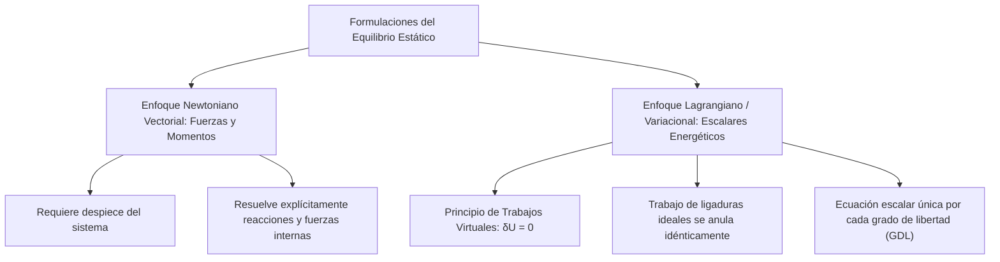
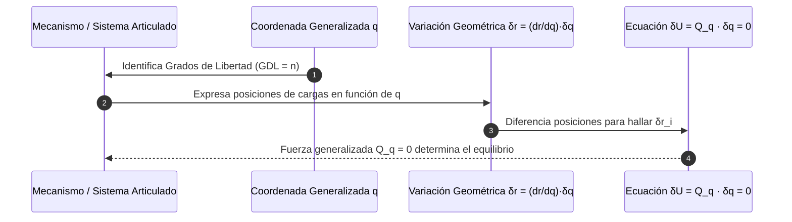

# Compendio de Repaso: Trabajo Virtual, Métodos Energéticos y Estabilidad del Equilibrio

---

## 1. Principio del Trabajo Virtual y Equilibrio

El enfoque analítico basado en el **Principio del Trabajo Virtual** (formulado por Jean Bernoulli en 1717 y consolidado por Joseph-Louis Lagrange en su *Mécanique Analytique*) sustituye el planteamiento vectorial newtoniano clásico ($\sum \vec{F} = \vec{0}$, $\sum \vec{M} = \vec{0}$) por una formulación escalar energética variacional, eliminando las fuerzas de reacción internas e hiperestáticas en mecanismos cinemáticos.



---

### 1.1 Desplazamiento Virtual, Trabajo Virtual ($\delta U$) y Restricciones Ideales

#### A. Definición de Desplazamiento Virtual ($\delta \vec{r}$)
Un **desplazamiento virtual** $\delta \vec{r}$ es un cambio diferencial arbitrario, puramente imaginario o hipotético, en la configuración espacial de un sistema material:
1. **Instantaneidad Temporal:** Ocurre a tiempo congelado ($\delta t \equiv 0$). A diferencia del desplazamiento real ($d\vec{r} = \vec{v} \, dt$), no transcurre ningún intervalo temporal durante el ensayo virtual.
2. **Compatibilidad Cinemática:** Debe ser consistente con las condiciones de contorno geométricas y restricciones cinemáticas impuestas por los enlaces o apoyos del sistema en ese instante dado.
3. **Magnitud Infinitesimal:** Es de orden diferencial de primer orden, permitiendo aplicar el cálculo diferencial variacional estándar.

<div align="center">
  <svg width="460" height="200" viewBox="0 0 460 200" xmlns="http://www.w3.org/2000/svg">
    <!-- Trayectoria o restricción -->
    <path d="M 40,160 C 140,140 240,60 420,80" fill="none" stroke="#94a3b8" stroke-width="2" stroke-dasharray="4,4"/>
    <text x="360" y="65" fill="#64748b" font-size="11" font-family="sans-serif">Restricción geométrica</text>
    <!-- Posición real P -->
    <circle cx="180" cy="115" r="5" fill="#0f172a"/>
    <text x="165" y="135" fill="#0f172a" font-size="12" font-family="sans-serif" font-weight="bold">P (r)</text>
    <!-- Fuerza Activa F -->
    <line x1="180" y1="115" x2="270" y2="45" stroke="#2563eb" stroke-width="2.5"/>
    <polygon points="266,41 277,41 272,50" fill="#2563eb"/>
    <text x="270" y="35" fill="#2563eb" font-size="13" font-family="sans-serif" font-weight="bold">F</text>
    <!-- Desplazamiento virtual delta r compatible -->
    <line x1="180" y1="115" x2="250" y2="92" stroke="#dc2626" stroke-width="2.5"/>
    <polygon points="244,87 257,90 248,98" fill="#dc2626"/>
    <text x="220" y="115" fill="#dc2626" font-size="13" font-family="sans-serif" font-weight="bold">δr</text>
    <!-- Ángulo theta -->
    <path d="M 215,88 A 40 40 0 0 1 218,103" fill="none" stroke="#0f172a" stroke-width="1.5"/>
    <text x="228" y="96" fill="#0f172a" font-size="11" font-family="sans-serif">θ</text>
  </svg>
</div>

#### B. Trabajo Virtual ($\delta U$)
El **trabajo virtual** es el trabajo escalar realizado por las fuerzas y momentos actuantes a lo largo del desplazamiento o rotación virtual impuesto:

$$
\delta U = \vec{F} \cdot \delta \vec{r} = F \cdot \delta r \cos(\theta)
$$

Para un momento o par concentrado $\vec{M}$ sometido a una rotación virtual angular infinitesimal $\delta \vec{\theta}$:
$$
\delta U = \vec{M} \cdot \delta \vec{\theta}
$$

En coordenadas cartesianas ortonormales en $\mathbb{R}^3$:
$$
\delta U = F_x \, \delta x + F_y \, \delta y + F_z \, \delta z
$$

#### C. Ligaduras y Restricciones Ideales (Sin Fricción)
Las restricciones mecánicas impuestas sobre un cuerpo rígido se clasifican en:
* **Fuerzas Activas:** Acciones externas capaces de realizar trabajo neto sobre el sistema (gravedad, cargas aplicadas, resortes, presiones).
* **Fuerzas de Ligadura o Reacción:** Fuerzas reactivas desarrolladas en los apoyos y articulaciones para restringir el movimiento.

> [!NOTE]
> **Postulado de las Restricciones Ideales:**
> Una restricción o enlace se define como **ideal** si la suma de los trabajos virtuales desarrollados por sus fuerzas y pares de reacción es estrictamente nula frente a cualquier desplazamiento virtual cinemáticamente admisible:
> $$
> \delta U_{\text{reactivas}} = \sum_{j} \vec{R}_j \cdot \delta \vec{r}_j = 0
> $$

##### Ejemplos Clásicos de Enlaces Ideales:
1. **Superficie Lisa sin Fricción:** La reacción $\vec{N}$ es normal a la superficie, mientras que $\delta \vec{r}$ es tangencial ($\vec{N} \perp \delta \vec{r} \implies \vec{N} \cdot \delta \vec{r} = 0$).
2. **Pasador o Articulación sin Rozamiento:** Las dos barras conectadas experimentan el mismo desplazamiento virtual en el nudo ($\delta \vec{r}$). Por la Tercera Ley de Newton, las fuerzas internas son iguales y opuestas ($\vec{F}_{12} + \vec{F}_{21} = \vec{0}$), por lo que su trabajo conjunto se cancela: $(\vec{F}_{12} + \vec{F}_{21}) \cdot \delta \vec{r} = 0$.
3. **Rodadura Pura sin Deslizamiento:** El punto instantáneo de contacto tiene velocidad nula y su desplazamiento virtual admisible de deslizamiento es cero ($\delta \vec{r}_{\text{cont}} = \vec{0} \implies \delta U = 0$).

---

### 1.2 Principio del Trabajo Virtual para un Cuerpo Rígido y Sistemas Interconectados

#### Enunciado Formal del Principio:
> *"La condición necesaria y suficiente para que un sistema mecánico holónomo de cuerpos rígidos interconectados con ligaduras ideales se encuentre en equilibrio estático es que el trabajo virtual total realizado por todas las **fuerzas y momentos activos exteriores** sea estrictamente igual a cero para cualquier conjunto de desplazamientos virtuales compatibles con las ligaduras del sistema."*

$$
\delta U = \sum_{i=1}^n \vec{F}_i \cdot \delta \vec{r}_i + \sum_{k=1}^m \vec{M}_k \cdot \delta \vec{\theta}_k = 0
$$



---

## 2. Métodos Energéticos y Estabilidad

### 2.1 Método de los Desplazamientos Virtuales y Coordenadas Generalizadas

Para un mecanismo con $n$ **grados de libertad (GDL)**, la configuración espacial completa de todos sus miembros queda unívocamente parametrizada mediante $n$ variables cinemáticas independientes $q_1, q_2, \dots, q_n$, denominadas **coordenadas generalizadas** (frecuentemente longitudes $x, s$ o ángulos de rotación $\theta, \phi$).

#### A. Relación Diferencial Cinemática:
La posición $\vec{r}_i$ del punto de aplicación de cada fuerza activa se formula paramétricamente: $\vec{r}_i = \vec{r}_i(q_1, q_2, \dots, q_n)$.

El desplazamiento virtual se calcula mediante la **regla de la cadena (diferencial total)**:
$$
\delta \vec{r}_i = \sum_{j=1}^n \frac{\partial \vec{r}_i}{\partial q_j} \delta q_j
$$

Sustituyendo en la expresión del trabajo virtual:
$$
\delta U = \sum_{i} \vec{F}_i \cdot \left( \sum_{j=1}^n \frac{\partial \vec{r}_i}{\partial q_j} \delta q_j \right) = \sum_{j=1}^n \left[ \sum_{i} \vec{F}_i \cdot \frac{\partial \vec{r}_i}{\partial q_j} \right] \delta q_j = 0
$$

Definiendo la **fuerza generalizada** $Q_j$ asociada a la coordenada $q_j$:
$$
Q_j = \sum_{i} \vec{F}_i \cdot \frac{\partial \vec{r}_i}{\partial q_j}
$$

Dado que las variaciones virtuales $\delta q_j$ son completamente independientes y arbitrarias:
$$
\delta U = \sum_{j=1}^n Q_j \, \delta q_j = 0 \iff Q_j = 0 \quad \forall j \in \{1, 2, \dots, n\}
$$

> [!TIP]
> **Técnica para Determinar Fuerzas Reactivas de Apoyo:**
> Para calcular una fuerza o momento de reacción en un apoyo fijo mediante trabajo virtual, **se suprime temporalmente la ligadura** reemplazándola por su fuerza de reacción desconocida $R$. El sistema adquiere un nuevo GDL virtual en la dirección de $R$, permitiendo incluir $R \cdot \delta s$ en la ecuación de $\delta U = 0$ y despejarla sin necesidad de desarmar la estructura.

---

### 2.2 Criterio de la Energía Potencial ($V$)

Cuando todas las fuerzas activas que actúan sobre el sistema son **conservativas** (la gravedad y fuerzas elásticas de resortes lineales o de torsión), el trabajo virtual realizado equivale a la variación negativa de la función escalar de **energía potencial total** $V$:

$$
\delta U = -\delta V
$$

Por consiguiente, el Principio de los Trabajos Virtuales adopta la forma equivalente:
$$
\delta V = \sum_{j=1}^n \frac{\partial V}{\partial q_j} \delta q_j = 0 \iff \frac{\partial V}{\partial q_j} = 0 \quad (j = 1, \dots, n)
$$

* **Criterio de Equilibrio Estático:** Una configuración de un sistema conservativo representa un estado de equilibrio si y solo si la **energía potencial total se encuentra en un punto estacionario** (primera derivada nula respecto a sus coordenadas generalizadas).

#### Formulación de Componentes Típicas de Energía Potencial:
1. **Energía Potencial Gravitatoria ($V_g$):**
   $$
   V_g = \sum_{k} m_k \, g \, y_{k,CG}
   $$
   donde $y_{k,CG}$ es la cota vertical medida hacia arriba desde un plano horizontal de referencia (*datum*) hasta el centro de gravedad de cada cuerpo.
2. **Energía Potencial Elástica de un Resorte Lineal ($V_e$):**
   $$
   V_e = \frac{1}{2} k \, s^2 = \frac{1}{2} k \, (L - L_0)^2
   $$
   donde $k$ es la rigidez elástica $[\text{N/m}]$, $L$ la longitud instantánea y $L_0$ la longitud indeformada.
3. **Energía Potencial Elástica de un Resorte Torsional ($V_\theta$):**
   $$
   V_\theta = \frac{1}{2} k_t (\theta - \theta_0)^2
   $$
   donde $k_t$ es la rigidez torsional $[\text{N}\cdot\text{m/rad}]$ y $(\theta - \theta_0)$ la distorsión angular.

---

### 2.3 Análisis de Estabilidad del Equilibrio Mediante Derivadas Sucesivas

Para un sistema con $1$ grado de libertad ($q$), la energía potencial alrededor de una posición de equilibrio $q_0$ puede expandirse mediante una serie de Taylor:

$$
V(q) = V(q_0) + \left.\frac{dV}{dq}\right|_{q_0} (q - q_0) + \frac{1}{2} \left.\frac{d^2V}{dq^2}\right|_{q_0} (q - q_0)^2 + \frac{1}{6} \left.\frac{d^3V}{dq^3}\right|_{q_0} (q - q_0)^3 + \dots
$$

Como en el equilibrio $\left.\frac{dV}{dq}\right|_{q_0} = 0$, el signo de la variación neta $\Delta V = V(q) - V(q_0)$ queda gobernado por el primer término diferencial no nulo de orden superior:

<div align="center">
  <svg width="600" height="200" viewBox="0 0 600 200" xmlns="http://www.w3.org/2000/svg">
    <!-- Caso Estable: Cuenco hacia arriba -->
    <rect x="25" y="20" width="170" height="165" rx="8" fill="#f8fafc" stroke="#cbd5e1" stroke-width="1.5"/>
    <text x="110" y="42" fill="#0f172a" font-size="12" font-family="sans-serif" font-weight="bold" text-anchor="middle">Equilibrio Estable</text>
    <path d="M 45,90 Q 110,165 175,90" fill="none" stroke="#16a34a" stroke-width="3"/>
    <circle cx="110" cy="127" r="8" fill="#16a34a"/>
    <text x="110" y="160" fill="#16a34a" font-size="11" font-family="sans-serif" font-weight="bold" text-anchor="middle">d²V/dq² &gt; 0</text>
    <text x="110" y="176" fill="#475569" font-size="10" font-family="sans-serif" text-anchor="middle">Mínimo de Energía</text>
    <!-- Caso Inestable: Cima hacia abajo -->
    <rect x="215" y="20" width="170" height="165" rx="8" fill="#f8fafc" stroke="#cbd5e1" stroke-width="1.5"/>
    <text x="300" y="42" fill="#0f172a" font-size="12" font-family="sans-serif" font-weight="bold" text-anchor="middle">Equilibrio Inestable</text>
    <path d="M 235,140 Q 300,65 365,140" fill="none" stroke="#dc2626" stroke-width="3"/>
    <circle cx="300" cy="103" r="8" fill="#dc2626"/>
    <text x="300" y="160" fill="#dc2626" font-size="11" font-family="sans-serif" font-weight="bold" text-anchor="middle">d²V/dq² &lt; 0</text>
    <text x="300" y="176" fill="#475569" font-size="10" font-family="sans-serif" text-anchor="middle">Máximo de Energía</text>
    <!-- Caso Indiferente: Superficie Plana -->
    <rect x="405" y="20" width="170" height="165" rx="8" fill="#f8fafc" stroke="#cbd5e1" stroke-width="1.5"/>
    <text x="490" y="42" fill="#0f172a" font-size="12" font-family="sans-serif" font-weight="bold" text-anchor="middle">Equilibrio Indiferente</text>
    <line x1="425" y1="115" x2="555" y2="115" stroke="#2563eb" stroke-width="3"/>
    <circle cx="490" cy="107" r="8" fill="#2563eb"/>
    <text x="490" y="160" fill="#2563eb" font-size="11" font-family="sans-serif" font-weight="bold" text-anchor="middle">d²V/dq² = 0</text>
    <text x="490" y="176" fill="#475569" font-size="10" font-family="sans-serif" text-anchor="middle">Energía Constante</text>
  </svg>
</div>

| Tipo de Equilibrio | Condición de la 2da Derivada | Condición de la Función $V(q)$ | Respuesta Dinámica frente a una Perturbación |
| :--- | :---: | :--- | :--- |
| **Estable** | $\dfrac{d^2V}{dq^2} > 0$ | $V(q)$ presenta un **mínimo local estricto** | Surgen fuerzas restauradoras que regresan el sistema a $q_0$. Oscilación confinada. |
| **Inestable** | $\dfrac{d^2V}{dq^2} < 0$ | $V(q)$ presenta un **máximo local** | Surgen fuerzas repulsivas que alejan indefinidamente al sistema de $q_0$. |
| **Indiferente (Neutro)** | $\dfrac{d^2V}{dq^2} = 0$ | $V(q)$ es localmente **plana o constante** | El sistema permanece en reposo en la nueva posición perturbada. |

#### Casos de Derivada Segunda Nula ($\frac{d^2V}{dq^2} = 0$):
Si la segunda derivada se anula, se deben examinar las **derivadas de orden superior sucesivas** en $q_0$:
1. Si la primera derivada no nula es de **orden impar** ($\frac{d^n V}{dq^n} \neq 0$ con $n$ impar, ej. $n=3$):
   * La función presenta un punto de inflexión con tangente horizontal. El equilibrio es **inestable**.
2. Si la primera derivada no nula es de **orden par** ($\frac{d^n V}{dq^n} \neq 0$ con $n$ par, ej. $n=4$):
   * Si $\frac{d^n V}{dq^n} > 0 \implies$ **Equilibrio Estable** (mínimo de orden superior).
   * Si $\frac{d^n V}{dq^n} < 0 \implies$ **Equilibrio Inestable** (máximo de orden superior).

> [!WARNING]
> **Sistemas de Múltiples Grados de Libertad ($n \ge 2$):**
> La estabilidad exige que la **matriz Hessiana de energía potencial** $\mathbf{H}_{jk} = \frac{\partial^2 V}{\partial q_j \partial q_k}$ sea **definida positiva** en el punto de equilibrio (todos sus autovalores estrictamente positivos, o por el Criterio de Sylvester, todos los determinantes menores principales mayores que cero). Si al menos un autovalor es negativo, el equilibrio es inestable (punto de silla).

---

## 3. Implementación Computacional: Solucionador Simbólico y Análisis de Estabilidad

El siguiente script en Python utiliza `sympy` para modelar la función de energía potencial $V(\theta)$ de un mecanismo, deducir analíticamente sus posiciones de equilibrio y clasificar su estabilidad mediante derivadas sucesivas:

```python
import sympy as sp

def analizar_estabilidad_mecanismo():
    """
    Analiza las posiciones de equilibrio y la estabilidad de un sistema 
    conservativo parametrizado por una coordenada angular theta.
    
    Ejemplo físico:
    Barra delgada homogénea de longitud L y peso W articulada en la base,
    sostenida por un resorte horizontal de constante k en su extremo superior.
    """
    # Definición de variables simbólicas
    theta = sp.Symbol('theta', real=True)
    L, W, k = sp.symbols('L W k', positive=True)

    # 1. Definición de cotas cinemáticas respecto a la base (y = 0 en la articulación):
    # Centro de gravedad de la barra: y_CG = (L/2) * cos(theta)
    # Extremo superior (resorte): x_sup = L * sin(theta)
    
    # 2. Función de Energía Potencial Total V(theta)
    # V_gravitatoria: W * y_CG
    # V_elastica: 1/2 * k * (delta_x)^2 = 1/2 * k * (L * sin(theta))^2
    V_g = W * (L / 2) * sp.cos(theta)
    V_e = sp.Rational(1, 2) * k * (L * sp.sin(theta))**2
    V = V_g + V_e

    # 3. Primera derivada (Condición de Equilibrio: dV/dtheta = 0)
    dV_dtheta = sp.diff(V, theta)

    # 4. Segunda derivada (Criterio de Estabilidad: d²V/dtheta²)
    d2V_dtheta2 = sp.diff(V, theta, 2)

    print("================ ANÁLISIS VARIACIONAL SIMBÓLICO ================")
    print(f"Función V(theta):\n  {sp.simplify(V)}")
    print(f"\nEcuación de Equilibrio dV/dtheta = 0:\n  {sp.simplify(dV_dtheta)} = 0")
    print(f"\nSegunda Derivada d²V/dtheta²:\n  {sp.simplify(d2V_dtheta2)}")

    # 5. Evaluación numérica para parámetros particulares:
    # L = 2.0 m, W = 100 N, k = 80 N/m
    valores = {L: 2.0, W: 100.0, k: 80.0}
    dV_num = dV_dtheta.subs(valores)
    d2V_num = d2V_dtheta2.subs(valores)

    # Búsqueda de soluciones angulares en el rango de trabajo [-pi/2, pi/2]
    soluciones = sp.solve(dV_num, theta)

    print("\n================ EVALUACIÓN DE ESTABILIDAD NUMÉRICA ================")
    for sol in soluciones:
        # Filtrar únicamente soluciones reales dentro del rango físico
        if sol.is_real and -sp.pi/2 <= sol <= sp.pi/2:
            sol_val = float(sol)
            d2_val = float(d2V_num.subs(theta, sol))

            if d2_val > 1e-6:
                estado = "ESTABLE (Mínimo local)"
            elif d2_val < -1e-6:
                estado = "INESTABLE (Máximo local)"
            else:
                # Examen de derivada de orden superior
                d4_val = float(sp.diff(V, theta, 4).subs(valores).subs(theta, sol))
                estado = "INDIFERENTE o REVISAR ORDEN SUPERIOR" if abs(d4_val) < 1e-6 else ("ESTABLE (Orden 4)" if d4_val > 0 else "INESTABLE (Orden 4)")

            print(f"Posición theta = {sol_val:8.4f} rad ({sol_val * 180 / 3.14159265:6.2f}°) | d²V/dtheta² = {d2_val:10.4f} -> {estado}")

if __name__ == "__main__":
    analizar_estabilidad_mecanismo()
```