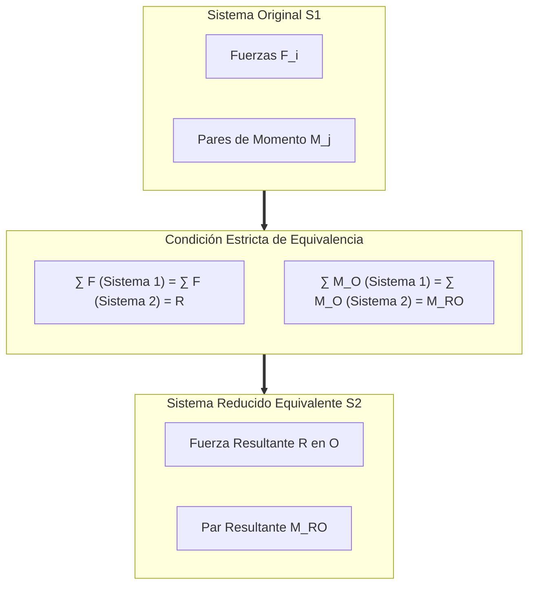
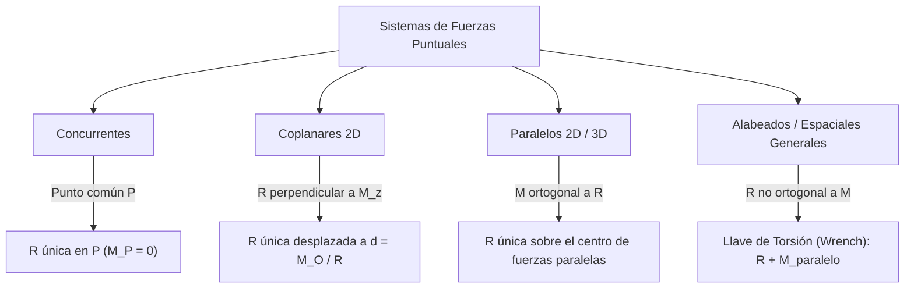
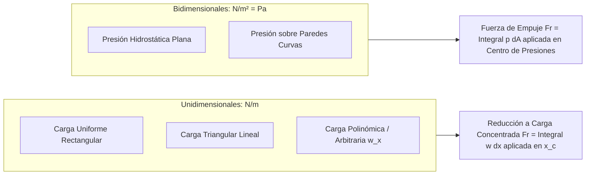
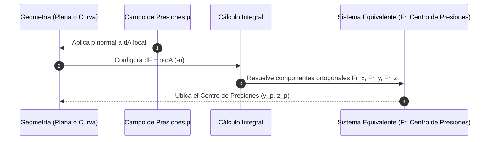
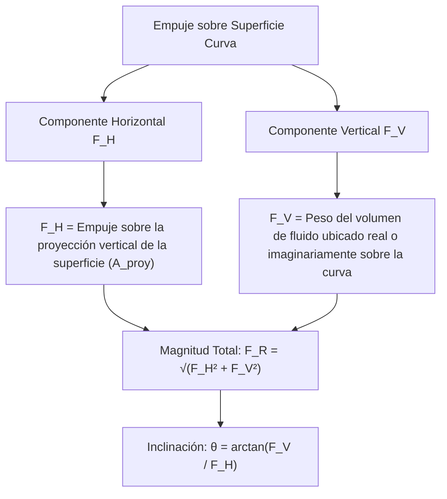

# Compendio de Repaso: Sistemas Equivalentes de Fuerzas y Cargas Distribuidas

---

## 1. Equivalencia y Reducción de Sistemas de Fuerzas Concentradas

### 1.1 Definición y Condiciones de Sistemas Equivalentes de Fuerzas

Dos sistemas de fuerzas, $S_1$ y $S_2$, que actúan sobre un mismo cuerpo rígido son **mecánicamente equivalentes** si y solo si producen exactamente el mismo efecto externo sobre el cuerpo (mismas aceleraciones lineales y angulares según las leyes de Newton-Euler, o preservación idéntica del estado de equilibrio estático).



#### Condiciones Matemáticas Necesarias y Suficientes
Para cualquier punto de referencia $O \in \mathbb{R}^3$:

1. **Igualdad de Fuerzas Resultantes:**
   $$
   \vec{R} = \sum_{i=1}^n \vec{F}_i^{(1)} = \sum_{k=1}^m \vec{F}_k^{(2)}
   $$
2. **Igualdad de Momentos Resultantes respecto al mismo punto $O$:**
   $$
   \vec{M}_{RO} = \sum_{i=1}^n \left( \vec{r}_i^{(1)} \times \vec{F}_i^{(1)} \right) + \sum_{j=1}^p \vec{C}_j^{(1)} = \sum_{k=1}^m \left( \vec{r}_k^{(2)} \times \vec{F}_k^{(2)} \right) + \sum_{l=1}^q \vec{C}_l^{(2)}
   $$
   donde $\vec{C}$ denota los momentos de pares libres aplicados.

#### Teorema de Reducción a un Sistema Fuerza-Par en un Punto
Cualquier sistema espacial arbitrario de fuerzas y momentos puede reducirse, en un punto base $O$ arbitrariamente seleccionado, a un sistema equivalente compuesto únicamente por:
* Una **fuerza resultante única** $\vec{R}$ aplicada directamente en $O$.
* Un **par resultante único** $\vec{M}_{RO}$ perpendicular o no a $\vec{R}$.

<div align="center">
  <svg width="440" height="180" viewBox="0 0 440 180" xmlns="http://www.w3.org/2000/svg">
    <!-- Contorno de cuerpo rígido -->
    <path d="M 40,40 Q 140,10 260,30 Q 400,50 410,120 Q 300,165 170,150 Q 30,155 40,40 Z" fill="#f8fafc" stroke="#64748b" stroke-width="2"/>
    
    <!-- Centro O -->
    <circle cx="150" cy="95" r="5" fill="#0f172a"/>
    <text x="135" y="115" fill="#0f172a" font-size="13" font-family="sans-serif" font-weight="bold">O</text>
    
    <!-- Vector R -->
    <line x1="150" y1="95" x2="250" y2="35" stroke="#2563eb" stroke-width="3.5"/>
    <polygon points="245,30 258,30 252,42" fill="#2563eb"/>
    <text x="260" y="30" fill="#2563eb" font-size="14" font-family="sans-serif" font-weight="bold">R = ∑F</text>
    
    <!-- Vector M_RO (Doble flecha de momento) -->
    <line x1="150" y1="95" x2="150" y2="20" stroke="#7c3aed" stroke-width="3"/>
    <polygon points="146,26 150,15 154,26" fill="#7c3aed"/>
    <polygon points="146,36 150,25 154,36" fill="#7c3aed"/>
    <text x="160" y="25" fill="#7c3aed" font-size="14" font-family="sans-serif" font-weight="bold">M_RO = ∑M_O</text>
    
    <!-- Flechas primitivas atenuadas -->
    <line x1="70" y1="130" x2="110" y2="80" stroke="#94a3b8" stroke-width="1.5" stroke-dasharray="3,3"/>
    <line x1="320" y1="120" x2="270" y2="85" stroke="#94a3b8" stroke-width="1.5" stroke-dasharray="3,3"/>
  </svg>
</div>

##### Cambio del Punto de Reducción
Si el sistema equivalente $(\vec{R}, \vec{M}_{RO})$ trasladado a un nuevo punto $O'$ produce $(\vec{R}, \vec{M}_{RO'})$:
$$
\vec{M}_{RO'} = \vec{M}_{RO} + \vec{r}_{O'/O} \times \vec{R} = \vec{M}_{RO} - \vec{r}_{O/O'} \times \vec{R}
$$
* $\vec{R}$ es un **vector invariante** frente al cambio de centro de reducción.
* $\vec{M}_{RO}$ es un **vector dependiente del punto**.

> [!NOTE]
> **Invariante Escalar del Sistema (Invariante de Bresse):**
> El producto escalar entre la fuerza resultante y el momento resultante es constante e independiente del punto base elegido $O$:
> $$
> I_1 = \vec{R} \cdot \vec{M}_{RO} = \vec{R} \cdot \vec{M}_{RO'} = \text{constante}
> $$

---

### 1.2 Resultante de Sistemas de Fuerzas Puntuales

La reducción a una **fuerza resultante única sin par residual** ($\vec{M}_R = \vec{0}$) solo es factible cuando $\vec{R} \cdot \vec{M}_{RO} = 0$, lo que ocurre si $\vec{R} \perp \vec{M}_{RO}$ o si $\vec{M}_{RO} = \vec{0}$.



#### A. Sistemas Concurrentes
Todas las líneas de acción se cruzan en un punto común $P$.
* **Momento respecto a $P$:**
  $$
  \vec{M}_{RP} = \sum (\vec{r}_{P/P} \times \vec{F}_i) = \vec{0}
  $$
* **Resultado:** Se reducen a una **fuerza única** $\vec{R} = \sum \vec{F}_i$ con línea de acción pasando obligatoriamente por el punto de concurrencia $P$.

---

#### B. Sistemas Coplanares (Fuerzas en el plano $xy$)
Todas las fuerzas actúan en el plano cartográfico $z = 0$.
* **Fuerza Resultante:**
  $$
  \vec{R} = R_x \hat{i} + R_y \hat{j} = \left( \sum F_{ix} \right)\hat{i} + \left( \sum F_{iy} \right)\hat{j}
  $$
* **Momento Resultante respecto a $O(0,0)$:**
  $$
  \vec{M}_{RO} = \left[ \sum (x_i F_{iy} - y_i F_{ix}) \right] \hat{k} = M_{ROz} \hat{k}
  $$
Como $\vec{R}$ pertenece al plano $xy$ y $\vec{M}_{RO}$ es colineal con el eje $z$, son mutuamente perpendiculares ($\vec{R} \cdot \vec{M}_{RO} = 0$).

##### Línea de Acción de la Fuerza Única Resultante
El sistema se reduce a una fuerza única $\vec{R}$ ubicada en coordenadas $(x, y)$ tales que reproduzcan el momento $M_{ROz}$:
$$
x R_y - y R_x = M_{ROz}
$$
Intersecciones características con los ejes:
$$
x_{\text{int}} = \frac{M_{ROz}}{R_y} \quad (\text{para } y = 0), \qquad y_{\text{int}} = -\frac{M_{ROz}}{R_x} \quad (\text{para } x = 0)
$$

---

#### C. Sistemas de Fuerzas Paralelas en Dos y Tres Dimensiones

Todas las fuerzas poseen vectores unitarios directores colineales: $\vec{F}_i = F_i \, \hat{u}$.

##### 1. Fuerzas Paralelas en Dos Dimensiones (Ejemplo: paralelas al eje $y$)
$$
\vec{F}_i = F_i \hat{j} \implies \vec{R} = \left( \sum_{i=1}^n F_i \right) \hat{j} = R \, \hat{j}
$$
El momento respecto al origen $O(0,0)$ es:
$$
\vec{M}_{RO} = \sum_{i=1}^n (x_i \hat{i}) \times (F_i \hat{j}) = \left( \sum_{i=1}^n x_i F_i \right) \hat{k}
$$
Para sustituir el sistema por una fuerza única $\vec{R}$ aplicada en $\bar{x}$:
$$
\bar{x} R = \sum_{i=1}^n x_i F_i \implies \bar{x} = \frac{\sum_{i=1}^n x_i F_i}{\sum_{i=1}^n F_i}
$$

##### 2. Fuerzas Paralelas en Tres Dimensiones (Ejemplo: paralelas al eje $z$)
$$
\vec{F}_i = F_i \hat{k} \implies \vec{R} = R \, \hat{k} = \left( \sum_{i=1}^n F_i \right) \hat{k}
$$
El momento respecto al origen cartesiando $O(0,0,0)$ es:
$$
\vec{M}_{RO} = \sum_{i=1}^n (x_i \hat{i} + y_i \hat{j}) \times (F_i \hat{k}) = \left( \sum_{i=1}^n y_i F_i \right) \hat{i} - \left( \sum_{i=1}^n x_i F_i \right) \hat{j}
$$
Igualando con el momento generado por una resultante única ubicada en $(\bar{x}, \bar{y}, 0)$:
$$
\vec{M}_{RO} = (\bar{x}\hat{i} + \bar{y}\hat{j}) \times (R \hat{k}) = \bar{y} R \, \hat{i} - \bar{x} R \, \hat{j}
$$
Despejando las coordenadas del **centro de fuerzas paralelas**:
$$
\bar{x} = \frac{\sum_{i=1}^n x_i F_i}{\sum_{i=1}^n F_i}, \qquad \bar{y} = \frac{\sum_{i=1}^n y_i F_i}{\sum_{i=1}^n F_i}
$$

| Tipo de Sistema | Grados de Libertad Activos | Condición de Invariante ($I_1$) | Reducción Canónica Final |
| :--- | :--- | :--- | :--- |
| **Concurrente** | 3 Traslaciones | $I_1 = 0$ ($\vec{M}_P = \vec{0}$) | Fuerza única $\vec{R}$ en punto concurrente $P$ |
| **Coplanar (2D)** | 2 Trasl., 1 Rotación | $I_1 = 0$ ($\vec{R} \perp \vec{M}_{RO}$) | Fuerza única $\vec{R}$ sobre recta soporte |
| **Paralelo (3D)** | 1 Trasl., 2 Rotaciones | $I_1 = 0$ ($\vec{R} \perp \vec{M}_{RO}$) | Fuerza única $\vec{R}$ en centro $(\bar{x}, \bar{y})$ |
| **Alabeado (3D General)**| 3 Trasl., 3 Rotaciones | $I_1 \neq 0$ (en el caso general) | **Llave de torsión (Wrench)**: $\vec{R} \parallel \vec{M}_R$ |

> [!WARNING]
> **Caso Límite:** Si $\sum \vec{F}_i = \vec{0}$ pero $\sum \vec{M}_O \neq \vec{0}$, el sistema **no** puede reducirse a una fuerza única. Su resultante irreducible es un **par libre puro** de momento $\vec{M}_{RO}$, cuyo valor es constante para cualquier punto del espacio.

---

## 2. Cargas Continuas Distribuidas

En aplicaciones estructurales y geotécnicas reales, las fuerzas no se aplican en nodos o puntos infinitesimales geométricos, sino de forma continua sobre líneas, superficies o volúmenes.



---

### 2.1 Cargas Distribuidas sobre una Línea (Cargas Lineales)

Una carga continua que actúa en el plano sobre una viga o elemento unidimensional se caracteriza por su función de intensidad de carga:
$$
w(x) = \lim_{\Delta x \to 0} \frac{\Delta F}{\Delta x} \quad \left[\frac{\text{N}}{\text{m}}\right] \quad \text{o} \quad \left[\frac{\text{kN}}{\text{m}}\right]
$$

<div align="center">
  <svg width="460" height="170" viewBox="0 0 460 170" xmlns="http://www.w3.org/2000/svg">
    <!-- Ejes -->
    <line x1="40" y1="130" x2="420" y2="130" stroke="#334155" stroke-width="2"/>
    <polygon points="418,127 426,130 418,133" fill="#334155"/>
    <text x="420" y="145" fill="#334155" font-size="12" font-family="sans-serif">x</text>
    
    <line x1="60" y1="140" x2="60" y2="20" stroke="#334155" stroke-width="2"/>
    <polygon points="57,22 60,14 63,22" fill="#334155"/>
    <text x="40" y="25" fill="#334155" font-size="12" font-family="sans-serif">w(x)</text>

    <!-- Curva de carga -->
    <path d="M 60,110 C 130,40 220,70 360,30 L 360,130 L 60,130 Z" fill="#e0f2fe" stroke="#0284c7" stroke-width="2"/>
    <text x="210" y="55" fill="#0369a1" font-size="13" font-family="sans-serif" font-weight="bold">w(x)</text>

    <!-- Flechas de carga distribuida -->
    <line x1="120" y1="85" x2="120" y2="126" stroke="#0284c7" stroke-width="1.5"/>
    <polygon points="117,122 120,128 123,122" fill="#0284c7"/>
    <line x1="180" y1="67" x2="180" y2="126" stroke="#0284c7" stroke-width="1.5"/>
    <polygon points="177,122 180,128 183,122" fill="#0284c7"/>
    <line x1="260" y1="57" x2="260" y2="126" stroke="#0284c7" stroke-width="1.5"/>
    <polygon points="257,122 260,128 263,122" fill="#0284c7"/>
    <line x1="320" y1="41" x2="320" y2="126" stroke="#0284c7" stroke-width="1.5"/>
    <polygon points="317,122 320,128 323,122" fill="#0284c7"/>

    <!-- Fr equivalente -->
    <line x1="230" y1="15" x2="230" y2="125" stroke="#dc2626" stroke-width="3"/>
    <polygon points="225,120 230,130 235,120" fill="#dc2626"/>
    <text x="238" y="25" fill="#dc2626" font-size="13" font-family="sans-serif" font-weight="bold">F_R = ∫ w(x)dx</text>
    <circle cx="230" cy="130" r="3" fill="#dc2626"/>
    <text x="225" y="148" fill="#dc2626" font-size="11" font-family="sans-serif">x_c</text>
  </svg>
</div>

##### 1. Magnitud de la Carga Concentrada Equivalente ($F_R$)
La resultante representa el área bajo la curva de la función de distribución:
$$
F_R = \int_{0}^{L} dF = \int_{0}^{L} w(x) \, dx
$$

##### 2. Punto de Aplicación / Línea de Acción ($\bar{x}$)
Aplicando el Principio de Momentos respecto al origen $x = 0$:
$$
M_{RO} = \int x \, dF = \int_{0}^{L} x \cdot w(x) \, dx
$$
Como $M_{RO} = \bar{x} \cdot F_R$:
$$
\bar{x} = \frac{\int_{0}^{L} x \, w(x) \, dx}{\int_{0}^{L} w(x) \, dx} = \frac{Q_w}{F_R}
$$
donde $\bar{x}$ coincide exactamente con la **coordenada centroidal horizontal ($x_c$) del área geométrica** delimitada por $w(x)$.

##### Casos Canónicos Fundamentales

| Geometría de Carga | Perfil Funcional | Magnitud Resultante ($F_R$) | Posición del Centroide ($\bar{x}$) |
| :--- | :--- | :--- | :--- |
| **Uniforme (Rectangular)** | $w(x) = w_0$ | $F_R = w_0 L$ | $\bar{x} = \frac{L}{2}$ |
| **Triangular (Creciente)** | $w(x) = w_0 \left(\frac{x}{L}\right)$ | $F_R = \frac{1}{2} w_0 L$ | $\bar{x} = \frac{2}{3} L$ |
| **Triangular (Decreciente)**| $w(x) = w_0 \left(1 - \frac{x}{L}\right)$ | $F_R = \frac{1}{2} w_0 L$ | $\bar{x} = \frac{1}{3} L$ |
| **Parabólica (Grado 2)** | $w(x) = w_0 \left(\frac{x}{L}\right)^2$ | $F_R = \frac{1}{3} w_0 L$ | $\bar{x} = \frac{3}{4} L$ |

> [!TIP]
> **Método de Superposición:** Ante perfiles trapezoidales o combinados, subdivide la figura en subáreas geométricas elementales conocidas (rectángulo + triángulo). La resultante global será la suma escalar de las áreas parciales, y la posición centroidal final se obtendrá con el momento estático compuesto:
> $$
> \bar{x} = \frac{F_{R1}\bar{x}_1 + F_{R2}\bar{x}_2}{F_{R1} + F_{R2}}
> $$

---

### 2.2 Cargas Distribuidas sobre Áreas Planas y Superficies Curvas

Cuando una fuerza actúa distribuida en una superficie, se define la **presión estática** $p$ como:
$$
p = \lim_{\Delta A \to 0} \frac{\Delta F_n}{\Delta A} \quad \left[\frac{\text{N}}{\text{m}^2} = \text{Pa}\right]
$$
El diferencial de fuerza actúa de manera **rigurosamente normal (perpendicular)** a la superficie de contacto:
$$
d\vec{F} = -p \, d\vec{A} = -p \, \hat{n} \, dA
$$



#### A. Empuje Hidrostático sobre Superficies Planas

Considerando un fluido incompresible con peso específico $\gamma = \rho g$ y superficie libre a presión atmosférica de referencia ($p_{\text{man}} = 0$):
$$
p(h) = \gamma h = \rho g h
$$
donde $h$ es la profundidad vertical.

<div align="center">
  <svg width="400" height="200" viewBox="0 0 400 200" xmlns="http://www.w3.org/2000/svg">
    <!-- Nivel de agua -->
    <line x1="40" y1="40" x2="360" y2="40" stroke="#0284c7" stroke-width="2"/>
    <polygon points="195,30 205,30 200,38" fill="#0284c7"/>
    <line x1="192" y1="27" x2="208" y2="27" stroke="#0284c7" stroke-width="1.5"/>
    
    <!-- Pared inclinada plana -->
    <line x1="120" y1="40" x2="240" y2="180" stroke="#334155" stroke-width="4"/>
    
    <!-- Prisma de presión triangular -->
    <polygon points="120,40 240,180 320,180" fill="#bae6fd" opacity="0.6"/>
    <line x1="240" y1="180" x2="320" y2="180" stroke="#0284c7" stroke-width="2"/>
    <text x="325" y="185" fill="#0369a1" font-size="12" font-family="sans-serif">p_max = γ h</text>

    <!-- Fuerza Resultante Fr -->
    <line x1="270" y1="100" x2="200" y2="133" stroke="#dc2626" stroke-width="3"/>
    <polygon points="208,127 195,135 204,138" fill="#dc2626"/>
    <text x="275" y="100" fill="#dc2626" font-size="13" font-family="sans-serif" font-weight="bold">F_R</text>

    <!-- Centroide vs Centro de Presiones -->
    <circle cx="180" cy="110" r="3.5" fill="#0f172a"/>
    <text x="145" y="105" fill="#0f172a" font-size="11" font-family="sans-serif">Centroide (C)</text>
    
    <circle cx="200" cy="133.3" r="3.5" fill="#dc2626"/>
    <text x="120" y="140" fill="#dc2626" font-size="11" font-family="sans-serif">C. Presiones (P)</text>
  </svg>
</div>

##### 1. Magnitud del Empuje Total ($F_R$)
Integrando sobre el área de la placa plana $A$:
$$
F_R = \int_A p \, dA = \int_A (\gamma y \sin\theta) \, dA = \gamma \sin\theta \int_A y \, dA
$$
Por definición del primer momento de área (momento estático): $\int_A y \, dA = y_c A$.
$$
F_R = \gamma (y_c \sin\theta) A = \gamma h_c A = p_c A
$$
* **Regla Fundamental:** La magnitud de la fuerza resultante es el producto de la presión hidrostática en el **centroide geométrico de la placa ($p_c$)** multiplicada por el **área total ($A$)**.

##### 2. Localización del Centro de Presiones ($y_p$)
El punto donde se aplica la fuerza resultante concentrada **no** es el centroide $y_c$, sino un punto más profundo debido al perfil creciente de presión:
$$
y_p = \frac{\int_A y \cdot p \, dA}{F_R} = \frac{\gamma \sin\theta \int_A y^2 \, dA}{\gamma h_c A} = \frac{I_{x}}{y_c A}
$$
Aplicando el **Teorema de Steiner (ejes paralelos)** para el segundo momento de área: $I_x = \bar{I}_{xc} + A y_c^2$:
$$
y_p = y_c + \frac{\bar{I}_{xc}}{y_c A}
$$
$$
x_p = x_c + \frac{\bar{I}_{xyc}}{y_c A}
$$

> [!NOTE]
> Dado que $\bar{I}_{xc} > 0$, **el centro de presiones ($y_p$) siempre se ubica estrictamente por debajo del centroide geométrico ($y_c$)** de la superficie plana sumergida.

---

#### B. Empuje Hidrostático sobre Superficies Curvas

En superficies con curvatura bidimensional o tridimensional, el vector unitario normal $\hat{n}$ varía continuamente de orientación en cada punto. Por consiguiente, la integración escalar directa de presión no es aplicable:
$$
\vec{F}_R = \int_A -p \, \hat{n} \, dA
$$

Para resolverlo analíticamente, el vector resultante se descompone en sus componentes ortogonales cartesianas independientes:



##### 1. Componente Horizontal ($F_H$)
La proyección del elemento diferencial de área inclinada sobre un plano vertical perpendicular al eje $x$ es $dA_x = dA \cos(\theta) = \hat{n} \cdot \hat{i} \, dA$:
$$
F_H = \int_A p \, dA_x = p_{c,\text{proy}} \cdot A_{\text{proy}}
$$
* **Regla Operativa:** La componente horizontal del empuje equivale a la fuerza que actuaría sobre una **placa plana vertical proyectada** que tenga la misma silueta frontal. Su línea de acción pasa por el centro de presiones de dicha área plana proyectada.

##### 2. Componente Vertical ($F_V$)
La proyección horizontal del área diferencial es $dA_z = dA \sin(\theta) = \hat{n} \cdot \hat{k} \, dA$:
$$
F_V = \int_A p \, dA_z = \int_A (\gamma h) \, dA_z = \gamma \int_{\forall} dV = \gamma \, V_{\text{fluido}}
$$
* **Regla Operativa:** La componente vertical es exactamente igual al **peso del volumen de fluido** contenido verticalmente entre la superficie curva y la superficie libre de referencia del líquido.
* **Línea de Acción:** Pasa a través del **centroide de dicho volumen de fluido**.

> [!WARNING]
> **Superficies Curvas Circulares:** Cuando la pared curva está conformada por un arco de circunferencia o cilindro circular, todas las presiones diferenciales hidrostáticas $d\vec{F}$ apuntan en dirección normal radial y convergen en el centro geométrico de curvatura. Por tanto, la línea de acción de la fuerza resultante combinada $\vec{F}_R$ **debe pasar obligatoriamente por el centro de radio de curvatura**.

---

## 3. Implementación de Reducción Numérica de Cargas

El siguiente script en Python utiliza `scipy.integrate` y `numpy` para reducir tanto un sistema de fuerzas concentradas coplanares como una distribución continua de carga $w(x)$ no estándar a sus equivalentes canónicos:

```python
import numpy as np
from scipy import integrate
from typing import Callable, Tuple

def reducir_sistema_coplanar(
    fuerzas: np.ndarray, 
    posiciones: np.ndarray
) -> Tuple[np.ndarray, float, float]:
    """
    Reduce un conjunto de fuerzas 2D a una fuerza resultante única.
    
    :param fuerzas: Matriz (N, 2) de vectores [Fx, Fy] en Newtons.
    :param posiciones: Matriz (N, 2) de coordenadas [x, y] en metros.
    :return: (R, M_O, x_interseccion)
             R: Vector resultante [Rx, Ry]
             M_O: Momento escalar respecto al origen (z-axial)
             x_interseccion: Punto de cruce de la resultante en el eje x (y=0)
    """
    R = np.sum(fuerzas, axis=0)
    # Momento 2D: r_x * F_y - r_y * F_x
    momentos_O = posiciones[:, 0] * fuerzas[:, 1] - posiciones[:, 1] * fuerzas[:, 0]
    M_O = float(np.sum(momentos_O))
    
    # Intersección con el eje X: x*Ry - 0*Rx = M_O -> x = M_O / Ry
    if np.isclose(R[1], 0.0):
        x_corte = np.nan  # Paralela al eje X
    else:
        x_corte = M_O / R[1]
        
    return R, M_O, x_corte

def reducir_carga_distribuida_lineal(
    w_func: Callable[[float], float], 
    L: float
) -> Tuple[float, float]:
    """
    Calcula la magnitud equivalente F_R y el centroide x_c 
    de una distribución arbitraria continua w(x) en el rango [0, L].
    """
    # 1. Magnitud: Area bajo la curva
    F_R, _ = integrate.quad(w_func, 0.0, L)
    
    # 2. Momento estático de primer orden respecto al origen
    Q_x, _ = integrate.quad(lambda x: x * w_func(x), 0.0, L)
    
    if np.isclose(F_R, 0.0):
        raise ValueError("La carga neta resultante es cero; el sistema se reduce a un par puro.")
        
    x_c = Q_x / F_R
    return F_R, x_c

if __name__ == "__main__":
    # --- PRUEBA 1: Reducción Coplanar Discreta ---
    # F1 en (1, 2) con valor (0, -50) N
    # F2 en (4, 1) con valor (30, -20) N
    fuerzas_discretas = np.array([
        [0.0, -50.0],
        [30.0, -20.0]
    ])
    pos_discretas = np.array([
        [1.0, 2.0],
        [4.0, 1.0]
    ])
    
    R_total, M_total, x_eje = reducir_sistema_coplanar(fuerzas_discretas, pos_discretas)
    print("--- Reducción Sistema Coplanar Discreto ---")
    print(f"Fuerza Resultante R: {R_total} N")
    print(f"Momento respecto a (0,0): {M_total:.2f} N*m")
    print(f"Punto de cruce en eje X: x = {x_eje:.4f} m\n")

    # --- PRUEBA 2: Carga Distribuida Continua Lineal ---
    # Carga parabólica: w(x) = 150 * (x/3)**2 sobre una viga de L = 3m
    longitud_viga = 3.0
    carga_parabolica = lambda x: 150.0 * (x / longitud_viga)**2
    
    FR_dist, xc_dist = reducir_carga_distribuida_lineal(carga_parabolica, longitud_viga)
    print("--- Reducción Carga Continua w(x) ---")
    print(f"Fuerza Concentrada Equivalente F_R: {FR_dist:.2f} N")
    print(f"Centroide (Línea de acción) x_c: {xc_dist:.4f} m (Teórico 3/4*L: {0.75*longitud_viga:.2f} m)")
```