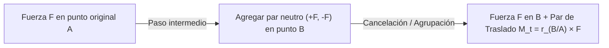
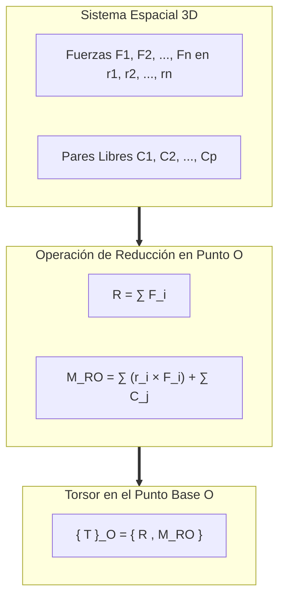
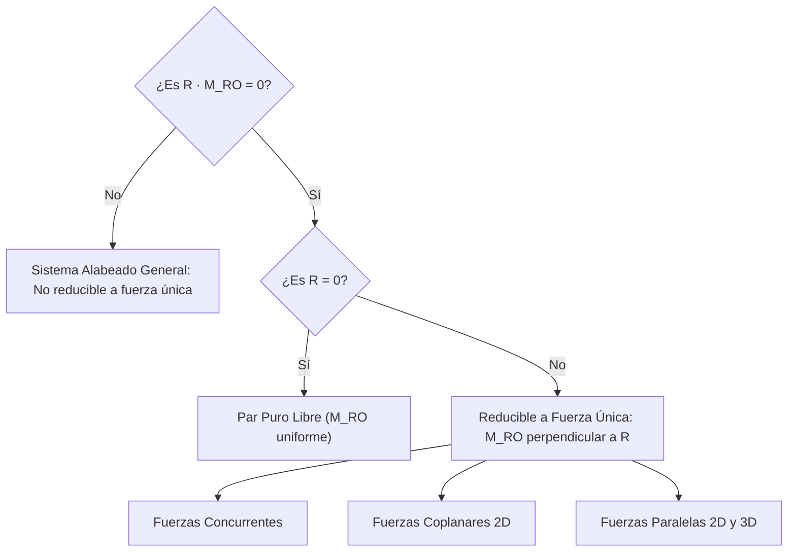
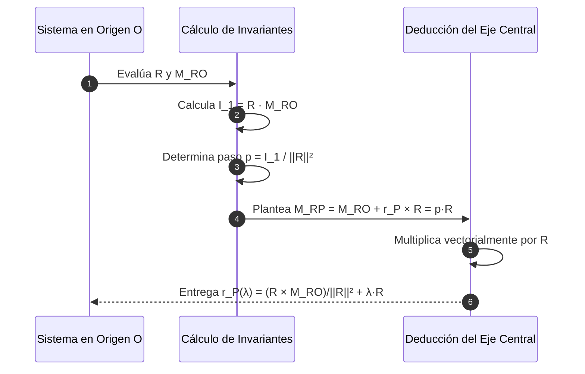

# Compendio de Repaso: Traslación de Fuerzas, Reducción Espacial y Torsor Central de Poinsot

---

## 1. Reducción General a Sistema Fuerza-Par

### 1.1 Traslación de una Fuerza a una Línea de Acción Paralela y Par de Traslado

El **principio de transmisibilidad** permite deslizar libremente una fuerza $\vec{F}$ a lo largo de su propia recta de acción sin alterar el estado cinético o estático externo del cuerpo rígido. No obstante, **trasladar una fuerza fuera de su línea de acción original a una posición paralela altera el equilibrio rotacional**, a menos que se introduzca un momento compensatorio denominado **par de traslado**.



#### Demostración Constructiva del Par de Traslado
Sea una fuerza $\vec{F}$ aplicada en el punto $A$. Se desea transferir su punto de aplicación al punto $B$, donde $\vec{r}_{B/A} = \vec{r}_B - \vec{r}_A$:

1. En el punto de destino $B$, se introduce un sistema mecánicamente nulo compuesto por dos fuerzas concurrentes opuestas colineales: $+\vec{F}$ y $-\vec{F}$ ($\vec{F}_{\text{neto}} = \vec{0}$).
2. Se asocian la fuerza original $+\vec{F}$ en $A$ y la fuerza reactiva $-\vec{F}$ en $B$. Ambas constituyen formalmente un **par de fuerzas** o cupla.
3. El momento generado por dicho par (independiente de cualquier origen por ser un vector libre) es:
   $$
   \vec{M}_t = \vec{r}_{A/B} \times \vec{F} = (\vec{r}_A - \vec{r}_B) \times \vec{F} = -\vec{r}_{B/A} \times \vec{F}
   $$
   Si se expresa el vector posición desde el nuevo punto de aplicación $B$ hacia el punto original $A$ ($\vec{r} = \vec{r}_A - \vec{r}_B$):
   $$
   \vec{M}_t = \vec{r}_{A/B} \times \vec{F}
   $$

<div align="center">
  <svg width="520" height="170" viewBox="0 0 520 170" xmlns="http://www.w3.org/2000/svg">
    <!-- Estado 1 -->
    <g>
      <circle cx="60" cy="120" r="4" fill="#0f172a"/>
      <text x="55" y="140" fill="#0f172a" font-size="12" font-family="sans-serif" font-weight="bold">A</text>
      <line x1="60" y1="120" x2="60" y2="40" stroke="#2563eb" stroke-width="3"/>
      <polygon points="56,45 60,32 64,45" fill="#2563eb"/>
      <text x="70" y="50" fill="#2563eb" font-size="13" font-family="sans-serif" font-weight="bold">F</text>
      <circle cx="160" cy="120" r="4" fill="#64748b"/>
      <text x="155" y="140" fill="#64748b" font-size="12" font-family="sans-serif">B</text>
      <text x="100" y="155" fill="#475569" font-size="11" font-family="sans-serif" text-anchor="middle">(1) Fuerza original</text>
    </g>
    <!-- Flecha de equivalencia 1 -->
    <text x="195" y="90" fill="#0f172a" font-size="18" font-family="sans-serif" font-weight="bold">≡</text>
    <!-- Estado 2: neutro -->
    <g>
      <circle cx="230" cy="120" r="4" fill="#0f172a"/>
      <text x="225" y="140" fill="#0f172a" font-size="12" font-family="sans-serif" font-weight="bold">A</text>
      <line x1="230" y1="120" x2="230" y2="40" stroke="#2563eb" stroke-width="3"/>
      <polygon points="226,45 230,32 234,45" fill="#2563eb"/>
      <circle cx="310" cy="120" r="4" fill="#0f172a"/>
      <text x="315" y="140" fill="#0f172a" font-size="12" font-family="sans-serif" font-weight="bold">B</text>
      <!-- Par nulo en B -->
      <line x1="310" y1="120" x2="310" y2="40" stroke="#16a34a" stroke-width="2.5"/>
      <polygon points="307,45 310,35 313,45" fill="#16a34a"/>
      <text x="318" y="45" fill="#16a34a" font-size="11" font-family="sans-serif">+F</text>
      <line x1="310" y1="120" x2="310" y2="165" stroke="#dc2626" stroke-width="2" stroke-dasharray="3,3"/>
      <polygon points="307,160 310,168 313,160" fill="#dc2626"/>
      <text x="318" y="165" fill="#dc2626" font-size="11" font-family="sans-serif">-F</text>
      <text x="270" y="155" fill="#475569" font-size="11" font-family="sans-serif" text-anchor="middle">(2) Sistema neutro</text>
    </g>
    <!-- Flecha de equivalencia 2 -->
    <text x="355" y="90" fill="#0f172a" font-size="18" font-family="sans-serif" font-weight="bold">≡</text>
    <!-- Estado 3: resultado -->
    <g>
      <circle cx="430" cy="120" r="4" fill="#0f172a"/>
      <text x="435" y="140" fill="#0f172a" font-size="12" font-family="sans-serif" font-weight="bold">B</text>
      <line x1="430" y1="120" x2="430" y2="40" stroke="#16a34a" stroke-width="3"/>
      <polygon points="426,45 430,32 434,45" fill="#16a34a"/>
      <text x="440" y="50" fill="#16a34a" font-size="13" font-family="sans-serif" font-weight="bold">F</text>
      <!-- Par de traslado curvo -->
      <path d="M 405,100 A 22 22 0 1 1 430,75" fill="none" stroke="#7c3aed" stroke-width="2.5"/>
      <polygon points="428,70 436,74 430,81" fill="#7c3aed"/>
      <text x="380" y="70" fill="#7c3aed" font-size="12" font-family="sans-serif" font-weight="bold">M_t = r × F</text>
      <text x="430" y="155" fill="#475569" font-size="11" font-family="sans-serif" text-anchor="middle">(3) Fuerza-Par</text>
    </g>
  </svg>
</div>

> [!NOTE]
> La magnitud escalar del par de traslado en el plano es invariablemente $M_t = F \cdot d$, donde $d$ es la distancia perpendicular más corta entre las dos rectas de soporte paralelas.

---

### 1.2 Caso General de Reducción Tridimensional: Fuerza y Par Resultante

Dado un sistema discreto arbitrario formado por $n$ fuerzas concentradas $\vec{F}_i$ aplicadas en coordenadas espaciales $\vec{r}_i$ y $p$ momentos de pares libres $\vec{C}_j$:



#### Ecuaciones Constitutivas del Torsor en el Punto Base $O$
1. **Fuerza Resultante:**
   $$
   \vec{R} = \sum_{i=1}^{n} \vec{F}_i = R_x \hat{i} + R_y \hat{j} + R_z \hat{k}
   $$
2. **Momento Resultante respecto a $O$:**
   $$
   \vec{M}_{RO} = \sum_{i=1}^{n} (\vec{r}_i \times \vec{F}_i) + \sum_{j=1}^{p} \vec{C}_j = M_{ROx}\hat{i} + M_{ROy}\hat{j} + M_{ROz}\hat{k}
   $$

#### Propiedades Cinemáticas y Estáticas del Torsor
* **Invariante Vectorial Principal:** $\vec{R}$ no depende del centro de reducción elegido. Para cualquier punto $A$: $\vec{R}_A \equiv \vec{R}$.
* **Ley de Cambio de Centro de Reducción:**
  $$
  \vec{M}_{RB} = \vec{M}_{RA} + \vec{r}_{B/A} \times \vec{R} = \vec{M}_{RA} + (\vec{r}_A - \vec{r}_B) \times \vec{R}
  $$
* **Primer Invariante Escalar (Invariante de Bresse):**
  $$
  I_1 = \vec{R} \cdot \vec{M}_{RO} = \vec{R} \cdot \vec{M}_{RA} = \text{constante} \quad \forall A \in \mathbb{R}^3
  $$
  *Demostración:*
  $$
  \vec{R} \cdot \vec{M}_{RB} = \vec{R} \cdot \left[ \vec{M}_{RA} + (\vec{r}_A - \vec{r}_B) \times \vec{R} \right] = \vec{R} \cdot \vec{M}_{RA} + \underbrace{\vec{R} \cdot \left[(\vec{r}_A - \vec{r}_B) \times \vec{R}\right]}_{= 0 \text{ (producto mixto con dos vectores idénticos)}} = \vec{R} \cdot \vec{M}_{RA}
  $$

---

## 2. Casos Particulares de Reducción y Torsor Central

### 2.1 Reducción de un Sistema a una Fuerza Única

Para que un sistema espacial complejo de fuerzas pueda condensarse en una **única fuerza resultante pura** ($\vec{R} \neq \vec{0}$) sin la presencia de un momento residual acoplado ($\vec{M}_R = \vec{0}$), es condición necesaria y suficiente que el primer invariante escalar sea estrictamente nulo:
$$
I_1 = \vec{R} \cdot \vec{M}_{RO} = 0
$$



#### Determinación del Punto de Aplicación de la Fuerza Única
Si $\vec{R} \cdot \vec{M}_{RO} = 0$, existe un conjunto de puntos $P$ tales que el momento resultante respecto a ellos se anula idénticamente:
$$
\vec{M}_{RP} = \vec{M}_{RO} + \vec{r}_P \times \vec{R} = \vec{0} \implies \vec{r}_P \times \vec{R} = -\vec{M}_{RO} = \vec{M}_{RO} \times (-\hat{u}_R \cdot R)
$$
El vector de posición mínimo que une el origen $O$ con la recta de acción de la fuerza única viene dado por la proyección vectorial directa:
$$
\vec{r}_{P0} = \frac{\vec{R} \times \vec{M}_{RO}}{\|\vec{R}\|^2}
$$

> [!WARNING]
> Si $\vec{R} = \vec{0}$ y $\vec{M}_{RO} \neq \vec{0}$, el invariante $I_1 = 0$, pero el sistema **no** es reducible a una fuerza única; su resultado irreducible es un **par libre puro**.

---

### 2.2 Reducción al Eje Central y Torsor de Poinsot (Wrench)

En el caso general tridimensional, la fuerza resultante $\vec{R}$ y el momento resultante $\vec{M}_{RO}$ no son mutuamente ortogonales ($I_1 = \vec{R} \cdot \vec{M}_{RO} \neq 0$). Louis Poinsot (1803) demostró que todo sistema espacial se reduce a una fuerza única actuando a lo largo de un eje específico más un momento par colineal paralelo a dicha fuerza. Esta configuración canónica se denomina **Torsor de Poinsot** o **Wrench**.

<div align="center">
  <svg width="440" height="200" viewBox="0 0 440 200" xmlns="http://www.w3.org/2000/svg">
    <!-- Eje Central Delta -->
    <line x1="60" y1="160" x2="380" y2="40" stroke="#94a3b8" stroke-width="2" stroke-dasharray="6,4"/>
    <text x="390" y="45" fill="#475569" font-size="13" font-family="sans-serif" font-style="italic">Eje Central (Δ)</text>
    <!-- Punto P sobre el eje -->
    <circle cx="200" cy="107" r="5" fill="#0f172a"/>
    <text x="205" y="125" fill="#0f172a" font-size="12" font-family="sans-serif" font-weight="bold">P</text>
    <!-- Fuerza Resultante R -->
    <line x1="200" y1="107" x2="290" y2="73" stroke="#2563eb" stroke-width="4"/>
    <polygon points="285,67 298,70 291,82" fill="#2563eb"/>
    <text x="250" y="60" fill="#2563eb" font-size="14" font-family="sans-serif" font-weight="bold">R</text>
    <!-- Momento Mínimo M_1 colineal (Doble flecha) -->
    <line x1="200" y1="107" x2="320" y2="62" stroke="#dc2626" stroke-width="2.5"/>
    <polygon points="314,57 326,60 320,70" fill="#dc2626"/>
    <polygon points="305,60 317,63 311,73" fill="#dc2626"/>
    <text x="330" y="80" fill="#dc2626" font-size="13" font-family="sans-serif" font-weight="bold">M_min = p R</text>
    <!-- Arco de torsión alrededor del eje -->
    <path d="M 230,110 A 15 15 0 1 1 245,85" fill="none" stroke="#dc2626" stroke-width="2"/>
    <polygon points="248,85 246,76 240,82" fill="#dc2626"/>
    <!-- Vector r_p desde el origen -->
    <circle cx="90" cy="160" r="4" fill="#0f172a"/>
    <text x="75" y="175" fill="#0f172a" font-size="12" font-family="sans-serif" font-weight="bold">O</text>
    <line x1="90" y1="160" x2="200" y2="107" stroke="#64748b" stroke-width="2"/>
    <polygon points="193,106 203,105 197,115" fill="#64748b"/>
    <text x="135" y="145" fill="#475569" font-size="12" font-family="sans-serif" font-weight="bold">r_p</text>
  </svg>
</div>

---

#### 1. Determinación del Par Mínimo ($\vec{M}_{\text{min}}$ o $\vec{M}_{\parallel}$)

Para un punto arbitrario $A$, el vector momento $\vec{M}_{RA}$ se descompone en dos proyecciones ortogonales respecto a la directriz de la fuerza resultante $\hat{u}_R = \frac{\vec{R}}{\|\vec{R}\|}$:
$$
\vec{M}_{RA} = \vec{M}_{\parallel} + \vec{M}_{\perp}
$$

* **Componente paralela ($\vec{M}_{\parallel}$):**
  $$
  \vec{M}_{\parallel} = (\vec{M}_{RA} \cdot \hat{u}_R) \hat{u}_R = \left( \frac{\vec{R} \cdot \vec{M}_{RA}}{\|\vec{R}\|^2} \right) \vec{R} = \left( \frac{I_1}{\|\vec{R}\|^2} \right) \vec{R}
  $$
  Puesto que $I_1$ y $\vec{R}$ son invariantes frente a cambios de posición, **la componente colineal $\vec{M}_{\parallel}$ es constante para todo punto del espacio**.

* **Magnitud del Par Mínimo:**
  $$
  \|\vec{M}_{RA}\|^2 = \|\vec{M}_{\parallel}\|^2 + \|\vec{M}_{\perp}\|^2 \implies \|\vec{M}_{RA}\| \geq \|\vec{M}_{\parallel}\|
  $$
  El momento resultante del sistema alcanza su módulo mínimo absoluto en aquellos puntos donde la componente normal transversal se extingue ($\vec{M}_{\perp} = \vec{0}$):
  $$
  \vec{M}_{\text{min}} = \vec{M}_{\parallel} = \frac{\vec{R} \cdot \vec{M}_{RO}}{\|\vec{R}\|^2} \vec{R}
  $$

---

#### 2. Paso o Avance del Torsor ($p$)

El parámetro escalar de avance o **paso del torsor** (denotado $p$) expresa la relación cuantitativa entre la magnitud del momento axial y la magnitud de la fuerza directriz:
$$
p = \frac{\vec{M}_{\text{min}} \cdot \vec{R}}{\|\vec{R}\|^2} = \frac{\vec{R} \cdot \vec{M}_{RO}}{\|\vec{R}\|^2} \quad [\text{m}] \quad \text{o} \quad [\text{mm}]
$$
Vinculando vectorialmente el par mínimo y la fuerza resultante:
$$
\vec{M}_{\text{min}} = p \cdot \vec{R}
$$

| Valor del Paso ($p$) | Naturaleza Mecánica del Torsor | Comportamiento Físico |
| :--- | :--- | :--- |
| $p = 0$ ($I_1 = 0$, $\vec{R} \neq \vec{0}$) | Fuerza única pura | Traslación pura o rotación pura alrededor de apoyos |
| $p > 0$ | Torsor a derechas (dextrógiro) | Avance y rotación coordinados según tornillo métrico estándar |
| $p < 0$ | Torsor a izquierdas (levógiro) | Sentido de giro inverso respecto a la línea de traslación |
| $p \to \pm \infty$ ($\vec{R} = \vec{0}$, $\vec{M} \neq \vec{0}$) | Par puro libre | Rotación pura desprovista de fuerza neta |

---

#### 3. Deducción de la Ecuación Vectorial y Paramétrica del Eje Central

El **Eje Central de Poinsot ($\Delta$)** es el lugar geométrico de los puntos $P$ del espacio para los cuales el momento resultante $\vec{M}_{RP}$ es estrictamente colineal con la fuerza resultante $\vec{R}$:
$$
\vec{M}_{RP} = \vec{M}_{\text{min}} = p \vec{R}
$$



##### Deducción Analítica Vectorial
Partiendo de la relación cinemática de cambio de centro de reducción para un punto genérico $P$ ($\vec{r}_P$):
$$
\vec{M}_{RP} = \vec{M}_{RO} - \vec{r}_P \times \vec{R} = p \vec{R}
$$
Reordenando términos:
$$
\vec{r}_P \times \vec{R} = \vec{M}_{RO} - p \vec{R}
$$
Efectuando el producto vectorial por la izquierda por el vector resultante $\vec{R}$:
$$
\vec{R} \times (\vec{r}_P \times \vec{R}) = \vec{R} \times (\vec{M}_{RO} - p \vec{R})
$$
Aplicando la identidad de Lagrange del triple producto vectorial $(\vec{A} \times (\vec{B} \times \vec{C}) = (\vec{A} \cdot \vec{C})\vec{B} - (\vec{A} \cdot \vec{B})\vec{C})$:
$$
(\vec{R} \cdot \vec{R})\vec{r}_P - (\vec{R} \cdot \vec{r}_P)\vec{R} = \vec{R} \times \vec{M}_{RO} - p \underbrace{(\vec{R} \times \vec{R})}_{=\vec{0}}
$$
$$
\|\vec{R}\|^2 \vec{r}_P - (\vec{R} \cdot \vec{r}_P)\vec{R} = \vec{R} \times \vec{M}_{RO}
$$
Despejando el vector de posición $\vec{r}_P$:
$$
\vec{r}_P = \frac{\vec{R} \times \vec{M}_{RO}}{\|\vec{R}\|^2} + \left(\frac{\vec{R} \cdot \vec{r}_P}{\|\vec{R}\|^2}\right)\vec{R}
$$
Haciendo el cambio de variable paramétrica $\lambda = \frac{\vec{R} \cdot \vec{r}_P}{\|\vec{R}\|^2} \in \mathbb{R}$:

##### Ecuación Vectorial del Eje Central
$$
\vec{r}_P(\lambda) = \vec{r}_{P0} + \lambda \vec{R}
$$
donde:
* $\vec{r}_{P0} = \frac{\vec{R} \times \vec{M}_{RO}}{\|\vec{R}\|^2}$ es el vector posición del punto del eje central **más cercano al origen coordenado** ($\vec{r}_{P0} \perp \vec{R}$).
* $\lambda \vec{R}$ representa la traslación sobre la recta directriz del eje.

##### Ecuación Paramétrica Escalar Cartesiana
Si $\vec{r}_{P0} = (x_0, y_0, z_0)$ y $\vec{R} = (R_x, R_y, R_z)$:
$$
\begin{cases}
x(\lambda) = x_0 + \lambda R_x \\
y(\lambda) = y_0 + \lambda R_y \\
z(\lambda) = z_0 + \lambda R_z
\end{cases}
$$

Forma continua simétrica (eliminando el parámetro $\lambda$):
$$
\frac{x - x_0}{R_x} = \frac{y - y_0}{R_y} = \frac{z - z_0}{R_z}
$$

> [!TIP]
> **Propiedad de Mínima Distancia:** El punto particular $\vec{r}_{P0} = \frac{\vec{R} \times \vec{M}_{RO}}{\|\vec{R}\|^2}$ satisface de forma natural $\vec{r}_{P0} \cdot \vec{R} = 0$, lo que garantiza que es el pie de la perpendicular trazada desde el origen $(0,0,0)$ hacia el Eje Central.

---

## 3. Implementación Numérica del Torsor de Poinsot

El siguiente script en Python calcula de forma analítica el sistema equivalente fuerza-par, evalúa el invariante escalar de Bresse, descompone el par mínimo, extrae el paso helicoidal y parametriza el Eje Central de Poinsot.

```python
import numpy as np
from dataclasses import dataclass
from typing import List, Tuple

@dataclass
class FuerzaPuntual:
    fuerza: np.ndarray       # Vector [Fx, Fy, Fz] en N
    posicion: np.ndarray     # Vector de posición [x, y, z] en m

def calcular_torsor_poinsot(
    fuerzas: List[FuerzaPuntual], 
    pares_libres: List[np.ndarray] = None
) -> dict:
    """
    Calcula el Torsor de Poinsot (Wrench) y la ecuación del Eje Central.
    """
    if pares_libres is None:
        pares_libres = []

    # 1. Fuerza Resultante Global
    R = np.sum([f.fuerza for f in fuerzas], axis=0).astype(float)
    norm_R = np.linalg.norm(R)
    
    if np.isclose(norm_R, 0.0):
        # Caso especial: Par puro
        M_RO = np.sum([np.cross(f.posicion, f.fuerza) for f in fuerzas], axis=0)
        M_RO += np.sum(pares_libres, axis=0) if len(pares_libres) > 0 else np.zeros(3)
        return {
            "tipo": "Par Puro Libre",
            "R": R,
            "M_RO": M_RO,
            "paso": np.inf
        }

    # 2. Momento Resultante en el Origen (0,0,0)
    M_RO = np.zeros(3, dtype=float)
    for f in fuerzas:
        M_RO += np.cross(f.posicion, f.fuerza)
    for c in pares_libres:
        M_RO += c

    # 3. Invariante Escalar de Bresse
    I1 = float(np.dot(R, M_RO))

    # 4. Paso del Torsor (Pitch)
    paso = I1 / (norm_R ** 2)

    # 5. Par Mínimo (Colineal con R)
    M_min = paso * R

    # 6. Punto del Eje Central más cercano al Origen (r_P0)
    r_P0 = np.cross(R, M_RO) / (norm_R ** 2)

    return {
        "tipo": "Fuerza Única" if np.isclose(paso, 0.0) else "Torsor Central (Wrench)",
        "R": R,
        "norm_R": norm_R,
        "M_RO": M_RO,
        "I1": I1,
        "paso": paso,
        "M_min": M_min,
        "r_P0": r_P0,
        "vector_director": R / norm_R
    }

if __name__ == "__main__":
    # --- CASO DE PRUEBA: Sistema Espacial 3D ---
    # Fuerza 1: 50 N vertical en (2, 0, 0)
    # Fuerza 2: 80 N transversal en (0, 3, 1)
    # Par libre adicional: [10, -20, 40] N*m
    sistema = [
        FuerzaPuntual(fuerza=np.array([0.0, 0.0, 50.0]), posicion=np.array([2.0, 0.0, 0.0])),
        FuerzaPuntual(fuerza=np.array([0.0, 80.0, 0.0]), posicion=np.array([0.0, 3.0, 1.0]))
    ]
    momentos_libres = [np.array([10.0, -20.0, 40.0])]

    res = calcular_torsor_poinsot(sistema, momentos_libres)

    print("================ RESULTADOS DEL TORSOR ================")
    print(f"Clasificación: {res['tipo']}")
    print(f"Fuerza Resultante R: {res['R']} N  (||R|| = {res['norm_R']:.2f} N)")
    print(f"Momento Resultante en O: {res['M_RO']} N*m")
    print(f"Invariante de Bresse (I1): {res['I1']:.4f} N^2*m")
    print(f"Paso del Torsor (p): {res['paso']:.4f} m")
    print(f"Momento Mínimo (M_min): {res['M_min']} N*m")
    print(f"Punto r_P0 más cercano al origen: {res['r_P0']} m")
    print("Ecuación Paramétrica del Eje Central r(λ) = r_P0 + λ * R:")
    print(f"  x(λ) = {res['r_P0'][0]:.4f} + {res['R'][0]:.4f} λ")
    print(f"  y(λ) = {res['r_P0'][1]:.4f} + {res['R'][1]:.4f} λ")
    print(f"  z(λ) = {res['r_P0'][2]:.4f} + {res['R'][2]:.4f} λ")
    print("=======================================================")
```