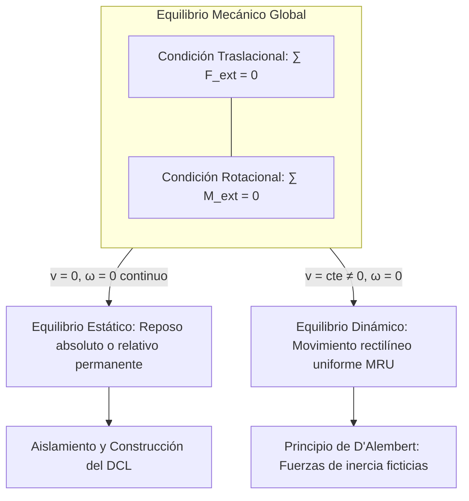
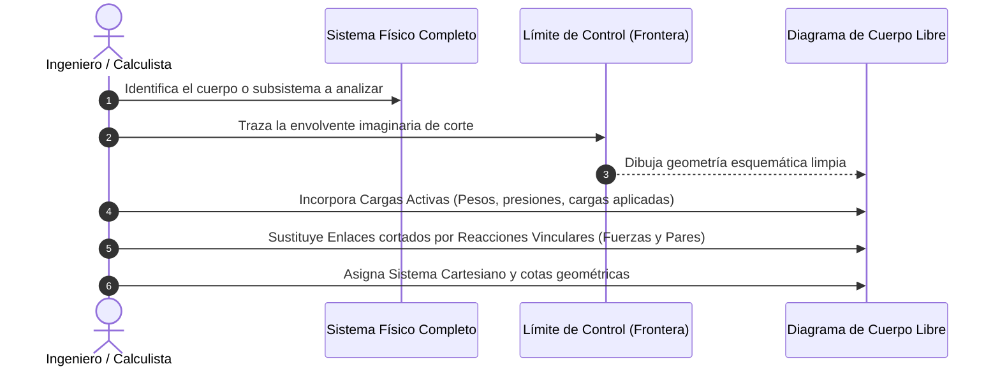
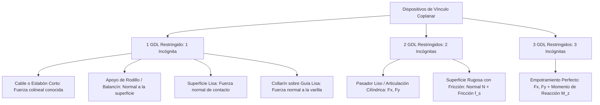
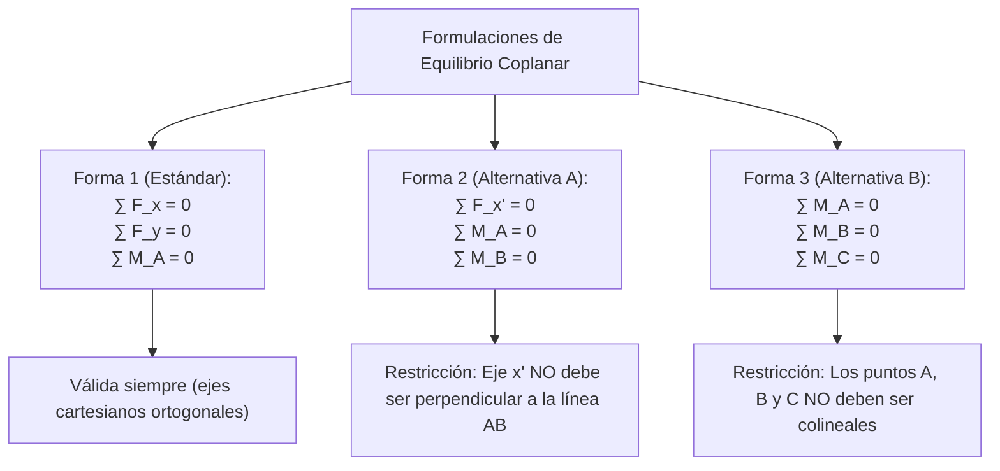
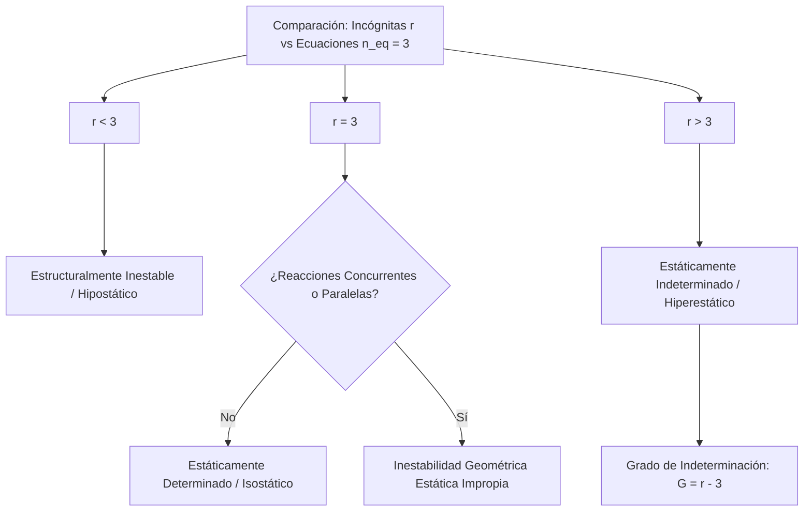
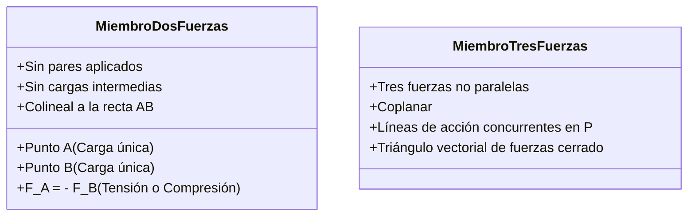
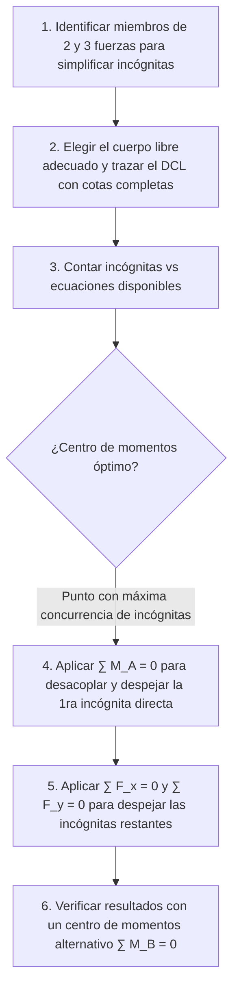

# Compendio de Repaso: Equilibrio en Dos Dimensiones

---

## 1. Principios y Modelado del Equilibrio Coplanar

### 1.1 Definición Física de Equilibrio Estático frente a Equilibrio Dinámico

En la mecánica del sólido rígido, el estado de **equilibrio** de un sistema material se define por la anulación neta de las acciones exteriores que alteran su estado cinemático lineal y angular. Se fundamenta rigurosamente en las **Ecuaciones de Newton-Euler**:

$$
\sum \vec{F}_{\text{ext}} = m \vec{a}_G, \qquad \sum \vec{M}_{G,\text{ext}} = \dot{\vec{H}}_G = I_G \vec{\alpha}
$$

donde $G$ es el centro de masa del cuerpo, $m$ su masa total, $I_G$ el momento de inercia baricéntrico, $\vec{a}_G$ la aceleración lineal del centro de masa y $\vec{\alpha}$ la aceleración angular.



#### Comparativa Fundamental: Estático vs. Dinámico

| Parámetro / Criterio | Equilibrio Estático | Equilibrio Dinámico |
| :--- | :--- | :--- |
| **Velocidad Lineal ($\vec{v}_G$)** | $\vec{v}_G = \vec{0}$ (estricta y permanentemente) | $\vec{v}_G = \vec{v}_0 \neq \vec{0}$ (constante en magnitud y dirección) |
| **Velocidad Angular ($\vec{\omega}$)** | $\vec{\omega} = \vec{0}$ | $\vec{\omega} = \vec{0}$ (no hay giro acelerado ni rotación libre con precesión) |
| **Aceleraciones ($\vec{a}_G, \vec{\alpha}$)** | $\vec{a}_G = \vec{0}, \quad \vec{\alpha} = \vec{0}$ | $\vec{a}_G = \vec{0}, \quad \vec{\alpha} = \vec{0}$ |
| **Condición de Fuerzas** | $\sum \vec{F}_{\text{ext}} = \vec{0}$ | $\sum \vec{F}_{\text{ext}} = \vec{0}$ (o $\sum \vec{F}_{\text{ext}} - m\vec{a} = \vec{0}$ vía D'Alembert) |
| **Campo de Aplicación** | Edificaciones, puentes, armaduras, presas | Vehículos a crucero, mecanismos a velocidad uniforme |

> [!NOTE]
> En ambos regímenes, las ecuaciones matemáticas que gobiernan las fuerzas externas son idénticas ($\sum \vec{F} = \vec{0}$, $\sum \vec{M} = \vec{0}$). La distinción radica en las condiciones de contorno de velocidad del sistema de referencia inercial.

---

### 1.2 Construcción y Análisis Riguroso del Diagrama de Cuerpo Libre (DCL)

El **Diagrama de Cuerpo Libre (DCL)** es la herramienta analítica fundamental de la estática. Consiste en la representación gráfica del elemento estructural o cuerpo de interés, completamente **desacoplado y aislado** de su entorno circundante, sobre el cual se dibujan todas las fuerzas y momentos externos (conocidos e incógnitas) que el resto del universo ejerce sobre él.



#### Protocolo de Ejecución en 5 Fases para un DCL Infalible

1. **Definición del Sistema y Frontera de Control:** Decide claramente si aíslas un sólido único, un nudo articulado, un miembro de dos fuerzas o una estructura completa con sus uniones internas intactas. Traza mental o físicamente una línea de corte cerrada que separe el cuerpo del universo.
2. **Dibujo Esquemático del Contorno:** Dibuja únicamente la silueta del cuerpo aislado. **Omite** soportes físicos, muros, tierra, cables o pasadores.
3. **Identificación de Fuerzas Activas (Acciones Directas):**
   * **Fuerzas de campo a distancia:** El peso gravitatorio ($W = mg$), aplicado obligatoriamente en el centro de gravedad ($G$).
   * **Cargas externas aplicadas:** Cargas puntuales, momentos torsores/flectores aplicados y distribuciones de carga ($w(x)$).
4. **Identificación de Fuerzas Reactivas (Vínculos y Enlaces Cortados):**
   * En cada punto donde la frontera de control cortó una interacción física con el exterior, coloca las fuerzas o pares reactivos equivalentes que restringen los grados de libertad del sólido.
5. **Parametrización Geométrica y Convención de Signos:**
   * Dibuja los ejes de coordenadas $(x, y)$.
   * Incluye todas las distancias, ángulos y brazos de palanca necesarios para evaluar momentos.
   * Supón sentidos iniciales coherentes para las incógnitas; el signo del resultado algebraico corregirá o confirmará la hipótesis.

<div align="center">
  <svg width="500" height="200" viewBox="0 0 500 200" xmlns="http://www.w3.org/2000/svg">
    <!-- Viga Aislada -->
    <rect x="70" y="80" width="360" height="20" rx="3" fill="#e2e8f0" stroke="#334155" stroke-width="2.5"/>
    <text x="250" y="95" fill="#334155" font-size="12" font-family="sans-serif" font-weight="bold" text-anchor="middle">Sólido Rígido Aislado</text>
    <!-- Punto A (Pasador cortado) -->
    <circle cx="70" cy="90" r="4" fill="#0f172a"/>
    <text x="50" y="95" fill="#0f172a" font-size="13" font-family="sans-serif" font-weight="bold">A</text>
    <!-- Reacción Ay -->
    <line x1="70" y1="160" x2="70" y2="95" stroke="#2563eb" stroke-width="3"/>
    <polygon points="66,105 70,95 74,105" fill="#2563eb"/>
    <text x="78" y="145" fill="#2563eb" font-size="12" font-family="sans-serif" font-weight="bold">A_y</text>
    <!-- Reacción Ax -->
    <line x1="10" y1="90" x2="65" y2="90" stroke="#2563eb" stroke-width="3"/>
    <polygon points="55,86 65,90 55,94" fill="#2563eb"/>
    <text x="25" y="80" fill="#2563eb" font-size="12" font-family="sans-serif" font-weight="bold">A_x</text>
    <!-- Carga Activa P en C -->
    <circle cx="250" cy="90" r="3" fill="#dc2626"/>
    <line x1="250" y1="20" x2="250" y2="78" stroke="#dc2626" stroke-width="3"/>
    <polygon points="246,70 250,80 254,70" fill="#dc2626"/>
    <text x="258" y="45" fill="#dc2626" font-size="13" font-family="sans-serif" font-weight="bold">P (Carga Activa)</text>
    <!-- Punto B (Rodillo cortado) -->
    <circle cx="430" cy="90" r="4" fill="#0f172a"/>
    <text x="445" y="95" fill="#0f172a" font-size="13" font-family="sans-serif" font-weight="bold">B</text>
    <!-- Reacción By -->
    <line x1="430" y1="160" x2="430" y2="95" stroke="#16a34a" stroke-width="3"/>
    <polygon points="426,105 430,95 434,105" fill="#16a34a"/>
    <text x="438" y="145" fill="#16a34a" font-size="12" font-family="sans-serif" font-weight="bold">B_y</text>
    <!-- Cotas de longitud -->
    <line x1="70" y1="175" x2="250" y2="175" stroke="#64748b" stroke-width="1.5"/>
    <line x1="70" y1="170" x2="70" y2="180" stroke="#64748b" stroke-width="1.5"/>
    <line x1="250" y1="170" x2="250" y2="180" stroke="#64748b" stroke-width="1.5"/>
    <text x="160" y="190" fill="#64748b" font-size="11" font-family="sans-serif" text-anchor="middle">L_1</text>
    <line x1="250" y1="175" x2="430" y2="175" stroke="#64748b" stroke-width="1.5"/>
    <line x1="430" y1="170" x2="430" y2="180" stroke="#64748b" stroke-width="1.5"/>
    <text x="340" y="190" fill="#64748b" font-size="11" font-family="sans-serif" text-anchor="middle">L_2</text>
  </svg>
</div>

> [!WARNING]
> **Errores Graves en la Elaboración del DCL:**
> 1. **Incluir fuerzas internas:** Interacciones moleculares o tensiones mutuas entre partes no divididas no deben dibujarse; se anulan según la Tercera Ley de Newton.
> 2. **Olvidar el peso propio:** Siempre que el enunciado asigne masa o peso al sólido, debe colocarse la fuerza hacia abajo aplicada en su centro de masa.
> 3. **Dibujar fuerzas que el cuerpo ejerce sobre otros:** En el DCL **solo** se dibujan las fuerzas que los cuerpos externos ejercen **sobre** el cuerpo aislado, jamás las reacciones que el cuerpo devuelve a los apoyos.

---

## 2. Condiciones de Equilibrio y Sustentación Plana

### 2.1 Tipos de Apoyos, Enlaces y Conexiones en 2D y Modelado de sus Reacciones

En un plano, un cuerpo rígido libre posee exactamente **tres grados de libertad (GDL)**:
1. Traslación a lo largo del eje $x$.
2. Traslación a lo largo del eje $y$.
3. Rotación en el plano alrededor del eje perpendicular $z$ ($\theta_z$).

Todo dispositivo de apoyo o sustentación mecánica tiene como objetivo restringir uno o más de estos grados de libertad mediante la generación de una fuerza o momento reactivo en la dirección del movimiento impedido.



#### Catálogo Estructurado de Enlaces en Dos Dimensiones

| Tipo de Enlace / Conexión | Representación Gráfica | Grados de Libertad Restringidos | Reacciones Generadas (Incógnitas) | Línea de Acción / Sentido |
| :--- | :--- | :---: | :--- | :--- |
| **Cable o Cuerda Ligera** | Segmento continuo tenso | 1 Traslación (alejamiento) | $1$ fuerza escalar: $T$ | Tracción saliente del cuerpo a lo largo del eje del cable. |
| **Eslabón Biela (Miembro de 2 Fuerzas)** | Barra articulada en extremos sin peso | 1 Traslación | $1$ fuerza escalar: $F_{AB}$ | Colineal con el eje que une los centros de ambos pasadores. |
| **Rodillo, Rodillo Basculante o Bola** | Círculo sobre superficie plana | 1 Traslación (perpendicular a la pista) | $1$ fuerza escalar: $N$ | Rigurosamente normal a la superficie de contacto en el punto de apoyo. |
| **Superficie Lisa sin Fricción** | Contacto directo pulido | 1 Traslación (penetración) | $1$ fuerza escalar: $N$ | Normal a la tangente común de contacto, empujando al cuerpo. |
| **Collarín sobre Barra Lisa / Pasador en Ranura Lisa** | Manguito deslizante libre | 1 Traslación + 0 Rotaciones | $1$ fuerza escalar: $N$ | Perpendicular al eje directriz de la barra o ranura guía. |
| **Pasador Articulado Liso (Perno)** | Perno cilíndrico en horquilla | 2 Traslaciones | $2$ componentes ortogonales: $R_x, R_y$ (o magnitud $R$ y ángulo $\theta$) | Dirección angular arbitraria desconocida. |
| **Superficie Rugosa con Fricción** | Contacto con textura | 2 Traslaciones | $2$ componentes: Fuerza normal $N$ y fuerza de rozamiento $f_s$ | $N$ perpendicular al plano, $f_s$ paralela y opuesta a la tendencia de deslizamiento. |
| **Empotramiento o Soporte Fijo** | Viga embutida en muro | 3 GDL (2 Traslaciones + 1 Rotación) | $2$ fuerzas: $R_x, R_y$ <br> $1$ par de momento: $M_R$ | Impide todo desplazamiento y cualquier rotación coplanar. |

---

### 2.2 Ecuaciones Fundamentales de Equilibrio Coplanar y Formas Alternativas

Para que un cuerpo rígido sometido a un sistema coplanar de fuerzas y momentos se encuentre en equilibrio estático, las resultantes globales de traslación y rotación deben anularse de forma simultánea e independiente.

#### Forma Canónica Primaria (1 Momento + 2 Fuerzas)
Es la formulación más habitual y de aplicación directa:

$$
\begin{aligned}
\sum F_x &= 0 \\
\sum F_y &= 0 \\
\sum M_O &= 0
\end{aligned}
$$

* $\sum F_x = 0$: Garantiza el equilibrio traslacional horizontal (aceleración $a_x = 0$).
* $\sum F_y = 0$: Garantiza el equilibrio traslacional vertical (aceleración $a_y = 0$).
* $\sum M_O = 0$: Garantiza el equilibrio rotacional coplanar alrededor de cualquier punto $O$ arbitrario del plano (aceleración angular $\alpha_z = 0$).



#### Formas Alternativas de Ecuaciones de Equilibrio

Para reducir acoplamientos algebraicos en la resolución de sistemas de ecuaciones lineales, se pueden sustituir una o dos ecuaciones de fuerzas por ecuaciones de momentos adicionales respecto a puntos estratégicos.

##### 1. Forma Alternativa 2 (Dos Momentos y Una Fuerza)
$$
\begin{aligned}
\sum M_A &= 0 \\
\sum M_B &= 0 \\
\sum F_u &= 0
\end{aligned}
$$

> [!WARNING]
> **Condición de Independencia Lineal:** El eje director $u$ sobre el que se proyectan las fuerzas **no puede ser perpendicular a la recta que une los puntos $A$ y $B$** ($\hat{u} \not\perp \vec{r}_{B/A}$). Si fuera perpendicular, una fuerza perpendicular a la recta $AB$ podría producir momentos idénticos en $A$ y $B$ sin que la ecuación $\sum F_u = 0$ aporte información independiente, introduciendo indeterminación matemática artificial.

##### 2. Forma Alternativa 3 (Tres Momentos Puros)
$$
\begin{aligned}
\sum M_A &= 0 \\
\sum M_B &= 0 \\
\sum M_C &= 0
\end{aligned}
$$

> [!WARNING]
> **Condición de No Colinealidad:** Los tres centros de reducción de momento $A$, $B$ y $C$ **no deben pertenecer a una misma línea recta** (no deben ser colineales: $\vec{r}_{C/A} \neq k \vec{r}_{B/A}$). Si los puntos fueran colineales, cualquier fuerza cuya línea de acción coincida con esa recta común generaría momento nulo en los tres puntos sin que la fuerza neta esté necesariamente equilibrada.

---

### 2.3 Determinación Estática: Isostaticidad, Hiperestaticidad e Inestabilidad

El número de ecuaciones algebraicas independientes de equilibrio disponibles para un sólido rígido único en el plano es **siempre tres** ($n_{\text{eq}} = 3$). Al contrastar este valor con el número de reacciones incógnitas independientes suministradas por los apoyos ($r$), surgen tres clasificaciones mecánicas:



1. **Sistema Hipostático o Incompleto ($r < 3$):** Hay menos incógnitas que ecuaciones de equilibrio. El cuerpo carece de sustentación suficiente y posee movilidad cinemática residual (mecanismo). No puede mantener el reposo ante cargas generales.
2. **Sistema Isostático o Estáticamente Determinado ($r = 3$ y sin fallas geométricas):** Las tres ecuaciones de equilibrio de la estática son necesarias y suficientes para despejar unívocamente todas las reacciones de vínculo.
3. **Sistema Hiperestático o Estáticamente Indeterminado ($r > 3$):** Las ecuaciones de la estática del sólido rígido son insuficientes para resolver las incógnitas. El grado de indeterminación hiperestática es:
   $$
   GH = r - 3
   $$
   Su resolución requiere formular **ecuaciones de compatibilidad cinemática de deformaciones** utilizando la mecánica de materiales deformables (módulos de Young, inercias y leyes constitutivas).

#### Inestabilidad Geométrica (Sistemas Impropios)
Incluso con $r \ge 3$, el cuerpo rígido será inestable si los vínculos están dispuestos de forma deficiente:
* **Reacciones Concurrentes:** Si todas las líneas de acción de las reacciones se intersectan en un único punto común $P$, el sistema no puede oponer resistencia frente a momentos respecto a $P$ ($\sum M_P \neq 0$ causará giro libre).
* **Reacciones Paralelas:** Si todas las reacciones son paralelas entre sí (por ejemplo, todas verticales), el sistema carece de restricción en el eje transversal ortogonal ($\sum F_x \neq 0$ provocará traslación no restringida).

---

### 2.4 Miembros Especiales de Equilibrio: Dos y Tres Fuerzas

Reconocer estos patrones estructurales antes de escribir ecuaciones permite simplificar el DCL y resolver problemas de forma directa:



#### Miembros de Dos Fuerzas (Bielas / Eslabones)
* **Condición:** Elemento que no tiene cargas transversales intermedias ni momentos de par aplicados, sujeto únicamente a dos fuerzas exteriores concentradas en dos puntos articulares $A$ y $B$.
* **Consecuencia de Equilibrio:** Para que $\sum \vec{F} = \vec{0}$ y $\sum \vec{M}_A = \vec{0}$, las dos fuerzas deben tener obligatoriamente **la misma magnitud, líneas de acción colineales a lo largo de la recta que conecta $A$ con $B$, y sentidos opuestos**:
  $$
  \vec{F}_A = -\vec{F}_B, \qquad \vec{F}_A \parallel \vec{r}_{B/A}
  $$
* Solo existe **una incógnita escalar** (la magnitud de la fuerza normal interna, en tracción o compresión), reduciendo el número de variables del problema.

#### Miembros de Tres Fuerzas
* **Condición:** Sólido rígido sometido únicamente a tres fuerzas coplanares no paralelas $\vec{F}_1, \vec{F}_2, \vec{F}_3$.
* **Principio de Concurrencia:** Para que $\sum \vec{M}_P = \vec{0}$ para cualquier punto, **las líneas de acción de las tres fuerzas deben converger en un punto común de intersección $P$**.
  * Si $\vec{F}_1$ y $\vec{F}_2$ intersectan en $P$, la línea de acción de $\vec{F}_3$ debe pasar obligatoriamente por $P$.
  * Excepción: Si las tres fuerzas son paralelas, el punto de concurrencia se desplaza al infinito.
* **Resolución gráfica/trigonométrica:** Se traza un polígono vectorial cerrado (triángulo de fuerzas) y se aplica la Ley de Senos:
  $$
  \frac{F_1}{\sin\alpha} = \frac{F_2}{\sin\beta} = \frac{F_3}{\sin\gamma}
  $$

---

## 3. Estrategia Sistemática de Resolución para Problemas 2D

Para abordar con éxito cualquier problema de estática bidimensional, sigue esta secuencia lógica de resolución:



> [!TIP]
> **Técnica del Desacoplamiento de Ecuaciones:** Nunca comiences planteando $\sum F_x = 0$ y $\sum F_y = 0$ a ciegas si ambas contienen varias incógnitas entrelazadas. Aplica la ecuación de momentos $\sum M_A = 0$ tomando como centro $A$ la intersección de dos reacciones desconocidas; esto anula instantáneamente los brazos de palanca de esas dos fuerzas, permitiendo despejar la tercera incógnita en un único paso algebraico.

---

## 4. Implementación Numérica: Solucionador de Reacciones en Vigas Isostáticas

El siguiente script en Python utiliza álgebra matricial con `numpy` para modelar y resolver de forma automática las reacciones vinculares de una viga simplemente apoyada sujeta a una combinación arbitraria de cargas puntuales, momentos aplicados y distribuciones continuas uniformes.

```python
import numpy as np
from dataclasses import dataclass
from typing import List, Tuple

@dataclass
class CargaPuntual:
    x: float        # Posición horizontal en metros
    fx: float       # Componente horizontal en Newtons (+ hacia la derecha)
    fy: float       # Componente vertical en Newtons (+ hacia arriba)

@dataclass
class CargaDistribuida:
    x_inicio: float # Cota inicial en metros
    x_fin: float    # Cota final en metros
    w: float        # Intensidad vertical en N/m (+ hacia arriba, - hacia abajo)

@dataclass
class MomentoConcentrado:
    x: float        # Posición horizontal en metros
    m: float        # Magnitud en N*m (+ antihorario)

class VigaIsostatica2D:
    """
    Modela una viga en el plano simplement apoyada con:
    - Apoyo fijo (articulado liso) en A (x = x_A): Reacciones Ax, Ay
    - Apoyo móvil (rodillo liso vertical) en B (x = x_B): Reacción By
    """
    def __init__(self, longitud: float, x_A: float, x_B: float):
        self.L = longitud
        self.xA = x_A
        self.xB = x_B
        self.cargas_puntuales: List[CargaPuntual] = []
        self.cargas_distribuidas: List[CargaDistribuida] = []
        self.momentos: List[MomentoConcentrado] = []

    def agregar_carga_puntual(self, x: float, fx: float, fy: float):
        self.cargas_puntuales.append(CargaPuntual(x, fx, fy))

    def agregar_carga_distribuida(self, x_ini: float, x_fin: float, w: float):
        self.cargas_distribuidas.append(CargaDistribuida(x_ini, x_fin, w))

    def agregar_momento(self, x: float, m: float):
        self.momentos.append(MomentoConcentrado(x, m))

    def resolver_reacciones(self) -> Tuple[float, float, float]:
        """
        Resuelve el sistema matricial M * R = B para el vector de incógnitas:
        R = [Ax, Ay, By]^T
        
        Ecuaciones:
        1) sum Fx = 0 -> Ax + sum(fx) = 0
        2) sum Fy = 0 -> Ay + By + sum(fy) = 0
        3) sum M_A = 0 -> By * (xB - xA) + sum(M_ext_A) = 0
        """
        # Matriz de coeficientes del sistema de ecuaciones (3x3)
        # Reacciones ordenadas: [Ax, Ay, By]
        M = np.array([
            [1.0, 0.0, 0.0],                # sum Fx
            [0.0, 1.0, 1.0],                # sum Fy
            [0.0, 0.0, (self.xB - self.xA)] # sum M_A
        ])

        # Vector de términos independientes (cargas externas trasladadas al lado derecho)
        sum_fx_ext = 0.0
        sum_fy_ext = 0.0
        sum_mA_ext = 0.0

        # Cargas puntuales
        for cp in self.cargas_puntuales:
            sum_fx_ext += cp.fx
            sum_fy_ext += cp.fy
            sum_mA_ext += (cp.x - self.xA) * cp.fy

        # Cargas distribuidas rectangulares (equivalentes a carga puntual en el centroide)
        for cd in self.cargas_distribuidas:
            longitud_carga = cd.x_fin - cd.x_inicio
            f_equiv = cd.w * longitud_carga
            x_centroide = (cd.x_inicio + cd.x_fin) / 2.0
            sum_fy_ext += f_equiv
            sum_mA_ext += (x_centroide - self.xA) * f_equiv

        # Momentos concentrados aplicados directamente
        for mc in self.momentos:
            sum_mA_ext += mc.m

        # Como la ecuación de equilibrio exige R_internas + Acciones_externas = 0:
        # M @ [Ax, Ay, By] = - [sum_fx, sum_fy, sum_mA]
        B = np.array([
            -sum_fx_ext,
            -sum_fy_ext,
            -sum_mA_ext
        ])

        # Resolución mediante álgebra lineal de precisión
        reacciones = np.linalg.solve(M, B)
        Ax, Ay, By = reacciones[0], reacciones[1], reacciones[2]
        return Ax, Ay, By

if __name__ == "__main__":
    # --- EJEMPLO PRÁCTICO DE VERIFICACIÓN ---
    # Viga de 8 m de longitud total
    # Apoyo fijo A en x = 0 m; Apoyo móvil B en x = 6 m (voladizo de 2 m a la derecha)
    viga = VigaIsostatica2D(longitud=8.0, x_A=0.0, x_B=6.0)

    # Carga 1: Fuerza inclinada en x = 2 m -> Fx = 10 kN (10000 N), Fy = -20 kN (-20000 N)
    viga.agregar_carga_puntual(x=2.0, fx=10000.0, fy=-20000.0)

    # Carga 2: Carga distribuida vertical hacia abajo de 5 kN/m entre x = 3 m y x = 6 m
    viga.agregar_carga_distribuida(x_ini=3.0, x_fin=6.0, w=-5000.0)

    # Carga 3: Par concentrado horario de 8 kN*m en x = 4 m (-8000 N*m)
    viga.agregar_momento(x=4.0, m=-8000.0)

    # Carga 4: Carga puntual en el extremo del voladizo x = 8 m de 15 kN vertical descendente
    viga.agregar_carga_puntual(x=8.0, fx=0.0, fy=-15000.0)

    # Ejecutar cálculo
    Ax, Ay, By = viga.resolver_reacciones()

    print("==================================================")
    print("      RESULTADOS DEL EQUILIBRIO COPLANAR 2D       ")
    print("==================================================")
    print(f"Reacción Horizontal en A (Ax) : {Ax / 1000.0:10.3f} kN")
    print(f"Reacción Vertical en A   (Ay) : {Ay / 1000.0:10.3f} kN")
    print(f"Reacción Vertical en B   (By) : {By / 1000.0:10.3f} kN")
    print("--------------------------------------------------")
    print(f"Comprobación Sumatoria Fy     : {(Ay + By - 20000.0 - 15000.0 - 15000.0):10.1e} N (Equilibrio estricto)")
```