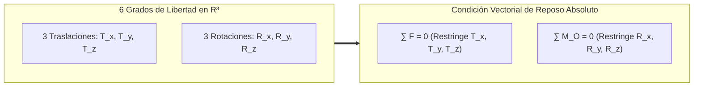
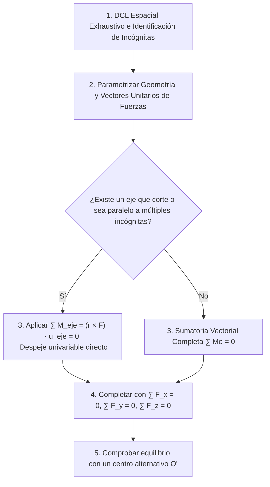
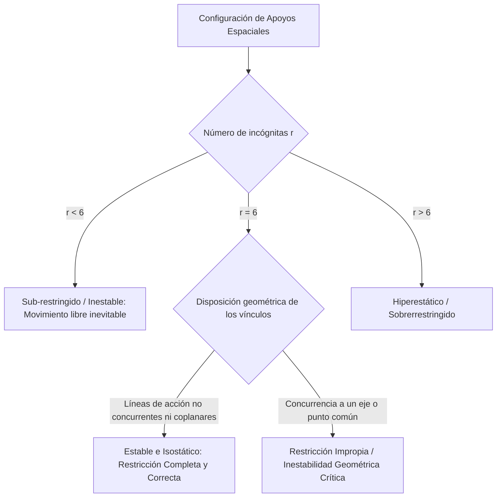

# Compendio de Repaso: Equilibrio en Tres Dimensiones

---

## 1. Condiciones Generales de Equilibrio Espacial

Un cuerpo rígido libre en el espacio tridimensional ($\mathbb{R}^3$) posee **seis grados de libertad (GDL)** independientes: tres traslaciones cartesianas ortogonales y tres rotaciones alrededor de dichos ejes:



---

### 1.1 Reacciones en Apoyos, Rótulas, Cojinetes y Conexiones en Tres Dimensiones

La regla física fundamental para modelar vínculos en el espacio establece que:
* **Si el enlace impide una traslación** en una dirección dada, se engendra una **fuerza de reacción** a lo largo de esa dirección.
* **Si el enlace impide una rotación** alrededor de un eje, se engendra un **momento de reacción (par resistente)** alrededor de dicho eje.

<div align="center">
  <svg width="620" height="230" viewBox="0 0 620 230" xmlns="http://www.w3.org/2000/svg">
    <!-- Marco de Cojinete Radial Simple -->
    <rect x="30" y="25" width="160" height="185" rx="8" fill="#f8fafc" stroke="#cbd5e1" stroke-width="1.5"/>
    <text x="110" y="48" fill="#0f172a" font-size="12" font-family="sans-serif" font-weight="bold" text-anchor="middle">Cojinete Radial (Eje x libre)</text>
    <path d="M 60,120 L 160,120" stroke="#64748b" stroke-width="14" stroke-linecap="round"/>
    <!-- Flechas de reacción Ry, Rz -->
    <line x1="110" y1="120" x2="110" y2="70" stroke="#dc2626" stroke-width="2.5"/>
    <polygon points="106,75 110,65 114,75" fill="#dc2626"/>
    <text x="118" y="75" fill="#dc2626" font-size="11" font-family="sans-serif" font-weight="bold">R_z</text>
    <line x1="110" y1="120" x2="155" y2="155" stroke="#dc2626" stroke-width="2.5"/>
    <polygon points="146,155 158,158 152,148" fill="#dc2626"/>
    <text x="160" y="160" fill="#dc2626" font-size="11" font-family="sans-serif" font-weight="bold">R_y</text>
    <text x="110" y="195" fill="#475569" font-size="10" font-family="sans-serif" text-anchor="middle">2 incógnitas de fuerza</text>
    <!-- Rótula Esférica (Ball and Socket) -->
    <rect x="230" y="25" width="160" height="185" rx="8" fill="#f8fafc" stroke="#cbd5e1" stroke-width="1.5"/>
    <text x="310" y="48" fill="#0f172a" font-size="12" font-family="sans-serif" font-weight="bold" text-anchor="middle">Rótula Esférica</text>
    <circle cx="310" cy="120" r="16" fill="#cbd5e1" stroke="#475569" stroke-width="2"/>
    <path d="M 310,120 L 310,170" stroke="#334155" stroke-width="6"/>
    <!-- Fuerzas Rx, Ry, Rz -->
    <line x1="310" y1="120" x2="310" y2="65" stroke="#2563eb" stroke-width="2.5"/>
    <polygon points="306,70 310,60 314,70" fill="#2563eb"/>
    <text x="318" y="70" fill="#2563eb" font-size="11" font-family="sans-serif" font-weight="bold">R_z</text>
    <line x1="310" y1="120" x2="365" y2="120" stroke="#2563eb" stroke-width="2.5"/>
    <polygon points="360,116 370,120 360,124" fill="#2563eb"/>
    <text x="372" y="124" fill="#2563eb" font-size="11" font-family="sans-serif" font-weight="bold">R_x</text>
    <line x1="310" y1="120" x2="270" y2="155" stroke="#2563eb" stroke-width="2.5"/>
    <polygon points="274,148 266,158 278,154" fill="#2563eb"/>
    <text x="255" y="165" fill="#2563eb" font-size="11" font-family="sans-serif" font-weight="bold">R_y</text>
    <text x="310" y="195" fill="#475569" font-size="10" font-family="sans-serif" text-anchor="middle">3 incógnitas de fuerza</text>
    <!-- Empotramiento Espacial Completo -->
    <rect x="430" y="25" width="160" height="185" rx="8" fill="#f8fafc" stroke="#cbd5e1" stroke-width="1.5"/>
    <text x="510" y="48" fill="#0f172a" font-size="12" font-family="sans-serif" font-weight="bold" text-anchor="middle">Empotramiento Fijo</text>
    <rect x="440" y="90" width="20" height="60" fill="#64748b"/>
    <line x1="460" y1="120" x2="560" y2="120" stroke="#334155" stroke-width="10"/>
    <!-- Fuerzas + Momentos -->
    <line x1="470" y1="120" x2="470" y2="70" stroke="#16a34a" stroke-width="2.5"/>
    <polygon points="466,75 470,65 474,75" fill="#16a34a"/>
    <line x1="470" y1="120" x2="520" y2="120" stroke="#16a34a" stroke-width="2.5"/>
    <polygon points="515,116 525,120 515,124" fill="#16a34a"/>
    <!-- Pares Reactivos -->
    <path d="M 465,100 A 15 15 0 1 1 480,110" fill="none" stroke="#7c3aed" stroke-width="2"/>
    <polygon points="483,107 483,114 476,112" fill="#7c3aed"/>
    <text x="510" y="195" fill="#475569" font-size="10" font-family="sans-serif" text-anchor="middle">6 incógnitas (3F + 3M)</text>
  </svg>
</div>

##### Taxonomía de Apoyos y Restricciones Espaciales

| Conexión / Vínculo Mecánico | Grados de Libertad Permitidos | Fuerzas de Reacción ($\mathbb{R}$) | Momentos de Reacción ($\mathbb{R}$) | Total Incógnitas |
| :--- | :--- | :--- | :--- | :---: |
| **Cable / Eslabón ligero** | 5 (3 Rotaciones + 2 Trasl.) | 1 fuerza colineal de tensión $\vec{T} = T \hat{u}$ | Ninguno | **1** |
| **Apoyo puntual sobre superficie lisa** | 5 (3 Rotaciones + 2 Trasl.) | 1 fuerza normal $\vec{N} = N \hat{n}$ | Ninguno | **1** |
| **Rodillo sobre riel guía bidireccional** | 4 (3 Rotaciones + 1 Trasl.) | 2 fuerzas ortogonales al riel | Ninguno | **2** |
| **Rótula esférica (*Ball-and-Socket*)**| 3 Rotaciones libres | 3 componentes ortogonales ($R_x, R_y, R_z$) | Ninguno | **3** |
| **Cojinete radial simple** (alineado al eje $x$) | 2 (1 Trasl. axial $x$ + 1 Rot. axial $x$) | 2 fuerzas radiales ($R_y, R_z$) | Ninguno* | **2** |
| **Cojinete radial con empuje (*Thrust Bearing*)** | 1 (Solo Rotación axial $x$) | 3 fuerzas ($R_x, R_y, R_z$) | Ninguno* | **3** |
| **Bisagra simple / Pasador espacial** | 1 (Rotación sobre el eje del pasador) | 3 fuerzas ($R_x, R_y, R_z$) | 2 momentos pares* | **5** (o 3*) |
| **Empotramiento rígido tridimensional** | 0 (Cuerpo totalmente inmovilizado) | 3 fuerzas ($R_x, R_y, R_z$) | 3 momentos pares ($M_x, M_y, M_z$) | **6** |

> [!NOTE]
> \* **Regla de Cojinetes y Bisagras Alineadas:** Cuando un cuerpo está sustentado por dos o más cojinetes/bisagras debidamente alineados sobre el mismo eje, los momentos reactivos de restricción flexionante ($M_y, M_z$) **no se introducen** en el modelo matemático. El par resistente es generado de forma natural por el brazo de palanca que separa a las fuerzas radiales transversales distribuidas en ambos apoyos.

---

### 1.2 Formulación Escalar y Vectorial de las Seis Ecuaciones de Equilibrio

Para que un cuerpo rígido permanezca en reposo absoluto bajo un sistema general de fuerzas $\vec{F}_i$ y pares concentrados $\vec{C}_j$, deben satisfacerse simultáneamente las dos condiciones de equilibrio de Newton-Euler:

$$
\sum \vec{F} = \vec{0} \qquad \text{y} \qquad \sum \vec{M}_O = \vec{0}
$$

Desarrollando vectorialmente respecto a un centro arbitrario $O$:
$$
\sum_{i=1}^n \vec{F}_i = \vec{0}
$$
$$
\sum_{i=1}^n (\vec{r}_i \times \vec{F}_i) + \sum_{j=1}^m \vec{C}_j = \vec{0}
$$

Descomponiendo en la base cartesiana ortonormal $\{\hat{i}, \hat{j}, \hat{k}\}$, se obtienen las **seis ecuaciones escalares independientes fundamentales**:

$$
\begin{cases}
\sum F_x = 0 \\
\sum F_y = 0 \\
\sum F_z = 0
\end{cases}
\qquad \text{y} \qquad
\begin{cases}
\sum M_x = \sum \left( y F_z - z F_y \right) + \sum C_x = 0 \\
\sum M_y = \sum \left( z F_x - x F_z \right) + \sum C_y = 0 \\
\sum M_z = \sum \left( x F_y - y F_x \right) + \sum C_z = 0
\end{cases}
$$

---

### 1.3 Técnicas Analíticas para la Solución Sistemática de Problemas 3D

Para evitar resolver sistemas algebraicos densos de $6 \times 6$, se debe emplear una estrategia de desacoplamiento secuencial mediante **momentos respecto a ejes estratégicos**:



#### Protocolo de Desacoplamiento Analítico:
1. **Definir vectores fuerza dirigidos mediante vectores de posición:**
   $$
   \vec{F} = F \cdot \hat{u}_{AB} = F \left( \frac{\vec{r}_B - \vec{r}_A}{\|\vec{r}_B - \vec{r}_A\|} \right)
   $$
2. **Selección del punto base para momentos ($\sum \vec{M}_O = \vec{0}$):** Elige un punto de apoyo $O$ donde confluyan la mayor cantidad de fuerzas de reacción desconocidas (por ejemplo, una rótula esférica elimina de inmediato 3 incógnitas de traslación).
3. **Equilibrio de momento proyectado respecto a un eje ($L$):**
   $$
   \sum M_L = \sum \left[ (\vec{r} \times \vec{F}) \cdot \hat{u}_L \right] = 0
   $$
   *Recordatorio operativo:* Toda fuerza cuya línea de acción **corte al eje $L$** o sea **paralela al eje $L$** genera momento nulo y se elimina automáticamente de la ecuación.

---

## 2. Casos Especiales y Análisis de Vínculos

### 2.1 Casos Especiales de Equilibrio en el Espacio

#### A. Elementos Sometidos a Dos Fuerzas (Bielas / Eslabones Espaciales)
Si sobre un cuerpo rígido actúan únicamente dos fuerzas concentradas en los puntos $A$ y $B$:
$$
\sum \vec{F} = \vec{F}_A + \vec{F}_B = \vec{0} \implies \vec{F}_B = -\vec{F}_A
$$
Tomando momentos respecto a $A$:
$$
\sum \vec{M}_A = \vec{r}_{B/A} \times \vec{F}_B = \vec{0} \implies \vec{r}_{B/A} \parallel \vec{F}_B
$$
* **Propiedad Invariable:** Las dos fuerzas deben tener exactamente la **misma magnitud**, actuar sobre la **misma línea de acción** que une los puntos de aplicación $A$ y $B$, y poseer **sentidos opuestos** (tracción pura o compresión pura). No admiten momentos flectores ni cortantes.

#### B. Elementos Sometidos a Tres Fuerzas en el Espacio
Si un cuerpo se encuentra en equilibrio bajo la acción exclusiva de tres fuerzas aplicadas en puntos no coincidentes ($\vec{F}_1 + \vec{F}_2 + \vec{F}_3 = \vec{0}$):
1. **Coplanaridad:** Las tres líneas de acción deben ser rigurosamente **coplanares** (yacer en un mismo plano geométrico bidimensional).
2. **Concurrencia o Paralelismo:** Las líneas de acción deben ser **concurrentes** en un punto común $P$ ($\vec{r}_{P} \times \vec{F}_i = \vec{0}$) o ser **estrictamente paralelas** entre sí.

> [!WARNING]
> No es posible el equilibrio estático de tres fuerzas si sus líneas de acción son alabeadas (rectas en el espacio que se cruzan sin cortarse ni ser paralelas).

---

### 2.2 Estabilidad y Restricción Completa (Vínculos Propios e Impropios)

Para que un cuerpo rígido esté completamente restringido contra cualquier movimiento de cuerpo rígido inducido por cualquier sistema general de cargas, sus apoyos deben configurarse de manera cinemáticamente cinemática adecuada.



#### Modos Críticos de Restricción Impropia (Inestabilidad en 3D con $r \ge 6$):
1. **Concurrencia de Todas las Fuerzas a una Recta Común:** Si las líneas de acción de todas las fuerzas de reacción intersectan una misma recta $L$, la sumatoria de momentos sobre dicho eje es idénticamente nula ($\sum M_L \equiv 0$). El cuerpo puede **rotar libremente alrededor del eje $L$** ante la menor componente de carga externa desbalanceada.
2. **Sistemas de Reacciones Paralelas:** Si todas las reacciones de apoyo son paralelas a un vector unitario $\hat{u}$, el cuerpo carece de equilibrio traslacional perpendicular a $\hat{u}$ y no ofrece resistencia contra giros ortogonales.

---

### 2.3 Análisis de Grados de Libertad e Indeterminación Estática

Sea $r$ el número total de reacciones escalares independientes suministradas por los apoyos de un sólido rígido simple en el espacio:

$$
\text{Grado de Indeterminación Estática: } GH = r - 6
$$

| Condición | Clasificación Estática | Estabilidad Cinemática | Resolubilidad con Estática Clásica |
| :---: | :--- | :--- | :--- |
| **$r < 6$** | **Subestático** (Parcialmente restringido) | **Inestable:** Posee al menos $6 - r$ grados de libertad desprovistos de soporte. | No resoluble para cargas generales. |
| **$r = 6$** | **Isostático** (Estáticamente determinado) | **Estable** (si no existen vínculos impropios colineales o concurrentes). | **Completamente resoluble:** Sistema lineal desacoplable de $6 \times 6$ con solución única ($\det(\mathbf{A}) \neq 0$). |
| **$r > 6$** | **Hiperestático** (Estáticamente indeterminado) | **Estable y Sobrerrestringido:** Posee apoyos redundantes. | **No resoluble solo con estática:** Requiere ecuaciones de compatibilidad geométrica de deformación (Ley de Hooke, elasticidad). |

---

## 3. Implementación: Solucionador Matricial de Equilibrio Espacial ($6 \times 6$)

El siguiente script en Python emplea `numpy` para resolver el sistema algebraico lineal acoplado $[\mathbf{A}]\vec{X} = \vec{B}$ correspondiente a las seis ecuaciones de equilibrio vectorial para un cuerpo rígido sustentado en el espacio.

```python
import numpy as np

def resolver_equilibrio_3d(
    posiciones_reacciones: list, 
    direcciones_reacciones: list, 
    fuerzas_cargas: list, 
    posiciones_cargas: list, 
    momentos_pares: list = None
) -> np.ndarray:
    """
    Resuelve las magnitudes de 6 reacciones de apoyo independientes en el espacio 3D.
    
    :param posiciones_reacciones: Lista de 6 arreglos [x, y, z] con puntos de aplicación.
    :param direcciones_reacciones: Lista de 6 vectores directores unitarios [ux, uy, uz] de cada reacción.
    :param fuerzas_cargas: Lista de vectores de carga externa [Fx, Fy, Fz] en Newtons.
    :param posiciones_cargas: Lista de puntos [x, y, z] de aplicación de cada carga externa.
    :param momentos_pares: Lista de momentos libres aplicados [Mx, My, Mz] en N*m.
    :return: Vector con las 6 magnitudes de reacción [R1, R2, R3, R4, R5, R6].
    """
    if len(posiciones_reacciones) != 6 or len(direcciones_reacciones) != 6:
        raise ValueError("Un sistema isostático espacial 3D requiere exactamente 6 incógnitas de apoyo.")

    # Matriz de coeficientes A (6x6) y vector de términos independientes B (6x1)
    A = np.zeros((6, 6))
    B = np.zeros(6)

    # Construcción de la matriz A:
    # Filas 0, 1, 2: Sumatoria de Fuerzas (Fx, Fy, Fz)
    # Filas 3, 4, 5: Sumatoria de Momentos respecto al origen O(0,0,0) (Mx, My, Mz)
    for j in range(6):
        r_apoyo = np.array(posiciones_reacciones[j], dtype=float)
        u_dir = np.array(direcciones_reacciones[j], dtype=float)
        u_unit = u_dir / np.linalg.norm(u_dir)

        # Contribución a fuerzas
        A[0:3, j] = u_unit
        
        # Contribución a momentos respecto a (0,0,0): r x u
        m_apoyo = np.cross(r_apoyo, u_unit)
        A[3:6, j] = m_apoyo

    # Construcción del vector B (Acciones exteriores cambiadas de signo para pasar al lado derecho)
    # sum(F_reactivas) = - sum(F_externas)
    f_ext_total = np.zeros(3)
    m_ext_total = np.zeros(3)

    for F, r_f in zip(fuerzas_cargas, posiciones_cargas):
        F_arr = np.array(F, dtype=float)
        r_arr = np.array(r_f, dtype=float)
        f_ext_total += F_arr
        m_ext_total += np.cross(r_arr, F_arr)

    if momentos_pares is not None:
        for C in momentos_pares:
            m_ext_total += np.array(C, dtype=float)

    B[0:3] = -f_ext_total
    B[3:6] = -m_ext_total

    # Verificación de indeterminación o inestabilidad geométrica (det(A) ~ 0)
    det_A = np.linalg.det(A)
    print(f"Determinante de la matriz de rigidez estática det(A) = {det_A:.4e}")
    if np.isclose(det_A, 0.0, atol=1e-8):
        raise np.linalg.LinAlgError("Restricción impropia detectada: det(A) = 0. El sistema es cinemáticamente inestable.")

    # Resolución del sistema lineal A * X = B
    reacciones = np.linalg.solve(A, B)
    return reacciones


if __name__ == "__main__":
    # CASO PRÁCTICO:
    # Placa horizontal sustentada por una rótula esférica en A(0,0,0) [3 reacciones: R_Ax, R_Ay, R_Az],
    # un rodillo en B(2,0,0) con reacción normal en z [1 reacción: R_Bz],
    # y dos tirantes de cable verticales en C(2,3,0) [R_Cz] y D(0,3,0) [R_Dz].
    # Carga puntual exterior: F = [0, 0, -1200] N aplicada en P(1, 1.5, 0)
    
    pos_reac = [
        [0.0, 0.0, 0.0],  # R_Ax
        [0.0, 0.0, 0.0],  # R_Ay
        [0.0, 0.0, 0.0],  # R_Az
        [2.0, 0.0, 0.0],  # R_Bz
        [2.0, 3.0, 0.0],  # R_Cz
        [0.0, 3.0, 0.0]   # R_Dz
    ]

    dir_reac = [
        [1.0, 0.0, 0.0],  # En dirección +x
        [0.0, 1.0, 0.0],  # En dirección +y
        [0.0, 0.0, 1.0],  # En dirección +z
        [0.0, 0.0, 1.0],  # En dirección +z
        [0.0, 0.0, 1.0],  # En dirección +z
        [0.0, 0.0, 1.0]   # En dirección +z
    ]

    cargas_F = [[0.0, 0.0, -1200.0]]
    pos_cargas = [[1.0, 1.5, 0.0]]

    R = resolver_equilibrio_3d(pos_reac, dir_reac, cargas_F, pos_cargas)

    nombres_reac = ["R_Ax", "R_Ay", "R_Az", "R_Bz", "R_Cz", "R_Dz"]
    print("\nResultados de Reacciones de Apoyo en Equilibrio 3D:")
    for nom, val in zip(nombres_reac, R):
        print(f"{nom:6s} = {val:10.2f} N")
```