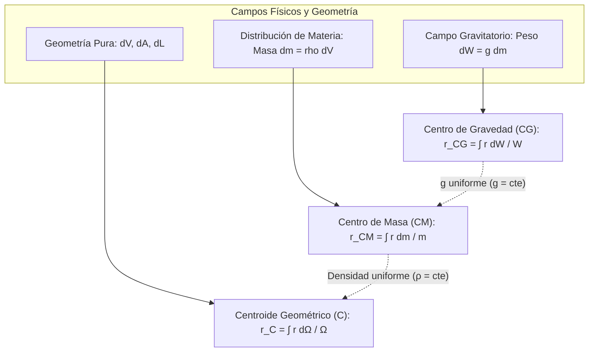
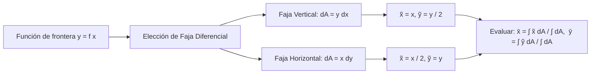
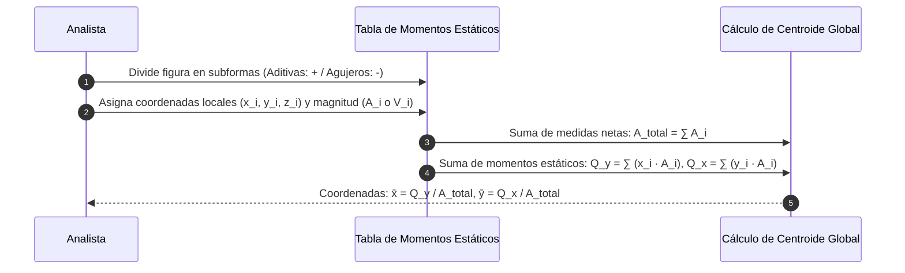

# Compendio de Repaso: Centros de Gravedad, Centro de Masa y Centroides

---

## 1. Conceptos Fundamentales de Localización de Masa y Peso

La interacción gravitacional y la inercia distribuidas a lo largo de la materia continua de un cuerpo rígido pueden reducirse a un único punto geométrico de aplicación efectiva según la naturaleza del campo físico considerado.



---

### 1.1 Centro de Gravedad (CG) y Centro de Masa (CM) de un Cuerpo Rígido

#### A. Centro de Gravedad (CG)
El **Centro de Gravedad** es el punto espacial donde se considera concentrado el peso total $\vec{W}$ de un cuerpo respecto a los efectos rotacionales y traslacionales que produce el campo gravitatorio terrestre.

* **Fuerza total (Peso):**
  $$
  W = \int dW = \int g(\vec{r}) \, dm
  $$
* **Principio de Momentos:** El momento del peso total concentrado en $\vec{r}_{CG}$ respecto a un origen arbitrario $O$ debe igualar la suma integral de los momentos producidos por los diferenciales de peso elementales:
  $$
  \vec{r}_{CG} \times \vec{W} = \int \left( \vec{r} \times d\vec{W} \right)
  $$
  Para un campo gravitatorio de aceleración vectorial uniforme y paralela $\vec{g} = -g \hat{k}$:
  $$
  \vec{r}_{CG} = \frac{\int \vec{r} \, dW}{W}
  $$
  Descompuesto en coordenadas cartesianas escalares:
  $$
  x_{CG} = \frac{\int x \, dW}{W}, \qquad y_{CG} = \frac{\int y \, dW}{W}, \qquad z_{CG} = \frac{\int z \, dW}{W}
  $$

---

#### B. Centro de Masa (CM)
El **Centro de Masa** es una propiedad inercial intrínseca del cuerpo, independiente de la presencia de cualquier campo de fuerzas gravitacionales externo.

* **Masa total:**
  $$
  m = \int dm = \int_{\forall} \rho(\vec{r}) \, dV
  $$
  donde $\rho(\vec{r})$ es la densidad de masa volumétrica local.
* **Vector de Posición del CM:**
  $$
  \vec{r}_{CM} = \frac{\int \vec{r} \, dm}{m} = \frac{\int_{\forall} \vec{r} \, \rho(\vec{r}) \, dV}{\int_{\forall} \rho(\vec{r}) \, dV}
  $$
  En coordenadas escalares cartesianas:
  $$
  x_{CM} = \frac{\int x \, dm}{m}, \qquad y_{CM} = \frac{\int y \, dm}{m}, \qquad z_{CM} = \frac{\int z \, dm}{m}
  $$

> [!NOTE]
> **Condición de Coincidencia (CG $\equiv$ CM):**
> El Centro de Gravedad coincide exactamente con el Centro de Masa si y solo si el campo gravitacional $\vec{g}$ es **estrictamente uniforme** en magnitud y dirección a lo largo de toda la extensión espacial del cuerpo. Esta hipótesis es válida con precisión ingenieril en estructuras civiles y maquinaria terrestre ($H \ll R_{\text{tierra}}$). En cuerpos de dimensiones orbitales o astronómicas (satélites extensos, asteroides), el gradiente gravitacional rompe esta identidad, generando momentos de gradiente gravitatorio.

---

### 1.2 Centroide Geométrico: Volúmenes, Superficies y Líneas

El **Centroide** ($C$) representa el centro geométrico medio de una región formal abstracta. Coincide con el CM cuando el cuerpo está compuesto por un material homogéneo e isótropo (densidad constante: $\rho = \text{cte}$).

<div align="center">
  <svg width="600" height="170" viewBox="0 0 600 170" xmlns="http://www.w3.org/2000/svg">
    <!-- Línea / Alambre -->
    <rect x="20" y="20" width="165" height="135" rx="8" fill="#f8fafc" stroke="#cbd5e1" stroke-width="1.5"/>
    <text x="102" y="42" fill="#0f172a" font-size="12" font-family="sans-serif" font-weight="bold" text-anchor="middle">Línea (1D)</text>
    <path d="M 40,120 Q 90,40 160,110" fill="none" stroke="#2563eb" stroke-width="3"/>
    <circle cx="102" cy="85" r="4" fill="#dc2626"/>
    <text x="102" y="103" fill="#dc2626" font-size="11" font-family="sans-serif" font-weight="bold" text-anchor="middle">C (x̄, ȳ, z̄)</text>
    <text x="102" y="140" fill="#64748b" font-size="10" font-family="sans-serif" text-anchor="middle">dL = √(dx²+dy²+dz²)</text>

    <!-- Área / Superficie -->
    <rect x="215" y="20" width="165" height="135" rx="8" fill="#f8fafc" stroke="#cbd5e1" stroke-width="1.5"/>
    <text x="297" y="42" fill="#0f172a" font-size="12" font-family="sans-serif" font-weight="bold" text-anchor="middle">Superficie (2D)</text>
    <path d="M 235,115 C 250,60 330,50 360,105 C 330,135 260,135 235,115 Z" fill="#dbeafe" stroke="#0284c7" stroke-width="2"/>
    <circle cx="295" cy="98" r="4" fill="#dc2626"/>
    <text x="295" y="116" fill="#dc2626" font-size="11" font-family="sans-serif" font-weight="bold" text-anchor="middle">C (x̄, ȳ, z̄)</text>
    <text x="297" y="140" fill="#64748b" font-size="10" font-family="sans-serif" text-anchor="middle">dA = dx dy  o  dA = r dr dθ</text>

    <!-- Volumen -->
    <rect x="410" y="20" width="170" height="135" rx="8" fill="#f8fafc" stroke="#cbd5e1" stroke-width="1.5"/>
    <text x="495" y="42" fill="#0f172a" font-size="12" font-family="sans-serif" font-weight="bold" text-anchor="middle">Volumen (3D)</text>
    <ellipse cx="495" cy="95" rx="55" ry="32" fill="#e2e8f0" stroke="#475569" stroke-width="2"/>
    <path d="M 440,95 A 55 18 0 0 0 550,95" fill="none" stroke="#64748b" stroke-width="1.5" stroke-dasharray="3,3"/>
    <circle cx="495" cy="95" r="4" fill="#dc2626"/>
    <text x="495" y="113" fill="#dc2626" font-size="11" font-family="sans-serif" font-weight="bold" text-anchor="middle">C (x̄, ȳ, z̄)</text>
    <text x="495" y="140" fill="#64748b" font-size="10" font-family="sans-serif" text-anchor="middle">dV = dx dy dz</text>
  </svg>
</div>

##### Tabla Sinóptica de Formulación Integral por Dimensión

| Dimensión | Dominio ($\Omega$) | Medida Diferencial ($d\Omega$) | Primer Momento ($Q$) | Coordenada Centroidal ($\bar{x}_i$) |
| :--- | :---: | :--- | :--- | :--- |
| **Línea (1D)** | Longitud total $L$ | $dL = \sqrt{1 + [f'(x)]^2} \, dx$ | $Q_L = \int_L x_i \, dL$ | $\bar{x}_i = \frac{\int_L x_i \, dL}{L}$ |
| **Área Plana (2D)** | Área total $A$ | $dA = dx \, dy = y \, dx$ (faja) | $Q_y = \int_A x \, dA$<br>$Q_x = \int_A y \, dA$ | $\bar{x} = \frac{Q_y}{A}, \quad \bar{y} = \frac{Q_x}{A}$ |
| **Superficie Curva (2D)** | Área alabeada $A$ | $dA = \sqrt{1 + \left(\frac{\partial z}{\partial x}\right)^2 + \left(\frac{\partial z}{\partial y}\right)^2} dx dy$ | $Q_k = \int_A x_k \, dA$ | $\bar{x}_k = \frac{\int_A x_k \, dA}{A}$ |
| **Volumen (3D)** | Volumen total $V$ | $dV = dx \, dy \, dz$ | $Q_{jk} = \int_V x_i \, dV$ | $\bar{x}_i = \frac{\int_V x_i \, dV}{V}$ |

---

## 2. Métodos de Cálculo y Teoremas Geométricos

### 2.1 Determinación de Centroides por Integración Directa

Para resolver analíticamente las integrales centroidales, se selecciona un elemento diferencial de orden inferior al orden completo de la región (utilizando elementos tipo faja vertical, horizontal, disco o cascarón cilíndrico) identificando con rigor el **centroide del elemento diferencial** $(\tilde{x}, \tilde{y}, \tilde{z})$.



#### Reglas de Elección del Diferencial:
1. **Faja Vertical Plana:**
   * Área: $dA = [y_2(x) - y_1(x)] \, dx$
   * Centroide del diferencial: $\tilde{x} = x$, $\tilde{y} = \frac{y_2(x) + y_1(x)}{2}$
2. **Faja Horizontal Plana:**
   * Área: $dA = [x_2(y) - x_1(y)] \, dy$
   * Centroide del diferencial: $\tilde{x} = \frac{x_2(y) + x_1(y)}{2}$, $\tilde{y} = y$

> [!WARNING]
> En la integral $\int \tilde{y} \, dA$ empleando una faja vertical, **no se debe escribir** $\int y \, (y \, dx)$. El integrando correcto es $\tilde{y} \, dA = \left(\frac{y}{2}\right) (y \, dx) = \frac{1}{2} y^2 \, dx$. Olvidar el factor $\frac{1}{2}$ duplica erróneamente el momento estático.

---

### 2.2 Método de Cuerpos y Figuras Compuestas

Cuando una geometría puede subdividirse en un conjunto discreto de $n$ subfiguras canónicas (rectángulos, triángulos, círculos, prismas, cilindros) cuyos centroides y medidas son conocidos a priori:



#### Ecuaciones Discretas de Centroides Compuestos:
$$
\bar{x} = \frac{\sum_{i=1}^n \tilde{x}_i \Omega_i}{\sum_{i=1}^n \Omega_i}, \qquad \bar{y} = \frac{\sum_{i=1}^n \tilde{y}_i \Omega_i}{\sum_{i=1}^n \Omega_i}, \qquad \bar{z} = \frac{\sum_{i=1}^n \tilde{z}_i \Omega_i}{\sum_{i=1}^n \Omega_i}
$$
donde $\Omega_i \in \{L_i, A_i, V_i, m_i, W_i\}$.

##### Convención Rigurosa de Signos para Cavidades y Sustracciones:
* **Material macizo añadido:** $\Omega_i > 0$
* **Huecos, cavidades, perforaciones o vacíos suprimidos:** $\Omega_i < 0$

##### Geometrías Canónicas Bidimensionales de Referencia Rápida

| Geometría | Dimensiones | Área ($A$) | Centroide ($\bar{x}, \bar{y}$) |
| :--- | :--- | :---: | :---: |
| **Rectángulo** | Base $b$, Altura $h$ | $b h$ | $\left(\frac{b}{2}, \, \frac{h}{2}\right)$ |
| **Triángulo Rectángulo** | Base $b$, Altura $h$ | $\frac{1}{2} b h$ | $\left(\frac{b}{3}, \, \frac{h}{3}\right)$ medido desde el ángulo recto |
| **Sector Circular** | Radio $R$, Semi-ángulo $\alpha$ (rad) | $\alpha R^2$ | $\bar{x} = \frac{2 R \sin\alpha}{3 \alpha}, \quad \bar{y} = 0$ (sobre eje de simetría) |
| **Semicírculo** | Radio $R$ | $\frac{\pi R^2}{2}$ | $\bar{x} = 0, \quad \bar{y} = \frac{4R}{3\pi} \approx 0.4244 R$ |
| **Arco Semicircular (1D)** | Radio $R$ | Longitud: $\pi R$ | $\bar{x} = 0, \quad \bar{y} = \frac{2R}{\pi} \approx 0.6366 R$ |

---

### 2.3 Teoremas de Pappus-Guldinus

Los teoremas enunciados por Pappus de Alejandría (ca. 300 d.C.) y reformulados por Paul Guldin (1635) relacionan los centroides de líneas y áreas planas con las áreas y volúmenes generados por su revolución espacial alrededor de un eje coplanar no secante.

#### Primer Teorema de Pappus-Guldinus (Superficies de Revolución)
> *"El área $A$ de una superficie de revolución engendrada al hacer girar una curva plana continua alrededor de un eje coplanar que no corta a la curva es igual a la longitud de la curva $L$ multiplicada por la distancia total recorrida por su centroide durante la rotación."*

$$
A = \theta \cdot \bar{r} \cdot L
$$
Para una revolución completa en un giro de $\theta = 2\pi$ radianes:
$$
A = 2\pi \, \bar{r} \, L
$$
donde $\bar{r}$ es la distancia perpendicular medida desde el eje de rotación hasta el centroide de la línea generatriz.

<div align="center">
  <svg width="420" height="180" viewBox="0 0 420 180" xmlns="http://www.w3.org/2000/svg">
    <!-- Eje de revolución -->
    <line x1="60" y1="15" x2="60" y2="165" stroke="#0f172a" stroke-width="2.5" stroke-dasharray="6,4"/>
    <text x="45" y="25" fill="#0f172a" font-size="12" font-family="sans-serif" font-weight="bold">Eje</text>
    
    <!-- Curva generatriz -->
    <path d="M 220,40 Q 280,85 240,135" fill="none" stroke="#2563eb" stroke-width="3"/>
    <text x="265" y="75" fill="#2563eb" font-size="12" font-family="sans-serif" font-weight="bold">Curva (L)</text>
    
    <!-- Centroide de la línea -->
    <circle cx="243" cy="85" r="4" fill="#dc2626"/>
    <text x="253" y="90" fill="#dc2626" font-size="11" font-family="sans-serif" font-weight="bold">C_L</text>
    
    <!-- Radio r_bar -->
    <line x1="60" y1="85" x2="243" y2="85" stroke="#dc2626" stroke-width="1.5" stroke-dasharray="3,3"/>
    <text x="145" y="78" fill="#dc2626" font-size="12" font-family="sans-serif" font-weight="bold">r̄</text>

    <!-- Arco de revolución -->
    <path d="M 243,85 A 183 25 0 0 1 100,107" fill="none" stroke="#7c3aed" stroke-width="2"/>
    <polygon points="98,103 92,109 100,111" fill="#7c3aed"/>
    <text x="120" y="130" fill="#7c3aed" font-size="11" font-family="sans-serif">Trayectoria 2π r̄</text>
  </svg>
</div>

#### Segundo Teorema de Pappus-Guldinus (Volúmenes de Revolución)
> *"El volumen $V$ de un cuerpo de revolución engendrado al hacer girar un área plana continua alrededor de un eje coplanar que no corta al área es igual a dicha área $A$ multiplicada por la distancia total recorrida por su centroide durante la rotación."*

$$
V = \theta \cdot \bar{r} \cdot A
$$
Para una revolución completa en un giro de $\theta = 2\pi$ radianes:
$$
V = 2\pi \, \bar{r} \, A
$$
donde $\bar{r}$ es la distancia perpendicular medida desde el eje de revolución hasta el centroide de la superficie generatriz.

> [!TIP]
> **Cálculo Inverso de Centroides Complejos:** Si conoces a priori el volumen o superficie de un sólido por geometría analítica elemental (por ejemplo, una esfera o un toroide), puedes despejar directamente la coordenada del centroide de su figura generatriz sin necesidad de integrar:
> $$
> \bar{r} = \frac{V}{2\pi A} \qquad \text{o} \qquad \bar{r} = \frac{A_{\text{sup}}}{2\pi L}
> $$

---

### 2.4 Aplicaciones Prácticas en Ingeniería: Presión Hidrostática y Sobrecargas

#### A. Centro de Presiones y Distribución Hidrostática
En la mecánica de fluidos y estructuras de contención (represas, diques, compuertas), la distribución triangular de presiones $p(h) = \gamma h$ sobre un muro vertical induce una fuerza de empuje equivalente calculada a través del centroide del **prisma de carga**:

* El prisma de presión que actúa sobre una compuerta plana rectangular vertical de ancho $b$ y profundidad $H$ es un cuerpo tridimensional triangular de volumen:
  $$
  F_R = V_{\text{prisma}} = \frac{1}{2} (\gamma H) \cdot (H \cdot b) = \frac{1}{2} \gamma b H^2
  $$
* El punto de aplicación de este empuje resultante (el centro de presiones $y_p$) corresponde a la **proyección vertical del centroide del prisma de carga**:
  $$
  y_p = \frac{2}{3} H \quad \text{(medido desde la superficie libre)} \iff h_p = \frac{1}{3} H \quad \text{(desde la base)}
  $$

#### B. Sobrecargas en Cimentaciones y Vigas Continuas
Para losas, zapatas corridas y vigas continuas sometidas a sobrecargas geotécnicas o de tráfico modeladas como funciones de densidad de carga $q(x)$:
* La carga concentrada total equivalente es el volumen bajo el perfil superficial de sobrecarga: $R = \int q(x) dx$.
* La línea de acción de la resultante de cargas se ubica directamente sobre la vertical que cruza el centroide del área de carga, simplificando el cálculo de asientos elásticos y diagramas de momento flector.

---

## 3. Implementación: Cálculo Numérico de Centroides (Compuestos y Pappus)

El siguiente script en Python utiliza `numpy` para resolver centroides de figuras compuestas generales (con soporte de cavidades mediante signo negativo) y valida volúmenes/áreas de revolución aplicando los Teoremas de Pappus-Guldinus.

```python
import numpy as np
from typing import List, Dict, Tuple

def centroide_figura_compuesta(partes: List[Dict[str, float]]) -> Tuple[float, float, float]:
    """
    Calcula el centroide global (x̄, ȳ) y el área neta de una figura compuesta 2D.
    
    Cada elemento en 'partes' debe ser un diccionario con:
      - 'area': Área geométrica positiva; si es un hueco/agujero, usar valor negativo.
      - 'x': Coordenada x del centroide de la parte.
      - 'y': Coordenada y del centroide de la parte.
    """
    area_total = 0.0
    Q_y = 0.0  # Primer momento respecto al eje Y (∫ x dA)
    Q_x = 0.0  # Primer momento respecto al eje X (∫ y dA)

    for parte in partes:
        a = parte['area']
        x = parte['x']
        y = parte['y']

        area_total += a
        Q_y += x * a
        Q_x += y * a

    if np.isclose(area_total, 0.0):
        raise ValueError("El área neta no puede ser nula.")

    x_barra = Q_y / area_total
    y_barra = Q_x / area_total

    return x_barra, y_barra, area_total


def pappus_guldinus_revolucion(
    medida_generatriz: float, 
    distancia_r_barra: float, 
    angulo_rad: float = 2 * np.pi, 
    es_volumen: bool = True
) -> float:
    """
    Aplica los Teoremas de Pappus-Guldinus.
    
    :param medida_generatriz: Área plana A (para volumen) o Longitud L (para superficie).
    :param distancia_r_barra: Distancia perpendicular del centroide al eje de rotación (r̄ >= 0).
    :param angulo_rad: Ángulo de revolución en radianes (por defecto 2π para revolución completa).
    :param es_volumen: True calcula volumen de revolución; False calcula área superficial.
    :return: Volumen V o Área superficial A generada.
    """
    if distancia_r_barra < 0:
        raise ValueError("La distancia centroidal al eje r̄ debe ser no negativa.")
        
    return angulo_rad * distancia_r_barra * medida_generatriz


if __name__ == "__main__":
    # CASO PRÁCTICO 1: Placa con perforación circular
    # Rectángulo macizo de base 120 mm, altura 80 mm centrado con vértice inferior en (0,0)
    # Perforación circular (hueco) de radio R = 20 mm ubicada en (40, 40) mm
    area_rect = 120.0 * 80.0
    x_rect, y_rect = 60.0, 40.0

    area_hueco = -np.pi * (20.0 ** 2)
    x_hueco, y_hueco = 40.0, 40.0

    geometria = [
        {'area': area_rect, 'x': x_rect, 'y': y_rect},
        {'area': area_hueco, 'x': x_hueco, 'y': y_hueco}
    ]

    x_c, y_c, a_neta = centroide_figura_compuesta(geometria)
    print("--- Cálculo de Centroide de Figura Compuesta ---")
    print(f"Área Neta: {a_neta:.2f} mm²")
    print(f"Coordenadas del Centroide: x̄ = {x_c:.4f} mm, ȳ = {y_c:.4f} mm\n")

    # CASO PRÁCTICO 2: Teoremas de Pappus-Guldinus
    # Toroide de sección circular con radio menor r = 10 mm y radio mayor R = 50 mm
    # Eje de revolución sobre el eje Y (x = 0)
    # 1. Área superficial del toroide: generado por circunferencia generatriz (L = 2πr)
    # 2. Volumen del toroide: generado por círculo generatriz (A = πr²)
    r_menor = 10.0
    R_medio = 50.0  # Corresponde a r̄ respecto al eje de giro

    longitud_circunferencia = 2.0 * np.pi * r_menor
    area_circulo = np.pi * (r_menor ** 2)

    area_sup_toro = pappus_guldinus_revolucion(longitud_circunferencia, R_medio, es_volumen=False)
    volumen_toro = pappus_guldinus_revolucion(area_circulo, R_medio, es_volumen=True)

    print("--- Teoremas de Pappus-Guldinus (Toroide) ---")
    print(f"Área Superficial generada (2π · R · L): {area_sup_toro:.2f} mm²")
    print(f"Volumen de revolución generado (2π · R · A): {volumen_toro:.2f} mm³")
```