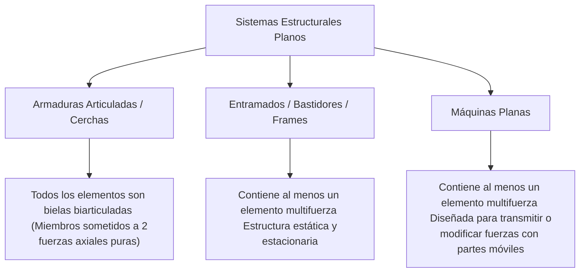
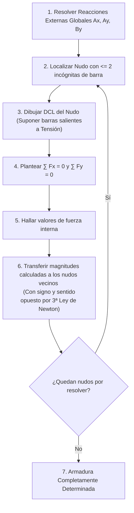

# Compendio de Repaso: Introducción a la Mecánica Estructural

---

## 1. Clasificación y Análisis de Sistemas Estructurales Planos

Una estructura es un ensamblaje físico de elementos mecánicos interconectados, diseñado para soportar cargas exteriores aplicadas y transmitirlas con seguridad a los cimientos o apoyos.



---

### 1.1 Definición y Tipología Estructural

#### A. Armaduras Articuladas (Trusses / Cerchas)
Estructura reticular formada por barras rectas unidas entre sí en sus extremos por uniones articuladas ideales (**nudos** o pasadores sin fricción).

##### Hipótesis de Cálculo de la Armadura Ideal:
1. **Cargas exclusivamente en los nudos:** Ninguna carga actúa directamente en el tramo intermedio de una barra (el peso propio de las barras se desprecia o se asigna en mitades equivalentes a los dos nudos extremos).
2. **Nudos articulados sin rozamiento:** Las barras giran libremente en los nudos; no transmiten momentos flectores ($M = 0$) ni esfuerzos cortantes ($V = 0$).
3. **Comportamiento axial puro:** Toda barra trabaja como un **miembro de dos fuerzas**, sometido únicamente a **tensión pura** o **compresión pura**.

```
Tensión (T > 0):    [Nudo] <-- (Barra traccionada se estira) --> [Nudo]
Compresión (C < 0): [Nudo] --> (Barra comprimida se acorta) <-- [Nudo]
```

> [!NOTE]
> **Convención de Signos Estándar:**
> Al plantear el equilibrio de un nudo, se asume que todas las barras desconocidas están sometidas a **tensión** (las fuerzas vectoriales "tiran" alejándose del nudo). Si el valor algebraico resultante es positivo ($+$), la barra está en **tensión ($T$)**; si resulta negativo ($-$), la barra está en **compresión ($C$)**.

#### B. Entramados o Bastidores (Frames)
Estructuras diseñadas para permanecer en reposo que contienen **al menos un elemento sometido a múltiples fuerzas** (miembro multifuerza). Un elemento multifuerza recibe fuerzas en tres o más puntos de su longitud, o soporta cargas intermedias distribuidas y momentos aplicados directos, desarrollando flexión interna ($M$) y cortante ($V$).

#### C. Máquinas Planas (Machines)
Sistemas estructurales que contienen partes articuladas móviles y al menos un elemento multifuerza. A diferencia de los bastidores, su función operativa principal no es sustentar cargas estacionarias, sino transformar, multiplicar o alterar la dirección de fuerzas de entrada en fuerzas de salida deseadas (ejemplos: alicates, llaves de apriete, gatos mecánicos).

---

### 1.2 Determinación de las Reacciones Externas en Apoyos y Ligaduras

El análisis estático global evalúa la armadura o pórtico como un **único cuerpo rígido**. Se sustituyen las ligaduras de contorno por sus respectivas fuerzas y pares reactivos de apoyo:

$$
\begin{cases}
\sum F_x = 0 \\
\sum F_y = 0 \\
\sum M_O = 0
\end{cases}
$$

<div align="center">
  <svg width="480" height="180" viewBox="0 0 480 180" xmlns="http://www.w3.org/2000/svg">
    <!-- Barras de armadura simple -->
    <polygon points="60,130 200,40 340,130" fill="none" stroke="#334155" stroke-width="4"/>
    <line x1="60" y1="130" x2="340" y2="130" stroke="#334155" stroke-width="4"/>
    <line x1="200" y1="40" x2="200" y2="130" stroke="#334155" stroke-width="3"/>
    
    <!-- Nudos -->
    <circle cx="60" cy="130" r="5" fill="#0f172a"/>
    <text x="45" y="145" fill="#0f172a" font-size="12" font-family="sans-serif" font-weight="bold">A</text>
    <circle cx="200" cy="40" r="5" fill="#0f172a"/>
    <text x="195" y="25" fill="#0f172a" font-size="12" font-family="sans-serif" font-weight="bold">B</text>
    <circle cx="340" cy="130" r="5" fill="#0f172a"/>
    <text x="350" y="145" fill="#0f172a" font-size="12" font-family="sans-serif" font-weight="bold">C</text>
    <circle cx="200" cy="130" r="4" fill="#0f172a"/>
    <text x="195" y="150" fill="#0f172a" font-size="11" font-family="sans-serif">D</text>

    <!-- Carga en B -->
    <line x1="200" y1="5" x2="200" y2="35" stroke="#dc2626" stroke-width="3"/>
    <polygon points="196,30 200,38 204,30" fill="#dc2626"/>
    <text x="210" y="20" fill="#dc2626" font-size="12" font-family="sans-serif" font-weight="bold">P</text>

    <!-- Apoyo A (Pasador fijo) -->
    <line x1="60" y1="165" x2="60" y2="135" stroke="#2563eb" stroke-width="2.5"/>
    <polygon points="57,140 60,132 63,140" fill="#2563eb"/>
    <text x="35" y="170" fill="#2563eb" font-size="11" font-family="sans-serif" font-weight="bold">A_y</text>
    <line x1="20" y1="130" x2="55" y2="130" stroke="#2563eb" stroke-width="2.5"/>
    <polygon points="50,127 58,130 50,133" fill="#2563eb"/>
    <text x="15" y="122" fill="#2563eb" font-size="11" font-family="sans-serif" font-weight="bold">A_x</text>

    <!-- Apoyo C (Rodillo móvil) -->
    <line x1="340" y1="165" x2="340" y2="135" stroke="#2563eb" stroke-width="2.5"/>
    <polygon points="337,140 340,132 343,140" fill="#2563eb"/>
    <text x="348" y="165" fill="#2563eb" font-size="11" font-family="sans-serif" font-weight="bold">C_y</text>
  </svg>
</div>

##### Determinación Estática Interna de Armaduras
Sea $b$ el número de barras (elementos biarticulados), $n$ el número de nudos articulares y $r$ el número de reacciones en apoyos:

$$
\text{Grado de Indeterminación Estática Global: } G_T = (b + r) - 2n
$$

| Condición ($r = 3$) | Clasificación Estática | Comportamiento Estructural |
| :---: | :--- | :--- |
| **$b + r < 2n$** | **Hipoestática (Mecanismo)** | Inestable. Se deforma libremente bajo cargas arbitrarias. |
| **$b + r = 2n$** | **Isostática (Determinada)** | Estable y resoluble únicamente mediante ecuaciones de equilibrio estático. |
| **$b + r > 2n$** | **Hiperestática (Indeterminada)** | Sobrerrestringida. El cálculo de esfuerzos requiere compatibilidad de deformaciones. |

---

## 2. Análisis de Fuerzas Internas en Miembros

---

### 2.1 Método de los Nudos (Equilibrio de Partículas)

El **método de los nudos** consiste en aislar cada pasador articular individual y aplicar las ecuaciones de equilibrio de una **partícula puntual en el plano**:

$$
\sum F_x = 0, \qquad \sum F_y = 0
$$

Dado que cada nudo proporciona exactamente 2 ecuaciones de equilibrio lineal independiente, el proceso de cálculo secuencial exige iniciar en un nudo que contenga **como máximo dos incógnitas desconocidas** (y al menos una fuerza externa o reacción conocida).



#### Protocolo de Ejecución:
1. **DCL del Nudo:** Dibujar el nudo como un punto aislado. Representar todas las fuerzas externas activas o reactivas que inciden en él.
2. **Dirección de las Fuerzas Internas:** Cada fuerza interna actúa exactamente colineal al eje longitudinal de la barra que representa:
   $$
   F_{AB,x} = F_{AB} \cdot \cos(\theta), \qquad F_{AB,y} = F_{AB} \cdot \sin(\theta)
   $$
   donde $\theta$ es el ángulo de inclinación respecto a la horizontal.
3. **Interpretación Numérica:**
   - $F_{AB} > 0 \implies$ Barra en **Tensión** ($T$).
   - $F_{AB} < 0 \implies$ Barra en **Compresión** ($C$).

---

### 2.2 Miembros de Fuerza Nula e Identificación Preliminar

Los **miembros de fuerza nula** (elementos con esfuerzo axial cero, $F = 0$) no soportan carga en el estado estático nominal actual. Su función radica en estabilizar geométricamente las barras largas esbeltas contra el pandeo elástico lateral o soportar escenarios de cargas móviles alternativas (sobrecargas variables de tráfico o viento).

La identificación visual preliminar de estos elementos antes de operar matemáticamente reduce el número de incógnitas del sistema:

<div align="center">
  <svg width="450" height="150" viewBox="0 0 450 150" xmlns="http://www.w3.org/2000/svg">
    <!-- Caso 1: Dos barras no colineales -->
    <rect x="20" y="15" width="180" height="120" rx="8" fill="#f8fafc" stroke="#cbd5e1" stroke-width="1.5"/>
    <text x="110" y="35" fill="#0f172a" font-size="12" font-family="sans-serif" font-weight="bold" text-anchor="middle">Caso 1: Dos Barras</text>
    <circle cx="80" cy="100" r="5" fill="#0f172a"/>
    <line x1="80" y1="100" x2="160" y2="100" stroke="#dc2626" stroke-width="3" stroke-dasharray="4,4"/>
    <line x1="80" y1="100" x2="130" y2="50" stroke="#dc2626" stroke-width="3" stroke-dasharray="4,4"/>
    <text x="110" y="125" fill="#dc2626" font-size="11" font-family="sans-serif" font-weight="bold">F_1 = 0,  F_2 = 0</text>

    <!-- Caso 2: Tres barras (dos colineales) -->
    <rect x="240" y="15" width="190" height="120" rx="8" fill="#f8fafc" stroke="#cbd5e1" stroke-width="1.5"/>
    <text x="335" y="35" fill="#0f172a" font-size="12" font-family="sans-serif" font-weight="bold" text-anchor="middle">Caso 2: Tres Barras</text>
    <circle cx="335" cy="100" r="5" fill="#0f172a"/>
    <line x1="270" y1="100" x2="400" y2="100" stroke="#2563eb" stroke-width="3"/>
    <line x1="335" y1="100" x2="335" y2="45" stroke="#dc2626" stroke-width="3" stroke-dasharray="4,4"/>
    <text x="345" y="70" fill="#dc2626" font-size="11" font-family="sans-serif" font-weight="bold">F_3 = 0</text>
    <text x="335" y="125" fill="#2563eb" font-size="11" font-family="sans-serif" font-weight="bold">F_1 = F_2</text>
  </svg>
</div>

#### Reglas de Inspección Rápida:

##### Regla 1 (Nudo con 2 barras no colineales sin carga):
Si en un nudo no cargado concurren únicamente dos barras que no forman una línea recta:
$$
\sum F_{y'} = F_1 \sin(\alpha) = 0 \implies F_1 = 0 \implies F_2 = 0
$$
* **Conclusión:** Ambas barras son **miembros de fuerza nula** ($F_1 = 0$ y $F_2 = 0$).

##### Regla 2 (Nudo con 3 barras, dos de ellas colineales, sin carga):
Si en un nudo sin cargas exteriores ni reacciones de apoyo confluyen tres barras, dos de las cuales son colineales (alineadas sobre la misma recta soporte):
* La tercera barra no colineal es un **miembro de fuerza nula** ($F_3 = 0$).
* Las dos barras colineales transmiten **exactamente la misma magnitud y tipo de esfuerzo**:
  $$
  F_1 = F_2
  $$

> [!WARNING]
> La presencia de cualquier **fuerza externa aplicada o reacción de apoyo** en el nudo invalida automáticamente estas dos reglas de inspección directa. En ese caso, la barra transversal no es cero, sino que equilibra la componente normal de dicha fuerza exterior.

---

### 2.3 Método de las Secciones o Método de Ritter

Cuando solo se requiere calcular la fuerza interna en unas pocas barras específicas de una armadura extensa, el método de los nudos resulta ineficiente. El **método de las secciones (Ritter)** permite obtener esfuerzos de barras directas mediante el equilibrio de una sección seccionada entera de la estructura.


<div align="center">
  <svg width="450" height="170" viewBox="0 0 450 170" xmlns="http://www.w3.org/2000/svg">
    <!-- Armadura seccionada izquierda -->
    <polygon points="50,130 150,50 150,130" fill="none" stroke="#334155" stroke-width="3"/>
    <line x1="50" y1="130" x2="150" y2="130" stroke="#334155" stroke-width="3"/>
    
    <!-- Línea de corte -->
    <line x1="180" y1="20" x2="170" y2="160" stroke="#dc2626" stroke-width="2" stroke-dasharray="6,4"/>
    <text x="185" y="30" fill="#dc2626" font-size="12" font-family="sans-serif" font-weight="bold">a - a' (Corte)</text>

    <!-- Fuerzas axiales expuestas en la sección -->
    <!-- Barra superior -->
    <line x1="150" y1="50" x2="230" y2="50" stroke="#2563eb" stroke-width="3"/>
    <polygon points="225,46 235,50 225,54" fill="#2563eb"/>
    <text x="240" y="55" fill="#2563eb" font-size="12" font-family="sans-serif" font-weight="bold">F_sup</text>
    
    <!-- Diagonal cortada -->
    <line x1="150" y1="50" x2="220" y2="120" stroke="#2563eb" stroke-width="3"/>
    <polygon points="214,122 225,125 220,115" fill="#2563eb"/>
    <text x="230" y="125" fill="#2563eb" font-size="12" font-family="sans-serif" font-weight="bold">F_diag</text>

    <!-- Barra inferior cortada -->
    <line x1="150" y1="130" x2="230" y2="130" stroke="#2563eb" stroke-width="3"/>
    <polygon points="225,126 235,130 225,134" fill="#2563eb"/>
    <text x="240" y="145" fill="#2563eb" font-size="12" font-family="sans-serif" font-weight="bold">F_inf</text>

    <!-- Cargas exteriores -->
    <circle cx="50" cy="130" r="4" fill="#0f172a"/>
    <line x1="50" y1="160" x2="50" y2="136" stroke="#16a34a" stroke-width="2"/>
    <polygon points="48,140 50,134 52,140" fill="#16a34a"/>
    <text x="35" y="160" fill="#16a34a" font-size="11" font-family="sans-serif">R_y</text>
  </svg>
</div>

##### Principios de Resolución del Método de Ritter:
1. **Regla de las 3 Barras:** La línea de corte imaginaria debe dividir la armadura en dos bloques independientes cortando, en general, **no más de tres barras cuyas fuerzas sean desconocidas**, dado que solo se dispone de tres ecuaciones independientes de equilibrio por sección en el plano.
2. **Estrategia del Centro de Momentos Concurrente:** Para despejar una fuerza cortada sin acoplar las otras dos:
   - Toma momentos en el punto de intersección de las líneas de acción de las **otras dos fuerzas desconocidas**. Dichas incógnitas producen momento nulo, permitiendo el despeje univariable directo de la incógnita restante.
   $$
   \sum M_I = 0 \implies F_{\text{buscada}} \cdot d - \sum M_{\text{cargas externas}} = 0
   $$
3. **Estrategia de Proyección Ortogonal:** Si dos de las barras cortadas son paralelas entre sí, la sumatoria de fuerzas en la dirección perpendicular a dichas barras aísla directamente la componente de la tercera barra (habitualmente una barra diagonal).
   $$
   \sum F_y = 0 \implies F_{\text{diagonal}} \cdot \sin(\theta) + \sum F_{y,\text{externas}} = 0
   $$

---

## 3. Comparativa Metodológica

| Criterio | Método de los Nudos | Método de las Secciones (Ritter) |
| :--- | :--- | :--- |
| **Entidad aislada en DCL** | Un único nudo articular (partícula) | Una porción completa de la estructura (cuerpo rígido) |
| **Ecuaciones por paso** | $2$ ecuaciones ($\sum F_x = 0, \sum F_y = 0$) | $3$ ecuaciones ($\sum F_x = 0, \sum F_y = 0, \sum M_O = 0$) |
| **Objetivo óptimo** | Cálculo de **todas** las barras de la estructura | Cálculo directo de **barras específicas intermedias** |
| **Dependencia del error** | El error numérico se propaga en cascada al siguiente nudo | Ecuaciones independientes; no arrastra errores previos |

---

## 4. Implementación Numérica en Python

El siguiente script implementa el método de los nudos mediante el ensamble de la matriz de equilibrio global $[A]_{2n \times (b+r)} \{X\} = \{P\}$ para resolver las fuerzas internas axiales y las reacciones de una armadura plana isostática:

```python
import numpy as np

def resolver_armadura_nudos(
    coordenadas_nudos: np.ndarray, 
    barras: list, 
    apoyos: dict, 
    cargas_nodos: dict
) -> tuple:
    """
    Resuelve los esfuerzos axiales en barras y las reacciones de una armadura 2D isostática.
    
    :param coordenadas_nudos: Array shape (n, 2) con [x, y] de cada nudo (índice 0 a n-1).
    :param barras: Lista de tuplas (nudo_i, nudo_j).
    :param apoyos: Diccionario {nudo: ['x', 'y']} indicando grados restringidos.
    :param cargas_nodos: Diccionario {nudo: [Px, Py]} con fuerzas aplicadas en Newtons.
    :return: (esfuerzos_barras, reacciones)
    """
    num_nudos = len(coordenadas_nudos)
    num_barras = len(barras)
    
    # Contabilizar reacciones de apoyos
    reacciones_indices = []
    for nudo, direcciones in apoyos.items():
        for direccion in direcciones:
            reacciones_indices.append((nudo, direccion))
    num_reacciones = len(reacciones_indices)
    
    total_incognitas = num_barras + num_reacciones
    num_ecuaciones = 2 * num_nudos
    
    if total_incognitas != num_ecuaciones:
        raise ValueError(
            f"Estructura no es estáticamente determinada: "
            f"{num_ecuaciones} ecuaciones vs {total_incognitas} incógnitas."
        )
        
    A = np.zeros((num_ecuaciones, total_incognitas))
    b = np.zeros(num_ecuaciones)
    
    # 1. Contribución de las barras a cada nudo
    for col_b, (ni, nj) in enumerate(barras):
        xi, yi = coordenadas_nudos[ni]
        xj, yj = coordenadas_nudos[nj]
        
        dx = xj - xi
        dy = yj - yi
        L = np.sqrt(dx**2 + dy**2)
        
        cos_theta = dx / L
        sin_theta = dy / L
        
        # En el nudo i (la barra tira saliendo hacia j)
        A[2 * ni, col_b] += cos_theta
        A[2 * ni + 1, col_b] += sin_theta
        
        # En el nudo j (la barra tira saliendo hacia i)
        A[2 * nj, col_b] -= cos_theta
        A[2 * nj + 1, col_b] -= sin_theta

    # 2. Contribución de las reacciones
    for col_r, (nudo, direccion) in enumerate(reacciones_indices):
        idx_col = num_barras + col_r
        if direccion == 'x':
            A[2 * nudo, idx_col] = 1.0
        elif direccion == 'y':
            A[2 * nudo + 1, idx_col] = 1.0

    # 3. Vector de cargas exteriores aplicadas (se pasan restando: A*X + P_ext = 0 -> A*X = -P_ext)
    for nudo, fuerzas in cargas_nodos.items():
        b[2 * nudo] -= fuerzas[0]
        b[2 * nudo + 1] -= fuerzas[1]

    # Resolver sistema lineal
    solucion = np.linalg.solve(A, b)
    
    esfuerzos_barras = solucion[:num_barras]
    reacciones = solucion[num_barras:]
    
    return esfuerzos_barras, reacciones, reacciones_indices


if __name__ == "__main__":
    # Nudos: 0: (0, 0), 1: (4, 0), 2: (2, 3)
    coords = np.array([
        [0.0, 0.0],  # Nudo 0 (Apoyo fijo: Rx, Ry)
        [4.0, 0.0],  # Nudo 1 (Apoyo móvil: Ry)
        [2.0, 3.0]   # Nudo 2 (Carga vertical hacia abajo)
    ])
    
    # Conectividad de barras (i, j)
    lista_barras = [
        (0, 1),  # Barra 0 (inferior)
        (0, 2),  # Barra 1 (inclinada izq)
        (1, 2)   # Barra 2 (inclinada der)
    ]
    
    # Apoyos
    restricciones = {
        0: ['x', 'y'],
        1: ['y']
    }
    
    # Cargas: 10 kN (10,000 N) hacia abajo en el nudo 2
    cargas = {
        2: [0.0, -10000.0]
    }
    
    fuerzas, reac_vals, reac_info = resolver_armadura_nudos(coords, lista_barras, restricciones, cargas)
    
    print("--- Esfuerzos Axiales en Barras ---")
    for idx, (b_i, b_j) in enumerate(lista_barras):
        tipo = "Tensión" if fuerzas[idx] >= 0 else "Compresión"
        print(f"Barra {idx} ({b_i}-{b_j}): {abs(fuerzas[idx]):10.2f} N [{tipo}]")
        
    print("\n--- Reacciones de Apoyo ---")
    for val, (nudo, direccion) in zip(reac_vals, reac_info):
        print(f"Reacción Nudo {nudo}_{direccion}: {val:10.2f} N")
```