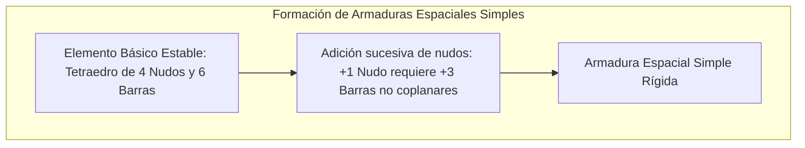
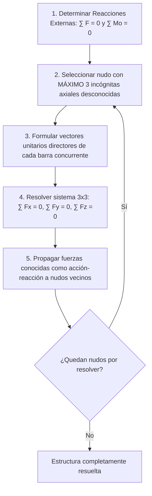
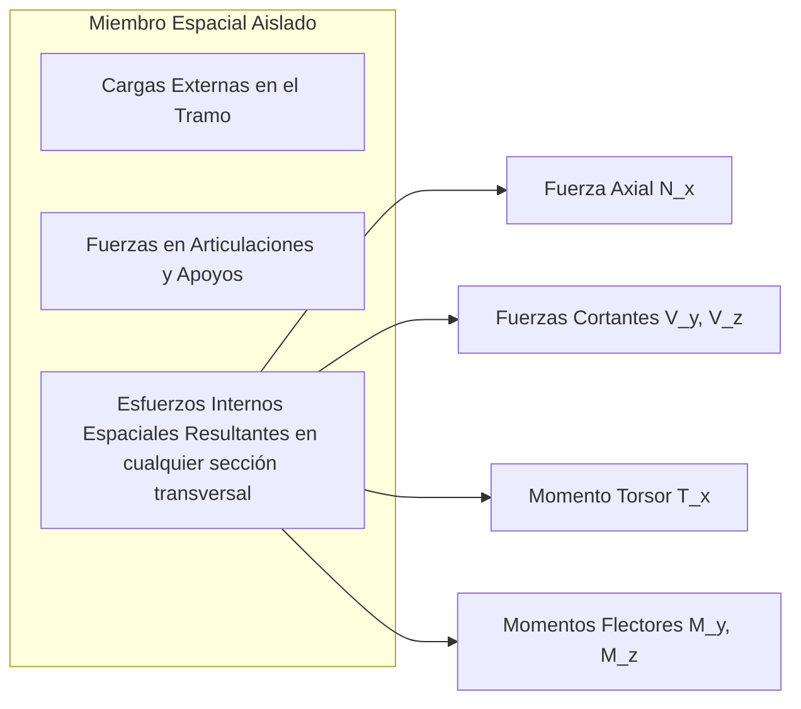
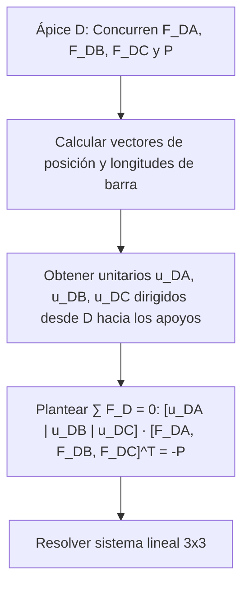

# Compendio de Repaso: Estructuras Espaciales y Mecanismos Tridimensionales

---

## 1. Armaduras y Entramados Tridimensionales

### 1.1 Armaduras Espaciales: Definición de Celosías Tridimensionales y Tetraedro Básico

Una **armadura espacial** (o celosía tridimensional) es una estructura tridimensional rígida constituida por barras rectas conectadas en sus extremos mediante articulaciones esféricas (*ball-and-socket joints*) libres de fricción.



#### A. El Tetraedro como Módulo Geométrico Fundamental
* En dos dimensiones, el polígono elemental indeformable es el **triángulo** (3 nudos, 3 barras).
* En tres dimensiones, la configuración básica cinemáticamente indeformable con el menor número de barras es el **tetraedro** (4 nudos, 6 barras).
* Para extender la celosía sin perder rigidez geométrica, cada nuevo nudo añadido en el espacio debe conectarse mediante al menos **tres barras concurrentes no coplanares** a nudos preexistentes.

<div align="center">
  <svg width="420" height="260" viewBox="0 0 420 260" xmlns="http://www.w3.org/2000/svg">
    <!-- Nudos de la base del tetraedro -->
    <!-- Base: A(100, 210), B(320, 210), C(240, 150), Apice D(210, 40) -->
    
    <!-- Barras de la base (oculta en punteado) -->
    <line x1="100" y1="210" x2="240" y2="150" stroke="#94a3b8" stroke-width="2" stroke-dasharray="4,4"/>
    <line x1="320" y1="210" x2="240" y2="150" stroke="#94a3b8" stroke-width="2" stroke-dasharray="4,4"/>
    <line x1="100" y1="210" x2="320" y2="210" stroke="#334155" stroke-width="2.5"/>
    
    <!-- Barras hacia el ápice D -->
    <line x1="100" y1="210" x2="210" y2="40" stroke="#2563eb" stroke-width="2.5"/>
    <line x1="320" y1="210" x2="210" y2="40" stroke="#2563eb" stroke-width="2.5"/>
    <line x1="240" y1="150" x2="210" y2="40" stroke="#2563eb" stroke-width="2" stroke-dasharray="4,4"/>
    
    <!-- Nudos -->
    <circle cx="100" cy="210" r="5" fill="#0f172a"/>
    <text x="80" y="225" fill="#0f172a" font-size="12" font-family="sans-serif" font-weight="bold">A</text>
    
    <circle cx="320" cy="210" r="5" fill="#0f172a"/>
    <text x="330" y="225" fill="#0f172a" font-size="12" font-family="sans-serif" font-weight="bold">B</text>
    
    <circle cx="240" cy="150" r="4" fill="#64748b"/>
    <text x="250" y="150" fill="#64748b" font-size="12" font-family="sans-serif" font-weight="bold">C</text>
    
    <circle cx="210" cy="40" r="5" fill="#dc2626"/>
    <text x="205" y="25" fill="#dc2626" font-size="13" font-family="sans-serif" font-weight="bold">D (Ápice)</text>
    
    <text x="210" y="245" fill="#475569" font-size="11" font-family="sans-serif" text-anchor="middle">Tetraedro básico: n = 4, b = 6 (b = 3n - 6)</text>
  </svg>
</div>

#### B. Criterio de Isostaticidad Interna y Externa
Sea $b$ el número total de barras, $n$ el número total de nudos, y $r$ el número de componentes de reacción en los apoyos:

* **Grados de libertad por nudo:** Cada nudo libre en $\mathbb{R}^3$ genera 3 ecuaciones de equilibrio traslacional ($\sum F_x = 0$, $\sum F_y = 0$, $\sum F_z = 0$).
* **Ecuaciones disponibles totales:** $3n$.
* **Incógnitas totales:** $b$ (fuerzas axiales internas) $+ r$ (reacciones de ligadura).

$$
b + r = 3n
$$

Para una armadura apoyada de forma externamente isostática ($r = 6$):
$$
b = 3n - 6
$$

| Condición | Clasificación Estática | Comportamiento Mecánico |
| :--- | :--- | :--- |
| **$b + r < 3n$** | **Subestática / Incompleta** | Cinemáticamente inestable; colapsa como mecanismo bajo cargas no específicas. |
| **$b + r = 3n$** | **Isostática (Estáticamente Determinada)** | Estable y resoluble exclusivamente mediante las ecuaciones de la estática (si no hay inestabilidad geométrica). |
| **$b + r > 3n$** | **Hiperestática (Estáticamente Indeterminada)** | Sobrerrestringida; requiere compatibilidad de deformaciones elásticas. |

> [!WARNING]
> La condición $b + r = 3n$ es **necesaria pero no suficiente**. Una estructura puede satisfacer numéricamente la igualdad y ser inestable si las tres barras que concurren a un nudo yacen en un mismo plano (**barras coplanares en el nudo**). Dicho nudo no ofrecerá rigidez frente a fuerzas normales al plano.

---

### 1.2 Determinación de Esfuerzos en Miembros

#### A. Método de los Nudos Espaciales
El método analiza el equilibrio de cada nudo aislado como una partícula tridimensional en equilibrio concurrente.



##### Formulación Vectorial del Nudo $i$:
Para un nudo $i$ conectado a varios nudos adyacentes $j$:
$$
\vec{F}_{ij} = F_{ij} \cdot \hat{u}_{ij} = F_{ij} \left( \frac{\vec{r}_j - \vec{r}_i}{\|\vec{r}_j - \vec{r}_i\|} \right)
$$
Donde:
* $F_{ij} > 0 \implies$ Barra sometida a **tracción** (tensión que tira del nudo).
* $F_{ij} < 0 \implies$ Barra sometida a **compresión** (empuja al nudo).

La condición vectorial de equilibrio traslacional del nudo exige:
$$
\sum \vec{F}_i = \vec{P}_i + \vec{R}_i + \sum_{j} F_{ij} \hat{u}_{ij} = \vec{0}
$$
Lo que se descompone en el sistema escalar lineal $3 \times 3$:
$$
\begin{cases}
\sum F_x = P_{ix} + R_{ix} + \sum_j F_{ij} \left( \frac{x_j - x_i}{L_{ij}} \right) = 0 \\
\sum F_y = P_{iy} + R_{iy} + \sum_j F_{ij} \left( \frac{y_j - y_i}{L_{ij}} \right) = 0 \\
\sum F_z = P_{iz} + R_{iz} + \sum_j F_{ij} \left( \frac{z_j - z_i}{L_{ij}} \right) = 0
\end{cases}
$$

##### Miembros de Fuerza Nula en Armaduras Espaciales (Inspección Rápida):
1. **Tres Barras no Coplanares en Nudo sin Carga:** Si en un nudo descargado ($P = 0$, $R = 0$) concurren exactamente tres barras que no forman un plano común, el esfuerzo en las **tres barras es idénticamente cero**.
2. **Tres Barras Coplanares y una Cuarta Fuera del Plano:** Si en un nudo descargado tres barras yacen en el plano $\Pi$ y una cuarta barra $B_4$ sale de dicho plano, la componente normal a $\Pi$ solo puede ser equilibrada por $B_4$. Por tanto:
   $$
   F_{B4} = 0
   $$

---

#### B. Método de las Secciones Espaciales (Corte de Ritter en 3D)
Cuando se desea conocer el esfuerzo axial de barras interiores específicas sin resolver secuencialmente todos los nudos intermedios:

* Se realiza un plano de corte imaginario que seccione la armadura en dos partes completamente separadas.
* Para resolver directamente la porción aislada mediante las **seis ecuaciones de equilibrio espacial**:
  $$
  \sum \vec{F} = \vec{0} \qquad (3 \text{ ecuaciones}), \qquad \sum \vec{M}_O = \vec{0} \qquad (3 \text{ ecuaciones})
  $$
* El corte debe atravesar como **máximo 6 barras con fuerzas desconocidas**, siempre que sus líneas de acción no corten todas a una misma recta directriz o sean mutuamente paralelas.

> [!TIP]
> **Estrategia para resolver una barra aislada con Secciones 3D:**
> Para hallar la fuerza en una barra específica $AB$, busca un eje espacial $L$ que **intersecte simultáneamente las líneas de acción de todas las demás barras cortadas desconocidas**. Al aplicar:
> $$
> \sum M_L = 0
> $$
> todas las demás incógnitas generarán momento nulo respecto al eje $L$, permitiendo despejar $F_{AB}$ en una sola ecuación univariable.

---

### 1.3 Entramados Tridimensionales y Miembros con Múltiples Fuerzas

A diferencia de las armaduras espaciales (cuyas barras son elementos de dos fuerzas axiales puras), los **entramados o bastidores espaciales** contienen al menos un elemento sometido a **múltiples fuerzas o momentos**:
* Actúan cargas intermedias transversales a lo largo de las vigas o columnas.
* Las uniones entre miembros pueden incluir conexiones rígidas que transmiten momentos torsores y flexión en el espacio.



#### Procedimiento de Despiece para Entramados Espaciales:
1. **DCL Global:** Resolver las reacciones externas en los apoyos si el sistema global es externamente determinado.
2. **Despiece por Elementos:** Separar cada miembro multifuerza formulando el DCL individual.
3. **Principio de Acción y Reacción (Tercera Ley de Newton):** En toda conexión común entre el elemento $A$ y el elemento $B$, las componentes de interacción satisfacen:
   $$
   \vec{F}_{A \to B} = -\vec{F}_{B \to A}, \qquad \vec{M}_{A \to B} = -\vec{M}_{B \to A}
   $$
4. **Equilibrio Individual:** Cada barra multifuerza aislada debe cumplir sus propias 6 ecuaciones de equilibrio espacial.

---

## 2. Mecanismos Espaciales y Práctica

### 2.1 Análisis de Equilibrio y Transmisión de Esfuerzos en Máquinas en el Espacio

Las **máquinas espaciales** son ensambles de miembros articulados diseñados deliberadamente para transmitir, transformar o amplificar fuerzas y momentos en el espacio $\mathbb{R}^3$, involucrando componentes móviles guiados.

#### A. Tipología de Articulaciones y Restricciones Cinemáticas Espaciales

| Par Cinemático / Vínculo | Traslaciones Permitidas | Rotaciones Permitidas | Restricciones de Fuerza | Restricciones de Momento |
| :--- | :---: | :---: | :---: | :---: |
| **Par Prismático (Guía Deslizante)** | 1 (axial) | 0 | 2 componentes transversales | 3 componentes de momento |
| **Par de Revolución (Bisagra / Eje)** | 0 | 1 (giro sobre el eje) | 3 componentes cartesianas | 2 componentes de momento |
| **Par Cilíndrico** | 1 (axial) | 1 (giro sobre el eje) | 2 componentes transversales | 2 componentes de momento |
| **Par Esférico (Rótula 3D)** | 0 | 3 (rotación espacial) | 3 componentes cartesianas | 0 (momento libre) |

#### B. Criterio de Movilidad Espacial (Ecuación de Kutzbach-Grübler para Mecanismos 3D)
Para un mecanismo espacial constituido por $n$ eslabones rígidos (incluyendo el bastidor fijo o bancada):
$$
m = 6(n - 1) - \sum_{i=1}^{j} (6 - f_i)
$$
Donde:
* $m$: Grados de libertad del mecanismo (movilidad).
* $n$: Número total de eslabones rígidos.
* $j$: Número total de uniones cinemáticas.
* $f_i$: Grados de libertad relativos permitidos por la articulación $i$.

---

### 2.2 Problemas y Ejercicios Integrales de Estructuras Espaciales

#### Problema Integral Resuelto 1: Armadura Espacial Tipo Trípode
**Enunciado:**
Un trípode simétrico está constituido por tres barras biarticuladas $AD$, $BD$ y $CD$ conectadas en el ápice común $D(0, 0, 4)\,\text{m}$. La base del trípode está anclada en el plano horizontal $xy$ en:
* $A(2, 0, 0)\,\text{m}$
* $B(-1, \sqrt{3}, 0)\,\text{m}$
* $C(-1, -\sqrt{3}, 0)\,\text{m}$

En el ápice $D$ se aplica una fuerza exterior concentrada $\vec{P} = 12\,\hat{i} - 6\,\hat{j} - 24\,\hat{k}\,\,[\text{kN}]$. Determine el esfuerzo axial (tracción o compresión) en cada una de las tres barras.



##### Solución Analítica Paso a Paso:

**Paso 1: Vectores de posición relativos desde el nudo $D$ hacia los apoyos:**
* $\vec{r}_{DA} = \vec{r}_A - \vec{r}_D = (2 - 0)\hat{i} + (0 - 0)\hat{j} + (0 - 4)\hat{k} = 2\hat{i} - 4\hat{k}$
  $$
  L_{DA} = \sqrt{2^2 + 0^2 + (-4)^2} = \sqrt{4 + 16} = \sqrt{20} = 2\sqrt{5} \approx 4.4721\,\text{m}
  $$
* $\vec{r}_{DB} = \vec{r}_B - \vec{r}_D = (-1)\hat{i} + \sqrt{3}\hat{j} - 4\hat{k}$
  $$
  L_{DB} = \sqrt{(-1)^2 + (\sqrt{3})^2 + (-4)^2} = \sqrt{1 + 3 + 16} = \sqrt{20} = 2\sqrt{5}\,\text{m}
  $$
* $\vec{r}_{DC} = \vec{r}_C - \vec{r}_D = (-1)\hat{i} - \sqrt{3}\hat{j} - 4\hat{k}$
  $$
  L_{DC} = \sqrt{(-1)^2 + (-\sqrt{3})^2 + (-4)^2} = \sqrt{20} = 2\sqrt{5}\,\text{m}
  $$

**Paso 2: Vectores unitarios directores:**
$$
\hat{u}_{DA} = \frac{1}{\sqrt{20}}\left( 2\hat{i} + 0\hat{j} - 4\hat{k} \right)
$$
$$
\hat{u}_{DB} = \frac{1}{\sqrt{20}}\left( -1\hat{i} + \sqrt{3}\hat{j} - 4\hat{k} \right)
$$
$$
\hat{u}_{DC} = \frac{1}{\sqrt{20}}\left( -1\hat{i} - \sqrt{3}\hat{j} - 4\hat{k} \right)
$$

**Paso 3: Ecuación de equilibrio vectorial en el nudo $D$:**
Asumiendo todas las barras en tracción saliendo del nudo $D$:
$$
\sum \vec{F}_D = F_{DA}\hat{u}_{DA} + F_{DB}\hat{u}_{DB} + F_{DC}\hat{u}_{DC} + \vec{P} = \vec{0}
$$
$$
F_{DA}\hat{u}_{DA} + F_{DB}\hat{u}_{DB} + F_{DC}\hat{u}_{DC} = -\vec{P} = -12\hat{i} + 6\hat{j} + 24\hat{k}
$$

Multiplicando la ecuación por $\sqrt{20}$:
$$
F_{DA} \begin{bmatrix} 2 \\ 0 \\ -4 \end{bmatrix} + F_{DB} \begin{bmatrix} -1 \\ \sqrt{3} \\ -4 \end{bmatrix} + F_{DC} \begin{bmatrix} -1 \\ -\sqrt{3} \\ -4 \end{bmatrix} = \sqrt{20} \begin{bmatrix} -12 \\ 6 \\ 24 \end{bmatrix}
$$

**Paso 4: Desacoplamiento y resolución de componentes escalares:**
1. Componente $y$:
   $$
   0 \cdot F_{DA} + \sqrt{3} F_{DB} - \sqrt{3} F_{DC} = 6\sqrt{20} \implies F_{DB} - F_{DC} = \frac{6\sqrt{20}}{\sqrt{3}} = 2\sqrt{60} \approx 15.4919
   $$
2. Sumando las componentes $x$ y $z$:
   * Eje $x$: $2 F_{DA} - F_{DB} - F_{DC} = -12\sqrt{20}$
   * Eje $z$: $-4(F_{DA} + F_{DB} + F_{DC}) = 24\sqrt{20} \implies F_{DA} + F_{DB} + F_{DC} = -6\sqrt{20}$
3. Despejando $F_{DB} + F_{DC}$ de la ecuación del eje $z$:
   $$
   F_{DB} + F_{DC} = -6\sqrt{20} - F_{DA}
   $$
4. Sustituyendo en la ecuación del eje $x$:
   $$
   2 F_{DA} - (-6\sqrt{20} - F_{DA}) = -12\sqrt{20} \implies 3 F_{DA} + 6\sqrt{20} = -12\sqrt{20}
   $$
   $$
   3 F_{DA} = -18\sqrt{20} \implies F_{DA} = -6\sqrt{20} \approx -26.8328\,\text{kN}
   $$
5. Calculando $F_{DB}$ y $F_{DC}$:
   * Suma: $F_{DB} + F_{DC} = -6\sqrt{20} - (-6\sqrt{20}) = 0 \implies F_{DC} = -F_{DB}$
   * Sustituyendo en la diferencia: $F_{DB} - (-F_{DB}) = 2 F_{DB} = \frac{6\sqrt{20}}{\sqrt{3}}$
   $$
   F_{DB} = \frac{3\sqrt{20}}{\sqrt{3}} = \sqrt{60} \approx +7.7460\,\text{kN}
   $$
   $$
   F_{DC} = -F_{DB} = -\sqrt{60} \approx -7.7460\,\text{kN}
   $$

##### Resultados e Interpretación Física:
* Barra $DA$: $F_{DA} = 26.83\,\text{kN}\,\,(\text{Compresión})$
* Barra $DB$: $F_{DB} = 7.75\,\text{kN}\,\,(\text{Tracción})$
* Barra $DC$: $F_{DC} = 7.75\,\text{kN}\,\,(\text{Compresión})$

---

## 3. Implementación Numérica: Solucionador Matricial de Nudos Espaciales

El siguiente script en Python utiliza `numpy` para resolver el sistema de equilibrio tridimensional de cualquier nudo espacial con $k$ barras concurrentes y cargas externas arbitrarias:

```python
import numpy as np

def resolver_nudo_espacial_3d(
    coord_nudo: np.ndarray,
    coords_vecinos: list,
    fuerza_externa: np.ndarray
) -> dict:
    """
    Calcula los esfuerzos axiales en un nudo espacial 3D con exactamente 3 barras concurrentes.
    
    :param coord_nudo: Vector [x, y, z] del nudo evaluado.
    :param coords_vecinos: Lista de 3 vectores [x, y, z] correspondientes a los nudos extremos de cada barra.
    :param fuerza_externa: Vector [Px, Py, Pz] de la carga aplicada sobre el nudo.
    :return: Diccionario con la fuerza axial y el tipo de esfuerzo (Tracción/Compresión) de cada barra.
    """
    coord_O = np.array(coord_nudo, dtype=float)
    if len(coords_vecinos) != 3:
        raise ValueError("El nudo debe tener exactamente 3 barras concurrentes para ser resuelto de forma isostática directa.")
    
    # Matriz A formada por los 3 vectores unitarios de dirección
    A = np.zeros((3, 3))
    longitudes = []
    
    for col, coord_vecino in enumerate(coords_vecinos):
        r_vec = np.array(coord_vecino, dtype=float) - coord_O
        L = np.linalg.norm(r_vec)
        if np.isclose(L, 0.0):
            raise ValueError(f"El nudo vecino en índice {col} coincide geométricamente con el nudo base.")
        longitudes.append(L)
        u_vec = r_vec / L
        A[:, col] = u_vec
        
    # Vector B = -P (Pasa al lado derecho de la ecuación de equilibrio)
    B = -np.array(fuerza_externa, dtype=float)
    
    # Verificación de coplanaridad (det(A) = 0)
    det_A = np.linalg.det(A)
    if np.isclose(det_A, 0.0, atol=1e-6):
        raise np.linalg.LinAlgError("Inestabilidad geométrica: Las 3 barras concurrentes son coplanares o colineales (det = 0).")
        
    # Resolución del sistema lineal A * F = B
    fuerzas = np.linalg.solve(A, B)
    
    resultados = {}
    for i, F_val in enumerate(fuerzas):
        tipo = "Tracción" if F_val > 1e-5 else ("Compresión" if F_val < -1e-5 else "Fuerza Nula")
        resultados[f"Barra_{i+1}"] = {
            "Magnitud_kN": abs(F_val),
            "Valor_Algebraico_kN": F_val,
            "Estado": tipo,
            "Longitud_m": longitudes[i]
        }
        
    return resultados


if __name__ == "__main__":
    # Verificación del Problema del Trípode:
    nodo_D = np.array([0.0, 0.0, 4.0])
    vecinos_base = [
        np.array([2.0, 0.0, 0.0]),           # Apoyo A
        np.array([-1.0, np.sqrt(3), 0.0]),    # Apoyo B
        np.array([-1.0, -np.sqrt(3), 0.0])   # Apoyo C
    ]
    P_aplicada = np.array([12.0, -6.0, -24.0])
    
    res = resolver_nudo_espacial_3d(nodo_D, vecinos_base, P_aplicada)
    
    print("=" * 60)
    print("RESULTADOS DEL EQUILIBRIO DEL NUDO ESPACIAL (TRÍPODE)")
    print("=" * 60)
    for barra, datos in res.items():
        print(f"{barra} (L = {datos['Longitud_m']:.3f} m): "
              f"Fuerza = {datos['Magnitud_kN']:8.4f} kN [{datos['Estado']}]")
    print("=" * 60)
```