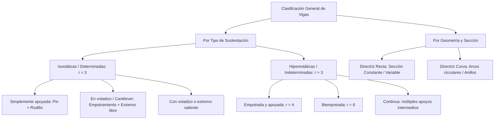
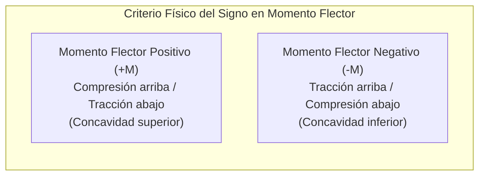
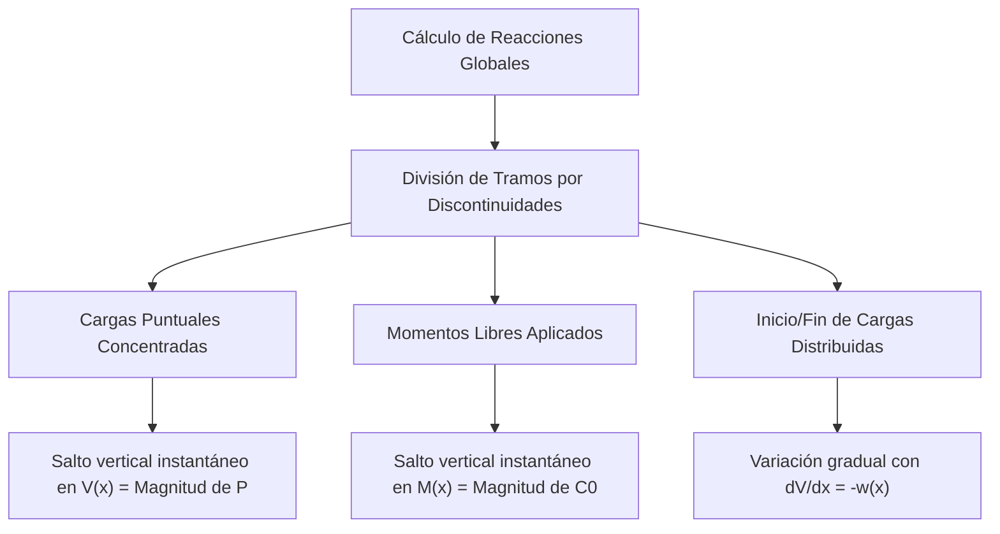

# Fuerzas y Momentos Internos de un Cuerpo Rígido

---

## 1. Tipología de Vigas y Convenios de Signos

### 1.1 Definición, Función Estructural y Clasificación de Vigas

Una **viga** es un elemento prismático estructural esbelto (donde la longitud longitudinal $L$ predomina sobre las dimensiones transversales de la sección $b, h$) diseñado primordialmente para resistir y transmitir cargas que actúan en dirección perpendicular o transversal a su eje centroidal o directriz, induciendo efectos de flexión y corte.



#### Clasificación por Condiciones de Borde y Grados de Indeterminación ($GH = r - 3$ en 2D):

| Tipo de Viga | Esquema de Apoyos | Reacciones ($r$) | Grado Hiperestático ($GH$) | Comportamiento Típico |
| :--- | :--- | :---: | :---: | :--- |
| **Simplemente Apoyada** | Pasador fijo ($2$) + Rodillo móvil ($1$) | $3$ | $0$ (Isostática) | Máximo momento positivo en el vano central |
| **Voladizo (*Cantilever*)** | Empotramiento fijo ($3$) + Extremo libre ($0$) | $3$ | $0$ (Isostática) | Cortante y momento máximo concentrado en la base |
| **Con Voladizo Saliente** | Pasador fijo ($2$) + Rodillo ($1$) intermedios | $3$ | $0$ (Isostática) | Inflexión con alternancia de momentos $+$ y $-$ |
| **Empotrada y Apoyada** | Empotramiento ($3$) + Rodillo ($1$) | $4$ | $1$ (Hiperestática) | Reducción de deflexión central frente a apoyada |
| **Biempotrada** | Dos empotramientos fijos ($3 + 3$) | $6$ | $3$ (Hiperestática) | Momentos negativos en empotramientos rígidos |
| **Continua** | Pasador ($2$) + $n$ rodillos intermedios | $2 + n$ | $n - 1$ (Hiperestática) | Redistribución elástica de esfuerzos de flexión |

---

### 1.2 Determinación Analítica de Esfuerzos Seccionales: $N$, $V$, $M$ y $T$

Para determinar las fuerzas internas que mantienen unidas las partes de un cuerpo continuo, se aplica el **Método de las Secciones**: se realiza un corte imaginario perpendicular a la directriz en una posición arbitraria $x$, dividiendo el elemento en dos bloques independientes. Las solicitaciones internas equivalen a la reducción fuerza-par del bloque suprimido aplicada en el centroide $C$ de la sección transversal expuesta.

<div align="center">
  <svg width="600" height="230" viewBox="0 0 600 230" xmlns="http://www.w3.org/2000/svg">
    <!-- Cara Izquierda (Cara Positiva x) -->
    <rect x="50" y="55" width="200" height="110" rx="4" fill="#f8fafc" stroke="#334155" stroke-width="2"/>
    <text x="140" y="40" fill="#0f172a" font-size="12" font-family="sans-serif" font-weight="bold">Cara Positiva (Normal exterior +x)</text>
    <!-- Centroide C -->
    <circle cx="250" cy="110" r="4" fill="#0f172a"/>
    <text x="230" y="105" fill="#0f172a" font-size="11" font-family="sans-serif">C</text>
    <!-- Vector Normal N hacia la derecha -->
    <line x1="250" y1="110" x2="310" y2="110" stroke="#2563eb" stroke-width="2.5"/>
    <polygon points="305,106 315,110 305,114" fill="#2563eb"/>
    <text x="285" y="100" fill="#2563eb" font-size="12" font-family="sans-serif" font-weight="bold">+N (Tracción)</text>
    <!-- Vector Cortante V hacia abajo -->
    <line x1="250" y1="110" x2="250" y2="185" stroke="#dc2626" stroke-width="2.5"/>
    <polygon points="246,180 250,190 254,180" fill="#dc2626"/>
    <text x="258" y="180" fill="#dc2626" font-size="12" font-family="sans-serif" font-weight="bold">+V (Hacia abajo)</text>
    <!-- Momento Flector M antihorario -->
    <path d="M 235,135 A 25 25 0 1 1 240,80" fill="none" stroke="#7c3aed" stroke-width="2.5"/>
    <polygon points="234,80 244,75 240,86" fill="#7c3aed"/>
    <text x="195" y="75" fill="#7c3aed" font-size="12" font-family="sans-serif" font-weight="bold">+M (Antihorario)</text>
    <!-- Separación del corte -->
    <line x1="265" y1="35" x2="265" y2="200" stroke="#94a3b8" stroke-dasharray="4,4" stroke-width="1.5"/>
    <!-- Cara Derecha (Cara Negativa -x) -->
    <rect x="350" y="55" width="200" height="110" rx="4" fill="#f8fafc" stroke="#334155" stroke-width="2"/>
    <text x="440" y="40" fill="#0f172a" font-size="12" font-family="sans-serif" font-weight="bold">Cara Negativa (Normal exterior -x)</text>
    <!-- Centroide C -->
    <circle cx="350" cy="110" r="4" fill="#0f172a"/>
    <text x="360" y="105" fill="#0f172a" font-size="11" font-family="sans-serif">C</text>
    <!-- Vector Normal N hacia la izquierda -->
    <line x1="350" y1="110" x2="290" y2="110" stroke="#2563eb" stroke-width="2.5"/>
    <polygon points="295,106 285,110 295,114" fill="#2563eb"/>
    <text x="295" y="125" fill="#2563eb" font-size="12" font-family="sans-serif" font-weight="bold">+N</text>
    <!-- Vector Cortante V hacia arriba -->
    <line x1="350" y1="110" x2="350" y2="35" stroke="#dc2626" stroke-width="2.5"/>
    <polygon points="346,40 350,30 354,40" fill="#dc2626"/>
    <text x="358" y="45" fill="#dc2626" font-size="12" font-family="sans-serif" font-weight="bold">+V (Hacia arriba)</text>
    <!-- Momento Flector M horario -->
    <path d="M 365,85 A 25 25 0 1 1 360,140" fill="none" stroke="#7c3aed" stroke-width="2.5"/>
    <polygon points="366,140 356,145 360,134" fill="#7c3aed"/>
    <text x="375" y="155" fill="#7c3aed" font-size="12" font-family="sans-serif" font-weight="bold">+M (Horario)</text>
  </svg>
</div>

#### Convenio Estándar de Signos en Flexión (Regla de Deformación):
* **Esfuerzo Normal o Axial ($N$):** 
  * Positivo ($+$): **Tracción pura** (tiende a alargar longitudinalmente el elemento; apunta saliendo de la cara transversal).
  * Negativo ($-$): **Compresión pura** (tiende a acortar la barra; apunta entrando a la sección).
* **Fuerza Cortante ($V$):** 
  * Positivo ($+$): Tiende a hacer girar el segmento de viga en **sentido horario** ($\circlearrowright$). En la cara derecha de un corte apunta hacia abajo; en la cara izquierda apunta hacia arriba.
* **Momento Flector ($M$):** 
  * Positivo ($+$): Tiende a curvar la viga con la **concavidad hacia arriba** ("sonrisa"), produciendo compresión en las fibras superiores y tracción en las fibras inferiores.
* **Momento Torsor ($T$):** 
  * Positivo ($+$): Vector momento axial que sale perpendicularmente de la sección de corte (regla de la mano derecha en la normal saliente).



---

## 2. Diagramas de Solicitaciones Internas

### 2.1 Relaciones Diferenciales entre Carga Distribuida, Fuerza Cortante y Momento Flector

Analizando el equilibrio estático de un elemento diferencial de viga de longitud infinitesimal $dx$ sometido a una carga distribuida vertical $w(x)$ orientada positivamente hacia arriba:

<div align="center">
  <svg width="420" height="190" viewBox="0 0 420 190" xmlns="http://www.w3.org/2000/svg">
    <!-- Rebanada diferencial -->
    <rect x="130" y="45" width="160" height="100" fill="#f1f5f9" stroke="#475569" stroke-width="2"/>
    <text x="210" y="165" fill="#0f172a" font-size="12" font-family="sans-serif" text-anchor="middle">dx</text>
    <line x1="130" y1="150" x2="290" y2="150" stroke="#475569" stroke-width="1.5" marker-start="url(#dot)" marker-end="url(#dot)"/>
    <!-- Carga w(x) hacia abajo -->
    <line x1="170" y1="15" x2="170" y2="40" stroke="#0284c7" stroke-width="2"/>
    <polygon points="167,36 170,44 173,36" fill="#0284c7"/>
    <line x1="210" y1="15" x2="210" y2="40" stroke="#0284c7" stroke-width="2"/>
    <polygon points="207,36 210,44 213,36" fill="#0284c7"/>
    <line x1="250" y1="15" x2="250" y2="40" stroke="#0284c7" stroke-width="2"/>
    <polygon points="247,36 250,44 253,36" fill="#0284c7"/>
    <text x="210" y="12" fill="#0284c7" font-size="12" font-family="sans-serif" text-anchor="middle">w(x)</text>
    <!-- Cara izquierda: V hacia arriba, M antihorario -->
    <line x1="130" y1="95" x2="130" y2="35" stroke="#dc2626" stroke-width="2"/>
    <polygon points="127,40 130,30 133,40" fill="#dc2626"/>
    <text x="105" y="45" fill="#dc2626" font-size="11" font-family="sans-serif" font-weight="bold">V</text>
    <path d="M 115,80 A 18 18 0 0 1 115,115" fill="none" stroke="#7c3aed" stroke-width="2"/>
    <polygon points="112,85 117,76 119,87" fill="#7c3aed"/>
    <text x="95" y="105" fill="#7c3aed" font-size="11" font-family="sans-serif" font-weight="bold">M</text>
    <!-- Cara derecha: V + dV hacia abajo, M + dM horario -->
    <line x1="290" y1="95" x2="290" y2="155" stroke="#dc2626" stroke-width="2"/>
    <polygon points="287,150 290,160 293,150" fill="#dc2626"/>
    <text x="295" y="155" fill="#dc2626" font-size="11" font-family="sans-serif" font-weight="bold">V + dV</text>
    <path d="M 305,80 A 18 18 0 0 0 305,115" fill="none" stroke="#7c3aed" stroke-width="2"/>
    <polygon points="308,110 303,119 301,108" fill="#7c3aed"/>
    <text x="310" y="105" fill="#7c3aed" font-size="11" font-family="sans-serif" font-weight="bold">M + dM</text>
  </svg>
</div>

Tomando convención de $w(x)$ orientada hacia abajo (cargas gravitatorias convencionales):

#### 1. Equilibrio Vertical de Fuerzas ($\sum F_y = 0$):
$$
V - (V + dV) - w(x) \, dx = 0 \implies \frac{dV}{dx} = -w(x)
$$
* **Regla Geométrica 1:** La **pendiente** de la curva del diagrama de fuerza cortante en cualquier sección es numéricamente igual al valor negativo de la intensidad de carga distribuida en ese punto.

Integrando entre dos secciones $x_A$ y $x_B$:
$$
V_B - V_A = -\int_{x_A}^{x_B} w(x) \, dx
$$
* **Regla Integral 1:** El cambio neto en la fuerza cortante ($\Delta V$) entre dos puntos es igual al negativo del **área bajo la curva** del diagrama de carga distribuida en ese tramo.

#### 2. Equilibrio Rotacional respecto al centroide de la cara derecha ($\sum M_C = 0$):
$$
-M + (M + dM) - V \, dx + w(x) \, dx \left( \frac{dx}{2} \right) = 0
$$
Despreciando diferenciales de segundo orden ($(dx)^2 \to 0$):
$$
dM - V \, dx = 0 \implies \frac{dM}{dx} = V(x)
$$
* **Regla Geométrica 2:** La **pendiente** de la curva de momento flector en cualquier sección es exactamente igual al valor local de la **fuerza cortante** $V(x)$.

Integrando entre dos secciones $x_A$ y $x_B$:
$$
M_B - M_A = \int_{x_A}^{x_B} V(x) \, dx
$$
* **Regla Integral 2:** La variación en el momento flector ($\Delta M$) entre dos puntos equivale con exactitud al **área neta bajo la curva** del diagrama de fuerza cortante.

> [!NOTE]
> **Condición de Extremo de Momento Flector:**
> Si $\frac{dM}{dx} = V(x) = 0$, el momento flector alcanza un punto crítico (máximo o mínimo relativo). En el diseño de vigas, **el momento flector máximo absoluto siempre ocurre donde el cortante se anula o cambia bruscamente de signo**.

#### 3. Relación Directa de Segundo Orden:
Derivando la relación de momento con respecto a $x$:
$$
\frac{d^2M}{dx^2} = \frac{dV}{dx} = -w(x)
$$

---

### 2.2 Elaboración e Interpretación de Diagramas de Solicitaciones

Los diagramas permiten visualizar la distribución continua de las funciones $N(x)$, $V(x)$, $M(x)$ y $T(x)$ a lo largo de toda la longitud de la viga.



#### Reglas Fundamentales de Continuidad y Discontinuidad:

1. **Carga Concentrada Transversal ($P$):**
   * Genera un **salto vertical** o escalón repentino en el diagrama de cortante $V(x)$ de magnitud exactamente igual a $P$, en la misma dirección de la carga.
   * En el diagrama de momentos $M(x)$, produce un **punto anguloso** (cambio abrupto de pendiente) sin salto discontinuo de cota.
2. **Momento Par Concentrado ($C_0$):**
   * **No produce alteración** en el diagrama de fuerza cortante $V(x)$.
   * Genera un **salto vertical instantáneo** en el diagrama de momento flector $M(x)$ igual al valor de $C_0$ (un par horario hace saltar el diagrama hacia arriba bajo convención estándar).
3. **Carga Axial Puntual ($P_x$):**
   * Produce una discontinuidad o salto neto equivalente en el diagrama de esfuerzo normal $N(x)$.
4. **Momento Torsor Puntual ($T_0$):**
   * Provoca un salto discreto en el diagrama de torsión $T(x)$, manteniéndose constante en tramos sin torsión distribuida.

##### Jerarquía Polinómica de Diagramas:

| Carga $w(x)$ | Cortante $V(x) = -\int w \, dx$ | Momento Flector $M(x) = \int V \, dx$ |
| :--- | :--- | :--- |
| **Nula ($w = 0$)** | Constante (Línea horizontal, Grado $0$) | Lineal (Línea inclinada, Grado $1$) |
| **Uniforme ($w = w_0$)** | Lineal (Rampa con pendiente, Grado $1$) | Parabólico (Parábola de Grado $2$) |
| **Triangular ($w = kx$)** | Parabólico (Grado $2$) | Cúbico (Curva cúbica de Grado $3$) |

---

### 2.3 Fuerzas Internas en Vigas Curvas y Elementos de Directriz no Recta

En elementos donde el eje centroidal presenta curvatura inicial (arcos, ganchos de grúa, anillos de sustentación) o cambia de orientación espacial (marcos rígidos y vigas acodadas), la sección de corte debe definirse según el **sistema de coordenadas intrínseco local** $\{\hat{t}, \hat{n}, \hat{b}\}$:

* $\hat{t}$: Vector unitario **tangente** a la directriz (define la normal de la sección).
* $\hat{n}$: Vector unitario **normal principal** (orientado hacia el centro de curvatura).
* $\hat{b} = \hat{t} \times \hat{n}$: Vector unitario **binormal** ortogonal al plano de curvatura.

<div align="center">
  <svg width="460" height="210" viewBox="0 0 460 210" xmlns="http://www.w3.org/2000/svg">
    <!-- Directriz Curva -->
    <path d="M 60,180 A 160 160 0 0 1 360,180" fill="none" stroke="#64748b" stroke-width="4" stroke-dasharray="6,4"/>
    <text x="210" y="195" fill="#64748b" font-size="12" font-family="sans-serif">Directriz curva (R = radio)</text>
    <!-- Centro de Curvatura O -->
    <circle cx="210" cy="180" r="4" fill="#0f172a"/>
    <text x="205" y="170" fill="#0f172a" font-size="12" font-family="sans-serif" font-weight="bold">O</text>
    <line x1="210" y1="180" x2="130" y2="67" stroke="#94a3b8" stroke-width="1.5" stroke-dasharray="2,2"/>
    <text x="160" y="130" fill="#64748b" font-size="11" font-family="sans-serif">R</text>
    <!-- Sección de Corte Inclinada en ángulo theta -->
    <line x1="105" y1="45" x2="155" y2="90" stroke="#334155" stroke-width="3"/>
    <!-- Ejes locales en la sección (t, n) -->
    <!-- Tangente Nt -->
    <line x1="130" y1="67" x2="85" y2="35" stroke="#2563eb" stroke-width="2.5"/>
    <polygon points="85,39 77,30 89,33" fill="#2563eb"/>
    <text x="50" y="30" fill="#2563eb" font-size="12" font-family="sans-serif" font-weight="bold">N(θ) [Tangencial]</text>
    <!-- Normal Vn -->
    <line x1="130" y1="67" x2="175" y2="99" stroke="#dc2626" stroke-width="2.5"/>
    <polygon points="171,94 183,105 176,101" fill="#dc2626"/>
    <text x="175" y="120" fill="#dc2626" font-size="12" font-family="sans-serif" font-weight="bold">V(θ) [Radial]</text>
    <!-- Momento M(theta) -->
    <path d="M 115,50 A 20 20 0 1 1 145,55" fill="none" stroke="#7c3aed" stroke-width="2.5"/>
    <polygon points="113,52 113,42 121,48" fill="#7c3aed"/>
    <text x="135" y="40" fill="#7c3aed" font-size="12" font-family="sans-serif" font-weight="bold">M(θ)</text>
  </svg>
</div>

#### Ecuaciones de Transformación Paramétrica ($\theta$):
Dada una directriz circular en el plano con radio de curvatura $R$, la posición de corte se parametriza mediante el ángulo angular $\theta$:

1. **Esfuerzo Normal Tangencial ($N$):** Proyección de todas las fuerzas externas sobre la tangente local:
   $$
   N(\theta) = \sum \vec{F}_{\text{ext}} \cdot \hat{t}(\theta)
   $$
2. **Fuerza Cortante Radial ($V$):** Proyección sobre el radio o normal que apunta al centro de curvatura:
   $$
   V(\theta) = \sum \vec{F}_{\text{ext}} \cdot \hat{n}(\theta)
   $$
3. **Momento Flector ($M$):** Sumatoria de momentos respecto al centroide de la sección curva a la cota angular $\theta$:
   $$
   M(\theta) = \sum M_{C(\theta)}
   $$

> [!WARNING]
> En barras con curvatura pronunciada ($\frac{R}{h} < 5$), el eje neutro tensional de flexión ya no coincide con el eje centroidal geométrico, desplazándose una distancia $e$ hacia el centro de curvatura. Aunque el valor estático del par $M(\theta)$ no varía, el cálculo de las tensiones elásticas finales requiere la fórmula de flexión para vigas hipercurvas de Winkler-Bach.

---

## 3. Implementación Numérica: Generador Analítico de Diagramas $V(x)$ y $M(x)$

El siguiente script en Python utiliza discretización analítica y evaluación vectorial para calcular y trazar las leyes de cortante y momento flector en una viga isostática sometida a una combinación de cargas puntuales y distribuidas:

```python
import numpy as np
import matplotlib.pyplot as plt

class VigaIsostatica2D:
    def __init__(self, longitud: float):
        self.L = longitud
        self.cargas_puntuales = []       # Tuplas (posicion_x, magnitud_P_hacia_abajo)
        self.cargas_distribuidas = []    # Tuplas (x_ini, x_fin, intensidad_w_constante)
        self.momentos_puntuales = []     # Tuplas (posicion_x, magnitud_C0_horario)
        self.R_Ay = 0.0                  # Reacción en apoyo fijo A (x = 0)
        self.R_By = 0.0                  # Reacción en rodillo B (x = L)

    def agregar_carga_puntual(self, x: float, P: float):
        self.cargas_puntuales.append((x, P))

    def agregar_carga_distribuida(self, x_ini: float, x_fin: float, w: float):
        self.cargas_distribuidas.append((x_ini, x_fin, w))

    def agregar_momento_par(self, x: float, C0: float):
        self.momentos_puntuales.append((x, C0))

    def resolver_reacciones(self):
        """Calcula el equilibrio estático global sumando momentos en x=0 y fuerzas verticales."""
        sum_F = 0.0
        sum_M0 = 0.0

        for x, P in self.cargas_puntuales:
            sum_F += P
            sum_M0 += P * x

        for x1, x2, w in self.cargas_distribuidas:
            longitud = x2 - x1
            f_eq = w * longitud
            x_c = x1 + longitud / 2.0
            sum_F += f_eq
            sum_M0 += f_eq * x_c

        for x, C0 in self.momentos_puntuales:
            sum_M0 += C0  # Par horario genera momento positivo respecto al eje saliente z

        # Sumatoria de Momentos en A (x=0) = 0: R_By * L - sum_M0 = 0
        self.R_By = sum_M0 / self.L
        # Sumatoria de Fuerzas en Y = 0: R_Ay + R_By - sum_F = 0
        self.R_Ay = sum_F - self.R_By

    def evaluar_esfuerzos(self, x_eval: np.ndarray):
        """Calcula V(x) y M(x) mediante el método directo de secciones."""
        V = np.zeros_like(x_eval)
        M = np.zeros_like(x_eval)

        for i, x in enumerate(x_eval):
            v_local = self.R_Ay
            m_local = self.R_Ay * x

            # Apoyo B si x alcanza el extremo
            if x >= self.L:
                v_local += self.R_By
                m_local += self.R_By * (x - self.L)

            # Cargas puntuales
            for xp, P in self.cargas_puntuales:
                if x > xp:
                    v_local -= P
                    m_local -= P * (x - xp)

            # Cargas distribuidas continuas
            for x1, x2, w in self.cargas_distribuidas:
                if x > x1:
                    tramo = min(x, x2) - x1
                    f_dist = w * tramo
                    brazo = (min(x, x2) - x1) / 2.0 + (x - min(x, x2))
                    v_local -= f_dist
                    m_local -= f_dist * brazo

            # Momentos libres aplicados
            for xm, C0 in self.momentos_puntuales:
                if x > xm:
                    m_local -= C0

            V[i] = v_local
            M[i] = m_local

        return V, M

if __name__ == "__main__":
    # CASO DE ESTUDIO:
    # Viga de 6.0 m simplemente apoyada en los extremos (A en x=0, B en x=6)
    # Carga distribuida uniforme w = 15 kN/m en el tramo [0, 4] m
    # Carga concentrada P = 30 kN aplicada en x = 4.5 m
    viga = VigaIsostatica2D(longitud=6.0)
    viga.agregar_carga_distribuida(x_ini=0.0, x_fin=4.0, w=15.0)
    viga.agregar_carga_puntual(x=4.5, P=30.0)
    
    viga.resolver_reacciones()
    print(f"Reacción vertical en A: R_Ay = {viga.R_Ay:.2f} kN")
    print(f"Reacción vertical en B: R_By = {viga.R_By:.2f} kN")

    # Muestreo numérico
    x = np.linspace(0, 6.0, 601)
    V, M = viga.evaluar_esfuerzos(x)

    # Identificación del Momento Máximo Positivo (donde V cruza por cero)
    idx_max = np.argmax(M)
    print(f"Momento Flector Máximo: M_max = {M[idx_max]:.2f} kN*m en x = {x[idx_max]:.2f} m")
```